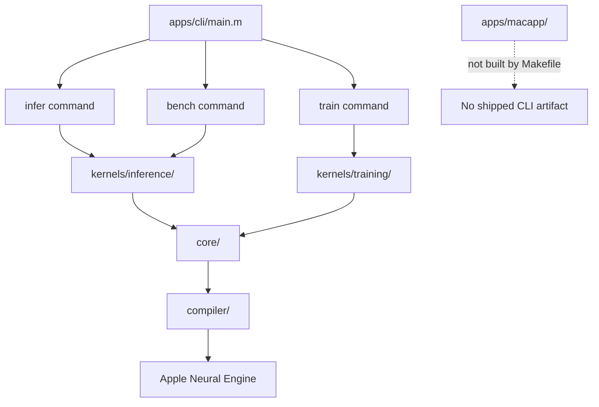
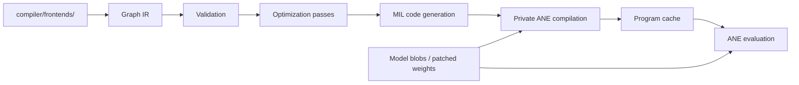
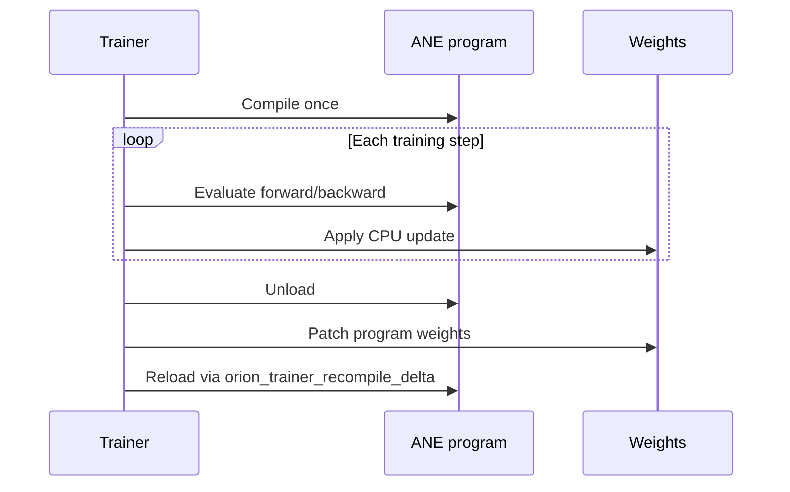
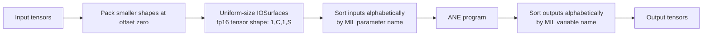

# Repository Guide

## Environment

- Orion is macOS-only Objective-C/C code that calls private ANE APIs. Building requires Apple Silicon, macOS 15+, and Xcode Command Line Tools; ANE execution cannot be meaningfully verified on other hosts.
- Runtime inference has no Python dependency. `requirements.txt` is only for Hugging Face weight conversion scripts under `model/convert/`.
- Model blobs, training data, checkpoints, and benchmark baselines are ignored. Do not assume a checkout has `model/blobs/*` or `data/*`.

## Commands

- `make` builds the root `./orion` CLI with `xcrun clang`; there is no Xcode project or separate package manager.
- `make test` builds and runs the suites listed in `Makefile`. It suppresses test output, so rerun a failure directly as `./build/tests/test_<name>`.
- Build or run one test with `make build/tests/test_<name>` then `./build/tests/test_<name>`. Compiler-only coverage is `make test-compiler`.
- `make bench` runs real ANE kernel benchmarks, not a lightweight validation step.
- Generate ignored weights with `python model/convert/hf_to_blobs_gpt2.py` or `python model/convert/hf_to_blobs_llama.py`. Download the ignored TinyStories shard with `scripts/download_data.sh`; its actual filename is `data/tinystories_data00.bin`.
- Treat the `Makefile` source/test lists and command `--help` output as authoritative; README suite counts and some historical prose are stale.

## Code Map

- `apps/cli/main.m` dispatches `infer`, `train`, and `bench`; handlers live in `apps/cli/commands/`.
- `core/` owns private-API compilation/eval, IOSurface tensors, program caching, runtime, checkpoints, and LoRA loading.
- `compiler/` is the active graph IR -> validation/optimization -> MIL codegen path. Add model graphs in `compiler/frontends/`; `archive/milgen/` is retired reference code and is not built.
- `kernels/inference/` contains GPT-2 CPU/ANE execution and KV cache code. `kernels/training/` contains Stories110M training, CPU updates, and data loading.
- `apps/macapp/` is not part of any Makefile target; changing it does not validate or ship a macOS app build.

## Compiler And Runtime Flow

For training, compilation is deliberately outside the per-step loop:

## ANE Invariants

- Read `docs/ane_constraints.md` before changing MIL, IOSurface allocation, BLOBFILE handling, or argument/result ordering. Many violations compile but silently produce wrong values.
- ANE I/O is fp16 `[1,C,1,S]`. Multi-input and multi-output surfaces must use uniform allocation sizes, but data for a smaller declared shape must remain packed at the start of an oversized surface.
- Supply input and output surfaces alphabetically by MIL parameter/variable name, not declaration or return-tuple order.
- Keep the BLOBFILE MIL offset at `uint64(64)`, pass MIL text as UTF-8 `NSData*`, and use `@{}` rather than `nil` for weight-free programs.
- Do not introduce MIL `concat`, `gelu`, conv `bias=`, or masked SDPA. Existing frontends decompose unsupported or incorrect operations.
- Training compiles programs once, then updates weights through unload -> patch -> reload via `orion_trainer_recompile_delta`; do not restore per-step ANE compilation or process-restart logic.

## Verification

- Prefer compiler-only tests for graph/pass/codegen changes; they do not require model blobs. ANE numerical tests require supported hardware, and several inference tests additionally require `model/blobs/gpt2_124m`.
- Tokenizer fixtures under `tokenizer/data/` are tracked. Golden JSON files are generated by `tests/gen_*_golden.py`; update them only when the intended reference behavior changes.
