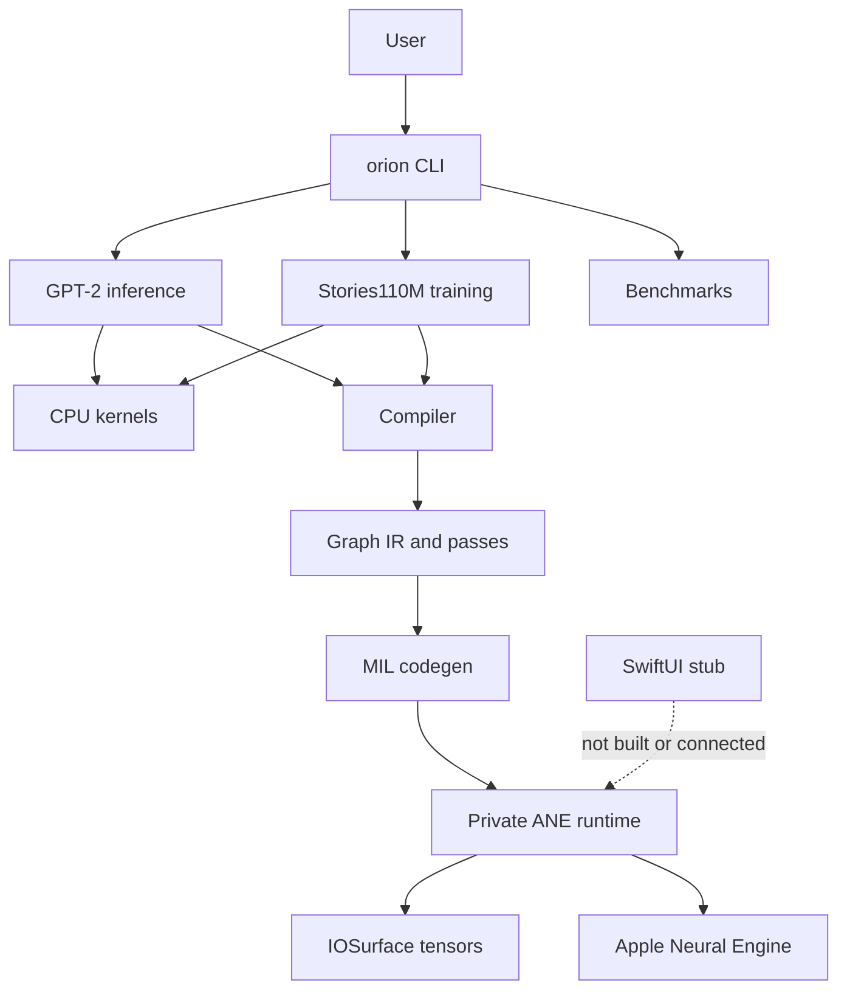
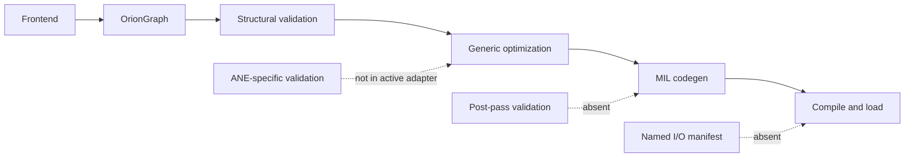
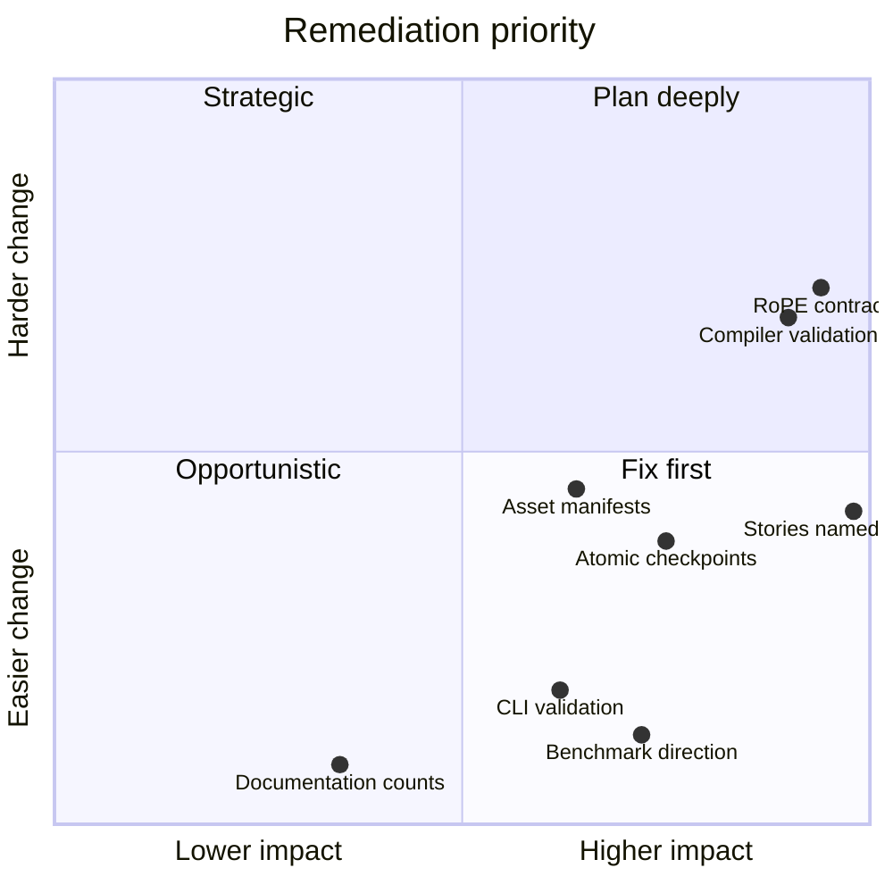
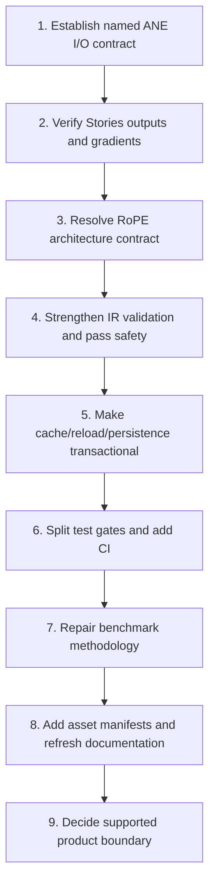

# Orion Codebase Analysis

## Executive summary

Orion is a substantive Apple Neural Engine research runtime and compiler, delivered today as a repository-root macOS CLI. Its active product is `./orion` with `infer`, `train`, and `bench` commands. It is not currently a packaged library, supported SDK, or functional SwiftUI application. The implementation is vertically integrated across a pure-C graph compiler, Objective-C MIL code generation, private ANE APIs, IOSurface transport, GPT-2 inference, and Stories110M training.

The repository has several strong foundations: an inspectable 47-translation-unit build, a distinct compiler-only test gate, explicit CPU/ANE partitioning, practical ANE constraint documentation, native runtime execution without Python, and compile-once training with unload/update/reload rather than per-step compilation. On the verified local Apple Silicon host, `make` succeeded, deterministic CPU and ANE smoke runs produced the same eight-token continuation, and all 23 Makefile test binaries passed after ignored GPT-2 assets and a data fixture were generated.

That successful local run is evidence of current viability, not proof that every static risk is absent. The most important unresolved correctness concern is an apparent mismatch between Stories training's semantic multi-output slot order and the repository's documented alphabetical ANE result mapping. The full suite emphasizes compilation, finite outputs, and synthetic smoke behavior; it does not independently compare every named training tap and full-model gradient against a trusted oracle. The active Stories graph also contains no RoPE operation despite the model configuration describing RoPE.

The highest-leverage architectural improvement is to make the ANE ABI explicit and enforceable. Today, alphabetical name mapping, equal multi-I/O allocation bytes, packed-prefix layout, dtype, shape, and logical byte counts are conventions spread across frontends and call sites. A generated per-kernel I/O manifest and named binding layer would convert silent-result hazards into checked errors.

## Evidence model

The reports distinguish four kinds of evidence:

| Evidence | Meaning |
|---|---|
| Observed code | Directly established from current source, Makefile lists, tracked files, or command behavior encoded in the repository. |
| Local verification | A dated result from this workspace and supported host. The build, deterministic CPU/ANE smoke, and 23/23 Makefile test result fall in this category. |
| Test evidence | Behavior asserted by a current test. Its strength depends on fixtures, assertions, skip behavior, and hardware. |
| Historical claim | Performance, endurance, or milestone prose not reproduced during this analysis. |

Historical throughput, latency, TFLOPS, RSS, compile-limit, and endurance figures are not new measurements. They remain useful research context only when read with their original host, workload, and date.

## Report map

| Report | Primary question | Key output |
|---|---|---|
| [01 Repository Build and Topology](01-repository-build-and-topology.md) | What actually builds, tests, and ships? | 47 active translation units, 23 configured tests, one root CLI, no CI or app target. |
| [02 CLI Product and Operations](02-cli-product-and-operations.md) | What user-facing behavior exists? | Command tree, fallbacks, parsing weaknesses, mutating training behavior, and exit-status risks. |
| [03 Module Architecture and Abstractions](03-module-architecture-and-abstractions.md) | How are responsibilities divided? | Effective layering, hardcoded model paths, dormant registry/runtime, and incomplete generic kernel adapter. |
| [04 Compiler IR, Frontends, and Passes](04-compiler-ir-frontends-and-passes.md) | Is the graph compiler contract sound? | Validation gaps, lossful cast rewrite, unsupported op handling, alias risk, and missing post-pass validation. |
| [05 MIL Codegen and ANE ABI](05-mil-codegen-and-ane-abi.md) | What exact contract connects MIL to surfaces? | Alphabetical mapping, equal allocation, packed prefixes, BLOBFILE offset 64, and dtype nuance. |
| [06 ANE Runtime, Cache, and Lifecycle](06-ane-runtime-cache-and-lifecycle.md) | How are programs compiled, cached, evaluated, and refreshed? | Ownership, cache races/identity gaps, global state, and donor-patch versus active reload semantics. |
| [07 GPT-2 Tokenization, Assets, and Weights](07-gpt2-tokenization-assets-and-weights.md) | How do text and external weights become runtime state? | BPE flow, two tokenizer families, conversion layout, BLOBFILE format, and validation gaps. |
| [08 GPT-2 CPU Inference](08-gpt2-cpu-inference.md) | How does the CPU baseline execute? | Forward/decode flow, 72 MiB KV cache, duplicate prefill QKV, allocation costs, bounds, and sampling complexity. |
| [09 GPT-2 ANE Inference](09-gpt2-ane-inference.md) | What runs on ANE versus CPU? | Bucketed prefill, hybrid decode, 25/24 program populations, cache flow, and fallback behavior. |
| [10 Stories110M Training System](10-stories110m-training-system.md) | How does training partition forward, backward, update, and reload? | 72 initial compiles, 60 reloads/step, CPU state, absent RoPE, and apparent output-order mismatch. |
| [11 Data, Checkpoints, and LoRA](11-data-checkpoints-and-lora.md) | How are training inputs and persistent adaptations managed? | Sequential mmap windows, non-atomic checkpoints, coherent deferred resume, and unintegrated LoRA. |
| [12 Testing and Correctness Evidence](12-testing-and-correctness-evidence.md) | What does the test suite prove? | Test taxonomy, local 23/23 result, asset/hardware coupling, skip semantics, and oracle gaps. |
| [13 Benchmarking and Observability](13-benchmarking-and-observability.md) | Are performance results measured and compared correctly? | Directionality bug, warning-only baselines, mode collisions, fabricated phase split, and incomplete profiler wiring. |
| [14 Assets, Tooling, and Reproducibility](14-assets-tooling-and-reproducibility.md) | Can inputs and generated artifacts be reproduced? | Unpinned dependencies/revisions, undeclared NumPy, unchecked downloads, and missing manifests. |
| [15 Security, Reliability, and Portability](15-security-reliability-and-portability.md) | Where can malformed state or platform drift cause failure? | Bounds/file checks, non-atomic mutation, concurrency, path containment, and private-API constraints. |
| [16 Documentation, Maintainability, and Roadmap](16-documentation-maintainability-and-roadmap.md) | What should be corrected and sequenced? | Documentation drift inventory, monolith/duplication analysis, and near/mid/long-term roadmap. |

## Architecture conclusions

### Product boundary

- The default build produces one macOS command-line executable, not a reusable library or app bundle.
- `apps/macapp/` is a nonfunctional stub outside every Makefile target.
- Inference is hardcoded to GPT-2 124M and training to Stories110M; the model registry does not select either path.
- `OrionRuntime` is mostly dormant, and `orion_kernel_from_frontend` constructs a kernel whose registered generator path returns `nil`.
- Private framework use makes OS compatibility, distribution, signing, and support materially different from a public-API macOS product.

### Compiler and ANE contract

- The active compiler has a clear frontend -> graph -> validate -> optimize -> MIL shape.
- Structural validation does not establish operation arity, dtype compatibility, shape legality, capacity propagation, or complete codegen support.
- The cast pass can incorrectly erase a lossy `fp32 -> fp16 -> fp32` round trip.
- `SPLIT` and `PAD` exist in the IR but lack codegen and are not rejected before emission.
- The active adapter does not run ANE-specific validation/passes and does not validate again after optimization.
- Codegen preserves registration order, while ANE multi-I/O binding is empirically alphabetical by MIL names.

### Execution systems

- GPT-2 CPU inference is a credible numerical baseline, but prefill-with-KV recomputes Q/K/V, repeatedly allocates workspaces, lacks robust context-capacity checks, and stochastic sampling insertion-sorts all 50,257 vocabulary entries.
- GPT-2 ANE inference is hybrid. Prefill runs transformer layers on ANE, while decode uses ANE for normalization/QKV and FFN but CPU for cache attention, output projection, final normalization, logits, and sampling.
- Stories training uses six ANE programs per layer and retains large CPU responsibility: residuals, selected normalization backwards, parameter gradients, classifier/loss, Adam, persistence, and reload orchestration.
- Core Stories fp32 parameters, gradients, and two Adam moments occupy about 1.75 GB decimal (1.63 GiB) before activations, IOSurfaces, temporary copies, and framework state.

## Priority risk register

| Priority | Risk | Why it matters | First action |
|---|---|---|---|
| P0 | Apparent Stories multi-output binding mismatch | Alphabetical ANE mapping may not match runner semantic slots; finite wrong tensors can evade smoke tests. | Build a named output manifest and compare every Stories output against an independent tiny-model oracle. |
| P0 | Claimed RoPE absent from active Stories graph | The represented model differs from the described Llama2-style architecture and lacks an explicit positional signal. | Add verified RoPE forward/backward support or rename/redefine the supported architecture. |
| P0 | ANE ABI is convention rather than checked metadata | Wrong order, allocation, packed bytes, dtype, or shape can silently corrupt results. | Generate parameter/result metadata and bind surfaces by name with byte-level validation. |
| P0 | Compiler can emit semantically invalid MIL | Validation gaps, unsupported ops, alias drift, and lossy cast elimination undermine graph correctness. | Fix cast safety, reject unsupported ops, add shape/type/arity checks, then revalidate post-pass. |
| P1 | Runtime/cache/reload lifecycle is non-transactional | Races, stale pointers, incomplete keys, unchecked writes, and partial reloads can mix program state. | Define ownership/concurrency and add content fingerprints plus transactional reload tests. |
| P1 | Persistence and binary readers trust malformed input | BLOBFILE, checkpoint, IOSurface, and path operations can overrun, truncate, or partially mutate state. | Centralize validated formats, check capacities, and use temporary-file plus atomic rename. |
| P1 | Test gate conflates pass, skip, missing assets, and hardware | Aggregate 23/23 can conceal unavailable coverage and does not provide a portable CI gate. | Split compiler, CPU, ANE synthetic, model-asset, training, and benchmark gates with explicit skip accounting. |
| P1 | Benchmark comparison can reward regressions | Throughput direction is inverted, warnings never fail, and modes share keys. | Add metric direction/schema, mode/environment identity, monotonic timing, and fail thresholds. |
| P2 | Reproducibility and documentation drift | Setup commands, paths, counts, constraints, assets, and performance status can mislead users. | Add manifests/locks and generate inventory/help documentation from executable sources. |

## Verification interpretation

The known local verification established:

1. The current code builds with `xcrun clang` on the supported Apple Silicon/macOS host.
2. Ignored GPT-2 assets can be generated with the Python conversion environment.
3. Deterministic CPU and ANE smoke paths agreed on `The meaning of life is not the same as the meaning of death` for the tested eight-token continuation.
4. All 23 test binaries configured by the Makefile returned success after required ignored assets were present.

It did not establish:

1. Full Stories forward/backward equivalence to an independent framework.
2. Correct semantic binding of every multi-output ANE training program.
3. Correct RoPE behavior, because active Stories graphs contain no RoPE.
4. Cache/reload concurrency safety, transactional failure recovery, or unbounded-session behavior.
5. Current performance, endurance, thermal stability, or benchmark regression correctness.
6. Portability beyond the tested private-framework/macOS/Apple Silicon combination.

## Recommended execution sequence

1. **Correctness boundary:** introduce named I/O manifests, automatic alphabetical binding, allocation-byte checks, packed-length checks, and exact dtype/shape metadata.
2. **Training oracle:** verify all six Stories programs and a tiny end-to-end model against independent forward and finite-difference/autograd gradients.
3. **Model contract:** implement RoPE or explicitly identify the model as a non-RoPE architecture; make `--seq` effective or remove it.
4. **Compiler contract:** add operation arity/shape/type/codegen validation, lossless-only rewrites, output identity preservation, and post-pass validation.
5. **Lifecycle hardening:** fingerprint cache entries, retain safe lookup ownership, bound cache growth, check filesystem operations, and make checkpoint/reload updates atomic and recoverable.
6. **Evidence gates:** separate portable compiler/CPU checks from ANE synthetic, model-asset, training, endurance, and controlled benchmark runs.
7. **Reproducibility:** pin converter dependencies and model revisions, declare NumPy, remove runtime package installation, verify downloads, and emit per-asset manifests with hashes.
8. **Product clarity:** update setup/docs from current commands and decide whether Orion is a research CLI or a supported runtime/SDK before expanding app/platform claims.

## Bottom line

Orion already contains meaningful systems work: a native compiler/runtime, empirical hardware knowledge, CPU reference paths, ANE-assisted inference, and a sophisticated hybrid training loop. Its central challenge is not lack of capability; it is converting hard-won, call-site-specific hardware conventions into checked contracts and independent correctness evidence. Addressing the named ANE ABI, Stories model equivalence, compiler validation, and lifecycle atomicity would materially improve confidence before performance optimization or broader product packaging.
