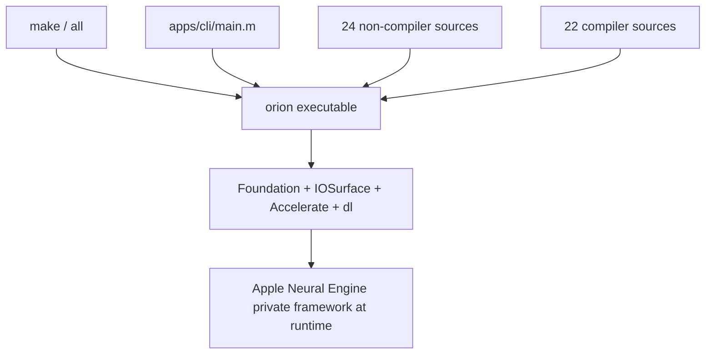
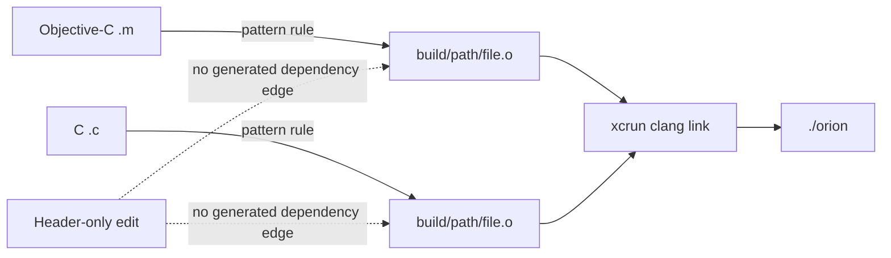
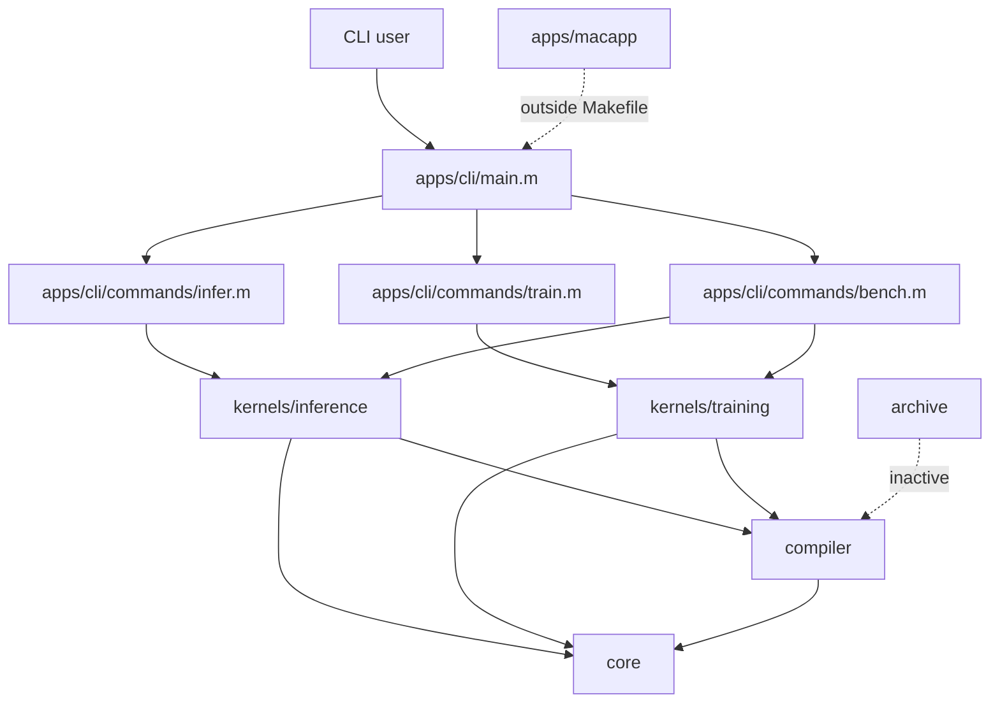
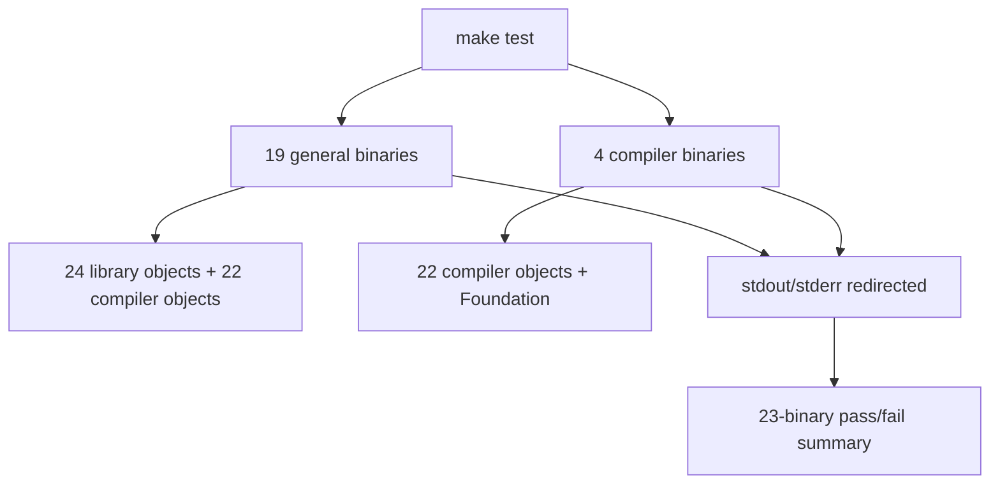

# Repository Build and Topology

## Scope and evidence method

This report describes the current repository layout, the active build graph, test topology, platform assumptions, and the boundary between shipped code and auxiliary material. The review used the source lists and recipes in `Makefile` as authoritative, then checked the listed directories and representative entry points. Documentation is used only as context when it agrees with code or is explicitly marked historical.

### Evidence-status legend

| Marker | Meaning |
|---|---|
| **[OC] Observed code** | Directly established from current repository source, build recipes, or tracked configuration. |
| **[LV] Local verification** | Result from the known local verification run supplied for this workspace. |
| **[TE] Test evidence** | Behavior asserted or exercised by a current test; this does not imply every static finding was dynamically reproduced. |
| **[HC] Historical claim** | A statement in project prose or historical results that was not re-benchmarked for this report. |

Static risks in this report are source-review findings. They are not labeled as locally reproduced unless an **[LV]** item says so.

## Executive view

Orion is a macOS-only Objective-C/C command-line program that directly loads private Apple Neural Engine APIs. The root `orion` executable is the only artifact produced by the default build. Its active build has exactly **47 translation units**: 24 non-compiler library sources, 22 compiler sources, and `apps/cli/main.m`. The active test inventory has exactly **23 test binaries**: 19 general tests and 4 compiler tests. These counts come from list expansion, not the stale comments in `Makefile` or older README status prose. **[OC]** (`Makefile:15-90`, `Makefile:96-125`)

## Authoritative build composition

### Production translation units

| Group | Count | Contents | Evidence |
|---|---:|---|---|
| Core | 11 | ANE runtime/cache, MIL builder, IOSurface tensors, profiler, buckets, checkpoints, registry, kernel/runtime abstractions, LoRA | **[OC]** `Makefile:15-26` |
| Inference | 4 | ANE prefill, ANE decode, CPU decode, KV cache | **[OC]** `Makefile:28-32` |
| Training | 3 | trainer, CPU training operations, data loader | **[OC]** `Makefile:34-37` |
| Model | 1 | Weight loader | **[OC]** `Makefile:39` |
| Tokenizer | 2 | GPT-2 BPE and SentencePiece wrapper | **[OC]** `Makefile:41-43` |
| CLI handlers | 3 | `infer`, `train`, `bench` | **[OC]** `Makefile:45-48` |
| Compiler C | 19 | IR, builder, topology, patterns, validation, passes, pipeline, and six frontend files | **[OC]** `Makefile:51-70` |
| Compiler Objective-C | 3 | MIL codegen, kernel adapter, MIL diff | **[OC]** `Makefile:72-75` |
| Entry point | 1 | `apps/cli/main.m` | **[OC]** `Makefile:77` |
| **Total** | **47** | 24 non-compiler + 22 compiler + 1 entry point | **[OC]** list expansion |

`LIB_SRC` deliberately excludes compiler objects and the entry point; the final link combines `ALL_OBJ` and `COMPILER_OBJ`. **[OC]** (`Makefile:79-90`, `Makefile:135-137`)

The comments claiming "38 total" and "21 total" are stale and should not be used for inventory. The actual lists define 47 production translation units and 23 tests. **[OC]** (`Makefile:11-13`, `Makefile:92-125`)

### Build mechanics

- `make` resolves through `all: orion`; there is no Xcode project in the active build. **[OC]** (`Makefile:131-137`)
- Objective-C and C compile through `xcrun clang`; Objective-C uses ARC and all sources use `-O2`, warnings, and repository include roots. **[OC]** (`Makefile:4-7`, `Makefile:139-147`)
- The executable links Foundation, IOSurface, Accelerate, and `libdl`. Private ANE linkage is deferred to runtime `dlopen`, so successful linking alone does not prove ANE availability. **[OC]** (`Makefile:6-7`; `core/ane_runtime.m:30-46`)
- Object paths preserve source directory structure under `build/`, avoiding basename collisions. **[OC]** (`Makefile:82-90`, `Makefile:139-147`)
- Header dependencies are not generated: there are no `-MMD/-MP` flags or included dependency files. An incremental build can therefore retain stale objects after header-only edits. **[OC]** (`Makefile:4-7`, `Makefile:139-147`)

## Repository topology and active boundaries

| Area | Current role | Build status |
|---|---|---|
| `apps/cli/` | Product entry point and command handlers | Active in `orion` |
| `core/` | Private API bridge, program lifecycle/cache, tensors, checkpoints, and abstractions | Active in `orion` and general tests |
| `compiler/` | Graph IR, frontends, passes, MIL codegen, adapters | Active in `orion` and all tests |
| `kernels/inference/` | GPT-2 CPU/ANE execution and KV cache | Active |
| `kernels/training/` | Stories110M training and CPU updates | Active |
| `model/` | Runtime weight loader plus Python conversion helpers | Loader active; conversion scripts are auxiliary |
| `tokenizer/` | Native runtime tokenization and tracked fixtures | Active |
| `tests/` | Standalone test executables and golden generators | Active through Makefile lists |
| `docs/` | ANE constraints and reference/history | Not compiled |
| `apps/macapp/` | SwiftUI/application work | Not present in any Makefile source list; not shipped by `make` |
| `archive/` | Retired reference material | Not present in active source lists |

Runtime inference has no Python dependency. Python is used for model conversion and golden/data preparation, while the built executable is Objective-C/C. **[OC]** (`Makefile:15-90`; `model/convert/`; `tests/gen_forward_golden.py`; `tests/gen_tokenizer_golden.py`)

## Test topology and verification

`TEST_NAMES` contains 19 general test binaries and `COMPILER_TEST_NAMES` contains 4 compiler test binaries. `make test` builds and runs all 23, suppressing each program's output and reporting only pass/fail. **[OC]** (`Makefile:96-125`, `Makefile:149-166`)

General tests link the test source with all 24 non-compiler library objects and all 22 compiler objects. Compiler tests have explicit rules linking only compiler objects plus Foundation. **[OC]** (`Makefile:187-207`)

Known local verification for this workspace:

- **[LV]** `make` succeeded.
- **[LV]** Deterministic 8-token CPU and ANE smoke runs both produced `The meaning of life is not the same as the meaning of death`.
- **[LV]** After generating ignored GPT-2 assets and the data fixture, `make test` passed **23/23**.
- **[TE]** The suite includes CPU/ANE inference, training, cache/reload, LoRA, tokenizer/data, graph IR, passes, ANE passes, and compiler structural equivalence according to the current test names. **[OC]** (`Makefile:96-122`)

These results establish that the known checkout built and its configured suites passed with generated local prerequisites. They do not dynamically reproduce every source-review risk in this report, and ignored assets mean another checkout may not be immediately test-ready.

`make bench` is not a lightweight test alias: it builds `orion` and runs an actual ANE kernel benchmark with ten iterations. **[OC]** (`Makefile:209-211`)

## Strengths

- The build is small, transparent, and reproducible from one authoritative Makefile without project-generator indirection. **[OC]**
- Source groups map cleanly to repository domains, and compiler-only tests can be built without the entire runtime. **[OC]**
- The default executable includes the active compiler rather than depending on retired generated MIL sources. **[OC]** (`Makefile:50-90`)
- The test target fails the build when any configured test binary exits nonzero. **[OC]** (`Makefile:151-166`)
- Runtime code explicitly handles required private-API representations, including UTF-8 MIL bytes and an empty weight dictionary fallback. **[OC]** (`core/ane_runtime.m:51-65`)
- The local verification covers build, all configured tests, and deterministic CPU/ANE product smoke behavior. **[LV]**

## Limitations

- The repository is intrinsically tied to Apple Silicon, macOS private APIs, and current private framework behavior; compilation on a Mac does not provide portability or API stability. **[OC]** (`core/ane_runtime.m:30-46`)
- Model blobs, generated data, checkpoints, and benchmark baselines are not guaranteed in a clean checkout, so full numerical/ANE coverage has external preparation steps.
- Test recipes suppress diagnostics, requiring direct execution of a failing binary for useful output. **[OC]** (`Makefile:156`, `Makefile:175`)
- There is no install, package, version, or release target in the Makefile; the product artifact is a repository-local `./orion`. **[OC]**
- Historical throughput, endurance, and speedup numbers in README and benchmark documents were not rerun here and remain **[HC]**, not current measurements. Examples include README performance prose at `README.md:7-13`, `README.md:93`, and `README.md:210-211`.

## Severity-ranked risks

### High

1. **Private API and platform drift can break the only hardware backend.** The runtime dynamically resolves underscored classes and invokes selectors through `objc_msgSend`; no public ABI contract protects these calls. A macOS update can turn a previously successful build into initialization, compile, load, or evaluation failure. **[OC]** (`core/ane_runtime.m:30-46`, `core/ane_runtime.m:62-115`, `core/ane_runtime.m:163-181`)
2. **Incremental builds can be stale after header changes.** Missing compiler-generated dependency files means `make` tracks source timestamps but not included headers. This is particularly risky because model configuration and graph interfaces are header-heavy. **[OC]** (`Makefile:139-147`)

### Medium

3. **A clean checkout is not self-contained for the full test target.** Several suites require ignored GPT-2 blobs or generated data. The 23/23 result required those prerequisites to be generated. **[LV]**
4. **Inventory comments and project prose are stale.** Incorrect source/test totals in comments can mislead maintenance and release review even though list expansion is correct. **[OC]** (`Makefile:11-13`, `Makefile:92-94`, `Makefile:149`; compare `README.md:193-204`)
5. **All general tests link nearly the entire product.** This catches integration issues but increases rebuild/link cost and weakens module isolation; accidental symbol dependencies can go unnoticed. **[OC]** (`Makefile:187-190`)

### Low

6. **`clean` and build directory creation are shell-specific and minimally guarded.** This is acceptable for the macOS-only scope but offers little diagnostics or configurability. **[OC]** (`Makefile:139-147`, `Makefile:213-216`)
7. **README paths can drift from actual fixtures.** For example, user-facing data setup prose should be checked against the downloader and current data-loader expectations before operational use. **[OC]** (`README.md:78-90`)

## Recommendations

1. Add `-MMD -MP` to C and Objective-C compilation, retain `.d` files beside objects, and include them from the Makefile.
2. Correct only the stale Makefile count comments to 47 translation units and 23 tests; keep the lists as the source of truth.
3. Add a `make test-compiler` preflight to CI and a separately labeled hardware job for asset-dependent ANE tests. Do not let unavailable hardware masquerade as passing coverage.
4. Add a prerequisite check that reports missing ignored blobs/data before `make test`, while preserving direct test execution for diagnostics.
5. Record macOS build number, chip, generated asset revision, and command line with future benchmark results. Treat existing published numbers as historical until rerun under that protocol.
6. Keep `apps/macapp/` and `archive/` explicitly outside release claims unless an authoritative build target starts producing and validating them.

## Bottom line

The active build is coherent and locally verified, but narrower than some historical project prose suggests. The defensible current statement is: one macOS CLI, 47 production translation units, 23 configured test binaries, compiler-integrated inference/training paths, and runtime dependence on unsupported private ANE APIs. **[OC][LV]**
