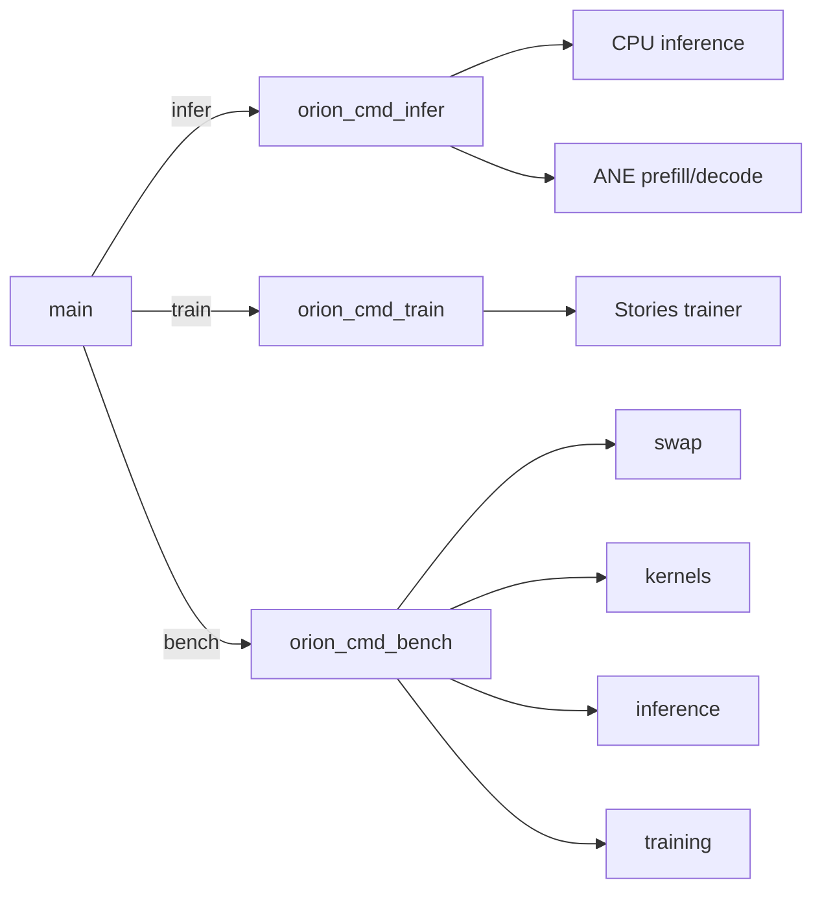
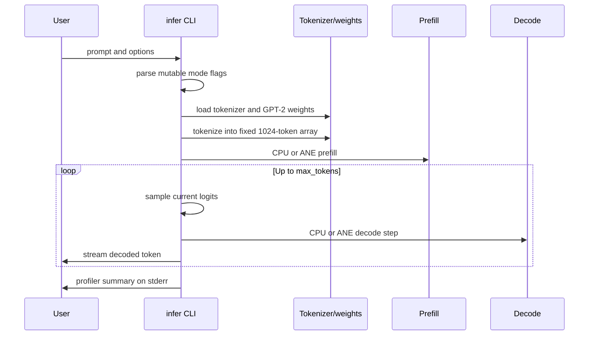
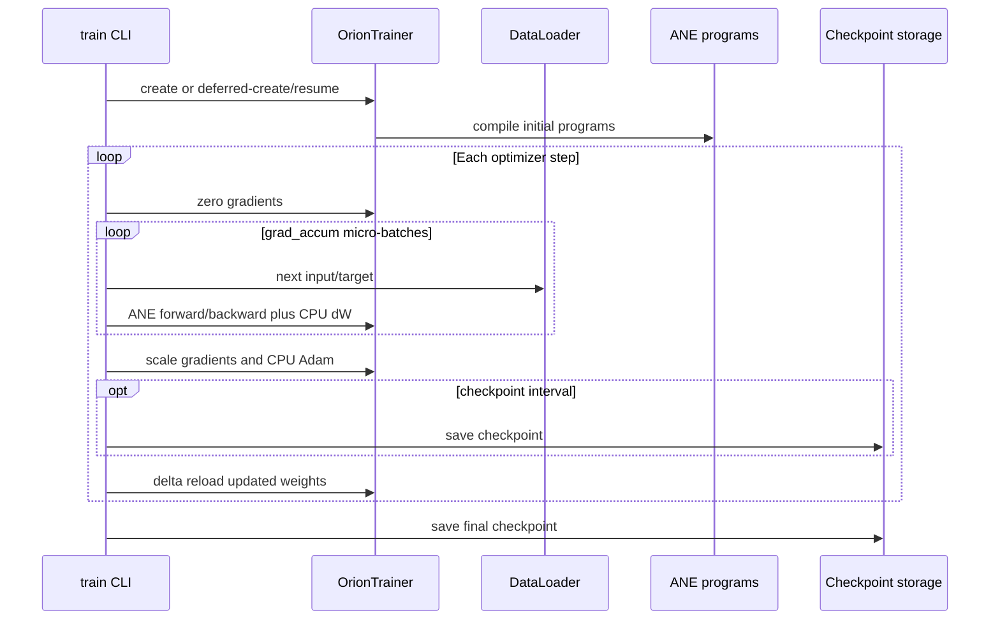
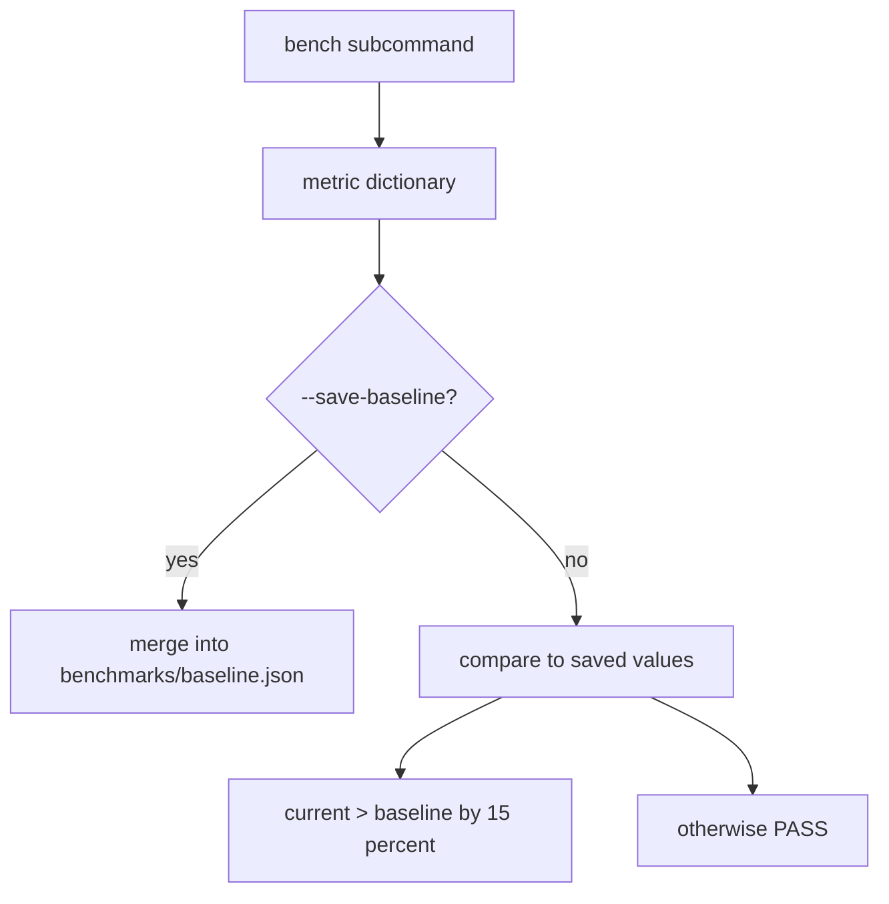

# CLI Product and Operations

## Scope and evidence method

This report reviews the shipped `orion` command surface, argument parsing, inference/training/benchmark flows, failure behavior, generated artifacts, and operator-facing reliability. Evidence comes from `apps/cli/main.m`, the three command handlers, and the runtime/kernel functions they invoke. Help text is compared to actual parser behavior rather than treated as authoritative by itself.

### Evidence-status legend

| Marker | Meaning |
|---|---|
| **[OC] Observed code** | Direct source observation. |
| **[LV] Local verification** | Result from the known local run supplied for this workspace. |
| **[TE] Test evidence** | Current tests exercise or assert the behavior; not proof that every CLI edge case was run. |
| **[HC] Historical claim** | Prior prose or benchmark result not rerun for this report. |

Static parser, state-mutation, and fallback findings below are **[OC]** unless explicitly marked **[LV]**. They were not claimed as dynamically reproduced.

## Product surface

The entry point accepts exactly three top-level commands and forwards a shifted argument vector whose element zero is the command name. Unknown commands fail with usage; top-level `-h` and `--help` succeed. **[OC]** (`apps/cli/main.m:10-45`)

| Command | Product role | Primary prerequisites |
|---|---|---|
| `infer` | GPT-2 generation with CPU, ANE-prefill/CPU-decode, or ANE-assisted full mode | GPT-2 blobs and BPE files; ANE only for ANE modes |
| `train` | Stories110M training, checkpoint/resume, CSV telemetry, delta weight reload | Stories weights, tokenized dataset, ANE |
| `bench` | Swap endurance, kernel latency, end-to-end inference, training breakdown, baseline persistence | Depends on subcommand; most paths require ANE and weights |

## Inference design and flow

`infer` defaults to greedy CPU generation with 128 maximum tokens, seed 42, GPT-2 blobs under `model/blobs/gpt2_124m`, and tracked tokenizer paths. `--ane` selects ANE prefill plus ANE decode; `--ane-prefill` selects ANE prefill plus CPU decode. **[OC]** (`apps/cli/commands/infer.m:22-59`)

The ANE prefill path selects a sequence bucket, embeds and transposes on CPU, runs attention and FFN kernels per layer, extracts K/V to the cache, runs final layer normalization on ANE, and projects logits on CPU. **[OC]** (`kernels/inference/prefill_ane.m:235-352`)

The ANE decode path is hybrid despite the CLI label "ANE full": each layer uses ANE for LN/QKV and FFN, but attention, output projection/residual, final layer normalization, and vocabulary projection execute on CPU. **[OC]** (`kernels/inference/decode_ane.m:12-18`, `kernels/inference/decode_ane.m:164-287`)

Known product verification: deterministic 8-token CPU and ANE smoke runs both produced `The meaning of life is not the same as the meaning of death`. **[LV]** The configured CPU and ANE golden suites also passed within the supplied 23/23 test run. **[LV][TE]** (`tests/test_infer_golden.m:55-107`; `tests/test_infer_golden_ane.m:141-187`)

## Training design and flow

The training command requires `--weights` and `--dataset`. It uses the fixed `kStories110M` configuration, constructs or resumes a trainer, opens tokenized data, performs gradient accumulation, applies CPU Adam, checkpoints periodically, and reloads updated program weights through the delta path after each optimizer step. **[OC]** (`apps/cli/commands/train.m:120-200`, `apps/cli/commands/train.m:225-289`)

Resume deliberately creates a trainer without compiling, loads checkpoint state, then compiles programs with resumed weights. Normal startup compiles immediately. **[OC]** (`apps/cli/commands/train.m:148-187`)

Training keeps compilation outside the steady-state loop: per-step `orion_trainer_recompile_delta` is described and implemented as weight patch/reload rather than a normal compile call. **[OC]** (`apps/cli/commands/train.m:270-280`; `core/ane_runtime.m:320-340`)

## Benchmark operations

`bench` has four explicit subcommands. Parsers reject unknown options, unlike `infer`. **[OC]** (`apps/cli/commands/bench.m:1042-1212`)

| Subcommand | Current behavior | Operational caveat |
|---|---|---|
| `swap` | Alternates cache bindings, compiles on miss, evaluates, evicts the opposite weight ID, and reports RSS | MIL body is weight-free, so weight paths affect cache identity rather than numerical weights **[OC]** (`bench.m:325-482`) |
| `kernels` | Compiles/evaluates five GPT-2 kernel shapes and emits JSONL to stdout | Requires real ANE; aggregate "SRAM" is a rough sum of estimates **[OC]** (`bench.m:497-735`) |
| `inference` | Warms up and times prefill/decode with optional ANE modes | Warmup return values are ignored; timed fallback state differs from `infer` **[OC]** (`bench.m:739-905`) |
| `training` | Runs synthetic-token training and reports a phase breakdown | Forward/backward split is a hard-coded 40/60 estimate, not separately measured **[OC]** (`bench.m:943-1015`) |

Baseline data is persisted in `benchmarks/baseline.json`, merged by metric key, and compared with a fixed 15 percent threshold. **[OC]** (`apps/cli/commands/bench.m:69-157`)

## Parsing, fallback, and mutation analysis

### Inference parser

- Unknown options are silently ignored because the parse chain has no final `else`. **[OC]** (`apps/cli/commands/infer.m:61-88`)
- A recognized option without a value is also silently ignored when its `i + 1 < argc` guard fails. **[OC]**
- Numeric conversion uses `atoi`, `atof`, and `strtoull` without end-pointer, range, finite-value, or semantic validation. Negative token counts, malformed strings converted to zero, invalid probabilities, and overflow are not rejected. **[OC]** (`apps/cli/commands/infer.m:64-71`)
- `--ane` and `--ane-prefill` mutate the same two booleans; when both are supplied, the last occurrence wins without a conflict diagnostic. **[OC]** (`apps/cli/commands/infer.m:72-77`)

### Inference fallback state

If ANE initialization fails, `use_ane` becomes false but `ane_decode` remains true. Prefill then executes on CPU, while the decode loop still attempts `orion_ane_decode_step`; the summary can call the backend CPU because it gates display on `use_ane`. **[OC]** (`apps/cli/commands/infer.m:96-102`, `apps/cli/commands/infer.m:148-163`, `apps/cli/commands/infer.m:172-200`, `apps/cli/commands/infer.m:211-215`)

If ANE prefill fails, the command rebuilds the KV cache and performs CPU prefill but does not clear either mode flag. It can continue with ANE decode and later report `ANE full`, even though prefill was CPU. **[OC]** (`apps/cli/commands/infer.m:148-159`, `apps/cli/commands/infer.m:211-215`)

The benchmark inference command correctly clears both flags on ANE initialization failure, but does not clear mode state after timed ANE prefill failure. This is inconsistent product behavior. **[OC]** (`apps/cli/commands/bench.m:744-750`, `apps/cli/commands/bench.m:821-835`)

### Training parser and completion state

- Any unknown option sets `args.help`, and the command then returns success because `return args.help ? 0 : 1` is necessarily zero inside `if (args.help)`. Thus malformed invocations can look successful to scripts. **[OC]** (`apps/cli/commands/train.m:64-92`, `apps/cli/commands/train.m:122-126`)
- `--seq` is parsed into `args.seq_len` but never applied; allocation, data loading, FLOP estimation, and training all use `cfg->max_seq`. **[OC]** (`apps/cli/commands/train.m:26`, `apps/cli/commands/train.m:83-84`, `apps/cli/commands/train.m:139-215`)
- `--csv` is implemented but absent from help text. **[OC]** (`apps/cli/commands/train.m:21`, `apps/cli/commands/train.m:30-46`, `apps/cli/commands/train.m:85-86`)
- `steps`, `grad_accum`, learning rate, sequence length, and checkpoint interval receive no range/finite validation. `grad_accum == 0` reaches division by zero in loss/gradient scaling. **[OC]** (`apps/cli/commands/train.m:75-84`, `apps/cli/commands/train.m:233-247`)
- A delta reload failure breaks the loop, but the command still writes a "final" checkpoint tagged with requested `args.steps` and returns zero. The checkpoint may therefore overstate progress and automation sees success. **[OC]** (`apps/cli/commands/train.m:273-289`, `apps/cli/commands/train.m:317-327`)
- Checkpoint directory creation and final checkpoint save errors are ignored. **[OC]** (`apps/cli/commands/train.m:204-206`, `apps/cli/commands/train.m:317-321`)

## Strengths

- The top-level command surface is small and discoverable, with command-specific help. **[OC]**
- Inference streams output while reporting load, prefill, decode, and profiler information separately on stderr. **[OC]** (`apps/cli/commands/infer.m:104-122`, `apps/cli/commands/infer.m:168-216`)
- CPU fallback exists for ANE initialization, prefill, and decode failures rather than unconditionally terminating. **[OC]**
- Resume compilation order protects checkpoint weights from being overwritten by initially baked weights. **[OC]** (`apps/cli/commands/train.m:148-176`)
- Benchmark subcommands provide machine-readable kernel JSONL and persisted regression inputs. **[OC]** (`apps/cli/commands/bench.m:680-684`)
- Known local smoke behavior is deterministic across CPU and ANE modes. **[LV]**

## Limitations

- There is no shared typed option parser, so validation, unknown-option behavior, help conventions, and fallback semantics differ across commands.
- "ANE full" is a product shorthand, not literal all-ANE execution; decode retains substantial CPU work. **[OC]**
- Commands assume repository-relative defaults and provide no global model/config selection despite a model registry existing elsewhere.
- Benchmark baseline comparison does not encode metric direction, environment identity, sample confidence, or a failing exit status.
- Published performance and endurance figures are **[HC]** unless rerun. This report does not promote README numbers to current measurements.

## Severity-ranked risks

### Critical

1. **Training can report success and mislabel checkpoint progress after a failed delta reload.** The loop breaks, `ckpt_final.bin` is saved with `args.steps`, and the process returns zero. This can corrupt orchestration decisions and resume position. **[OC]** (`apps/cli/commands/train.m:273-289`, `apps/cli/commands/train.m:317-327`)

### High

2. **Inference ANE initialization fallback leaves ANE decode enabled.** This violates the warning's promise of CPU fallback and makes execution and backend reporting disagree. **[OC]** (`apps/cli/commands/infer.m:96-102`, `apps/cli/commands/infer.m:192-215`)
3. **Malformed train CLI input exits successfully.** Unknown or missing-value options are converted into help with status zero, making shell automation unable to distinguish errors from requested help. **[OC]** (`apps/cli/commands/train.m:64-92`, `apps/cli/commands/train.m:122-126`)
4. **Unchecked numeric values can create invalid control flow or arithmetic.** Zero/negative accumulation and token counts, non-finite learning rates, and out-of-range sampling parameters are accepted. **[OC]**

### Medium

5. **Fallback mutation can produce inaccurate backend attribution.** CPU prefill after ANE failure can still be summarized as full ANE; initialization failure can attempt ANE decode while summarized as CPU. **[OC]**
6. **`--seq` is a no-op and `--csv` is undocumented.** Operators can believe sequence length changed when it did not, while a real output feature is hidden. **[OC]**
7. **Baseline regression logic has no metric direction.** It warns when any current value rises over 15 percent. That is appropriate for latency but incorrectly warns on throughput improvements and passes throughput regressions. **[OC]** (`apps/cli/commands/bench.m:125-153`, metric `inference.tok_per_sec` at `bench.m:883-890`)
8. **Training benchmark phase labels imply measurements that are only estimated.** The 40/60 split is hard-coded from one combined duration. **[OC]** (`apps/cli/commands/bench.m:964-998`)

### Low

9. **Inference silently ignores unknown options.** Typos can run a materially different mode with defaults. **[OC]**
10. **Help and defaults use underscore option names inconsistently with common CLI conventions.** This is usability debt rather than a correctness defect.

## Recommendations

1. Introduce one strict parsing helper for required values, integers, finite floats, ranges, unknown options, and conflict detection. Preserve current option spelling initially to avoid unnecessary compatibility churn.
2. Represent inference backend as one enum (`CPU`, `ANE_PREFILL`, `ANE_HYBRID_DECODE`) rather than two independently mutable booleans. On each fallback, mutate the enum once and derive both execution and reporting from it.
3. Make train parser failures return nonzero; reserve zero for explicit `--help` and successful operation.
4. Either wire `--seq` through a validated mutable model configuration and every allocation, or remove it from the current CLI until supported. Add `--csv` to help.
5. Reject `steps <= 0`, `grad_accum <= 0`, non-finite/non-positive learning rates, invalid sampling ranges, and negative generation counts before loading assets.
6. Track `last_completed_step`; save that value, check all checkpoint writes, and return nonzero after reload or checkpoint failure.
7. Give benchmark metrics direction metadata (`lower_is_better` or `higher_is_better`), include environment metadata in baselines, and optionally fail on regressions for CI use.
8. Rename or explain "ANE full" as hybrid ANE decode in user-facing output unless the entire decode path actually moves to ANE.

## Bottom line

The CLI exposes useful end-to-end inference, training, and measurement workflows, and its known happy paths are locally verified. Its main operational weakness is state and error semantics: parsers are inconsistent, fallback flags can disagree with actual execution, and training can convert a partial failure into a successful, overstated final checkpoint. **[OC][LV]**
