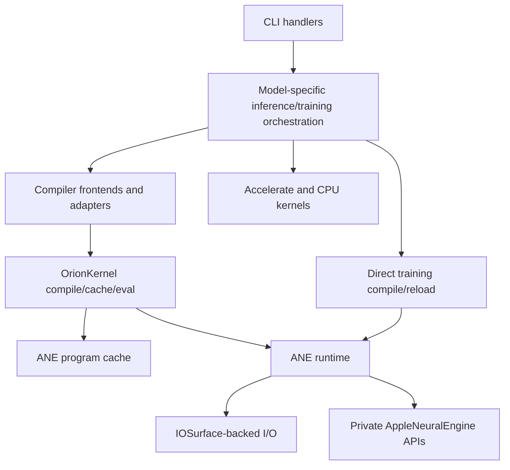
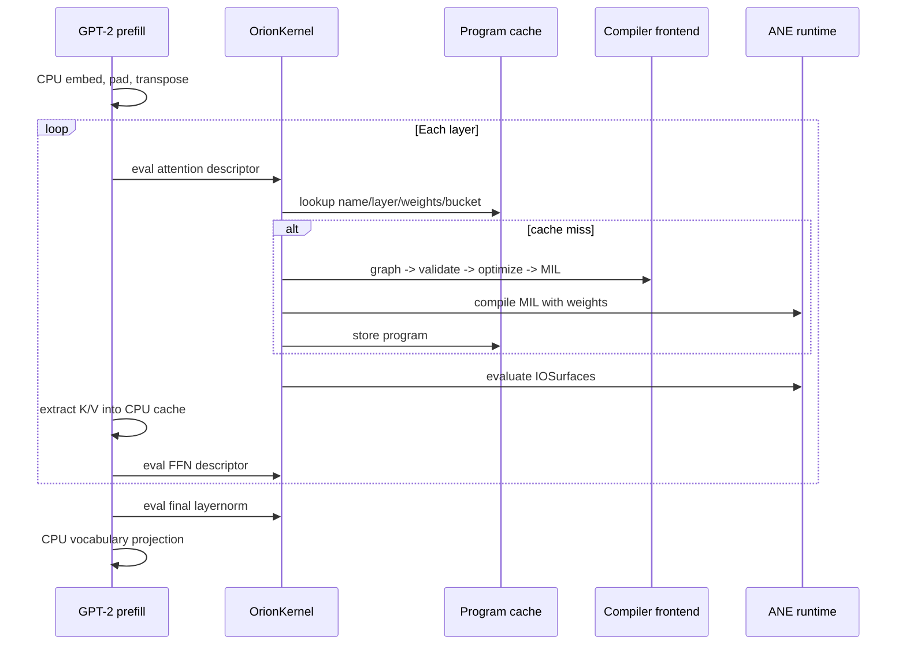
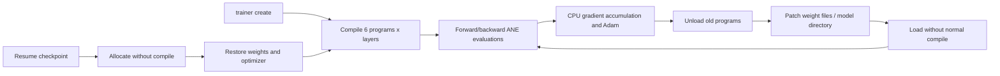
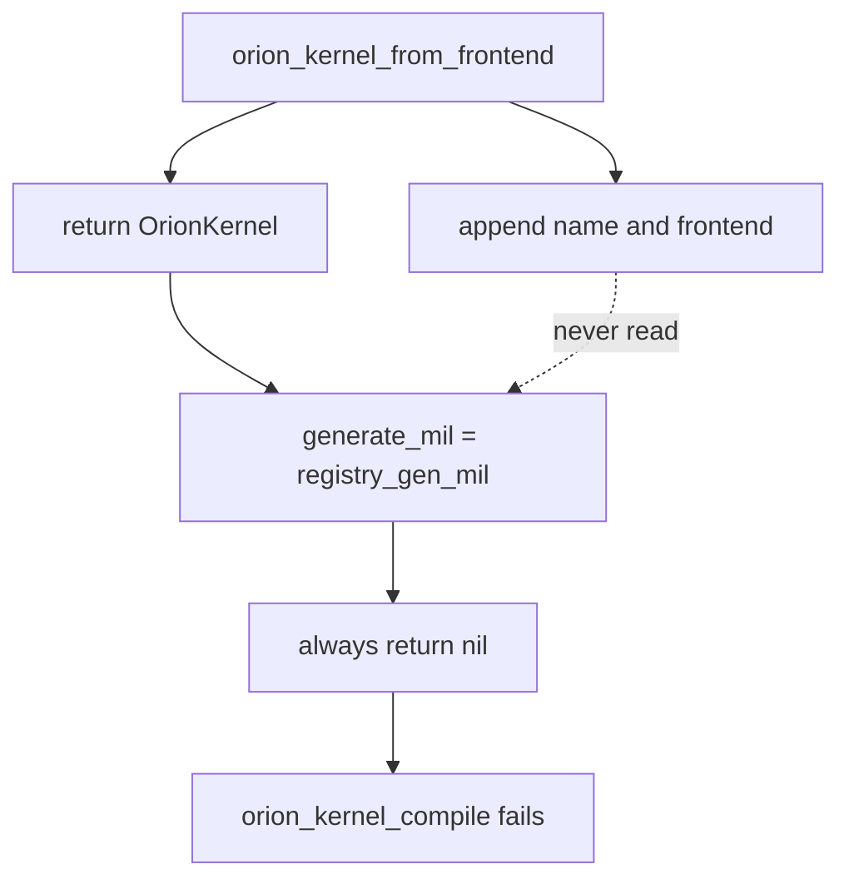

# Module Architecture and Abstractions

## Scope and evidence method

This report maps active module dependencies and runtime flows, then evaluates the intended reusable abstractions against their actual production usage. The review traces CLI calls into inference/training kernels, compiler adapters, program cache, private ANE runtime, tensor storage, registry, and runtime facade. A repository-wide symbol search distinguishes active APIs from code that is merely compiled.

### Evidence-status legend

| Marker | Meaning |
|---|---|
| **[OC] Observed code** | Direct source or symbol-usage evidence. |
| **[LV] Local verification** | Known local build, smoke, or test result supplied for this workspace. |
| **[TE] Test evidence** | Current tests exercise the named component or flow. |
| **[HC] Historical claim** | Prior architectural/performance statement not revalidated here. |

Compiled does not mean active. APIs with definitions but no production call sites are described as dormant, even though they contribute translation units to the executable.

## Current architectural layers

The practical architecture is model-specific orchestration over shared low-level services. GPT-2 inference uses `OrionKernel` descriptors and the global cache; Stories training directly owns six programs per layer and its reload lifecycle. The generic `OrionRuntime` and model registry are compiled but not used by CLI, inference, training, or benchmark production paths. **[OC]** (`kernels/inference/prefill_ane.m:139-159`, `kernels/inference/decode_ane.m:117-130`, `kernels/training/stories_train.m:305-345`; symbol usage in `core/runtime.*` and `core/model_registry.*`)

## Active inference flow

### Prefill

GPT-2 prefill combines CPU embedding/layout work with compiler-generated ANE kernels. Static `OrionKernel` descriptors bind frontend adapters and weight-dictionary builders. `orion_kernel_eval` performs cache lookup, frontend-to-MIL generation on miss, private compilation, cache storage, and evaluation. **[OC]** (`kernels/inference/prefill_ane.m:101-159`, `core/kernel.m:4-49`)

ANE decode likewise uses descriptors for projection and FFN, while CPU code owns token embedding, attention over the KV cache, attention output projection, final normalization, and logits. **[OC]** (`kernels/inference/decode_ane.m:134-287`)

### Shared cache

The program cache key is `(kernel_name, layer_idx, weights_id, bucket)`. An Objective-C wrapper owns each opaque `OrionProgram` and releases it during replacement, eviction, or clear. Access is synchronized. **[OC]** (`core/ane_program_cache.m:4-16`, `core/ane_program_cache.m:18-33`, `core/ane_program_cache.m:43-112`)

This is a useful ownership boundary: callers receive borrowed program pointers and cache entries centralize unload/release. **[OC]**

## Active training flow

Stories training does not use the global cache or `OrionRuntime`. Each `OrionTrainer` owns arrays of six compiled programs, model weights, gradients, Adam state, and IOSurfaces per layer. **[OC]** (`kernels/training/stories_train.m:305-386`, `kernels/training/stories_train.m:501-605`)

The delta API creates or reloads private in-memory models without incrementing the normal compile count. The code explicitly unloads, updates files, then loads. **[OC]** (`core/ane_runtime.m:223-340`, `core/ane_runtime.m:344-385`)

The training allocation layer manually enforces known uniform output IOSurface sizes for multi-output kernels. This constraint is not delegated to the compiler's uniform-output pass. **[OC]** (`kernels/training/stories_train.m:348-385`)

## Abstraction inventory and actual status

| Abstraction | Intended role | Actual usage/status |
|---|---|---|
| `OrionProgram` / ANE runtime functions | Opaque private-model lifecycle and eval | Active everywhere ANE is used **[OC]** |
| `OrionKernel` | Descriptor plus compile/cache/eval | Active in GPT-2 inference; descriptor input/output counts are metadata only **[OC]** (`core/kernel.h:22-63`; `core/kernel.m:37-49`) |
| Program cache | Shared ownership and binding-key reuse | Active in inference and swap benchmark **[OC]** |
| `OrionRuntime` | ANE init, kernel dispatch, compile-budget facade | Dormant: no call sites outside its own declaration/definition **[OC]** (`core/runtime.h:8-43`; `core/runtime.m:6-54`) |
| Model registry | Named model configs/default paths | Dormant: no consumers outside declaration/definition **[OC]** (`core/model_registry.m:4-59`) |
| Compiler direct adapters | Frontend -> validate -> optimize -> MIL | Active in inference, training, tests, and benchmark **[OC]** (`compiler/kernel_adapter.m:18-61`) |
| `orion_kernel_from_frontend` | Generic compiler frontend -> `OrionKernel` constructor | Broken and unused: installs a callback that always returns `nil` **[OC]** (`compiler/kernel_adapter.m:63-90`) |
| Checkpoint API | Persist/restore trainer state | Active in train CLI and tests **[OC][TE]** |
| LoRA adapter | Load adapter tensors for input-based hot swap | Compiled and covered by `test_lora`; not exposed by current CLI **[OC][TE]** (`Makefile:26`, `Makefile:115`) |

### Broken frontend constructor

`orion_kernel_from_frontend` records `(name, frontend)` in a static registry, then returns an `OrionKernel` whose `generate_mil` function is `registry_gen_mil`. That callback ignores all arguments and returns `nil`. `orion_kernel_compile` treats nil MIL as failure. The comments mention thread-local context, but no context exists and the registry is never read. **[OC]** (`compiler/kernel_adapter.m:9-16`, `compiler/kernel_adapter.m:63-90`; `core/kernel.m:13-19`)

Production avoids this defect by writing small static adapter functions and static descriptors directly. **[OC]** (`kernels/inference/prefill_ane.m:101-159`; `kernels/inference/decode_ane.m:93-130`)

### Dormant runtime and registry

`OrionRuntime` wraps ANE initialization and compile-count deltas, but no product path constructs it. Its `clear_cache` resets only the facade's `total_compiles`; the global private runtime's compile count remains unchanged, and `needs_restart` correctly uses that global count. **[OC]** (`core/runtime.m:18-50`)

The model registry duplicates GPT-2 and Stories dimensions and default paths already available through model configuration headers and command defaults. With no consumers, it cannot currently prevent configuration drift or drive generic dispatch. **[OC]** (`core/model_registry.m:4-38`; `apps/cli/commands/infer.m:57-59`; `apps/cli/commands/train.m:139-140`)

## Data and ownership boundaries

- `OrionProgram` manually bridges Objective-C model/temp-directory objects into a C struct and releases both during program destruction. **[OC]** (`core/ane_runtime.m:19-26`, `core/ane_runtime.m:117-126`, `core/ane_runtime.m:187-215`)
- The cache owns stored programs; training owns its program pointers directly. Mixing these ownership models requires care because the same pointer must not be independently released and cached. **[OC]**
- ANE requests wrap caller-owned IOSurfaces for each evaluation. The runtime validates non-null arrays and positive counts but does not know declared names, shapes, allocation uniformity, or ordering. **[OC]** (`core/ane_runtime.m:132-181`)
- Weight dictionaries are assembled in each kernel module. Missing files are generally omitted rather than reported at dictionary-build time, deferring failure or wrong composition to compilation. **[OC]** (`kernels/inference/prefill_ane.m:48-88`; `kernels/inference/decode_ane.m:58-90`)
- The cache key formats `wb->weights_id` and assumes all descriptor/binding pointers are valid; public functions do not guard null bindings. **[OC]** (`core/ane_program_cache.m:43-58`)

## Strengths

- Private API handling is isolated behind a small opaque C API, limiting Objective-C runtime details outside `core/ane_runtime.m`. **[OC]**
- Program ownership is explicit in both cache-managed inference and trainer-owned training paths. **[OC]**
- Compiler frontends are genuinely used by active inference and training rather than existing only as tests. **[OC]**
- Model-specific orchestration makes ANE constraints visible at the points where surfaces are allocated and ordered. **[OC]**
- CPU/ANE partitioning is pragmatic: large or awkward operations remain on CPU while ANE kernels handle suitable blocks. **[OC]**
- The known local run passed all 23 configured suites, including cache, program swap, delta compilation, LoRA, and ANE runtime coverage. **[LV][TE]**

## Limitations

- The reusable "general runtime" story exceeds current implementation: registry and runtime facade are not in the active product flow.
- `OrionKernel.n_inputs` and `n_outputs` are never enforced by `orion_kernel_eval`; callers can pass inconsistent counts directly to the private runtime. **[OC]** (`core/kernel.h:23-29`; `core/kernel.m:37-49`)
- Kernel modules duplicate weight-dictionary loading and adapter boilerplate.
- Model configuration and paths exist in several places rather than one active source of truth.
- Low-level runtime calls cannot enforce alphabetical argument/result ordering or packed/uniform allocation because names and shape metadata are absent from `OrionProgram`.
- Private runtime globals and the cache are process-global, which constrains isolation and parallel test/runtime design.

## Severity-ranked risks

### Critical

1. **The public generic frontend-to-kernel constructor cannot compile any kernel.** Its installed callback always returns `nil`, so adopting the documented abstraction causes deterministic compile-path failure. Existing production paths survive only because they bypass it. **[OC]** (`compiler/kernel_adapter.m:63-90`; `core/kernel.m:13-19`)

### High

2. **Runtime APIs cannot enforce ANE I/O invariants.** Wrong surface order, nonuniform allocations, or unpacked smaller inputs may compile and evaluate with failure or silent wrong data; `orion_eval` only preserves array order. **[OC]** (`core/ane_runtime.m:132-181`; constraints documented at `docs/ane_constraints.md:19-37`, `docs/ane_constraints.md:152-184`)
3. **Missing weight files are silently omitted from dictionaries.** The helper adds only successfully loaded `NSData`, without surfacing the missing path. This moves diagnosis away from the actual fault and can produce incomplete compile inputs. **[OC]** (`kernels/inference/prefill_ane.m:48-52`; `kernels/inference/decode_ane.m:58-63`)

### Medium

4. **Dormant abstractions can drift while still appearing complete.** `OrionRuntime` and model registry compile, but no product execution or focused usage protects their contracts. **[OC]**
5. **Descriptor I/O counts are unenforced.** The abstraction advertises expected counts but passes caller counts through unchanged. **[OC]**
6. **Model configuration is duplicated.** Registry structs, fixed model headers, CLI defaults, and kernel assumptions can diverge without a compiler error. **[OC]**
7. **Delta patching selects the first dictionary blob as a special `data` file.** Objective-C dictionary enumeration order is not an expressive mapping contract; multi-weight correctness depends on private model-directory semantics that are not represented in the API. **[OC]** (`core/ane_runtime.m:274-309`)

### Low

8. **Global cache and compile counters complicate multiple-runtime semantics.** Creating more than one `OrionRuntime` does not create isolated state. **[OC]**
9. **The registry has a fixed two-model static table and no extension mechanism.** This is acceptable today because it is unused, but does not yet support the generalized architecture claimed in older prose. **[OC]**

## Recommendations

1. Remove or fix `orion_kernel_from_frontend` before any consumer adopts it. The smallest correct fix is to change `OrionKernel` so generation receives descriptor context, rather than relying on a global registry or nonexistent thread-local context.
2. Decide explicitly whether `OrionRuntime` and model registry will become the product path. If yes, route one command through them and add focused tests; if no, remove them from architectural claims and consider deleting the dead facade.
3. Enforce `kernel->n_inputs` and `kernel->n_outputs` in `orion_kernel_eval` before private API dispatch.
4. Extend compiled program metadata with sorted input/output names and declared sizes, then centralize order and uniform-allocation validation where feasible.
5. Make weight-dictionary builders fail with the exact missing file path instead of silently omitting entries.
6. Consolidate model dimensions/default paths behind the configuration actually used by CLI and kernels; avoid maintaining an inactive duplicate registry.
7. Replace implicit "first blob" delta behavior with an explicit primary-data mapping and test multi-blob patch semantics directly.

## Bottom line

Orion has effective shared low-level services and active compiler-backed model paths, but it is not currently a generic registry-driven runtime. The robust architecture is the concrete GPT-2/Stories orchestration plus ANE runtime/cache; the generic `OrionRuntime` and model registry are dormant, and `orion_kernel_from_frontend` is unusable as implemented. **[OC][LV]**
