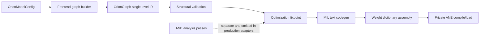
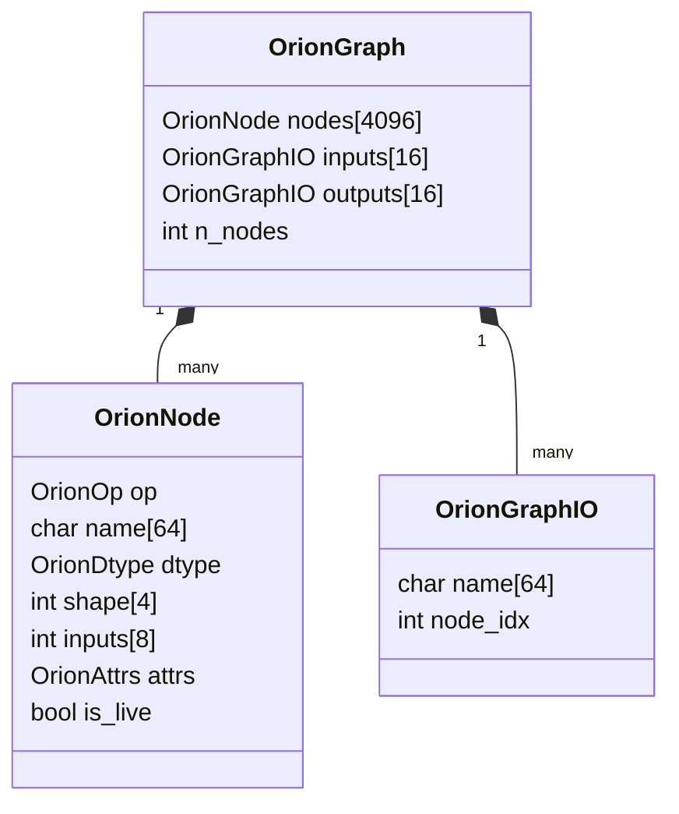
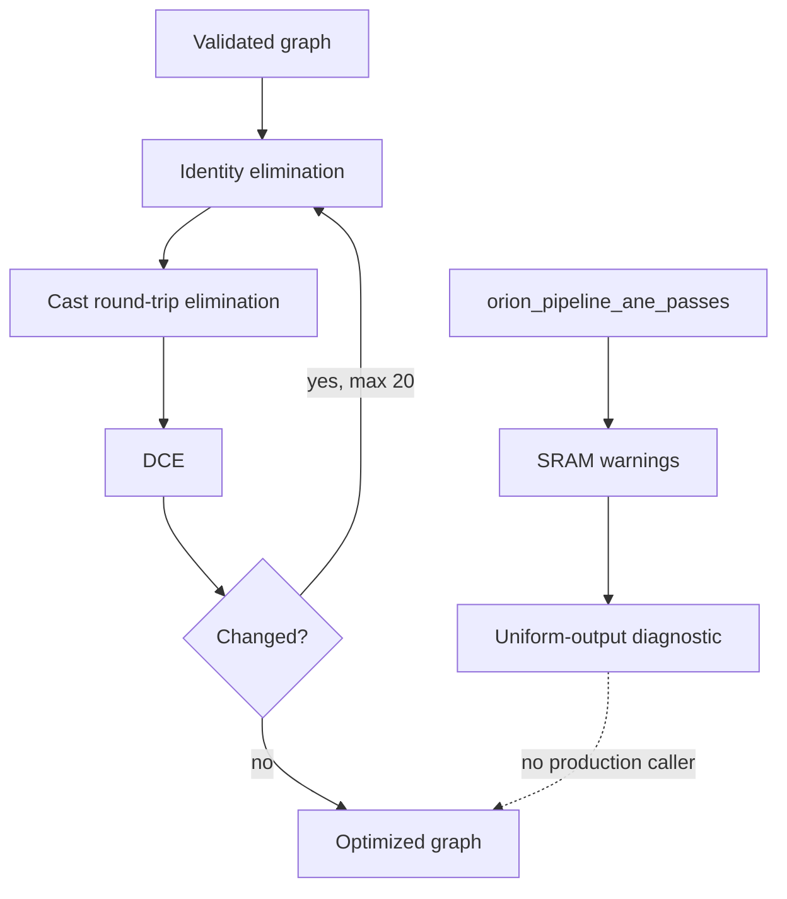

# Compiler IR, Frontends, and Passes

## Scope and evidence method

This report reviews the active compiler from graph representation through frontend construction, structural validation, optimization, ANE-specific analysis, MIL emission, adapters, and tests. Source inspection covers every active compiler source group listed by the Makefile, with detailed tracing of validation/pass/codegen interactions and production call sites.

### Evidence-status legend

| Marker | Meaning |
|---|---|
| **[OC] Observed code** | Directly established from current compiler or consumer source. |
| **[LV] Local verification** | Known local build/test/smoke result supplied for this workspace. |
| **[TE] Test evidence** | Current test assertions or exercised compiler paths. |
| **[HC] Historical claim** | Older prose, counts, or benchmarks not established as current by this review. |

Passing compiler tests are not treated as dynamic reproduction of every static risk. In particular, unsupported-op, output-alias, post-pass-validation, and production-pass omissions below are source findings.

## Compiler architecture

The active compiler contains 22 translation units: 19 C sources and 3 Objective-C sources. Six frontend source files build GPT-2 prefill/decode/final, classifier/softmax, Stories training, and LoRA graphs. **[OC]** (`Makefile:50-75`)

The production direct adapters implement `frontend -> orion_graph_validate -> orion_pipeline_optimize -> orion_codegen_mil`. They do not run ANE-specific passes or validation, and they do not revalidate after optimization. **[OC]** (`compiler/kernel_adapter.m:18-61`)

## IR design

`OrionGraph` is a fixed-capacity, single-level DAG with up to 4096 nodes and 16 named graph inputs/outputs. Nodes carry an enum opcode, fixed name buffer, dtype, four-dimensional shape, up to eight input indices, a union-like attribute struct, and liveness/output flags. **[OC]** (`compiler/graph.h:11-17`, `compiler/graph.h:59-111`)

The operation enum has 28 entries including input and const. It intentionally marks concat as banned and also exposes `SPLIT` and `PAD`. **[OC]** (`compiler/graph.h:18-48`)

Builder functions infer many output shapes and dtypes from operands, while frontends supply explicit output shapes for matmul, reshape, reductions, and slices. Composite builders decompose layer normalization, GELU, SiLU, RMS normalization, and linear layers into supported primitives. **[OC]** (`compiler/builder.c:61-223`, `compiler/builder.c:225-425`)

Important ANE-aware construction choices include:

- Linear layers use convolution and emit bias as a separate add, avoiding unsupported `conv(bias=...)`. **[OC]** (`compiler/builder.c:396-425`; `compiler/codegen.m:57-77`)
- Weight references use BLOBFILE offset 64. **[OC]** (`compiler/builder.c:401-410`)
- GELU and SiLU are decomposed rather than emitted as monolithic ops. **[OC]** (`compiler/builder.c:285-345`)
- Attention frontends use explicit patterns rather than relying on masked SDPA. **[OC]** (`compiler/frontends/gpt2_prefill.c:48-59`)

## Frontends and active model coverage

| Frontend family | Graphs represented | Active consumers |
|---|---|---|
| GPT-2 prefill | Attention and FFN, plus final layer normalization | Inference, benchmark, tests **[OC]** |
| GPT-2 decode | Q/K/V projection and FFN | Inference, benchmark, tests **[OC]** |
| Classifier/softmax | Classifier forward and vocabulary softmax | Compiler tests; not current CLI inference path **[OC]** |
| Stories training | Forward attention/FFN and four backward kernels | Trainer and tests **[OC]** |
| LoRA | Adapter-as-input graph construction | LoRA support/tests; no CLI command **[OC][TE]** |

For example, GPT-2 prefill creates an fp32 input, casts to fp16, constructs layer normalization and Q/K/V projections, applies explicit causal attention, projects/residual-adds, casts hidden/K/V outputs to fp32, and registers three outputs. **[OC]** (`compiler/frontends/gpt2_prefill.c:8-71`)

Stories training frontends expose intermediate tensors as multiple outputs for backward reuse. The trainer manually allocates all corresponding outputs to uniform maximum sizes. **[OC]** (`compiler/frontends/stories_train.h:8-30`; `kernels/training/stories_train.m:348-385`)

## Validation model

Structural validation currently checks:

- Non-null, nonempty graph with at least one output.
- Names on live nodes.
- Rejection of `ORION_OP_CONCAT_BANNED`.
- In-range, live input references.
- In-range, live output references.
- Absence of cycles through topological sort.

**[OC]** (`compiler/validate.c:29-79`)

It does not check op-specific arity, input-node membership, duplicate names, graph I/O alias uniqueness, shape positivity/compatibility, dtype compatibility, output-name-to-node-name identity, maximum counters corrupted by external construction, BLOBFILE offset policy, or whether codegen supports the opcode. **[OC]**

Topological sort correctly counts repeated input edges separately, so `add(x, x)` does not create a false cycle. **[OC]** (`compiler/topo.c:13-24`, `compiler/topo.c:41-55`)

## Optimization and ANE pass pipeline

The standard optimizer iterates identity elimination, cast elimination, and dead-code elimination to a fixpoint capped at 20 iterations. Conv-bias fusion is intentionally disabled because ANE does not support bias on conv. **[OC]** (`compiler/pipeline.c:12-27`)

### Identity elimination

Identity ops, same-dtype casts, same-shape reshapes, and identity transposes are bypassed by rewriting node and graph-output indices, then marking the old node dead. **[OC]** (`compiler/pass_identity.c:29-86`)

The rewrite preserves graph output aliases rather than node names. This matters because codegen emits the referenced node's name, while ANE validation checks the alias stored in `graph->outputs[i].name`. **[OC]** (`compiler/pass_identity.c:17-22`; `compiler/codegen.m:280-286`; `compiler/pass_ane_validate.c:76-84`)

### Cast elimination

The cast pass removes any adjacent cast pair where the original input dtype equals the final target dtype. **[OC]** (`compiler/pass_cast.c:22-50`)

This is unsound for narrowing/widening round trips such as `fp32 -> fp16 -> fp32`: the intermediate fp16 conversion loses precision, but bypassing both casts restores the original fp32 values. The implementation does not distinguish lossless and lossy conversions. The current unit test covers `fp16 -> fp32 -> fp16`, which does not expose this direction. **[OC][TE]** (`compiler/pass_cast.c:35-46`; `tests/test_passes.m:77-91`)

### DCE

DCE recursively marks dependencies reachable from graph output indices and marks all other live nodes dead. **[OC]** (`compiler/pass_dce.c:6-38`)

### ANE-specific passes

`orion_pipeline_ane_passes` runs SRAM estimation and a uniform-output diagnostic. The latter only prints and returns whether padding is needed; it does not alter graph shapes or allocate surfaces. ANE constraint validation is a separate function and is not called by that pipeline. **[OC]** (`compiler/pipeline.c:29-34`; `compiler/pass_uniform_outputs.c:17-34`)

Repository-wide usage shows ANE passes and `orion_pass_ane_validate` are called only by their compiler tests, not by production adapters, inference, training, or benchmark compilation. **[OC]**

## MIL code generation

Codegen obtains a topological order, emits a hard-coded MIL 1.3/iOS 18 header, writes function inputs in graph registration order, emits each supported live node, and returns referenced node variable names in graph-output order. **[OC]** (`compiler/codegen.m:243-290`)

Strong ANE-specific details include named boolean constants for matmul transpose flags, separate bias add, decomposition-friendly primitive emission, BLOBFILE references, and explicit cast dtype constants. **[OC]** (`compiler/codegen.m:18-77`, `compiler/codegen.m:115-146`)

However, `ORION_OP_SPLIT` and `ORION_OP_PAD` have no emission cases. They fall into the default branch, which writes only an `// UNSUPPORTED OP` comment. Structural validation permits both. If such a node is an output or feeds another live node, generated MIL references an undefined variable. **[OC]** (`compiler/graph.h:43-44`; `compiler/codegen.m:230-240`)

### Output aliases and ordering

`orion_gb_output(g, node, name)` stores a graph-output alias independently of the node's actual MIL variable name. Codegen ignores the alias and returns the node name. ANE validation checks alphabetical order of aliases, not emitted node names. Therefore a graph can pass output-order validation while supplying a different actual variable ordering to ANE. Duplicate aliases and multiple aliases of one node are also accepted. **[OC]** (`compiler/builder.c:215-223`; `compiler/pass_ane_validate.c:76-84`; `compiler/codegen.m:280-286`)

Input ordering has the same hardware sensitivity, but ANE validation contains no alphabetical input check. Codegen preserves insertion order. **[OC]** (`compiler/codegen.m:263-273`; compare constraints in `docs/ane_constraints.md:164-172`)

## Testing and verification

Four compiler test binaries cover graph IR, generic passes, ANE passes, and structural frontend/codegen equivalence. **[OC]** (`Makefile:117-122`)

- `test_passes` verifies DCE, same-cast/identity elimination, one cast round trip, and fixpoint termination. **[TE]** (`tests/test_passes.m:30-140`)
- `test_ane_passes` verifies per-node SRAM sizing, uniform-output detection, concat rejection, a nominal graph, and small-tensor rejection. **[TE]** (`tests/test_ane_passes.m:18-149`)
- `test_compiler_equiv` describes itself as structural, checks for operation/name/path substrings, and explicitly states that full numerical equivalence requires ANE and weights. **[TE]** (`tests/test_compiler_equiv.m:1-5`, `tests/test_compiler_equiv.m:78-253`)
- Active inference and training tests also traverse compiler adapters into generated MIL. **[TE]**

Known local verification: `make` succeeded, `make test` passed 23/23 after ignored assets/data were generated, and deterministic CPU/ANE 8-token smoke output matched. **[LV]** This supports the current frontend graphs used by those paths, but does not dynamically prove the static edge cases above.

## Strengths

- The IR is compact, inspectable, and implemented in pure C; Objective-C is confined to string-heavy codegen/adaptation. **[OC]**
- Active frontends replace hand-authored MIL in inference and training paths rather than serving only as examples. **[OC]**
- Composite builders encode several hard-won ANE constraints at construction time: no concat, decomposed activations/attention, offset 64, and separate conv bias. **[OC]**
- Topological ordering and DCE operate over explicit index edges and handle repeated edges. **[OC]**
- The fixpoint has a termination bound. **[OC]**
- Compiler tests are separable from the full runtime, while integration tests exercise generated programs on supported local hardware. **[TE][LV]**

## Limitations

- Shape and dtype inference is trust-based; malformed external graph construction can survive validation into codegen.
- "ANE passes" mostly diagnose rather than transform, and are omitted from production compilation.
- Output/input name ordering is split across aliases, node names, caller arrays, and hardware behavior without one canonical contract.
- The op enum advertises operations that codegen cannot emit.
- Structural equivalence tests use substring presence, not parsed MIL semantics or a reference interpreter.
- SRAM analysis checks each tensor against a fixed 32 MB threshold, not simultaneous liveness or actual device-specific SRAM behavior. **[OC]** (`compiler/pass_sram.c:24-41`)
- Codegen build metadata is hard-coded to specific tool versions and iOS 18 syntax. **[OC]** (`compiler/codegen.m:253-264`)

## Severity-ranked risks

### Critical

1. **Lossy cast round trips can be incorrectly eliminated.** `fp32 -> fp16 -> fp32` is not semantically equal to identity, yet the pass removes it whenever first and final dtypes match. This can silently alter model numerics. **[OC]** (`compiler/pass_cast.c:35-46`)
2. **Output alias validation does not validate emitted output ordering.** ANE returns outputs alphabetically by MIL variable name, but the validator sorts/checks independent graph aliases while codegen emits node names. A passing graph can therefore bind output surfaces incorrectly and silently corrupt results. **[OC]** (`compiler/builder.c:215-223`; `compiler/pass_ane_validate.c:76-84`; `compiler/codegen.m:280-286`)

### High

3. **`SPLIT` and `PAD` are accepted IR ops but unsupported by codegen.** The result is a comment instead of an emitted definition, with no validation failure. **[OC]** (`compiler/graph.h:43-44`; `compiler/codegen.m:237-239`)
4. **There is no validation after mutation.** Frontends are validated before optimization, then passes rewrite outputs and liveness immediately before codegen. Any pass defect or invalid post-pass alias/reference state bypasses structural checking. **[OC]** (`compiler/kernel_adapter.m:26-40`, `compiler/kernel_adapter.m:50-59`)
5. **Production omits ANE-specific passes and validation.** `orion_pipeline_ane_passes` and `orion_pass_ane_validate` have no production call sites, so tested constraints do not gate emitted programs. **[OC]**
6. **Alphabetical input ordering is not validated or canonicalized.** Multi-input graph registration order becomes MIL signature order, while runtime correctness requires alphabetical parameter-to-surface mapping. **[OC]** (`compiler/codegen.m:263-273`; `docs/ane_constraints.md:164-172`)

### Medium

7. **Validation lacks op contracts, shape/dtype checks, and duplicate-name detection.** Invalid MIL or silent shape assumptions can reach private compilation with weak diagnostics. **[OC]** (`compiler/validate.c:29-79`)
8. **Uniform-output pass does not perform padding.** Its name implies a transformation, but callers must independently allocate correct surfaces; production currently does so manually for training. **[OC]** (`compiler/pass_uniform_outputs.c:17-34`; `kernels/training/stories_train.m:355-385`)
9. **ANE minimum-size validation applies a blanket per-compute-node rule.** The documented hardware issue concerns IOSurface evaluation allocation, while internal tensors may legitimately be smaller; the current check can reject graphs without modeling actual external allocation. It is currently test-only, masking this design mismatch. **[OC]** (`compiler/pass_ane_validate.c:49-56`)
10. **Compiler equivalence tests are structural substring checks.** They can miss wrong attributes, ordering, shapes, dtype changes, and numerical regressions. **[TE]** (`tests/test_compiler_equiv.m:78-253`)

### Low

11. **Graph output `is_output` flags can become stale after rewrites.** DCE/codegen use graph output indices, so current behavior mostly survives, but debug/introspection can disagree. **[OC]** (`compiler/pass_identity.c:17-22`; `compiler/pass_cast.c:15-19`)
12. **Fixed capacities fail through return values that frontends do not consistently check.** Very large future graphs could propagate `-1` indices before validation. **[OC]** (`compiler/graph.c:13-19`; builder call patterns)

## Recommendations

1. Restrict cast-pair elimination to proven lossless compositions. At minimum, do not eliminate when the intermediate dtype has lower precision or range than the original.
2. Make graph output names canonical MIL variable names, or emit explicit identity aliases. Validate and sort using exactly the names codegen emits; reject duplicates. Apply the same canonicalization to inputs and expose sorted runtime binding metadata.
3. Reject every opcode without a complete codegen implementation. Remove `SPLIT`/`PAD` from the public enum until implemented, or add explicit validation errors and tests.
4. Run structural validation both before and after optimization. Post-pass validation should include live references, op arity, unique names, shapes, dtypes, and codegen support.
5. Integrate ANE validation into the production adapter after optimization, with checks that model external I/O rather than blanket internal tensor assumptions.
6. Rename diagnostic passes (`report_sram_risk`, `report_uniform_output_requirement`) unless they become real transformations. Return structured metadata for surface allocation rather than relying on stderr.
7. Add negative tests for lossy casts, alias/node-name disagreement, duplicate names, unordered inputs, unsupported ops, malformed op arity, and invalid post-pass graphs.
8. Strengthen equivalence testing with parsed MIL normalization and numerical tests on small reference graphs; keep hardware-specific ANE tests separately labeled.
9. Move hard-coded MIL build metadata behind one versioned target profile and verify it against the host private compiler during supported-platform testing.

## Bottom line

The compiler is active, compact, and captures important ANE-specific construction knowledge. Its largest correctness gap is not frontend coverage but enforcement between stages: validation is shallow and pre-pass only, output aliases diverge from emitted names, unsupported enum ops reach codegen, ANE checks are test-only, and cast elimination can change numerics. These should be addressed before treating arbitrary external graphs as safe compiler inputs. **[OC][LV]**
