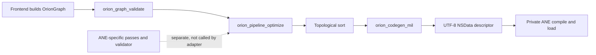
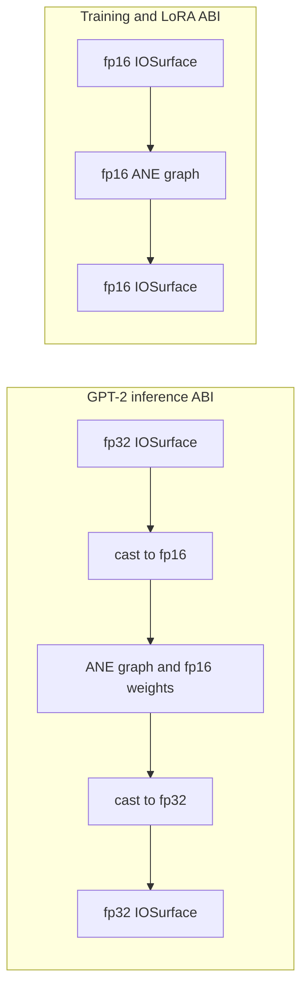
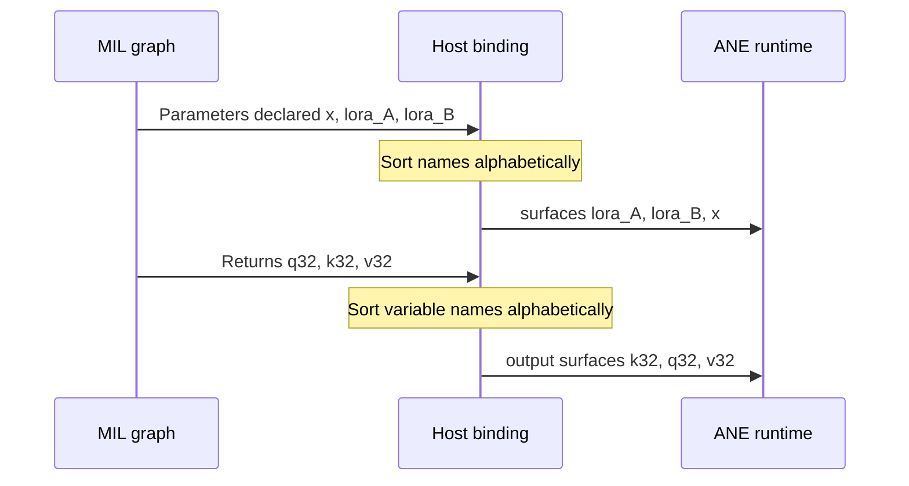
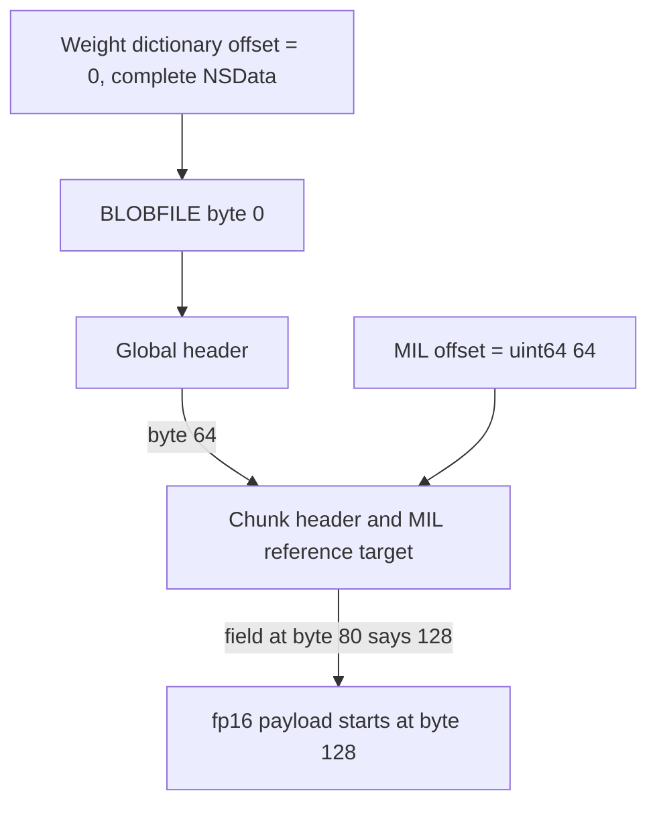

# MIL Code Generation and the ANE ABI

## Scope and method

This report traces the active compiler path from graph frontends through MIL text generation and into the IOSurface ABI. The review covered `compiler/graph.*`, `compiler/builder.*`, `compiler/patterns.*`, `compiler/pipeline.*`, `compiler/pass_ane_validate.*`, `compiler/pass_uniform_outputs.*`, `compiler/codegen.m`, `compiler/kernel_adapter.m`, representative GPT-2, Stories, and LoRA frontends, `core/ane_runtime.m`, `core/iosurface_tensor.m`, and relevant tests. Retired generators under `archive/` were excluded.

References are repository-relative and line ranges describe the reviewed tree. The local verification statements below are supplied results from this workspace; this report did not rerun benchmarks and makes no new performance claim.

## Evidence-status legend

| Status | Meaning in this report |
|---|---|
| **Observed code** | Directly established by the referenced active source. |
| **Local verification** | Supplied result from this checkout and host: `make` succeeded; deterministic CPU and ANE eight-token smoke runs both produced `The meaning of life is not the same as the meaning of death`; `make test` passed 23/23 after ignored assets were generated. |
| **Test evidence** | Behavior asserted by a checked-in test; stronger than a comment, but dependent on that test's fixtures, assertions, and platform. |
| **Historical claim** | Repository prose or comments describing prior experiments. It is not treated as a measurement made for this report. |

## Compiler control flow

The active adapter constructs a graph, runs structural validation, applies the generic optimization loop, emits MIL, and frees the graph (`compiler/kernel_adapter.m:20-40`, `compiler/kernel_adapter.m:44-60`). The generic loop removes identities, selected casts, and dead nodes; convolution bias fusion is deliberately disabled (`compiler/pipeline.c:14-27`). ANE SRAM and output-uniformity passes exist in a separate entry point (`compiler/pipeline.c:29-34`), but the adapter does not call that entry point or `orion_pass_ane_validate`. Consequently, the active frontend-to-MIL path relies substantially on frontend discipline.

`orion_codegen_mil` emits a fixed MIL 1.3/build-info header, preserves graph input order in the function signature, emits live nodes in topological order, and preserves graph output order in the return tuple (`compiler/codegen.m:243-290`). Constants with a blob path become typed `BLOBFILE` references using the offset held in the graph (`compiler/codegen.m:18-25`). Casts receive explicit dtype constants (`compiler/codegen.m:137-146`), and convolution bias remains a separate add because ANE does not accept `bias=` on `conv` (`compiler/codegen.m:57-77`, `compiler/pipeline.c:21-23`).

The GPT-2 frontends make precision boundaries explicit. Prefill accepts fp32 `x`, casts to fp16, performs the layer, and casts hidden/K/V outputs back to fp32 (`compiler/frontends/gpt2_prefill.c:15-20`, `compiler/frontends/gpt2_prefill.c:61-69`). Decode does the same for its external input and Q/K/V or hidden outputs (`compiler/frontends/gpt2_decode.c:13-16`, `compiler/frontends/gpt2_decode.c:41-49`, `compiler/frontends/gpt2_decode.c:60-86`). By contrast, LoRA adapter inputs and Stories training interfaces are fp16 (`compiler/frontends/lora.c:80-107`, `compiler/frontends/lora.c:136-170`, `compiler/frontends/stories_train.h:7-29`). It is therefore incorrect to state that all external ANE I/O is fp16: GPT-2 inference uses fp32 external IOSurfaces with internal casts, while training and LoRA paths use fp16 external surfaces.

## ABI data flow and invariants

### Name-based multi-I/O mapping

The private ANE request receives positional arrays and integer indices; `orion_eval` does not attach MIL names (`core/ane_runtime.m:132-181`). Empirically, the required position is the alphabetical order of MIL parameter names for inputs and MIL variable names for outputs, not declaration or return-tuple order (`docs/ane_constraints.md:29-37`, `docs/ane_constraints.md:164-172`). LoRA's test supplies `{lora_A, lora_B, x}` even though the frontend declares `x` first (`tests/test_lora.m:127-151`). Decode supplies outputs according to the sorted runtime order; the frontend comment and insertion order disagree at `compiler/frontends/gpt2_decode.c:46-49`, demonstrating why return order must not be used as the ABI contract.

The compiler validator catches non-alphabetical graph outputs (`compiler/pass_ane_validate.c:76-85`) but does not check inputs. More importantly, the normal adapter does not invoke it. Codegen itself neither sorts nor emits binding metadata (`compiler/codegen.m:263-285`). Correctness is thus distributed between frontend naming and each caller's surface-array construction.

### Equal allocation bytes and packed prefix

For multi-input or multi-output evaluation, all surfaces in the respective group must have equal allocation bytes. Smaller MIL-declared tensors occupy a packed prefix of the oversized flat surface; they are not written with the larger surface's conceptual row stride (`docs/ane_constraints.md:19-25`, `docs/ane_constraints.md:152-184`). The LoRA test demonstrates both rules by allocating rank-16 A/B inputs at the full sequence allocation and writing only `dim * rank` contiguous fp16 values at offset zero (`tests/test_lora.m:132-143`).

`orion_pass_uniform_outputs` only diagnoses differing output channel counts and returns a flag; it does not transform the graph or allocate surfaces (`compiler/pass_uniform_outputs.c:6-34`). `orion_tensor_create` and `orion_tensor_create_f32` allocate exact `C * S * element_size` flat buffers (`core/iosurface_tensor.m:10-45`). Callers must therefore choose a common maximum allocation and still write each declared tensor as a packed prefix. The raw and conversion writes do not compare requested bytes/count against `IOSurfaceGetAllocSize` (`core/iosurface_tensor.m:48-105`).

### BLOBFILE offset and descriptor contract

A blob file has a 128-byte file header, but the MIL reference must point to the chunk header at byte 64. GPT-2 frontends consistently pass `64` to `orion_gb_const_weight` (`compiler/frontends/gpt2_prefill.c:25-30`, `compiler/frontends/gpt2_decode.c:18-24`), and codegen emits that value literally (`compiler/codegen.m:18-25`). The weight dictionary entry itself conventionally uses offset zero; the complete `NSData` includes the header (`tests/test_delta_compile.m:35-45`, `tests/test_delta_compile.m:115-119`). Confusing the 128-byte payload start with the MIL offset silently selects the wrong data.

The runtime passes MIL as UTF-8 bytes in `NSData` and replaces a nil weight dictionary with `@{}` (`core/ane_runtime.m:51-65`), satisfying two private-API requirements. Weight files and `model.mil` are materialized before compile (`core/ane_runtime.m:73-100`).

## Evidence summary

| Finding | Status | Evidence |
|---|---|---|
| Active graph-to-MIL path validates structure, optimizes, and emits topologically. | **Observed code** | `compiler/kernel_adapter.m:20-60`; `compiler/codegen.m:243-290` |
| Active adapter omits ANE-specific validation/passes. | **Observed code** | `compiler/kernel_adapter.m:26-38`; `compiler/pipeline.c:29-34` |
| GPT-2 external ANE tensors are fp32 around internal fp16 computation. | **Observed code** | `compiler/frontends/gpt2_prefill.c:15-20,61-69`; `compiler/frontends/gpt2_decode.c:13-16,41-49` |
| LoRA/training external paths use fp16. | **Observed code** | `compiler/frontends/lora.c:85-107,145-170`; `compiler/frontends/stories_train.h:7-29` |
| Alphabetical multi-I/O mapping, equal allocation, and packed-prefix behavior work on ANE. | **Test evidence** | `tests/test_lora.m:127-151`; repository constraint record `docs/ane_constraints.md:152-184` |
| ANE pass tests cover concat, minimum tensors, and uniform-output diagnosis. | **Test evidence** | `tests/test_ane_passes.m:56-149` |
| Build, complete configured suite, and CPU/ANE deterministic smoke succeeded on the local supported host. | **Local verification** | Supplied results; suite membership is `Makefile:96-125` |
| Unsupported ops and private-ABI constraints were discovered in earlier experiments. | **Historical claim** | `docs/ane_constraints.md:9-205`; no new benchmark was run for this report |

## Strengths

- Precision is represented in graph nodes and MIL types rather than hidden in runtime convention (`compiler/graph.h:52-77`, `compiler/codegen.m:7-10`).
- Unsupported convolution bias and GELU behavior is handled by decomposition instead of optimistic code emission (`compiler/codegen.m:57-77`, `compiler/patterns.c:1-150`).
- GPT-2 explicitly bridges fp32 host interoperability to fp16 ANE computation, while fp16-native training/LoRA avoids unnecessary external casts.
- BLOBFILE paths and offsets are first-class graph attributes, producing inspectable MIL (`compiler/builder.c:37-42`, `compiler/codegen.m:18-25`).
- Focused compiler tests cover graph IR, passes, codegen equivalence, and several ANE constraints (`Makefile:117-125`, `tests/test_ane_passes.m:18-149`).

## Limitations

- ABI ordering is not modeled as binding metadata. Names, caller array positions, and comments must remain synchronized manually.
- ANE validation is neither comprehensive nor in the active adapter path. It checks output ordering but not input ordering, equal input allocation, packed-prefix writes, BLOBFILE offset 64, or external surface dtype.
- Uniform-output handling reports a requirement but does not produce an allocation plan. Mixed dtype or sequence dimensions are not reduced to exact allocation bytes.
- `orion_tensor_write*`, `read*`, and region-copy helpers trust caller sizes and offsets, so an ABI mistake can become memory corruption before ANE reports an error.
- Private-framework behavior is platform/version sensitive. Passing compiler-only tests cannot prove numerical correctness on ANE.

## Severity-ranked risks

| Severity | Risk | Failure mode | Evidence |
|---|---|---|---|
| Critical | Multi-I/O arrays drift from alphabetical MIL-name order. | Valid evaluation with silently swapped tensors and incorrect numerical results. | `core/ane_runtime.m:141-168`; `docs/ane_constraints.md:29-37,164-172` |
| Critical | Surface allocations differ or smaller tensors are stride-padded instead of prefix-packed. | Eval status failure or silent wrong values. | `docs/ane_constraints.md:19-25,152-184`; `tests/test_lora.m:132-151` |
| Critical | BLOBFILE MIL offset changes from 64. | Weight data is read from the wrong location without a reliable error. | `compiler/codegen.m:18-25`; `docs/ane_constraints.md:87-99` |
| High | Active adapter bypasses ANE validation. | Invalid graphs reach private compilation/evaluation despite an available validator. | `compiler/kernel_adapter.m:20-40`; `compiler/pipeline.c:29-34` |
| High | fp16 is assumed for every external surface. | GPT-2 fp32 buffers are allocated/written at half size or interpreted with the wrong dtype. | `compiler/frontends/gpt2_prefill.c:15-20,61-69`; `core/iosurface_tensor.m:10-45` |
| High | Tensor helper count/offset exceeds allocation. | Host-side out-of-bounds `memcpy` or NEON write. | `core/iosurface_tensor.m:48-157` |
| Medium | Output-uniformity pass compares channels rather than exact bytes. | Future mixed dtype/shape outputs can pass an incomplete check. | `compiler/pass_uniform_outputs.c:6-33` |
| Medium | Fixed MIL build-info/private API contract changes across macOS releases. | Compile or load failure after OS/toolchain update. | `compiler/codegen.m:253-264`; `core/ane_runtime.m:30-46` |

## Recommendations

1. Make a compiled binding plan the single output of codegen: sorted input/output names, declared dtype/shape, and exact common allocation bytes. Require runtime callers to bind by name through that plan rather than hand-order arrays.
2. Invoke `orion_pipeline_ane_passes` and `orion_pass_ane_validate` in `orion_kernel_adapter_generate_mil*`, failing before codegen on hard ABI violations. Extend validation to alphabetical inputs, exact byte uniformity, and BLOBFILE offset 64.
3. Add checked IOSurface helpers that reject writes, reads, and region copies beyond `IOSurfaceGetAllocSize`; provide an explicit packed-prefix API for oversized multi-I/O surfaces.
4. Add compile-time tests that intentionally scramble input declaration/output return order and assert the generated binding plan sorts names without changing mathematical identity.
5. Document dtype per kernel interface. Keep the rule precise: GPT-2 inference external I/O is fp32 with internal fp16 casts; current Stories training and LoRA adapter I/O is fp16.
6. Retain ANE numerical tests for ordering, uniform allocation, and packed-prefix behavior, because compiler-text tests alone cannot establish the private runtime ABI.
