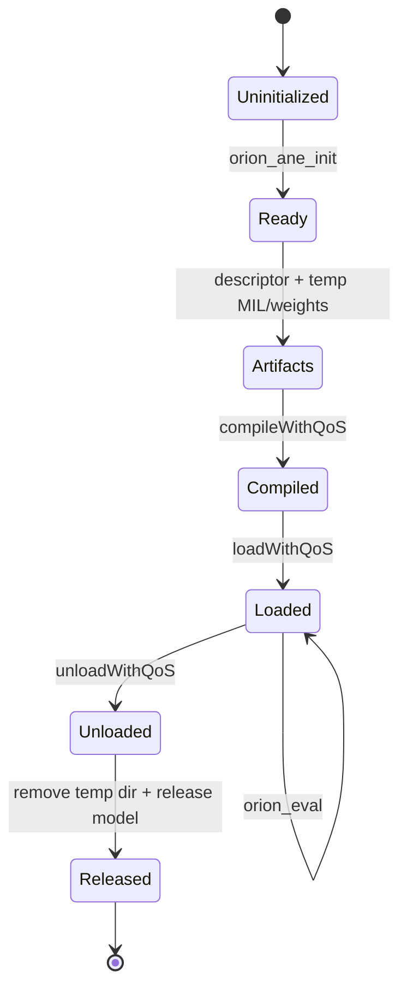
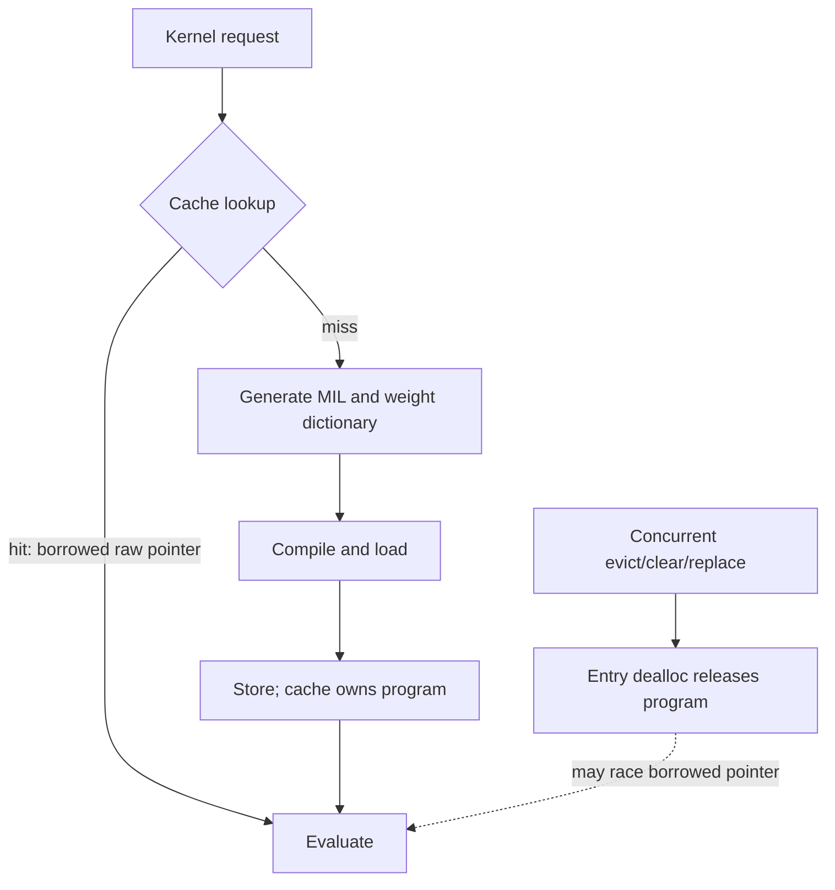
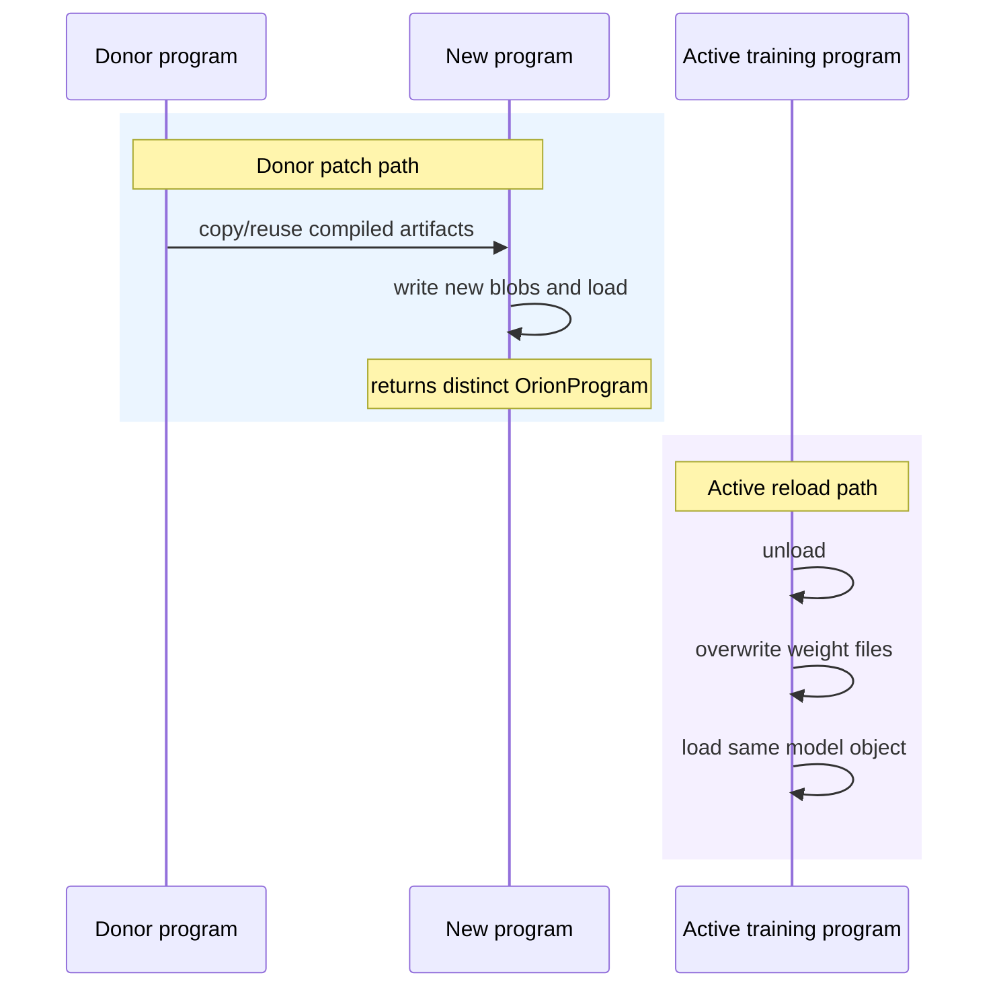
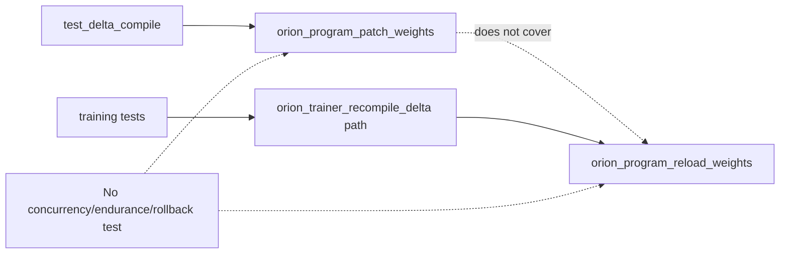

# ANE Runtime, Cache, and Program Lifecycle

## Scope and method

This report reviews initialization, compile/load/evaluate/unload, temporary artifacts, program caching, compile-budget accounting, donor-based patching, active-program weight reload, and training integration. Primary sources are `core/ane_runtime.m`, `core/ane_program_cache.m`, `core/kernel.m`, `core/runtime.m`, `kernels/training/stories_train.m`, and focused runtime/cache/delta tests. Private-framework behavior recorded only in prose is labeled historical.

The supplied local results establish build and smoke viability on this host, not concurrency, endurance, cache-capacity, or performance characteristics. No historical timing printed by tests or comments is presented as a new measurement.

## Evidence-status legend

| Status | Meaning in this report |
|---|---|
| **Observed code** | Direct inspection of active implementation. |
| **Local verification** | Supplied result: `make` succeeded; CPU and ANE deterministic eight-token smoke produced the same sentence; `make test` passed 23/23 after ignored assets were generated. |
| **Test evidence** | Checked-in executable assertions, bounded by their fixture and coverage. |
| **Historical claim** | Prior experimental result in comments/docs, not remeasured here. |

## Runtime control flow

`orion_ane_init` dynamically opens the private framework, resolves four Objective-C classes, and initializes process-global state (`core/ane_runtime.m:12-17`, `core/ane_runtime.m:30-46`). Compilation creates a descriptor from UTF-8 MIL `NSData` and a non-nil dictionary, creates an in-memory model, writes MIL and weights into the model's temporary identifier directory, compiles, loads, and wraps retained objects in an opaque `OrionProgram` (`core/ane_runtime.m:51-127`). Evaluation wraps caller-owned IOSurfaces in private objects, constructs a request, and invokes `evaluateWithQoS` (`core/ane_runtime.m:132-181`). Release unloads, removes the temporary directory, releases retained objects, and frees the wrapper (`core/ane_runtime.m:185-215`).

Error handling is asymmetric. Private compile/load/eval failures generally return false/null, with selected `NSError` logging. Filesystem creation, `model.mil` writes, weight writes, temp cleanup, and unload results are usually unchecked (`core/ane_runtime.m:73-95`, `core/ane_runtime.m:187-203`). A partially written artifact can therefore be diagnosed later as a private compile/load failure rather than at its actual source.

## Cache data flow and ownership

The cache key is a formatted string of kernel name, layer index, caller-supplied `weights_id`, and bucket (`core/ane_program_cache.m:43-47`). `_OrionCacheEntry` owns a raw `OrionProgram *` and releases it during Objective-C deallocation (`core/ane_program_cache.m:18-33`). Dictionary operations synchronize on the entry class (`core/ane_program_cache.m:49-112`), but lookup returns a borrowed raw pointer after leaving the synchronized block.

`orion_kernel_compile` performs lookup, then MIL generation/compilation, then store as three separate operations (`core/kernel.m:4-35`). Two threads can both miss and compile the same key. The later store replaces the earlier entry and releases its program; a caller holding the earlier borrowed pointer can then evaluate freed storage. Synchronizing individual dictionary operations does not make compile-on-miss or pointer use atomic.

The key does not include MIL content, frontend/compiler version, model configuration, weight content digest, blob provenance, dtype, or OS/runtime version. `weights_id` is trusted as a complete caller-level identity. Reusing an ID after changing files can return a stale program, while unique step IDs create unbounded entries unless explicitly evicted. There is no capacity, LRU policy, byte accounting, or automatic invalidation (`core/ane_program_cache.m:35-112`).

The step-ID API uses one static mutable character buffer (`core/ane_program_cache.m:114-137`). Increment and formatting are synchronized, but the returned pointer is shared and can be overwritten by the next call after the lock is released. Persisting that pointer rather than copying it can mutate the apparent identity of existing bindings.

## Compile budget and process state

The compile counter is a plain process-global integer incremented after successful load and read without synchronization (`core/ane_runtime.m:12-17`, `core/ane_runtime.m:107-118`, `core/ane_runtime.m:217-219`). `OrionRuntime` compares it with a default budget of 119 (`core/runtime.m:4-45`); training uses a conservative limit of 100 and estimates six programs per layer (`kernels/training/stories_train.m:1053-1063`). Cache clearing resets only an `OrionRuntime` bookkeeping field, not the process-global counter (`core/runtime.m:47-50`).

The approximately 119-compile ceiling is a historical/private-runtime observation, not a guarantee or a new local measurement (`docs/ane_constraints.md:53-59`). The runtime can report exhaustion, but this layer does not itself checkpoint and `exec` a replacement process.

## Two distinct weight-update lifecycles

The code has two mechanisms that must not be conflated.

### Donor patch creates a new program

`orion_program_patch_weights` creates a new descriptor/model, derives its expected directory, reuses or copies a donor's compiled `net.plist`, writes new weight data, and loads the new model without calling compile (`core/ane_runtime.m:223-340`). It returns a new `OrionProgram`; it does not mutate the donor's model. If donor and target directory IDs match, it transfers temporary-directory ownership away from the donor (`core/ane_runtime.m:246-272`). The implementation writes the first dictionary blob as the compiled `data` file, which is explicitly heuristic for multi-weight programs (`core/ane_runtime.m:274-310`).

### Active in-place reload mutates one program lifecycle

`orion_program_reload_weights` unloads an existing model, overwrites weight-path files in its current directory, reloads that same model object, and restores `loaded` on success (`core/ane_runtime.m:344-385`). Training's `patch_layer` uses this active in-place reload for five weighted programs and leaves the weight-free `sdpa_bwd2` unchanged (`kernels/training/stories_train.m:991-1023`). `orion_trainer_recompile_delta` saves updated blobs, applies those reloads layer by layer, and falls back to full recompilation on failure (`kernels/training/stories_train.m:1025-1050`).

The dedicated delta test covers donor patching with a single 768x768 weight, exact equality to a fresh compile, no compile-count increment, and ten consecutive patches (`tests/test_delta_compile.m:103-239`). It does not invoke `orion_program_reload_weights`. Conversely, the configured training tests exercise the training path, but the one-layer synthetic smoke scope and overall suite pass do not establish multi-layer endurance, failure rollback, concurrent eval/reload safety, or arbitrary multi-blob donor patch correctness (`tests/test_train_smoke.m:108-158`; `Makefile:96-125`).

## Evidence summary

| Finding | Status | Evidence |
|---|---|---|
| Runtime materializes artifacts, compiles, loads, evaluates, unloads, and removes temp storage. | **Observed code** | `core/ane_runtime.m:51-215` |
| Cache dictionary methods are synchronized, but compile-on-miss and borrowed pointer use are not atomic. | **Observed code** | `core/ane_program_cache.m:49-112`; `core/kernel.m:4-35` |
| Cache key is caller identity rather than content identity and cache has no bound. | **Observed code** | `core/ane_program_cache.m:35-112` |
| Donor patch returns a new model; active reload unloads and reloads an existing model. | **Observed code** | `core/ane_runtime.m:223-385` |
| Donor patch works for the checked single-weight cases without incrementing compile count. | **Test evidence** | `tests/test_delta_compile.m:103-239` |
| Cache tests cover key dimensions, replacement, eviction, clear, and evaluation. | **Test evidence** | `tests/test_program_cache.m:57-240` |
| Build, configured 23-test suite, and deterministic CPU/ANE smoke passed. | **Local verification** | Supplied results; configured tests at `Makefile:96-125` |
| About 119 compiles per process is a prior empirical limit. | **Historical claim** | `docs/ane_constraints.md:53-59`; not remeasured here |

## Strengths

- Program ownership is stated and centralized in cache entries, with unload and temporary-directory cleanup in one release function.
- Compile count distinguishes real compilation from no-compile patch/reload operations.
- Cache identity includes kernel, layer, caller weight identity, and bucket, preventing several obvious cross-shape collisions.
- Training compiles outside the step loop and has an explicit reload-to-full-recompile fallback (`kernels/training/stories_train.m:1025-1050`).
- Tests exercise normal lifecycle, cache replacement/eviction, ANE evaluation, donor patch equality, and consecutive patching.

## Limitations

- Process globals (`g_init`, private classes, compile count, cache, step buffer) do not form a coherent thread-safe runtime object.
- Filesystem writes and several cleanup/unload operations discard errors.
- Cache lookup exposes unretained C pointers while concurrent mutation can destroy them.
- The cache has incomplete identity, no resource bound, and no single-flight compilation.
- Donor multi-weight patching chooses the first dictionary value as `data`; dictionary enumeration is not a semantic mapping of compiled weight storage.
- Active reload has no transactional rollback. A failed load leaves `loaded == false` after files may have been partly replaced.
- Tests do not establish concurrency safety, long-run cache behavior, process compile-limit handling, or active reload equivalence to a fresh compile across all training kernels.

## Severity-ranked risks

| Severity | Risk | Failure mode | Evidence |
|---|---|---|---|
| Critical | Cache returns a borrowed raw pointer that can be released by concurrent clear/evict/replace. | Use-after-free during evaluation. | `core/ane_program_cache.m:26-31,49-79,82-105`; `core/kernel.m:9-34` |
| Critical | Eval, unload, and reload can operate on the same program concurrently. | Private-runtime corruption, failed requests, or stale/freed state. | No program-level lock in `core/ane_runtime.m:132-215,344-385` |
| High | Cache key omits MIL/config/content/runtime identity. | Stale or incompatible compiled program returned as a hit. | `core/ane_program_cache.m:43-47`; `core/kernel.m:9-25` |
| High | Cache is unbounded. | Persistent ANE programs, model objects, and temp artifacts grow with unique IDs/buckets. | `core/ane_program_cache.m:35-112` |
| High | Active reload is non-transactional and ignores file-write results. | Partial weight set or permanently unloaded program after failure. | `core/ane_runtime.m:355-384` |
| High | Donor patch's first-blob-as-`data` heuristic is not valid for general multi-weight layouts. | Newly loaded program uses incomplete/wrong compiled data. | `core/ane_runtime.m:274-310` |
| Medium | Initialization and compile count race. | Duplicate init/reset, lost increments, inaccurate budget decision. | `core/ane_runtime.m:12-17,30-46,115-118` |
| Medium | Shared step-ID return buffer is overwritten after return. | Binding identity changes if callers retain the pointer. | `core/ane_program_cache.m:116-130` |
| Medium | Unchecked artifact writes hide root cause. | Compile/load failure with weak diagnostics or stale files. | `core/ane_runtime.m:73-95,283-317,363-372` |

## Recommendations

1. Introduce a process runtime lock and retained program handle. Make lookup-through-eval safe against eviction, and serialize eval versus unload/reload per program.
2. Replace lookup/compile/store with single-flight `get_or_compile`, so one key has one compile and ownership transfer cannot invalidate another caller.
3. Build cache keys from a versioned digest of MIL text, complete model configuration, weight manifest/content identity, bucket, compiler schema, and relevant OS/runtime version. Treat display IDs as metadata only.
4. Add capacity and byte/program limits with LRU eviction, plus cache hit/miss/eviction/compile counters. Copy generated step IDs into caller-owned storage.
5. Check every directory creation, write, copy, unload, and cleanup result. Stage reload files in a new directory and swap only after complete validation; restore the old loaded model on failure.
6. Restrict donor patching to a proven compiled-artifact mapping or remove the multi-weight heuristic. Add multi-blob fresh-compile equivalence tests before general use.
7. Add separate tests for active `orion_program_reload_weights`: numerical equivalence, repeated reloads, injected write/load failures, all weighted training kernels, and unchanged weight-free kernels.
8. Add concurrency and endurance tests for cache hit/evict/eval, duplicate misses, reload/eval exclusion, bounded growth, and compile-budget behavior. Keep prior timing and ~119-limit figures labeled historical unless freshly measured under a documented host/OS configuration.
