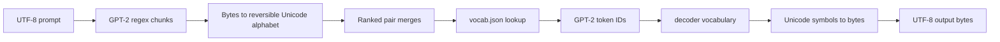
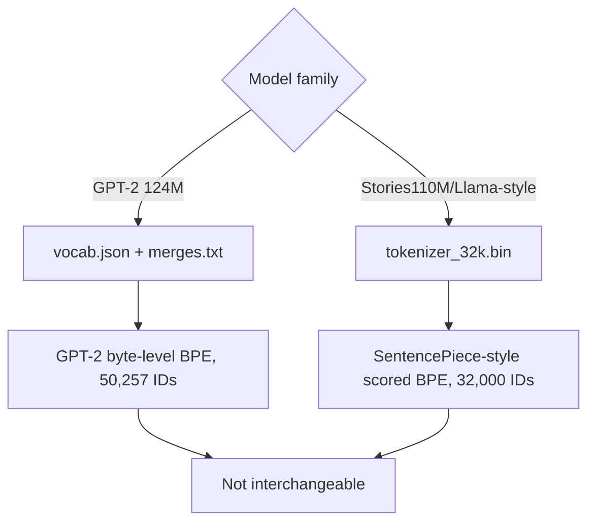
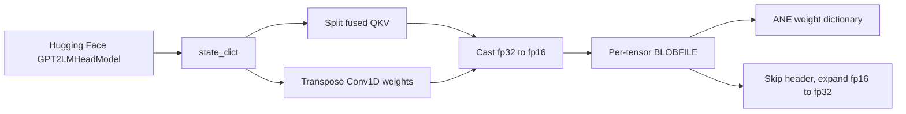
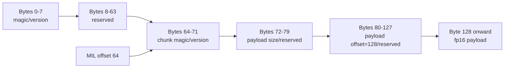

# GPT-2 Tokenization, Assets, and Weights

## Scope and method

This report follows text and model assets from their external formats into runtime token IDs and fp32 CPU weights/fp16 ANE blobs. It reviews `tokenizer/gpt2_bpe.m`, the distinct Stories tokenizer in `tokenizer/sentencepiece_wrap.m`, tracked tokenizer files, GPT-2 conversion in `model/convert/hf_to_blobs_gpt2.py`, `model/weight_loader.m`, CLI loading, and tokenizer/weight tests. Generated `model/blobs/*` content is ignored and is not treated as a tracked source artifact.

The supplied local suite result was obtained after ignored assets were generated. That fact is material: a passing local suite does not mean a clean checkout contains GPT-2 model blobs or training data.

## Evidence-status legend

| Status | Meaning in this report |
|---|---|
| **Observed code** | Direct property of active source or tracked asset layout. |
| **Local verification** | Supplied result: build succeeded; CPU and ANE deterministic eight-token smoke agreed; configured tests passed 23/23 after ignored assets were generated. |
| **Test evidence** | Checked-in test behavior and fixture assertions. |
| **Historical claim** | Prior provenance/performance statement not independently established in this review. |

## Tokenization control and data flow

GPT-2 inference loads `vocab.json` and `merges.txt` through `orion_gpt2_tokenizer_load` (`tokenizer/gpt2_bpe.m:266-287`). Encoding applies GPT-2's contraction/Unicode/number/punctuation/whitespace pre-tokenization regex, converts UTF-8 bytes through GPT-2's reversible byte-to-Unicode alphabet, repeatedly merges the lowest-rank adjacent pair, and maps resulting symbols through the vocabulary (`tokenizer/gpt2_bpe.m:146-175`, `tokenizer/gpt2_bpe.m:179-261`, `tokenizer/gpt2_bpe.m:290-315`). Decoding concatenates vocabulary strings and reverses the byte mapping (`tokenizer/gpt2_bpe.m:318-343`).

Vocabulary JSON loading sizes the decoder from dictionary count, pre-fills empty entries, and only writes an entry when `idx < count` (`tokenizer/gpt2_bpe.m:75-110`). It does not reject negative, duplicate, non-integral, sparse, or out-of-range IDs, nor assert 50,257 entries. Merge loading ignores headers, blank lines, and malformed lines, then assigns ranks in file order without asserting 50,000 rules or validating symbols against the vocabulary (`tokenizer/gpt2_bpe.m:113-144`). Encoding silently omits a BPE symbol absent from the vocabulary and silently truncates at `max_tokens` (`tokenizer/gpt2_bpe.m:304-311`).

The mutable BPE cache is not synchronized (`tokenizer/gpt2_bpe.m:201-205`, `tokenizer/gpt2_bpe.m:259-260`). The API also assumes non-null tokenizer/text/output pointers and valid UTF-8; unlike the Stories tokenizer, GPT-2 encode has no entry guard (`tokenizer/gpt2_bpe.m:290-315`).

## GPT-2 versus Stories tokenizer

The Stories path is not GPT-2 tokenization. `orion_sp_tokenizer_load` reads Karpathy's `tokenizer.bin` format for a caller-supplied 32,000-token vocabulary, then encodes by prepending/replacing spaces with U+2581, tokenizing UTF-8 characters or `<0xNN>` bytes, and greedily selecting the highest-scoring adjacent merge (`tokenizer/sentencepiece_wrap.m:7-46`, `tokenizer/sentencepiece_wrap.m:59-162`). Decoding reverses byte tokens and U+2581 spacing (`tokenizer/sentencepiece_wrap.m:165-238`).

The Stories loader breaks out of a partial read and still returns a tokenizer; it does not validate `max_token_len`, entry lengths, allocation success, exact entry count, trailing data, or a format signature (`tokenizer/sentencepiece_wrap.m:17-46`). This is separate from GPT-2 asset risk but important because all three tokenizer assets are tracked under the same directory.

## Weight conversion and BLOBFILE layout

The GPT-2 converter calls `GPT2LMHeadModel.from_pretrained(model_name)`, reads the state dict/config, splits Hugging Face's fused QKV tensors, transposes Conv1D matrices to `[out, in]`, converts every array to fp16, and writes one BLOBFILE per runtime tensor (`model/convert/hf_to_blobs_gpt2.py:82-168`). The CLI default model name is `gpt2` (`model/convert/hf_to_blobs_gpt2.py:171-177`).

Each file contains a 128-byte header followed by fp16 payload. Header bytes include global magic at 0 and 4, chunk magic at 64, payload byte count at 72, and payload start 128 at 80 (`model/convert/hf_to_blobs_gpt2.py:23-52`). MIL references point to byte 64, the chunk header, not byte 128; the CPU reader directly seeks to payload byte 128 (`compiler/codegen.m:18-25`, `model/weight_loader.m:23-40`).

The CPU loader hard-codes GPT-2 124M dimensions and expected element counts, loads 196 files into fp32 arrays, and fails if the payload-derived element count differs (`model/weight_loader.m:55-123`). It does not parse or validate header magic, declared size, declared payload offset, endianness/version, tensor checksum, finiteness, or exact read completion. `fseek`, `ftell`, allocations, and `fread` are unchecked (`model/weight_loader.m:16-50`). A file with 128 arbitrary bytes and the expected payload length is accepted.

## Asset provenance and test coverage

Tracked GPT-2 tokenizer fixtures are `tokenizer/data/vocab.json` and `tokenizer/data/merges.txt`; Stories uses `tokenizer/data/tokenizer_32k.bin`. Runtime defaults are wired in `apps/cli/commands/infer.m:57-59,104-126`. GPT-2 model blobs are generated into an ignored path and are required by numerical CPU/ANE tests (`tests/test_cpu_forward.m:30-48`, `tests/test_infer_golden_ane.m:145-154`).

The converter does not pin a Hugging Face revision, request local-only content, record repository/revision/config hashes, write a manifest, hash output tensors, capture package versions, or copy/token-bind the tokenizer assets (`model/convert/hf_to_blobs_gpt2.py:82-101`, `model/convert/hf_to_blobs_gpt2.py:171-177`). Runtime receives only a directory path. Thus model weights and tokenizer can be independently replaced while retaining plausible dimensions.

GPT-2 tokenizer tests compare encode/decode against tracked golden vectors (`tests/test_tokenizer.m:6-92`). BLOBFILE Python tests verify header fields, fp16 round-trip, file size, and transpose behavior (`tests/test_weight_convert.py:24-111`), but that Python test is not listed in the 23 binaries run by `make test` (`Makefile:96-125,149-166`). CPU forward tests check dimensions, selected embeddings/logits, and argmax outputs when generated blobs are present (`tests/test_cpu_forward.m:26-201`). Stories tokenizer tests cover basic loading/round-trip and invalid path, not truncated/corrupt input (`tests/test_sp_tokenizer.m:18-141`).

## Evidence summary

| Finding | Status | Evidence |
|---|---|---|
| GPT-2 uses regex pre-tokenization plus reversible byte-level ranked BPE. | **Observed code** | `tokenizer/gpt2_bpe.m:146-261,290-315` |
| Stories uses a distinct 32K tokenizer.bin/scored-BPE path. | **Observed code** | `tokenizer/sentencepiece_wrap.m:7-162` |
| Conversion splits/transposes GPT-2 tensors and writes fp16 BLOBFILE payloads. | **Observed code** | `model/convert/hf_to_blobs_gpt2.py:23-59,118-164` |
| CPU loader validates expected payload length but not BLOBFILE header or read completion. | **Observed code** | `model/weight_loader.m:16-50` |
| Golden GPT-2 tokenizer behavior and selected model outputs are tested. | **Test evidence** | `tests/test_tokenizer.m:12-92`; `tests/test_cpu_forward.m:30-201` |
| BLOBFILE writer unit tests are Python tests outside `make test`. | **Test evidence** | `tests/test_weight_convert.py:24-115`; `Makefile:96-125` |
| Complete configured suite and deterministic CPU/ANE smoke passed after ignored assets were generated. | **Local verification** | Supplied results |
| Any upstream identity implied by the default string `gpt2` is not durable provenance. | **Observed code** | `model/convert/hf_to_blobs_gpt2.py:90-92,171-177` |

## Strengths

- The GPT-2 tokenizer implements the model's byte-level BPE rather than substituting a generic word tokenizer.
- Encode/decode golden vectors are tracked, making tokenizer drift visible for covered strings.
- Conversion explicitly handles GPT-2 Conv1D orientation and fused QKV splitting, matching CPU and ANE tensor naming/layout.
- Runtime element-count checks catch missing, extra, or wrongly shaped payloads for the hard-coded GPT-2 124M topology.
- BLOBFILE writer tests encode the unusual distinction between a 128-byte payload start and the chunk metadata around byte 64.

## Limitations

- GPT-2 vocabulary and merge loaders accept structurally weak or inconsistent assets and can silently drop symbols/tokens.
- Stories tokenizer loading accepts partial files and trusts lengths from disk.
- BLOBFILE runtime loading validates length only, not header integrity or provenance.
- Conversion is not reproducibly pinned and produces no manifest connecting source model, tokenizer, tensor names, shapes, dtypes, hashes, and converter version.
- Model configuration is duplicated as hard-coded runtime constants instead of loaded from a verified artifact.
- Generated model blobs are ignored; a clean checkout cannot reproduce model-dependent tests without network/tooling and explicit conversion.

## Severity-ranked risks

| Severity | Risk | Failure mode | Evidence |
|---|---|---|---|
| Critical | Tokenizer and model weights have no verified shared identity. | Valid token IDs target the wrong embedding semantics, producing plausible but invalid inference. | `apps/cli/commands/infer.m:57-59,104-126`; no manifest in converter |
| High | Runtime ignores BLOBFILE header and unchecked `fread`. | Corrupt/truncated/malicious files can yield uninitialized or semantically wrong weights. | `model/weight_loader.m:16-50` |
| High | Converter source revision and environment are unpinned. | Regeneration is not auditable or byte-reproducible. | `model/convert/hf_to_blobs_gpt2.py:82-101,171-177` |
| High | GPT-2 vocab/merge inconsistencies are tolerated. | Missing IDs or BPE symbols are silently skipped; token sequence changes without load failure. | `tokenizer/gpt2_bpe.m:90-109,127-143,304-311` |
| High | Stories tokenizer returns success after partial reads and trusts disk lengths. | Null entries, excessive allocation, out-of-bounds assumptions, or wrong tokenization. | `tokenizer/sentencepiece_wrap.m:17-46` |
| Medium | GPT-2 encode/cache API is not thread-safe or defensive. | Concurrent mutation or null/invalid UTF-8 crash. | `tokenizer/gpt2_bpe.m:201-205,259-260,290-315` |
| Medium | `max_tokens` truncation is silent. | Prompt meaning is cut while caller sees a successful positive token count. | `tokenizer/gpt2_bpe.m:296-314` |
| Medium | Python conversion tests are outside `make test`. | Header/conversion regressions can coexist with a green configured C/ObjC suite. | `Makefile:96-125`; `tests/test_weight_convert.py:24-115` |

## Recommendations

1. Generate a signed or at least hashed model manifest containing source repository and immutable revision, model config, tokenizer file hashes, converter commit/schema, dependency versions, and every tensor's file, shape, dtype, byte count, and SHA-256.
2. Make runtime load the manifest first and reject mismatched tokenizer hashes, topology, tensor inventory, BLOBFILE header fields, payload sizes, and checksums.
3. Pin Hugging Face revision explicitly in the converter and record resolved revision/config. Support an offline/local source path for reproducible builds.
4. Harden GPT-2 tokenizer loading: require exactly 50,257 unique contiguous IDs and the expected merge count, validate value types/ranges and merge syntax, and fail rather than silently skipping unknown BPE outputs.
5. Return explicit encode status including required/output token counts and truncation; validate null pointers and UTF-8. Synchronize or remove the shared mutable BPE cache for concurrent use.
6. Harden Stories tokenizer parsing with bounded lengths, exact entry count, allocation/read checks, format/version metadata, and corruption tests.
7. Parse BLOBFILE headers in `read_blob_f32`, verify all file operations and allocations, reject non-finite payloads where appropriate, and use overflow-checked `size_t` arithmetic.
8. Add `tests/test_weight_convert.py` to an authoritative test target and add clean-checkout documentation/automation that generates ignored assets without implying they are tracked.
