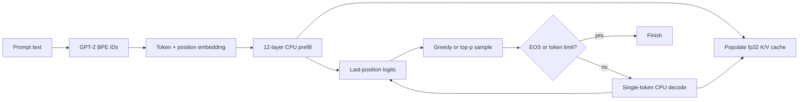
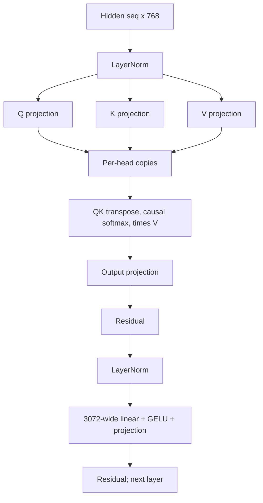
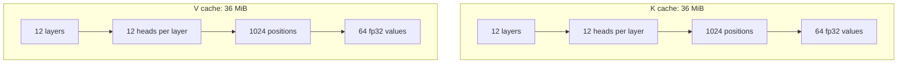

# GPT-2 CPU Inference

## Scope and method

This report reviews the fp32 CPU implementation for GPT-2 124M: embedding, layer normalization, prefill attention, feed-forward layers, logits, KV-cache prefill/decode, and sampling. Primary sources are `kernels/inference/decode_cpu.m`, `kernels/inference/kv_cache.*`, `model/weight_loader.*`, CLI orchestration, and CPU/decode/golden tests. ANE internals are out of scope except where the CLI selects or falls back to the CPU path.

Memory estimates are derived from declared dimensions and allocation formulas, not process telemetry. Historical benchmark comments are not reported as current measurements.

## Evidence-status legend

| Status | Meaning in this report |
|---|---|
| **Observed code** | Directly established from active source. |
| **Local verification** | Supplied result: `make` succeeded; CPU and ANE deterministic eight-token smoke both emitted `The meaning of life is not the same as the meaning of death`; `make test` passed 23/23 after ignored assets were generated. |
| **Test evidence** | Checked-in tests and golden assertions. |
| **Historical claim** | Prior comments/results not freshly measured for this report. |

## End-to-end control flow

The CLI parses generation settings, loads the GPT-2 tokenizer and all weights, tokenizes into a fixed 1,024-element prompt buffer, allocates logits and a KV cache, performs prefill, and enters sample/decode until `max_tokens` or EOS (`apps/cli/commands/infer.m:48-138`, `apps/cli/commands/infer.m:143-204`). CPU-only mode calls `orion_gpt2_prefill_kv` and then `orion_gpt2_decode_step`; ANE failures can fall back into the same CPU routines (`apps/cli/commands/infer.m:148-163`, `apps/cli/commands/infer.m:190-201`).



Weights are stored as fp16 blobs but expanded to fp32 arrays at load (`model/weight_loader.m:6-50`). CPU matrix multiplication uses Accelerate SGEMM/SGEMV. Converted GPT-2 Conv1D matrices are `[out, in]`, so `linear` multiplies `X` by the transposed stored matrix and adds bias (`kernels/inference/decode_cpu.m:7-12`, `kernels/inference/decode_cpu.m:42-57`).

## Full prefill data flow

`orion_gpt2_forward_cpu_all` embeds all positions, then for each of 12 layers applies pre-attention layer norm, full causal attention, residual add, pre-FFN layer norm, GELU FFN, and a second residual. Final layer norm precedes a tied-embedding logits GEMM (`kernels/inference/decode_cpu.m:217-275`). `attention_prefill` computes separate Q/K/V matrices, extracts each head into contiguous temporary arrays, computes a full `seq_len x seq_len` score matrix, applies a causal softmax row by row, combines values, and projects the result (`kernels/inference/decode_cpu.m:87-179`).



`orion_gpt2_forward_cpu` allocates logits for every prompt position even though it returns only the last row (`kernels/inference/decode_cpu.m:203-215`). The KV-prefill variant improves this by computing only final-position logits (`kernels/inference/decode_cpu.m:331-335`), but it introduces duplicated QKV work: lines 302-311 compute Q/K/V to fill the cache, then `attention_prefill` immediately recomputes all three from the same normalized input at line 314 because its interface accepts `x`, not precomputed Q/K/V (`kernels/inference/decode_cpu.m:295-324`; recomputation at `kernels/inference/decode_cpu.m:96-103`). The first Q allocation is therefore used only for cache-adjacent setup and is never otherwise consumed.

## KV-cache layout and decode

The cache is two zeroed fp32 allocations with layout `[layer, head, max_seq, head_dim]` (`kernels/inference/kv_cache.h:9-17`, `kernels/inference/kv_cache.m:11-23`). For GPT-2 124M, each of K and V contains `12 * 12 * 1024 * 64` floats. Together this is 75,497,472 bytes, exactly 72 MiB, excluding the cache struct and allocator overhead.



Prefill rearranges interleaved `[seq, n_head * head_dim]` K/V into this head-major cache (`kernels/inference/kv_cache.m:26-43`). Decode embeds one token at `current_len`, computes Q/K/V per layer, appends current K/V, attends Q over all cached positions for each head, projects, runs FFN, computes logits, and increments the shared cache length after all layers (`kernels/inference/decode_cpu.m:380-463`). `orion_kv_cache_append` intentionally writes every layer at the same `current_len`; the increment occurs only after the complete layer loop (`kernels/inference/kv_cache.m:45-61`).

The implementation has no bounds checks for token ID, `seq_len`, cache layer, `current_len < max_seq`, head divisibility, or position embedding range. `orion_kv_cache_create` does not check struct or 36 MiB allocation failures (`kernels/inference/kv_cache.m:11-23`). A prompt of 1,024 tokens followed by any decode writes position 1,024 beyond both cache arrays and reads beyond `wpe`; the CLI allows this because prompt tokenization can fill 1,024 tokens and generation count is independent (`apps/cli/commands/infer.m:124-138,176-204`). Negative or oversized token IDs similarly index `wte` without validation (`kernels/inference/decode_cpu.m:77-84`, `kernels/inference/decode_cpu.m:398-401`).

## Allocation behavior

The hot paths allocate frequently:

- LayerNorm allocates and frees a `dim` temporary on every call (`kernels/inference/decode_cpu.m:17-40`). Prefill invokes it per position, twice per layer, plus final normalization.
- Full attention allocates Q/K/V, attention output, score and unused `softmax_buf`, then four per-head buffers for each head (`kernels/inference/decode_cpu.m:96-178`).
- FFN allocates its `seq_len * 3072` activation each call (`kernels/inference/decode_cpu.m:181-199`).
- Decode allocates hidden workspaces per token, Q/K/V and projection per layer, FFN storage per layer, and a score vector per head (`kernels/inference/decode_cpu.m:344-462`).
- All allocations are unchecked before use.

`softmax_buf` is allocated but never read or written (`kernels/inference/decode_cpu.m:107-109,177-178`). Per-head extraction copies Q/K/V out of interleaved matrices even though BLAS strides or a persistent packed layout could avoid much of this churn (`kernels/inference/decode_cpu.m:111-123`).

## Sampling flow and complexity

Temperature zero performs a linear argmax and does not dereference the RNG pointer (`kernels/inference/decode_cpu.m:477-490`). Positive temperature allocates probabilities and indices, computes full-vocabulary softmax, and insertion-sorts all vocabulary indices in descending probability before nucleus truncation (`kernels/inference/decode_cpu.m:492-553`). For vocabulary size 50,257 this is worst-case O(V^2), about 1.26 billion pair comparisons/moves in the descending-shift worst case, per generated token.

```mermaid
flowchart LR
    L[50,257 logits] --> Z[Temperature softmax O(V)]
    Z --> IS[Full insertion sort O(V squared)]
    IS --> TP[Cumulative top-p scan]
    TP --> RN[Renormalize and RNG sample]
```

Positive-temperature sampling assumes `rng_state` is non-null at `xorshift64`, does not validate finite positive temperature, or clamp `top_p` to `(0,1]` (`kernels/inference/decode_cpu.m:467-478`, `kernels/inference/decode_cpu.m:525-545`). A zero RNG state remains zero forever. Non-finite logits can poison max/softmax/norm. The CLI supplies a valid state and defaults to greedy, but the public C function itself does not enforce these preconditions (`apps/cli/commands/infer.m:51-54,173-177`).

## Test evidence and observed behavior

CPU forward tests validate all expected weight pointers, selected embedding values, layer norm, and known argmax outputs for one- and multi-token prompts (`tests/test_cpu_forward.m:26-201`). Decode tests compare KV prefill against full forward, single-token decode against equivalent prefill, and multi-step decode against a longer prefill (`tests/test_decode.m:30-137`). Golden inference checks deterministic greedy token sequences (`tests/test_infer_golden.m:16-106`). These establish useful numerical consistency for short, valid inputs with generated GPT-2 blobs.

They do not cover maximum context, invalid token IDs, allocation failure, null pointers, nonzero-temperature sampling complexity/correctness, NaN/Inf logits, corrupt weights, or repeated long generation. The supplied 23/23 suite result includes these binaries only after ignored assets were generated (`Makefile:96-125`). The supplied CPU/ANE smoke sentence is a deterministic functional observation, not a throughput measurement.

## Evidence summary

| Finding | Status | Evidence |
|---|---|---|
| CPU implementation follows GPT-2 pre-norm attention/FFN with tied embeddings. | **Observed code** | `kernels/inference/decode_cpu.m:217-275` |
| KV-prefill computes QKV once for cache and again inside attention. | **Observed code** | `kernels/inference/decode_cpu.m:302-315`; `kernels/inference/decode_cpu.m:96-103` |
| GPT-2 fp32 K/V storage is exactly 72 MiB at configured dimensions. | **Observed code** | Formula in `kernels/inference/kv_cache.m:19-21`; dimensions in `model/weight_loader.m:55-68` and model config |
| Sampler insertion-sorts all 50,257 candidates, O(V^2). | **Observed code** | `kernels/inference/decode_cpu.m:508-523` |
| Short valid prefill/decode/golden sequences have numerical test coverage. | **Test evidence** | `tests/test_cpu_forward.m:26-201`; `tests/test_decode.m:30-137`; `tests/test_infer_golden.m:16-106` |
| Build, 23 configured tests, and deterministic CPU/ANE smoke passed with generated ignored assets. | **Local verification** | Supplied results |
| Benchmark comments elsewhere are not measurements for this report. | **Historical claim** | For example `tests/test_bench_decode.m:125-127` |

## Strengths

- Matrix orientation is documented and consistently matched to converted GPT-2 weights.
- Accelerate handles the dominant dense operations rather than scalar matrix loops.
- Causal masking and stable max-subtracted softmax are explicit and inspectable.
- KV layout is simple, contiguous per head, and shared by CPU and hybrid/ANE orchestration.
- Short-sequence tests cross-check full prefill, KV prefill, decode, golden logits/argmax, and deterministic generation.
- Greedy sampling is O(V), allocation-free, and deterministic.

## Limitations

- The implementation is fixed to GPT-2 124M assumptions, including 12 heads in forward/prefill (`kernels/inference/decode_cpu.m:220-224,282-286`).
- KV-prefill duplicates all QKV projections and allocates an unused Q result solely before recomputation.
- Temporary allocation/free dominates many fine-grained operations and all allocation results are trusted.
- KV cache reserves the full 72 MiB regardless of requested generation length and has no sliding-window or smaller-capacity option.
- Bounds and input contracts are not checked at API boundaries.
- Non-greedy sampling has quadratic sorting complexity and weak parameter/RNG validation.

## Severity-ranked risks

| Severity | Risk | Failure mode | Evidence |
|---|---|---|---|
| Critical | Decode runs with `current_len >= max_seq`. | Out-of-bounds K/V writes and positional-embedding read. | `kernels/inference/decode_cpu.m:390-401,419-430`; `kernels/inference/kv_cache.m:45-60` |
| Critical | Prompt token IDs or decode token are outside `[0, vocab)`. | Out-of-bounds embedding read. | `kernels/inference/decode_cpu.m:77-84,398-401` |
| High | Allocation failure is unchecked throughout model load/inference/cache creation. | Null dereference or partially initialized state, especially under high memory pressure. | `model/weight_loader.m:39-50,63-84`; `kernels/inference/decode_cpu.m:17-555`; `kernels/inference/kv_cache.m:11-23` |
| High | Positive-temperature sampler performs O(V^2) insertion sort. | Severe per-token latency and energy growth for 50,257 vocabulary entries. | `kernels/inference/decode_cpu.m:508-523` |
| High | Positive-temperature call receives null/zero RNG state or invalid parameters. | Crash, deterministic degenerate RNG, divide-by-zero, or invalid probabilities. | `kernels/inference/decode_cpu.m:467-478,492-550` |
| Medium | KV-prefill duplicates QKV projections. | Avoidable compute and allocation for every layer and prompt position. | `kernels/inference/decode_cpu.m:302-315` |
| Medium | Per-position/per-head allocation churn and copies. | Avoidable allocator overhead, fragmentation, and memory bandwidth. | `kernels/inference/decode_cpu.m:17-40,96-178,344-462` |
| Medium | Full-forward wrapper allocates logits for every sequence position. | `seq_len * 50,257 * 4` bytes even when only the final row is requested. | `kernels/inference/decode_cpu.m:203-215` |

## Recommendations

1. Validate every public inference boundary: non-null objects/buffers, `0 < seq_len <= max_seq`, token ranges, layer/head dimensions, and `current_len < max_seq`. Have decode return a status rather than writing unconditionally.
2. In the CLI, cap generation to `max_seq - prompt_len` and reject a prompt that leaves no decode capacity. Add exact 1,024-context regression tests and sanitizer-backed overflow tests.
3. Refactor prefill attention to accept precomputed Q/K/V. Use those same matrices for cache storage and attention, removing the second three projections and the otherwise unused first Q.
4. Allocate a reusable inference workspace sized once per request/model. Reuse layernorm, QKV, attention, FFN, per-head score, and logits buffers; remove `softmax_buf`.
5. Make KV capacity configurable up to model maximum and use overflow-checked allocation. Check all allocations and unwind cleanly on failure.
6. Replace full insertion sort with partial selection or a descending O(V log V) sort; for top-p, use a heap/partition strategy and stop once a provably sufficient candidate set is accumulated.
7. Validate sampling inputs (`isfinite`, temperature, `top_p`, RNG pointer/state), define behavior for NaN/Inf logits, and provide an internally seeded RNG option.
8. Add tests for nonzero-temperature sampling, boundaries, invalid inputs, allocation failure, long generation, and memory/workspace reuse. Measure performance separately under a recorded host/OS/build configuration rather than promoting historical benchmark comments.
