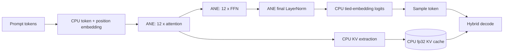
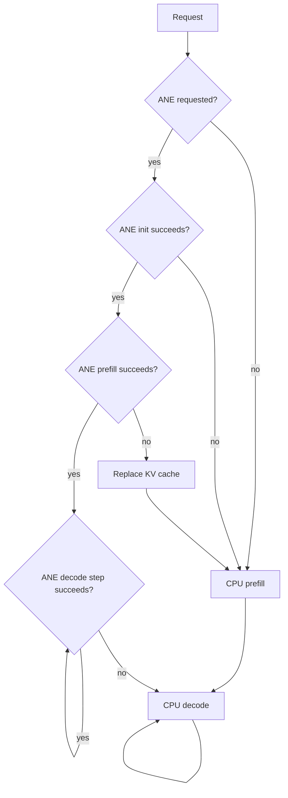
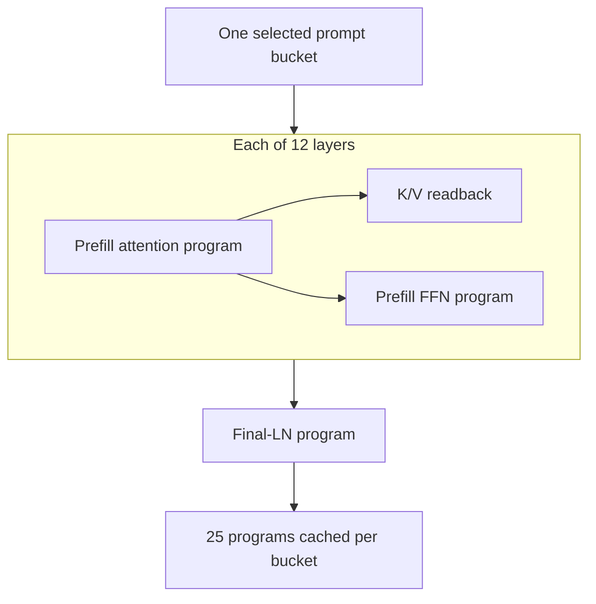
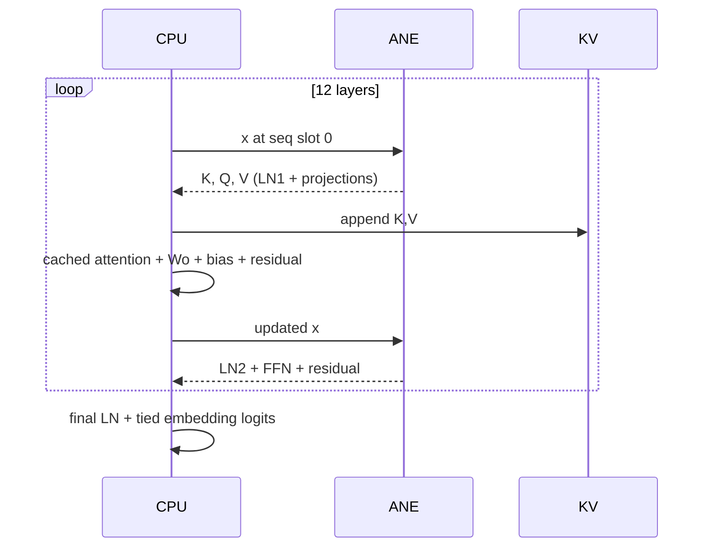

# GPT-2 ANE Inference

## Scope and method

This report traces the active GPT-2 124M inference implementation from CLI selection through prefill, KV-cache population, token decode, fallback, and program caching. It is based on static inspection of the current sources and a local `make test` run on 2026-07-12. It does not treat historical benchmark prose as a current measurement.

Primary sources are `apps/cli/commands/infer.m`, `kernels/inference/{prefill_ane,decode_ane,decode_cpu,kv_cache}.m`, the GPT-2 compiler frontends, and `core/{kernel,ane_program_cache}.m`.

## Evidence-status legend

| Mark | Meaning |
|---|---|
| **[CODE]** | Directly established by the current active source. |
| **[LOCAL]** | Observed in the 2026-07-12 local run; environment and ignored assets matter. |
| **[TEST]** | Established by a test's assertion design, which may be narrower than a binary PASS. |
| **[STATIC-RISK]** | Plausible failure inferred from control/data flow; not reproduced in this review. |
| **[HISTORICAL]** | Repository prose or benchmark output from an earlier run; not re-benchmarked here. |

## Architecture summary

The `--ane` path is hybrid, not an all-ANE forward pass. Prefill places all transformer attention/FFN blocks and final LayerNorm on ANE, but computes token/position embeddings, layout conversion, KV extraction, and logits on CPU. Decode places LN1 plus Q/K/V projections and LN2 plus FFN on ANE; CPU performs attention over the KV cache, attention output projection and residual, final LayerNorm, and vocabulary projection (`kernels/inference/prefill_ane.m:163-191`, `kernels/inference/prefill_ane.m:263-352`, `kernels/inference/decode_ane.m:134-287`). **[CODE]**

### CLI and fallback flow

`--ane` enables ANE prefill and ANE-assisted decode; `--ane-prefill` enables ANE prefill with CPU decode; no flag is CPU-only (`apps/cli/commands/infer.m:22-39`, `apps/cli/commands/infer.m:48-88`). If ANE initialization fails, the command switches to CPU before loading weights. If ANE prefill fails, it discards and recreates the KV cache and reruns CPU prefill. If a decode step fails, it disables ANE decode and immediately invokes CPU decode using the existing cache (`apps/cli/commands/infer.m:96-102`, `apps/cli/commands/infer.m:143-163`, `apps/cli/commands/infer.m:172-204`). **[CODE]**

The prefill fallback is coherent because it replaces the potentially partial cache. Decode fallback is less robust: `orion_ane_decode_step` appends K/V separately for each completed layer before later ANE evaluations can fail (`kernels/inference/decode_ane.m:164-197`, `kernels/inference/decode_ane.m:254-267`). A failure after one or more layers can therefore leave current-position cache entries partially changed, after which CPU decode writes the position again layer by layer. Values in completed layers are overwritten, but failure timing and cache state are not transactional. This is a **[STATIC-RISK]**, not a locally observed failure.

### Prefill program flow and count

The bucket is selected from the configured GPT-2 bucket set; prompts beyond the largest bucket fail ANE prefill (`kernels/inference/prefill_ane.m:235-257`). For each selected bucket, the first prefill compiles two programs per layer, then one final-LN program: `12 * 2 + 1 = 25`. The attention frontend performs LN1, Q/K/V, decomposed causal attention, output projection, and residual; the FFN frontend performs LN2, GELU FFN, and residual (`compiler/frontends/gpt2_prefill.c:8-72`, `compiler/frontends/gpt2_prefill.c:74-110`, `compiler/frontends/gpt2_final.c:7-31`). **[CODE]**

Attention returns `hidden`, `k_cache`, and `v_cache`; these names are already alphabetical, so the runner's surface order matches the documented ANE rule by coincidence/design (`compiler/frontends/gpt2_prefill.c:61-69`, `kernels/inference/prefill_ane.m:263-285`, `docs/ane_constraints.md:29-37`). KV data is transposed from ANE `[d,bucket]` to CPU `[head,seq,head_dim]`, only for real prompt positions (`kernels/inference/prefill_ane.m:194-231`).

The cache key includes kernel name, layer, weights ID, and bucket (`core/ane_program_cache.m:43-59`). Inference hard-codes `weights_id = "base"`; each new bucket therefore adds another 25 prefill programs, while repeated use of the same bucket reuses them (`kernels/inference/prefill_ane.m:259-264`, `core/kernel.m:4-34`). There is no cache size policy or compile-budget guard in the CLI inference path. **[CODE]**

### Decode program flow and count

Decode uses a fixed sequence allocation of 16 with token data at position zero, satisfying the minimum IOSurface constraint (`kernels/inference/decode_ane.m:17-18`, `kernels/inference/decode_ane.m:139-162`, `docs/ane_constraints.md:41-49`). It compiles two programs per layer: `decode_proj` and `decode_ffn`, for `12 * 2 = 24` programs. The explicit output surface order `{ioK, ioQ, ioV}` correctly accounts for alphabetical ANE mapping of `k32`, `q32`, `v32` (`compiler/frontends/gpt2_decode.c:41-49`, `kernels/inference/decode_ane.m:167-193`). **[CODE]**

## Strengths

- The backend choices and fallback modes are explicit in CLI help and control flow (`apps/cli/commands/infer.m:22-39`, `apps/cli/commands/infer.m:72-78`). **[CODE]**
- Prefill failure resets the KV cache before CPU recomputation, avoiding mixed-backend partial prefill state (`apps/cli/commands/infer.m:148-159`). **[CODE]**
- Decode explicitly handles alphabetical multi-output binding, a known silent-correctness hazard (`kernels/inference/decode_ane.m:174-179`). **[CODE]**
- Program reuse is keyed by bucket and avoids repeat compilation for a warmed shape (`core/kernel.m:9-34`, `core/ane_program_cache.m:43-79`). **[CODE]**
- The local suite exercised real ANE and GPT-2 asset-dependent tests and passed, including CPU/ANE decode comparisons and full-forward token checks. This is useful evidence for this machine and fixture set, not a universal guarantee. **[LOCAL]**

## Limitations

- “ANE full” in profiler output is a misleading label for a hybrid decode whose attention, output projection, final LN, and logits remain CPU-side (`apps/cli/commands/infer.m:209-216`, `kernels/inference/decode_ane.m:199-252`, `kernels/inference/decode_ane.m:276-282`).
- Prefill compiles 25 programs for every newly encountered bucket; decode adds 24. Multiple prompt buckets can approach the empirical per-process compile limit because inference has no eviction/restart policy (`kernels/inference/prefill_ane.m:259-351`, `kernels/inference/decode_ane.m:148-179`, `docs/ane_constraints.md:53-59`).
- The cache's `base` weight identity is a convention, not a content hash. Reusing the process with changed blobs at the same path would retain old compiled programs (`kernels/inference/prefill_ane.m:259-260`, `kernels/inference/decode_ane.m:148-149`).
- KV cache append functions do not guard `current_len < max_seq`; generation past capacity can write out of bounds (`kernels/inference/kv_cache.m:45-60`).
- Existing ANE golden tests generally emphasize greedy tokens/top-k and tolerate later divergence; they do not prove close logits over all buckets and long contexts (`tests/test_infer_golden_ane.m:76-134`, `tests/test_decode_ane_step.m:94-135`). **[TEST]**

## Severity-ranked risks

1. **Critical: KV-cache out-of-bounds at maximum context.** Neither CLI generation nor `orion_kv_cache_append` rejects `current_len >= max_seq`; a long prompt plus generation can write beyond allocated K/V storage (`apps/cli/commands/infer.m:124-137`, `kernels/inference/kv_cache.m:45-60`). **[STATIC-RISK]**
2. **High: decode fallback is not transactional.** A late ANE failure can occur after per-layer K/V writes, yet fallback continues with the same cache (`kernels/inference/decode_ane.m:164-267`, `apps/cli/commands/infer.m:190-201`). **[STATIC-RISK]**
3. **High: cache/compile growth across buckets.** Each distinct prefill bucket contributes 25 programs, decode contributes 24, and no inference guard handles the documented approximate compile ceiling (`core/ane_program_cache.m:35-112`, `docs/ane_constraints.md:53-59`). **[STATIC-RISK]**
4. **Medium: stale program reuse after on-disk weight replacement.** The fixed `base` ID does not represent blob content or model path (`kernels/inference/prefill_ane.m:259-260`, `core/ane_program_cache.m:43-47`). **[STATIC-RISK]**
5. **Medium: coarse correctness thresholds can hide drift.** Several tests accept top-k or first-token agreement rather than bounded full-logit error over sustained decode (`tests/test_infer_golden_ane.m:108-134`, `tests/test_decode_ane_step.m:94-135`). **[TEST]**

## Recommendations

1. Enforce context capacity before prefill and every append; stop or report a clear error before `max_seq` is reached.
2. Make ANE decode transactional for the current token: stage K/V or snapshot `current_len` and completed-layer cache slices, then commit only after all 12 layers succeed. Alternatively, rebuild the entire cache via CPU prefill on fallback.
3. Replace `weights_id = "base"` with an identity derived from canonical model path plus blob metadata/content version; clear cache on model replacement.
4. Track projected compile count before warming a new bucket and either reject, evict/restart safely, or predeclare the supported bucket set for the process.
5. Rename the displayed backend to “ANE-assisted decode” or print CPU/ANE responsibilities explicitly.
6. Add long-context boundary tests, forced-failure fallback tests at several layers, and per-bucket numerical comparisons against CPU with logit and KV tolerances.

Historical performance statements such as cached decode overhead in `tests/test_bench_decode.m:122-128` are **[HISTORICAL]** comments/output labels unless a benchmark is rerun and its hardware, OS, thermal state, fixture revision, and raw results are recorded.
