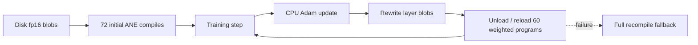
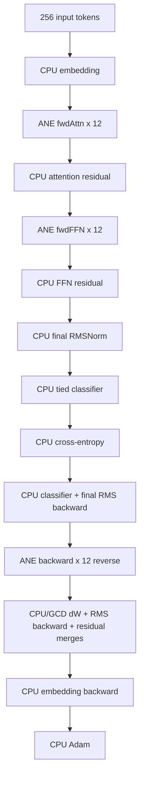
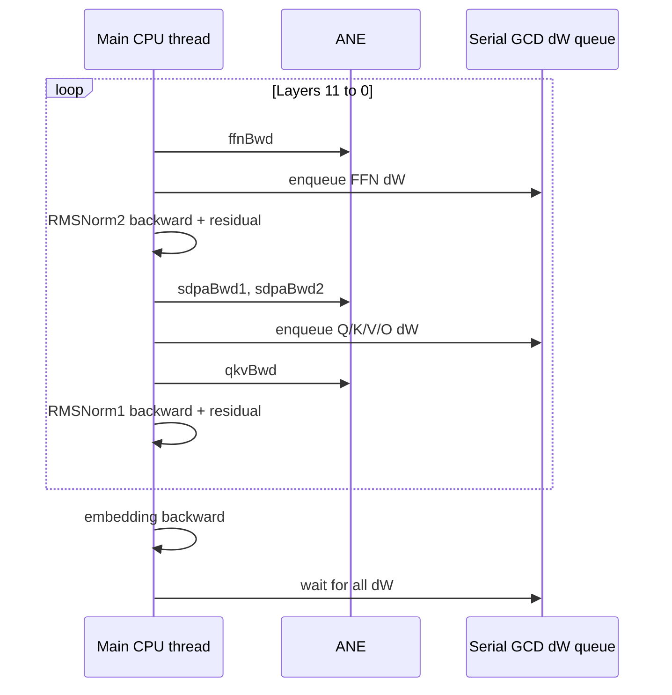
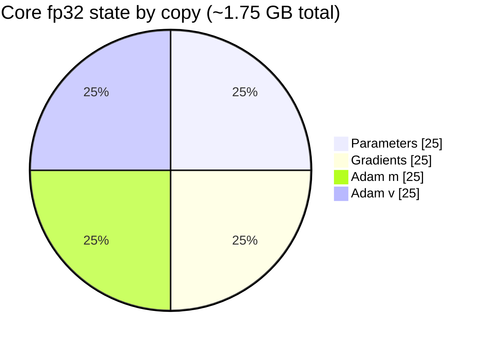

# Stories110M Training System

## Scope and method

This report audits the active Stories110M trainer: model definition, ANE program partitioning, forward/backward data flow, CPU work, optimizer state, weight reload, and numerical safeguards. Evidence comes from current source inspection plus the local 2026-07-12 `make test` run. Static ordering concerns are kept distinct from that run's process-level PASS result.

## Evidence-status legend

| Mark | Meaning |
|---|---|
| **[CODE]** | Direct statement of active source behavior. |
| **[LOCAL]** | Observed in the local 2026-07-12 run. |
| **[TEST]** | What test assertions actually establish. |
| **[STATIC-RISK]** | Source-level correctness concern not reproduced here. |
| **[HISTORICAL]** | Prior benchmark/endurance claim, not rerun for this report. |

## System shape and program lifecycle

The configured model has 12 layers, 12 heads, width 768, head dimension 64, SwiGLU width 2048, vocabulary 32,000, and fixed sequence length 256 (`model/configs/stories110m.h:6-19`). The comment claims a Llama2-style architecture “with RMSNorm, SwiGLU, RoPE,” but the active forward and backward frontends project Q/K/V directly into attention and contain no rotary-position operation or positional input (`model/configs/stories110m.h:6-9`, `compiler/frontends/stories_train.c:9-55`, `compiler/frontends/stories_train.c:170-364`). **RoPE is absent from the active training graph despite the configuration claim. [CODE]**

Each layer owns six ANE programs: `fwd_attn`, `fwd_ffn`, `ffn_bwd`, `sdpa_bwd1`, `sdpa_bwd2`, and `qkv_bwd` (`kernels/training/stories_train.h:27-35`, `kernels/training/stories_train.m:307-345`). Initial construction therefore performs `6 * 12 = 72` compiles. Resume deliberately allocates and loads CPU state without compiling, overlays the checkpoint, writes resumed weights to blobs, and then compiles 72 programs once (`kernels/training/stories_train.m:503-582`, `apps/cli/commands/train.m:148-187`). **[CODE]**

After Adam, `orion_trainer_recompile_delta` writes all layer weights and reloads five weighted programs per layer. `sdpa_bwd2` is weight-free and retained, so the normal step reload count is `5 * 12 = 60`, with zero compiler calls (`kernels/training/stories_train.m:993-1049`). Reload itself is unload, non-atomic file replacement in each program temp directory, then load (`core/ane_runtime.m:344-385`). A failed patch falls back to full recompilation (`kernels/training/stories_train.m:1037-1043`). **[CODE]**

## Detailed training flow

### Forward

CPU gathers embeddings. For each layer, ANE computes RMSNorm, Q/K/V, decomposed causal attention, and `Wo`; CPU adds the first residual. ANE then computes RMSNorm and SwiGLU FFN; CPU adds the second residual (`kernels/training/stories_train.m:656-696`, `compiler/frontends/stories_train.c:9-99`). Final RMSNorm, tied embedding classifier, softmax cross-entropy, and `dlogits` are CPU operations (`kernels/training/stories_train.m:698-746`, `kernels/training/stories_cpu_ops.m:17-60`). **[CODE]**

### Backward

CPU computes classifier/embedding gradient and final RMSNorm backward. Per layer in reverse, ANE computes FFN activation gradients, attention/V gradients, softmax/Q/K gradients, and summed QKV input gradient. CPU computes all parameter `dW` products using Accelerate on a serial GCD queue, both RMSNorm backwards, residual merges, and embedding backward (`kernels/training/stories_train.m:720-910`). Adam and all fp32 master parameters/moments remain CPU-side (`kernels/training/stories_train.m:914-950`, `kernels/training/stories_cpu_ops.m:70-95`). **[CODE]**

## CPU memory core

The active parameter formula, including embedding, final RMS, and both per-layer RMS vectors, is approximately 109,529,856 fp32 values. Trainer allocation maintains four full-size logical copies: parameters, gradients, Adam `m`, and Adam `v` (`kernels/training/stories_train.m:403-474`, `kernels/training/stories_train.m:525-570`). That is 1,752,477,696 bytes, approximately **1.75 GB decimal or 1.63 GiB** of fp32 parameter/gradient/Adam core state. This is often rounded to “~1.75 GiB,” but the byte-accurate binary figure is 1.63 GiB. **[CODE-derived]**

This excludes roughly 81 MiB of persistent fp32 activation/logit buffers, IOSurfaces, temporary backward arrays, GCD-captured copies, fp16 blobs, ANE/private-framework state, and compiler artifacts (`kernels/training/stories_train.m:566-570`, `kernels/training/stories_train.m:780-869`). Actual peak RSS is therefore materially higher.

## Apparent output-ordering mismatch

The documented ANE invariant is that result surfaces map alphabetically by MIL variable name, not return-tuple position (`docs/ane_constraints.md:29-37`). Codegen emits output tuples in frontend registration order and does not sort them (`compiler/codegen.m:280-286`). The training runner passes `OrionLayerIO` arrays in semantic/registration order (`kernels/training/stories_train.h:82-96`, `kernels/training/stories_train.m:675-693`, `kernels/training/stories_train.m:772-883`). This creates an apparent mismatch for every multi-output training program:

| Program | Runner expects by slot | Documented alphabetical mapping |
|---|---|---|
| `fwdAttn` | `wo,q,k,v,attn,rms1` | `attn,k,q,rms1,v,wo` |
| `fwdFFN` | `w2,w1,w3,gate,rms2` | `gate,rms2,w1,w2,w3` |
| `ffnBwd` | `dx,dh1,dh3` | `dh1,dh3,dx` |
| `sdpaBwd1` | `dvf,pf,dpf` | `dpf,dvf,pf` |
| `sdpaBwd2` | `dqf,dkf` | `dkf,dqf` |

Frontend definitions are at `compiler/frontends/stories_train.c:47-53`, `compiler/frontends/stories_train.c:91-96`, `compiler/frontends/stories_train.c:161-165`, `compiler/frontends/stories_train.c:268-270`, and `compiler/frontends/stories_train.c:361-362`. Runner consumption is at `kernels/training/stories_train.m:675-694` and `kernels/training/stories_train.m:764-898`.

This is the top-priority **[STATIC-RISK]**. The local 23/23 binary result does not disprove it: kernel eval tests primarily assert compilation/evaluation and finiteness, and the smoke test can pass with internally consistent but semantically swapped finite tensors (`tests/test_train_kernels.m:100-155`, `tests/test_train_kernels.m:188-243`, `tests/test_train_smoke.m:133-223`). No full-gradient golden compares all named forward taps and gradients to an independent framework.

## Numerical safeguards and observability

ANE readback and write paths clamp values to fp16 range; readback maps NaN and positive overflow to `65504`, while blob serialization maps NaN to zero. Adam silently replaces non-finite gradients with zero (`kernels/training/stories_train.m:19-53`, `kernels/training/stories_train.m:56-75`, `kernels/training/stories_cpu_ops.m:80-94`). **[CODE]**

These measures can prevent a crash or overflow cascade, but they can also hide instability and produce a finite loss after serious corruption. There are no counters, thresholds, or step failures for clamp/sanitize events. Consequently, “finite loss” and “0 NaN” are weaker evidence than they appear. **[STATIC-RISK]**

## Strengths

- Compilation is outside the step loop; weighted programs use reload rather than restoring per-step compilation (`apps/cli/commands/train.m:270-280`).
- Resume's deferred compile is coherent: checkpoint CPU weights are loaded before programs bake those weights, avoiding 144 startup compiles (`apps/cli/commands/train.m:148-176`).
- CPU/ANE responsibilities are explicit, and async dW buffers are copied before dispatch with a final group wait (`kernels/training/stories_train.m:748-910`).
- Multi-output surfaces are uniformly allocated to the maximum channel size, matching a documented runtime constraint (`kernels/training/stories_train.m:350-385`).
- The local suite completed ANE training smoke and delta-reload tests successfully. **[LOCAL]**

## Limitations

- No active RoPE exists despite the model comment; this changes the represented architecture and removes positional information entirely from embedding/attention (`model/configs/stories110m.h:6-9`, `kernels/training/stories_train.m:656-660`).
- Training is fixed to full 256-token single samples per micro-batch; CLI `--seq` is parsed but never applied to `cfg` (`apps/cli/commands/train.m:26-27`, `apps/cli/commands/train.m:83-84`, `apps/cli/commands/train.m:139-140`).
- No gradient clipping, loss scaling policy, overflow accounting, validation split, or held-out metric appears in the active loop (`apps/cli/commands/train.m:225-289`).
- The full 12-layer, 32k-vocabulary gradient has no independent golden. The smoke test uses one layer and vocabulary 256 (`tests/test_train_smoke.m:108-118`).
- Historical claims of ~4.5 s initial compile, ~494 ms reload, 1,000 stable steps, and loss reduction in `README.md:93`, `README.md:168`, and `README.md:210` are **[HISTORICAL]**, not measurements from this review.

## Severity-ranked risks

1. **Critical: apparent multi-output binding mismatch.** The runner's semantic slot order conflicts with the repository's own alphabetical result-mapping rule, potentially swapping finite tensors silently. **[STATIC-RISK]**
2. **Critical: model lacks claimed RoPE/position encoding.** The active graph has no positional signal, so it is not the architecture described by the config comment. **[CODE]**
3. **High: clamping/sanitization can conceal instability.** NaNs, infinities, and overflows are converted to finite values or zero without telemetry (`kernels/training/stories_train.m:19-75`, `kernels/training/stories_cpu_ops.m:80-94`). **[STATIC-RISK]**
4. **High: no full-gradient independent oracle.** Process completion, finite outputs, and short loss decrease cannot establish correct tap binding or backward calculus. **[TEST]**
5. **Medium: reload failure fallback may consume the compile budget.** A partial set of successful reloads followed by full recompilation can leave mixed lifecycle state and use another 72 compiles (`kernels/training/stories_train.m:1037-1043`, `kernels/training/stories_train.m:954-989`). **[STATIC-RISK]**
6. **Medium: `--seq` is ineffective.** Users can believe they changed sequence length while all allocations/frontends continue using `kStories110M.max_seq` (`apps/cli/commands/train.m:83-84`, `apps/cli/commands/train.m:139-140`).

## Recommendations

1. First, construct a one-layer named-output probe with distinguishable expected tensors and test every output permutation on target hardware. Then either sort result surfaces alphabetically in the runner or make codegen/output naming enforce a single generated binding table. Do not proceed from finiteness alone.
2. Add an independent PyTorch/JAX golden for one full layer and a tiny end-to-end model, covering every forward tap, input gradient, all `dW`, RMS gradients, embedding gradient, and one Adam update.
3. Implement RoPE in both forward and backward or remove the architecture claim and explicitly document that the current model is positionless.
4. Replace silent clamping with counters and policy: record max magnitude and non-finite counts per kernel/tensor, fail a step above a threshold, and expose metrics in CSV/log output.
5. Add global gradient norm measurement and configurable clipping; consider dynamic loss scaling if fp16 ANE paths require it.
6. Reject `--seq` until dynamic sequence configuration is truly supported, or create a validated config copy and ensure blobs/masks/frontends/allocations agree.
7. Record reproducible benchmark metadata and raw CSV before promoting historical timing/endurance claims to current evidence.
