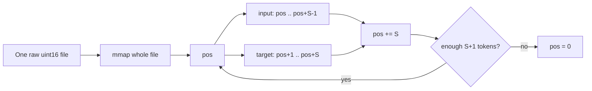
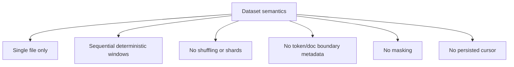
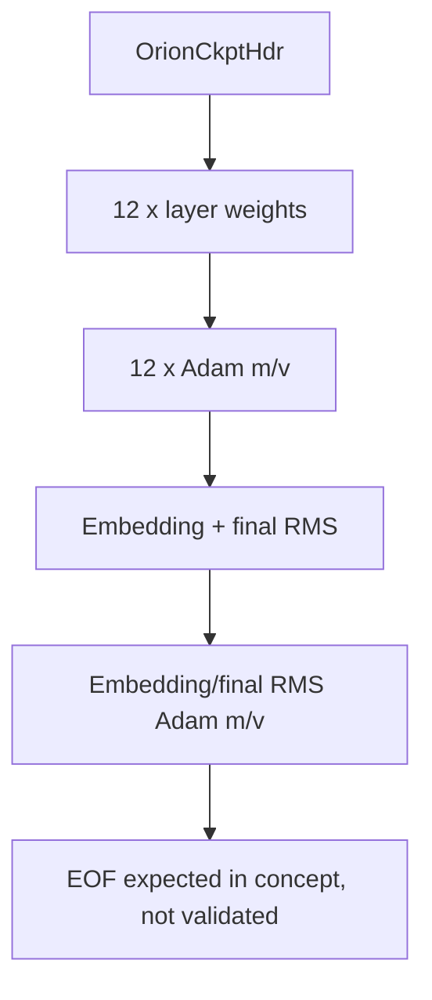
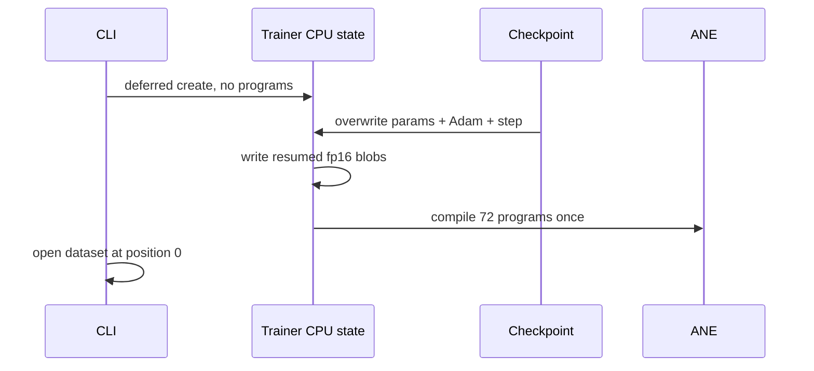

# Data, Checkpoints, and LoRA

## Scope and method

This report follows training data from file to tokens, checkpoint state to resumed programs, and LoRA adapter files to ANE IOSurfaces/frontends. It uses current active source and the local 2026-07-12 test run. It distinguishes implemented libraries from features reachable through the shipped CLI.

## Evidence-status legend

| Mark | Meaning |
|---|---|
| **[CODE]** | Directly visible active behavior. |
| **[LOCAL]** | Observed in the local 2026-07-12 run. |
| **[TEST]** | Guaranteed only to the extent of test assertions. |
| **[STATIC-RISK]** | Inferred risk not reproduced in this review. |
| **[HISTORICAL]** | Earlier repository claim, not freshly measured. |

## Data path

The loader opens one raw file, verifies only that it contains at least `seq_len + 1` uint16 values, and maps the entire file read-only with `mmap` (`kernels/training/data_loader.m:11-41`). Each call copies a contiguous sequence to int32 input and the next token to target, then advances exactly `seq_len`. At exhaustion it resets position to zero and returns false; the CLI immediately retries (`kernels/training/data_loader.m:44-70`, `apps/cli/commands/train.m:233-240`). **[CODE]**

There is no shuffle, random seed, shard list, epoch permutation, batching abstraction, distributed partition, token validation, document-boundary handling, or attention/loss masking. The comment says documents are BOS-separated, but the loader does not interpret BOS; fixed windows may cross document boundaries (`kernels/training/data_loader.m:8-10`, `kernels/training/data_loader.m:44-61`). **[CODE]**

The file's odd trailing byte, if any, is silently ignored by integer division. Token IDs are not checked against vocabulary bounds before embedding lookup, so malformed data can index outside `embed` (`kernels/training/data_loader.m:21-36`, `kernels/training/stories_cpu_ops.m:62-67`). **[STATIC-RISK]**

The data-loader unit fixture `data/tinystories_test.bin` is ignored by Git and was present locally. The local PASS therefore depends on an untracked/ignored fixture not guaranteed in a clean checkout (`tests/test_data_loader.m:16-24`, `.gitignore:60-61`). **[LOCAL]**

## Checkpoint format and flow

The checkpoint is a direct host-layout binary stream: a fixed C header, all layer fp32 parameters, layer Adam `m` and `v`, embedding and final RMS parameters, and their moments (`core/checkpoint.m:6-17`, `core/checkpoint.m:107-153`). Gradients, activations, RNG state, data-loader position, gradient-accumulation partial state, and wall/profiling counters are not restored. **[CODE]**

Save opens the destination path directly with `fopen(path, "wb")`, writes sequentially, and closes it. A crash, disk-full condition, or concurrent reader can observe a truncated checkpoint at the final name; there is no temporary file, `fsync`, atomic rename, checksum, or generation manifest (`core/checkpoint.m:107-153`). **[CODE]**

Load validates magic, version, layer count, width, hidden width, and vocabulary. It does not compare `n_heads` or `seq_len`, validate exact expected file size/trailing bytes, verify checksum, reject non-finite state, validate step/Adam ranges, or stage into temporary buffers before mutating the live trainer (`core/checkpoint.m:158-213`). A truncated checkpoint can partially overwrite trainer state before returning false. **[STATIC-RISK]**

### Resume coherence

The resume compile ordering is sound. `orion_trainer_create_deferred` initializes buffers and loads base disk weights without ANE compilation; checkpoint load overwrites CPU parameter and Adam arrays; `orion_trainer_recompile` serializes the checkpoint parameters to blobs and compiles all programs with those weights (`apps/cli/commands/train.m:148-176`, `kernels/training/stories_train.m:503-582`, `kernels/training/stories_train.m:954-989`). **[CODE]**

Resume is not a bitwise continuation of data order: the loader is opened after checkpoint restoration with `pos = 0`, so training restarts the dataset while the optimizer step continues (`apps/cli/commands/train.m:148-203`, `kernels/training/data_loader.m:33-39`). The CLI also applies `trainer->lr = args.lr` after load, overriding checkpoint LR with the command/default (`apps/cli/commands/train.m:189-195`). These choices should be explicit policy rather than incidental behavior. **[CODE]**

## LoRA implementation and reachability

`core/lora_adapter.m` parses a text config containing rank, alpha, and q/k/v/o target flags, then loads per-layer A/B BLOBFILE payloads into uniformly sized IOSurfaces while writing the logical matrices packed at offset zero (`core/lora_adapter.m:9-98`, `core/lora_adapter.m:102-155`). This correctly reflects documented uniform-input and packed-data constraints (`docs/ane_constraints.md:152-184`). **[CODE]**

The compiler offers:

- A standalone fused linear graph, `base(x) + alpha/rank * (x A^T) B`, with A and B as hot-swappable inputs (`compiler/frontends/lora.c:17-109`).
- An attention frontend that can apply LoRA to Q, K, V, and/or O (`compiler/frontends/lora.c:112-249`).

However, active production references stop at these declarations/implementations: `orion_lora_load`, `orion_lora_create_zero`, and `orion_frontend_lora_attn` have no call sites in inference, training, or CLI code. There is no `--lora` option (`core/lora_adapter.m:102-224`, `compiler/frontends/lora.c:136-249`, `apps/cli/commands/infer.m:22-88`, `apps/cli/commands/train.m:30-92`). Thus LoRA is a library/prototype surface, not an integrated user path. **[CODE]**

The one LoRA binary test exercises only the standalone linear frontend, not the attention frontend or adapter file loader. It checks graph text, ANE compile/eval when ANE is available, zero/nonzero adapter effects, hot-swap output differences, and unchanged compile count (`tests/test_lora.m:65-212`). If ANE is unavailable it prints a skip and exits successfully after structural checks (`tests/test_lora.m:214-233`). **[TEST]**

## Strengths

- `mmap` keeps data ingestion simple and avoids loading a large corpus into an additional heap copy (`kernels/training/data_loader.m:27-41`).
- Shifted targets and non-overlapping sequential windows are straightforward and deterministic (`kernels/training/data_loader.m:44-61`).
- Checkpoints include fp32 master parameters and both Adam moments, which are the core trainable state (`core/checkpoint.m:132-150`).
- Deferred resume compilation ensures ANE programs correspond to restored rather than stale base weights (`apps/cli/commands/train.m:148-176`).
- LoRA surfaces use packed logical data inside uniform allocations and test the critical alphabetical input order (`core/lora_adapter.m:49-58`, `tests/test_lora.m:132-151`).
- The local data-loader, checkpoint smoke, delta reload, and standalone LoRA binaries passed with local ignored fixtures/hardware. **[LOCAL]**

## Limitations

- Data order is one deterministic stream with no sampling controls, shards, epochs, or document-aware loss.
- Checkpoint ABI depends on native C scalar layout, endianness, and exact field sequence; there is no portable schema (`core/checkpoint.h:6-26`).
- Checkpoints do not preserve loader cursor, RNG, accumulation phase, or metrics; resume semantics are partial rather than exact.
- Save is non-atomic and load mutates live state incrementally.
- LoRA supports only attention projections in its layered frontend; no FFN adapters, training path, merge/export path, CLI integration, or checkpoint association is present.
- The adapter parser uses substring target matching and minimal validation; unknown keys/targets, duplicate fields, header integrity, and read length are not robustly checked (`core/lora_adapter.m:63-98`, `core/lora_adapter.m:17-47`).

## Severity-ranked risks

1. **High: checkpoint corruption can destroy the last good checkpoint.** Direct truncating writes target the final path without atomic replacement (`core/checkpoint.m:107-153`). **[STATIC-RISK]**
2. **High: malformed token IDs can cause out-of-bounds embedding access.** The loader never checks IDs against `cfg->vocab` (`kernels/training/data_loader.m:54-58`, `kernels/training/stories_cpu_ops.m:63-67`). **[STATIC-RISK]**
3. **High: failed checkpoint load can leave partially restored live state.** Reads write directly into trainer arrays before complete-file validation (`core/checkpoint.m:185-213`). **[STATIC-RISK]**
4. **Medium: resume silently restarts corpus order.** Optimizer time advances while data position returns to zero, changing exact continuation and potentially oversampling the corpus prefix (`apps/cli/commands/train.m:194-203`).
5. **Medium: checkpoint compatibility validation is incomplete.** Head count, sequence length, exact size, integrity, and finiteness are not enforced (`core/checkpoint.m:167-210`).
6. **Medium: LoRA may be mistaken for a shipped feature.** It has no CLI/runtime call site and only a standalone linear test; the attention integration is unexercised (`tests/test_lora.m:65-233`).
7. **Low: fixed windows cross document boundaries.** This may be intentional for a raw stream, but it contradicts expectations of document-isolated TinyStories samples unless explicitly documented.

## Recommendations

1. Write checkpoints to a same-directory temporary file, flush and `fsync`, validate byte count, then atomically rename; retain at least one previous generation.
2. Add an expected payload length and checksum to the header. Validate all metadata, exact file size, and finite/range constraints before committing staged state to the trainer.
3. Persist data identity and cursor, accumulation phase, RNG/sampling state, and explicit resume LR policy. Reject dataset mismatch unless the user opts in.
4. Validate even byte length and every token ID during load or before embedding; report the first invalid offset.
5. Add shard enumeration, deterministic seeded shuffle, and document-boundary/mask policy. Preserve a simple sequential mode for reproducibility.
6. Either integrate LoRA end to end with a CLI option, per-layer input binding, attention numerical tests, adapter metadata validation, and lifecycle ownership, or label it clearly as experimental/internal.
7. Add file-loader tests for valid/corrupt/truncated LoRA adapters and numerical tests for `orion_frontend_lora_attn` across target combinations and layers.

Any LoRA speed/hot-swap claims outside the current standalone assertions should be treated as **[HISTORICAL]** until measured through an integrated inference path.
