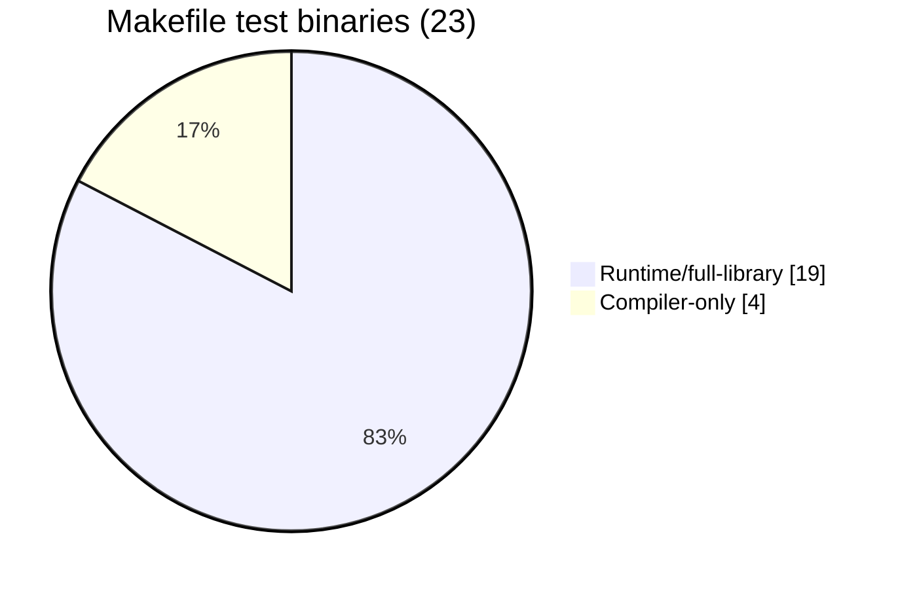
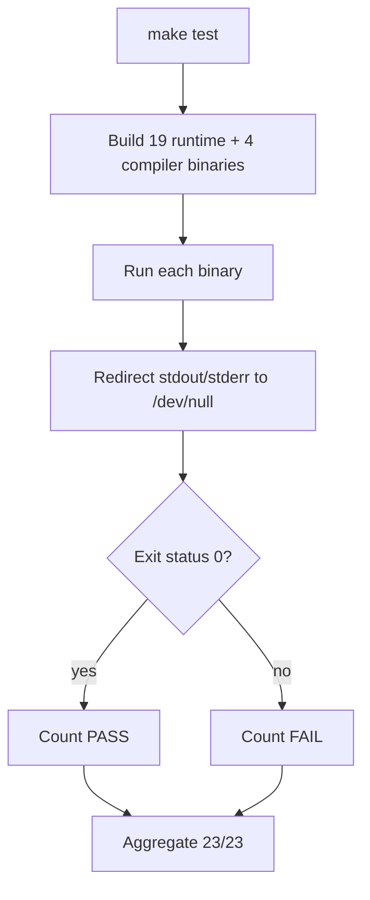
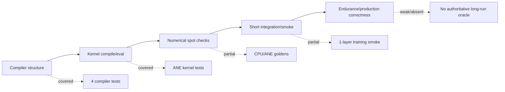
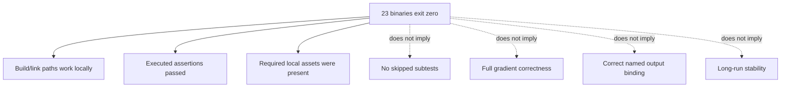

# Testing and Correctness Evidence

## Scope and method

This report inventories the authoritative Makefile suite, records the local result, and evaluates what the assertions do and do not prove. It separately classifies compiler-only checks, CPU numerical tests, ANE hardware tests, asset-dependent tests, benchmarks, ignored fixtures, excluded tests, and static risks.

The authoritative target currently contains 19 runtime/full-library binaries plus 4 compiler binaries, for 23 total (`Makefile:96-125`). Comments claiming 21 or 17 original tests are stale (`Makefile:93-94`, `Makefile:149-150`).

## Evidence-status legend

| Mark | Meaning |
|---|---|
| **[LOCAL]** | Directly observed in this workspace on 2026-07-12. |
| **[ASSERTION]** | What a test's checks establish if that code path runs. |
| **[SKIP-PASS]** | A binary can exit zero without running all intended checks. |
| **[STATIC-RISK]** | Source concern not falsified by the suite. |
| **[HISTORICAL]** | Prior output/prose, not a current controlled measurement. |

## Local run result

`make test` was run locally on 2026-07-12 and reported **23/23 passed, 0 failed**. The workspace had ignored GPT-2 blobs at `model/blobs/gpt2_124m` and an ignored loader fixture at `data/tinystories_test.bin`; both are excluded by `.gitignore` (`.gitignore:35-37`, `.gitignore:60-61`). The output showed the aggregate binary statuses because the Makefile redirects each test's stdout and stderr to `/dev/null` (`Makefile:149-166`). **[LOCAL]**

This result establishes that every listed binary returned zero in this environment with these local assets. It does not mean every internal assertion ran, every skip was absent, or every numerical path was independently correct.

## Suite execution model

The target treats process exit status as the only aggregate signal. This is conventional, but several binaries include skip branches that return zero. For example, `test_program_cache` returns zero when ANE is unavailable, and `test_lora` runs structural checks but skips ANE checks while still succeeding (`tests/test_program_cache.m:303-323`, `tests/test_lora.m:214-233`). `test_ane_prefill` also contains individual asset/compile skips, and its ANE-init failure returns success when no earlier check failed (`tests/test_ane_prefill.m:354-361`, `tests/test_ane_prefill.m:440-447`, `tests/test_ane_prefill.m:528-547`, `tests/test_ane_prefill.m:642-655`). **[SKIP-PASS]**

Other hardware/assets tests fail hard instead, so policy is inconsistent. `test_delta_compile`, `test_decode_ane_step`, and `test_infer_golden_ane` return failure on missing ANE or blobs (`tests/test_delta_compile.m:244-261`, `tests/test_decode_ane_step.m:248-274`, `tests/test_infer_golden_ane.m:141-186`).

## Evidence layers

### Compiler and graph evidence

The four compiler binaries cover graph construction, optimization passes, ANE constraint checks, and frontend MIL structure (`Makefile:117-125`, `tests/test_compiler_equiv.m:1-18`). `test_compiler_equiv` explicitly says it checks structural, not full numerical, equivalence and mostly searches generated MIL for operations/names (`tests/test_compiler_equiv.m:1-4`, `tests/test_compiler_equiv.m:78-252`). **[ASSERTION]**

The normal frontend adapter runs graph validation and optimization, but does not call `orion_pipeline_ane_passes`; the uniform-output pass itself only reports allocation needs and does not reorder outputs (`compiler/kernel_adapter.m:18-60`, `compiler/pipeline.c:14-34`, `compiler/pass_uniform_outputs.c:17-33`). Compiler success therefore cannot establish runtime surface binding.

### CPU numerical evidence

CPU training primitive tests independently check RMSNorm, cross-entropy gradients, embedding lookup, Adam behavior, and dW accumulation (`tests/test_cpu_training_ops.m:26-418`). CPU GPT-2 tests check selected embedding/logit values and token argmaxes using local model blobs (`tests/test_cpu_forward.m:26-201`). Decode tests compare cached decode against full CPU prefill at selected prompts (`tests/test_decode.m:30-137`). **[ASSERTION]**

Coverage remains spot-based. `tests/forward_golden.json` contains useful reference vectors, but active CPU tests hard-code only a subset rather than loading that file (`tests/test_cpu_forward.m:55-78`, `tests/test_cpu_forward.m:108-149`). `tests/test_infer_golden.json` is empty and unused (`tests/test_infer_golden.json:1-6`). **[STATIC-RISK/coverage gap]**

### ANE inference evidence

ANE prefill tests compile/evaluate kernels, check finite/nontrivial outputs, compare one K projection loosely, and compare top tokens for selected prompts (`tests/test_ane_prefill.m:158-224`, `tests/test_ane_prefill.m:352-435`, `tests/test_ane_prefill.m:438-586`). Decode-step tests compare greedy token, max/average logit differences, and top-5 overlap for short sequences (`tests/test_decode_ane_step.m:52-188`). Full-forward golden tests accept exact short sequences in some cases but allow later fp16 divergence if the first three tokens match (`tests/test_infer_golden_ane.m:76-134`). **[ASSERTION]**

This is meaningful targeted evidence for GPT-2 on the local machine, but not exhaustive across buckets, context lengths, sampling modes, cache boundaries, fallback failures, or model assets.

### Training evidence

Kernel tests establish MIL generation and compilation for all six Stories programs, but numerical eval checks exist only for forward attention and FFN and assert primarily finiteness (`tests/test_train_kernels.m:55-243`, `tests/test_train_kernels.m:245-351`). Backward programs are compiled but not compared to numerical gradients there. **[ASSERTION]**

The smoke test uses one layer, vocabulary 256, fixed sequence 256, synthetic weights, and synthetic repeated tokens; it checks trainer construction, finite positive loss, Adam timestep, five-step loss decrease, gradient accumulation completion, recompilation, and checkpoint round-trip (`tests/test_train_smoke.m:108-118`, `tests/test_train_smoke.m:120-377`). It does not compare the full gradient to an independent framework. **[ASSERTION]**

Most importantly, a finite/loss-decreasing smoke test does not disprove the apparent Stories output-order mismatch. The documented ANE rule says results map alphabetically (`docs/ane_constraints.md:29-37`), while training frontends register semantic-order outputs and the runner consumes that same semantic order (`compiler/frontends/stories_train.c:47-53`, `compiler/frontends/stories_train.c:91-96`, `kernels/training/stories_train.m:675-694`). Swapped tensors can remain finite, and clamping can force non-finite values back into range (`kernels/training/stories_train.m:19-53`). **23/23 must not be interpreted as disproving this silent-correctness risk. [STATIC-RISK]**

## Excluded and weakly authoritative artifacts

- `tests/test_weight_convert.py` contains useful BLOBFILE header/round-trip tests but is not in `make test` or another Makefile target (`tests/test_weight_convert.py:1-115`, `Makefile:92-125`). It also depends on Python/NumPy and conversion modules. **Excluded.**
- `tests/test_program_swap.m` is an unimplemented stub that returns failure, but it is not listed in the suite (`tests/test_program_swap.m:1-15`, `Makefile:96-125`). Program swap endurance/RSS behavior therefore lacks this intended test. **Excluded stub.**
- `tests/test_bench_decode` is included in `make test`, but it has no failure-count assertions and returns zero after printing “PASS” regardless of numerical equivalence or latency (`tests/test_bench_decode.m:62-133`). It is a benchmark smoke command, not correctness evidence. **Weak assertion design.**
- `tests/test_infer_golden.m` generates the “Once upon a time” expected sequence from the implementation under test and reruns it, proving determinism rather than external correctness for that case (`tests/test_infer_golden.m:81-99`).
- Historical benchmark/endurance statements in README and comments are **[HISTORICAL]** unless rerun under a recorded protocol. The local `make test` suppressed benchmark output, so no current latency numbers are claimed here.

## Strengths

- The Makefile gives one command that builds and runs a broad 23-binary matrix (`Makefile:124-166`).
- Compiler-only tests avoid model-asset dependence and provide fast graph/pass/codegen feedback (`Makefile:168-207`).
- Real ANE paths, cache behavior, delta reload, LoRA input ordering, and GPT-2 CPU/ANE comparisons are represented.
- CPU primitives have direct expected-value checks rather than only smoke assertions.
- The local complete binary matrix passed on supported hardware with the ignored fixtures present. **[LOCAL]**

## Limitations

- Output suppression hides skip messages, assertion counts, numerical errors, benchmark metadata, and diagnostic logs during a passing aggregate run (`Makefile:151-166`).
- Skip semantics are inconsistent and can count unavailable hardware or missing assets as PASS in some binaries.
- Ignored fixtures make local reproducibility dependent on workspace state.
- The suite mixes unit tests, integration tests, hardware probes, and benchmarks without labels or required-capability reporting.
- Goldens are weakly integrated: one JSON is unused, one is empty, and several expected sequences are hard-coded or self-generated.
- No full Stories forward/backward golden, finite-difference gradient check, full 12-layer reference comparison, or authoritative endurance test exists.

## Severity-ranked risks

1. **Critical: no test resolves the apparent Stories named-output binding issue.** Finiteness and short loss decrease are insufficient for a silent permutation bug. **[STATIC-RISK]**
2. **High: no full-gradient independent golden.** Backward kernels can compile and produce finite values while being mathematically wrong. **[ASSERTION GAP]**
3. **High: skip-as-pass can overstate coverage.** Aggregate `23/23` lacks a required/skipped count and suppresses the evidence needed to distinguish them (`Makefile:151-166`).
4. **High: ignored assets impede clean-checkout reproducibility.** GPT-2 and data tests require files outside version control.
5. **Medium: benchmark binaries are counted as tests.** `test_bench_decode` always exits zero after execution and contributes one PASS without a correctness threshold (`tests/test_bench_decode.m:62-133`).
6. **Medium: golden drift and self-reference.** Empty/unused goldens and implementation-generated expected tokens weaken independence.
7. **Medium: program reload/swap endurance is under-tested.** The intended swap test is a stub excluded from the suite (`tests/test_program_swap.m:4-15`).

## Recommendations

1. Add a mandatory named-output binding test on ANE: write distinguishable outputs, pass surfaces in every relevant ordering, and assert each semantic tensor. Use the proven mapping to generate runner bindings rather than hand-maintained arrays.
2. Build a tiny independent reference model and check every Stories forward tap, input gradient, parameter gradient, and post-Adam parameter value. Include finite-difference checks for selected parameters.
3. Change the harness to preserve logs per binary and print `PASS/FAIL/SKIP`, assertion count, hardware requirement, fixture requirement, duration, and log path. Required CI profiles should fail when required capabilities are absent.
4. Split targets into `test-unit`, `test-compiler`, `test-ane`, `test-assets`, and `bench`; keep `make test` as a declared profile rather than mixing benchmarks with correctness.
5. Add a fixture bootstrap/checksum manifest for ignored GPT-2 blobs and TinyStories test data, or generate compact tracked synthetic fixtures where feasible.
6. Wire `forward_golden.json` into active tests, populate or remove `test_infer_golden.json`, and record generator version/model hash with each golden.
7. Move `test_weight_convert.py` into an explicit conversion-test target and implement or remove `test_program_swap.m`; add repeated unload/reload output and RSS assertions.
8. Add context-boundary, forced ANE failure/fallback, all prefill buckets, checkpoint corruption, LoRA attention, and long-running training telemetry tests.

The correct summary is: **all 23 listed binaries returned success locally with ignored fixtures present; assertion design still leaves major silent-correctness risks, especially Stories output ordering and full gradients.**
