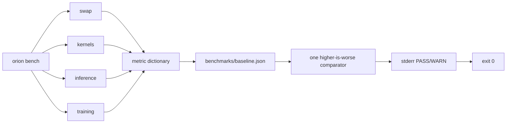
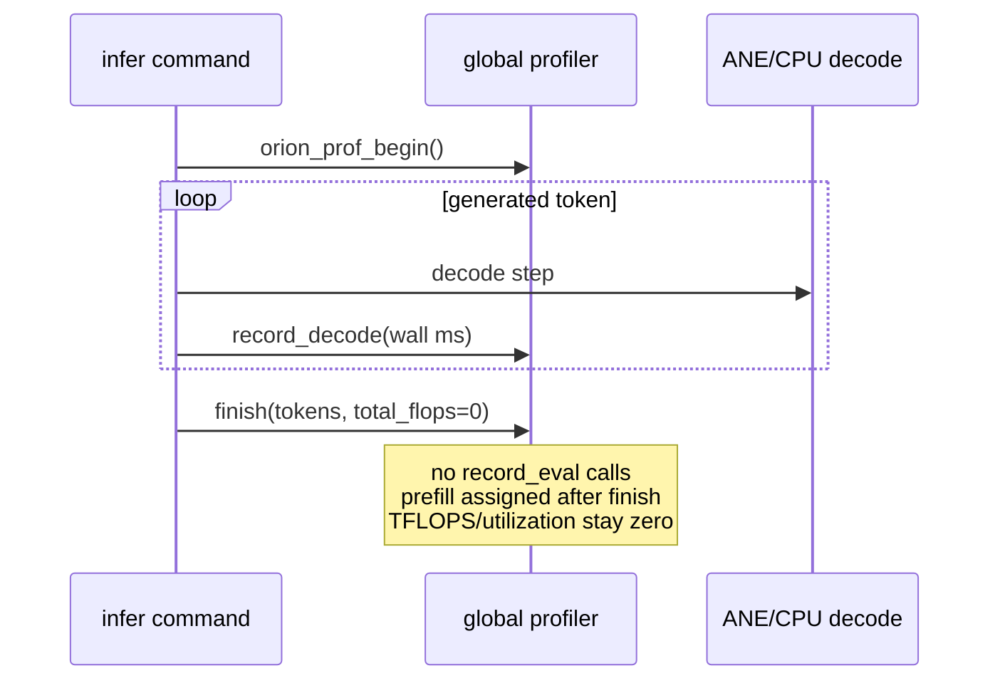
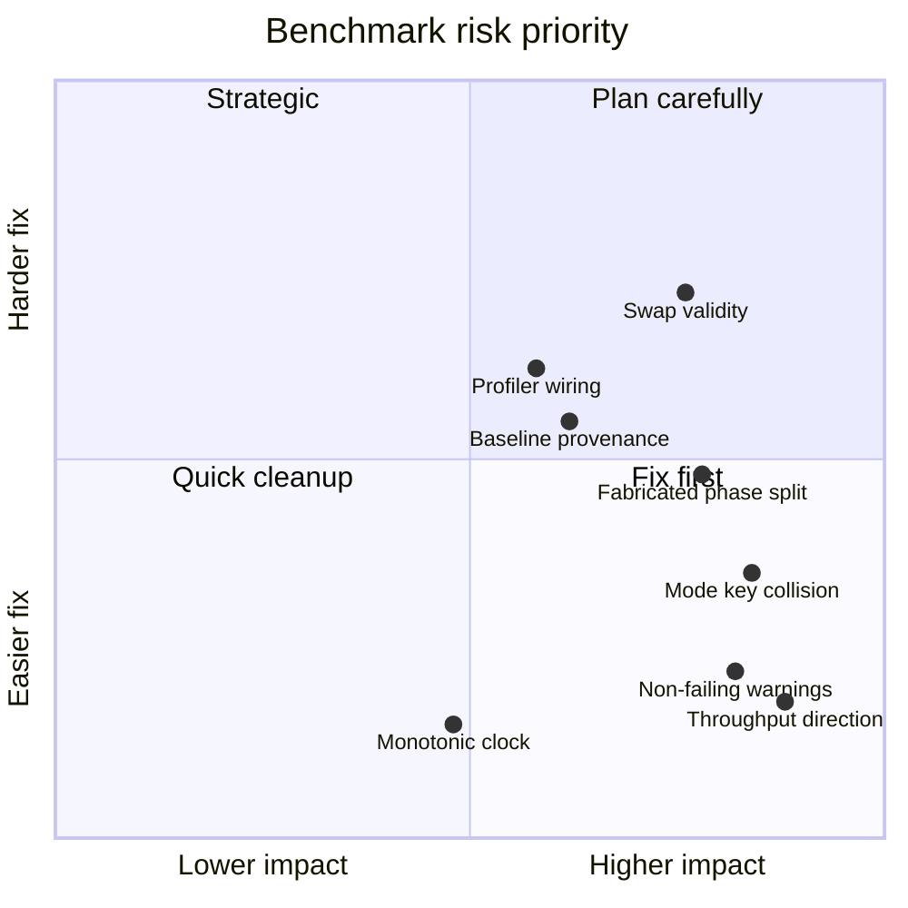

# Benchmarking and Observability Review

## Scope and method

This review traces the benchmark CLI, inference profiler, regression baseline format, benchmark-like tests, and published performance material. Primary sources were `apps/cli/commands/bench.m`, `apps/cli/commands/infer.m`, `core/profiler.{h,m}`, `tests/test_bench_decode.m`, `Makefile`, `README.md`, `RESULTS.md`, and `docs/m2_benchmarks.md`. Findings are based on source inspection; no benchmark was run for this report.

## Evidence status

| Status | Meaning | Evidence in this review |
|---|---|---|
| Source-confirmed | Directly visible in current code | Benchmark calculations, keys, exits, timers, profiler wiring, synthetic training data |
| Locally verified previously | Known result supplied for this review, not rerun here | Build and 23/23 tests succeeded after ignored assets were installed; deterministic CPU/ANE smoke outputs agreed |
| Historical only | Recorded by repository documents, not locally reproduced | All throughput, latency, TFLOPS, RSS, 1,000-step, and M4 Max figures in `RESULTS.md:7-179`, `docs/m2_benchmarks.md:1-45`, and `README.md:7-13,93-110,168-170,210-211` |
| Unsupported/currently misleading | Claimed behavior not produced by current implementation | TFLOPS and ANE utilization in benchmark claims; measured forward/backward split; genuine weight-swap benchmark |

Historical performance numbers must be read as historical observations on the stated machine, not as results reproduced during this audit. The known local smoke agreement supports deterministic numerical behavior for that smoke case only; it does not validate benchmark accuracy, performance, endurance, or regression detection.

## Current flow and design

`orion bench` dispatches four modes in `orion_cmd_bench` (`apps/cli/commands/bench.m:1042-1212`): swap, kernels, inference, and training. Results are emitted primarily to stderr; kernel rows additionally emit JSONL to stdout (`bench.m:676-684`). Every mode merges scalar metrics into one ignored file, `benchmarks/baseline.json` (`bench.m:69-110`; `.gitignore:76-77`), then compares common keys with a fixed 15% threshold (`bench.m:113-157`).

Kernel mode compiles five layer-0 programs and samples eval latency (`bench.m:497-734`). Inference mode warms up, performs one timed generation, and derives decode percentiles and throughput (`bench.m:739-905`). Training mode uses synthetic token IDs, times the combined training call, invents a phase split, then separately times Adam and reload (`bench.m:910-1037`). Swap mode compiles a weight-free addition graph under alternating cache identities (`bench.m:325-483`).

The separate profiler has process-global accumulators (`core/profiler.m:9-18`). Inference records only decode samples (`apps/cli/commands/infer.m:140-141,190-210`) and manually overwrites `prefill_ms`; no production caller records eval/total time, and `orion_prof_finish` is called with zero FLOPs (`infer.m:209-210`). Therefore `tflops` and `ane_utilization` remain zero (`core/profiler.m:65-70`) despite the advertised fields (`core/profiler.h:9-17`; `README.md:95-110`).

## Strengths

- The CLI exposes distinct kernel, end-to-end inference, training, and endurance entry points with explicit options (`bench.m:232-320,1042-1212`).
- Kernel sampling reports min, p50, p90, average, compile time, and a rough working-set estimate rather than only a mean (`bench.m:648-684`).
- Inference includes warmup, deterministic greedy sampling seed, prefill/decode separation, percentiles, throughput, generated-token count, and RSS (`bench.m:788-881`).
- Baseline writes are atomic and sorted, and merge mode preserves metrics from other commands (`bench.m:82-110`).
- Machine-readable kernel JSONL is useful for external collection (`bench.m:680-684`).
- `make test` has 23 current suites, including a decode benchmark executable (`Makefile:92-125,149-166`), and known local verification reported 23/23 passing after ignored assets were installed.

## Limitations

- `gettimeofday` is wall-clock time and can jump with clock adjustment; it is used by the benchmark CLI (`bench.m:37-41`), inference (`apps/cli/commands/infer.m:42-46`), and benchmark tests (`tests/test_bench_decode.m:30-34`). Training’s normal CLI already demonstrates the appropriate monotonic family through `mach_absolute_time` (`apps/cli/commands/train.m:95-99`).
- Percentiles are single-run order statistics with no confidence interval, environment capture, cooldown, outlier policy, or repeated-process sampling (`bench.m:648-672,839-870`).
- Kernel “SRAM” is a static sum of I/O and declared weights, then summed across sequential kernels (`bench.m:673-674,707-713`); this is not measured peak SRAM residency.
- Warmup ignores failures and always runs five decode steps rather than matching the requested workload (`bench.m:788-814`). Timed fallback can change backend without updating `mode_str` or baseline identity (`bench.m:782-786,823-855,873-890`).
- `test_bench_decode` always prints PASS if execution reaches the end; it has no performance or numerical assertion despite its summary claiming exact token matching (`tests/test_bench_decode.m:122-133`).
- The training benchmark calls real ANE kernels but feeds synthetic sequential IDs, so it is a micro-workload rather than representative dataset throughput (`bench.m:943-950`).

## Severity-ranked risks

### Critical

None identified. The defects undermine measurement and gating but do not directly corrupt runtime model outputs.

### High

1. **Throughput regressions are classified backwards.** `baseline_compare` warns only when current values rise by more than 15% (`bench.m:136-150`). That is correct for latency and RSS but treats faster `inference.tok_per_sec` as a regression and lets throughput collapse pass (`bench.m:883-890`).
2. **Regression warnings cannot fail automation.** The comparator returns `void`, modes return zero after WARN, and missing baselines merely print a message (`bench.m:113-157,471-482,726-734,892-905,1026-1037`). `make bench` consequently cannot enforce a performance gate (`Makefile:209-211`).
3. **Inference baselines collide across modes and workload identity.** CPU, hybrid, and ANE-full runs all write `inference.*`; prompt, token count, warmup, model/weight identity, bucket, hardware, OS, and fallback status are absent (`bench.m:739-743,782-890`). One mode silently overwrites another and comparisons can be meaningless.
4. **The training phase breakdown is fabricated.** `orion_train_step` includes forward, loss, backward, and dW, yet elapsed time is assigned 40% to forward and 60% to backward (`bench.m:964-974`). Labels and baselines imply measured phases (`bench.m:952-955,1017-1024`).
5. **Swap does not mutate or consume weights.** The graph is only `z = x + y` and compiles with `@{}` (`bench.m:332-352,390-405`). `weights_a` and `weights_b` are cache-key strings, so results test identity-driven compile/evict behavior, not weight swapping or changed outputs. Historical “weight swap” figures in `RESULTS.md:109-118` therefore cannot be attributed to this current path without external evidence.

### Medium

1. **Ignored baselines have no provenance or stable identity.** The single ignored JSON object contains only metric/value pairs (`bench.m:69-110`; `.gitignore:76-77`). There is no schema version, commit, dirty state, hardware, OS, compiler, model digest, command, sample count, units, direction, or timestamp.
2. **Missing training assets are reported as success.** `bench_training` prints “Skipping” and returns zero (`bench.m:912-925`), allowing CI or users to believe the requested benchmark passed.
3. **Profiler fields are not wired.** `orion_prof_record_eval` has no caller outside its definition; `prefill_ms` is never set inside the profiler; `total_tokens` is unused; inference passes zero FLOPs (`core/profiler.m:20-74`; `apps/cli/commands/infer.m:140-216`). README promises actual TFLOPS and ANE utilization (`README.md:95-112`).
4. **Wall-clock timing can produce invalid samples.** Clock changes can make durations negative or distorted (`bench.m:37-41`).
5. **Failures may produce partial “successful” kernel reports.** Compile failures and eval failures skip individual kernels, yet the mode still returns zero and can save a partial baseline (`bench.m:635-734`).

### Low

1. Metric names omit units on most latency keys (`eval_p50`, `decode_avg`) while values are milliseconds (`bench.m:715-724,883-890`).
2. p90 indexing uses truncation and does not define a percentile convention (`bench.m:669-672,865-869`).
3. Benchmark logic, weight-dictionary construction, CLI parsing, regression storage, and four workloads occupy one 1,212-line file, increasing change coupling (`bench.m:1-1212`).

## Actionable recommendations

1. **Make metric semantics explicit.** Define each metric with name, unit, direction (`lower`, `higher`, or bounded), warning/failure threshold, and workload dimensions. Compare throughput with `(baseline-current)/baseline`; compare latency with `(current-baseline)/baseline`.
2. **Add enforceable exits.** Have comparison return counts/status; return nonzero for missing required baseline, incomplete workload, benchmark failure, and threshold violation. Offer separate `--warn-only` for exploratory use.
3. **Use identity-scoped records.** Key records by benchmark, backend actually used, model digest, prompt/token shape, bucket, grad accumulation, hardware, OS, compiler/build, and git revision/dirty state. Store append-only runs plus a deliberately selected baseline rather than merging into one map.
4. **Replace `gettimeofday` with `mach_continuous_time`, `mach_absolute_time`, or `clock_gettime(CLOCK_MONOTONIC_RAW, ...)`** through one timing helper shared by CLI and tests.
5. **Instrument real training phases.** Add timers around embedding/forward/loss/backward/dW in `orion_train_step`, or report the combined call honestly as `train_compute_ms`. Never infer subphases by constants.
6. **Make swap a correctness benchmark.** Compile/reload a small weight-bearing graph, alternate two blobs with known outputs, assert output changes A/B/A, then report unload/write/load/eval/RSS separately. Validate both asset paths and hash them.
7. **Wire or remove profiler claims.** Record eval and wall time at the runtime boundary, pass a documented FLOP estimate, set prefill through an API, and make sessions instance-based or thread-local. Otherwise remove TFLOPS/utilization from public claims.
8. **Harden methodology.** Separate compile and steady-state runs, validate all return values, perform multiple measured runs, report sample count and dispersion, and prevent CPU fallback from retaining an ANE label.
9. **Reclassify published numbers.** Prefix `RESULTS.md` and `docs/m2_benchmarks.md` with hardware/date/commit/command/assets and “historical, not continuously reproduced”; do not present them as current verification.
