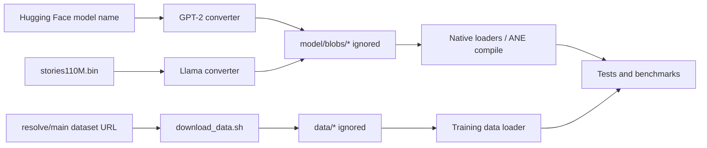
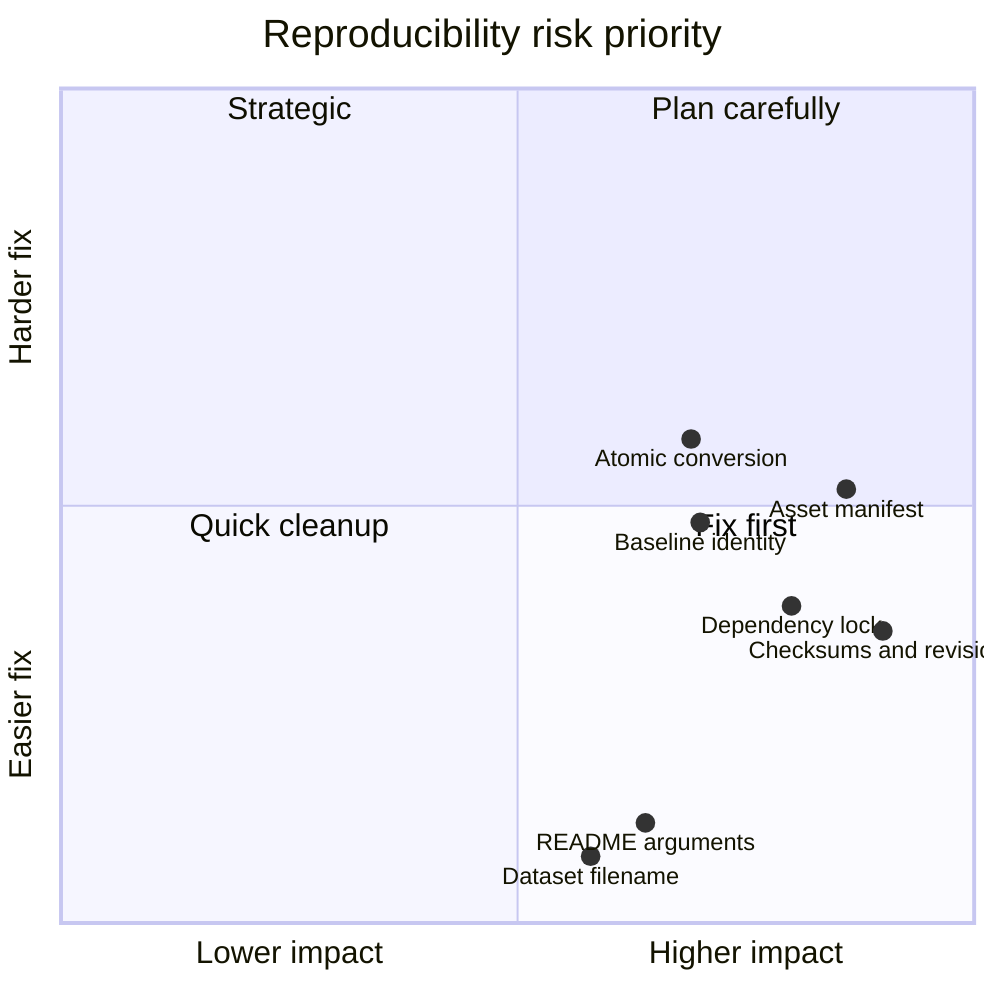
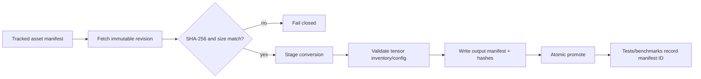

# Assets, Tooling, and Reproducibility Review

## Scope and method

This review follows external assets from download or Hugging Face resolution through conversion, ignored storage, loading, tests, and documented setup. Sources include `requirements.txt`, `.gitignore`, `scripts/download_data.sh`, `model/convert/*.py`, `model/weights/download.md`, golden generators, tokenizer fixtures, `model/weight_loader.m`, training loaders, `Makefile`, and setup instructions in `README.md`. No network download or conversion was performed.

## Evidence status

| Status | Meaning | Evidence |
|---|---|---|
| Source-confirmed | Present in current scripts/configuration | Dependency ranges, download URLs, converter arguments, ignored paths, loader behavior |
| Tracked and reviewable | Versioned in the checkout | Native source, tokenizer fixtures, golden JSON, scripts |
| Ignored/local | Required or optional but not versioned | `model/blobs/*`, `model/weights/*.bin`, `data/`, `benchmarks/`, checkpoints (`.gitignore:35-40,60-61,76-81`) |
| Locally verified previously | Supplied result, not rerun | Build and 23/23 tests succeeded after ignored assets were installed; deterministic CPU/ANE smoke agreed |
| Historical only | Not reproduced in this audit | Performance and endurance claims tied to unspecified local asset instances |

The known 23/23 result demonstrates that one local asset population supported the suite. Because no manifest or digest identifies those files, it cannot establish that another checkout can reconstruct the same inputs.

## Current flow and design

GPT-2 conversion resolves a mutable Hugging Face model name (default `gpt2`) through `from_pretrained`, converts tensors to fp16 BLOBFILEs, and writes an output directory (`model/convert/hf_to_blobs_gpt2.py:82-168,171-181`). Stories conversion consumes a separately downloaded llama2.c checkpoint and emits forward, transposed, and mask blobs (`hf_to_blobs_llama.py:22-106,127-206`). TinyStories data is downloaded directly from a moving `resolve/main` URL (`scripts/download_data.sh:8-20`).

Python is conversion/test tooling only; the native runtime links Foundation, IOSurface, Accelerate, and `dl` (`Makefile:4-7,135-147`). `requirements.txt` declares only lower bounds for Torch and Transformers (`requirements.txt:1-2`). Both converters import NumPy directly (`hf_to_blobs_gpt2.py:17-20`; `hf_to_blobs_llama.py:12-19`), and tests/golden generation do too (`tests/test_weight_convert.py:16`; `tests/gen_forward_golden.py:6-14`).

Generated BLOBFILEs use a 128-byte header and fp16 payload (`hf_to_blobs_gpt2.py:23-53`). The GPT-2 native loader mostly validates payload element count but does not validate the header (`model/weight_loader.m:16-50`). Training has a separate reader/writer implementation (`kernels/training/stories_train.m:56-82,188-210`), and LoRA has another reader (`core/lora_adapter.m:9-61`).

## Strengths

- Runtime inference has no Python dependency; Python is isolated to conversion and golden generation (`Makefile:15-90`; `AGENTS.md:5-6`).
- Converter code records tensor names/shapes and deterministically writes fp16 little-endian BLOBFILE payloads (`hf_to_blobs_gpt2.py:23-59,106-166`).
- Stories conversion creates both forward and transposed weights plus known causal-mask buckets in one operation (`hf_to_blobs_llama.py:127-202`).
- Tokenizer fixtures are tracked, so tokenizer tests do not depend on a live Hugging Face download (`tokenizer/data/vocab.json`, `tokenizer/data/merges.txt`).
- Build and test entry points are simple and centralized in `Makefile:131-211`.
- Large assets are excluded from Git, avoiding accidental repository bloat (`.gitignore:35-40,60-61`).

## Limitations

- Asset acquisition is fragmented: dataset has a script, Stories weights have prose (`model/weights/download.md:1-20`), and GPT-2 downloads implicitly inside Transformers. There is no single bootstrap/verify command.
- Conversion writes directly into the final output tree and leaves a partially generated directory on failure (`hf_to_blobs_gpt2.py:101-166`; `hf_to_blobs_llama.py:139-205`).
- Existing downloads are accepted solely by path existence (`scripts/download_data.sh:14-17`), even if truncated or wrong.
- Generated output records only console text. There is no machine-readable model config, source identity, tensor manifest, dtype/layout, converter version, or digest.
- Golden generation resolves `gpt2` from the network/cache without a pinned revision (`tests/gen_forward_golden.py:16-18,31-36`) and writes relative to the current working directory (`gen_forward_golden.py:72-75`).
- Build/test prerequisites are implicit; `make test` suppresses all test output and asset-related diagnostics (`Makefile:149-166`).

## Severity-ranked risks

### Critical

None identified in asset tooling alone.

### High

1. **Inputs are not immutable or authenticated.** Dataset download uses `resolve/main` with no revision or checksum (`scripts/download_data.sh:11-20`); GPT-2 uses an unpinned model name (`hf_to_blobs_gpt2.py:90-92,173-177`); the Stories download command has no digest (`model/weights/download.md:9-20`). Upstream mutation, cache differences, truncation, or compromise can silently alter weights, data, golden vectors, and reported results.
2. **No asset manifest connects source to generated blobs.** Ignored outputs have no revision, checksum, config, tensor inventory, converter commit, or generation arguments. Tests and historical benchmarks cannot identify which local model they exercised.
3. **Dependencies are not reproducible.** `torch>=2.0` and `transformers>=4.30` allow unbounded future versions (`requirements.txt:1-2`). NumPy is imported directly but undeclared (`hf_to_blobs_gpt2.py:20`; `hf_to_blobs_llama.py:16`; `tests/gen_forward_golden.py:7`; `tests/test_weight_convert.py:16`). Converter semantics can change across Torch/Transformers/NumPy releases.

### Medium

1. **Golden generation encourages ad hoc environment mutation.** On import failure it tells the user to run `pip install torch transformers` at generator runtime (`tests/gen_forward_golden.py:9-14`), bypassing a locked project environment and still omitting NumPy. The GPT-2 converter repeats this incomplete instruction (`hf_to_blobs_gpt2.py:84-88`).
2. **README converter commands are not executable as shown.** Both converters require `--output`, and the Stories converter also requires `--checkpoint` (`hf_to_blobs_gpt2.py:171-175`; `hf_to_blobs_llama.py:209-213`), while `README.md:303-311` supplies no arguments.
3. **Dataset path documentation disagrees with tooling.** README uses `data/tinystories.bin` (`README.md:27-29,81-90`), but the downloader creates `data/tinystories_data00.bin` (`scripts/download_data.sh:11-20`).
4. **Ignored benchmark baselines are unrecoverable and unidentified.** `.gitignore:76-77` excludes the only baseline file, while its format contains no run identity (`apps/cli/commands/bench.m:69-110`). This prevents review, sharing, and deterministic regression setup.
5. **Converters do not fail the process on logical failure.** `convert_gpt2` can return `False`, but `main` ignores the return and exits successfully (`hf_to_blobs_gpt2.py:82-89,171-181`).
6. **Partial and stale outputs can mix.** Converters create/overwrite individual files but do not clear, stage, or atomically promote an output directory (`hf_to_blobs_gpt2.py:101-166`; `hf_to_blobs_llama.py:139-205`). Changing model/config can leave extra old blobs.

### Low

1. The dataset script relies on `curl` and `du` without checking tool availability (`scripts/download_data.sh:19-21`).
2. Python version requirements are prose only (`README.md:287-292`) and not encoded in a project file.
3. There is no generated-file marker or command/version embedded in golden JSON (`tests/forward_golden.json`; `tests/gen_forward_golden.py:50-73`).

## Actionable recommendations

1. **Create a tracked asset manifest.** For every model, dataset shard, tokenizer, and golden source record canonical URL/repository, immutable revision, SHA-256, byte size, license, expected config, and destination. Record generated blob hashes and converter commit/arguments.
2. **Pin a supported Python toolchain.** Use an exact lock file with Python platform constraints and declare direct dependencies including NumPy. Keep `requirements.txt` generated from that lock if needed.
3. **Make acquisition verified and atomic.** Download to a temporary file, require HTTP failure handling, verify size/hash, then rename. Verify an existing file rather than accepting existence.
4. **Pin Hugging Face revisions.** Pass `revision=<commit>` to model/tokenizer `from_pretrained`; support offline/local-files-only mode; persist the resolved revision in output metadata.
5. **Generate into staging directories.** Validate the complete expected tensor set and dimensions, write `manifest.json`, fsync as appropriate, then atomically replace/promote the output. Refuse stale or mixed outputs.
6. **Add `scripts/bootstrap_assets.sh` and `scripts/verify_assets.sh`.** Keep downloads opt-in, but provide one authoritative path that reports which tests/commands each asset enables.
7. **Fix command documentation.** Show exact required converter arguments and the real `data/tinystories_data00.bin` path. Make scripts location-independent.
8. **Make generators hermetic.** Remove runtime `pip install` advice in favor of the locked environment command; include source revision and generator version in golden output; fail if the repository root/output path is ambiguous.
9. **Version benchmark fixtures separately from run data.** Track a small baseline manifest or approved baseline artifact with identity; keep noisy raw runs ignored if desired.

