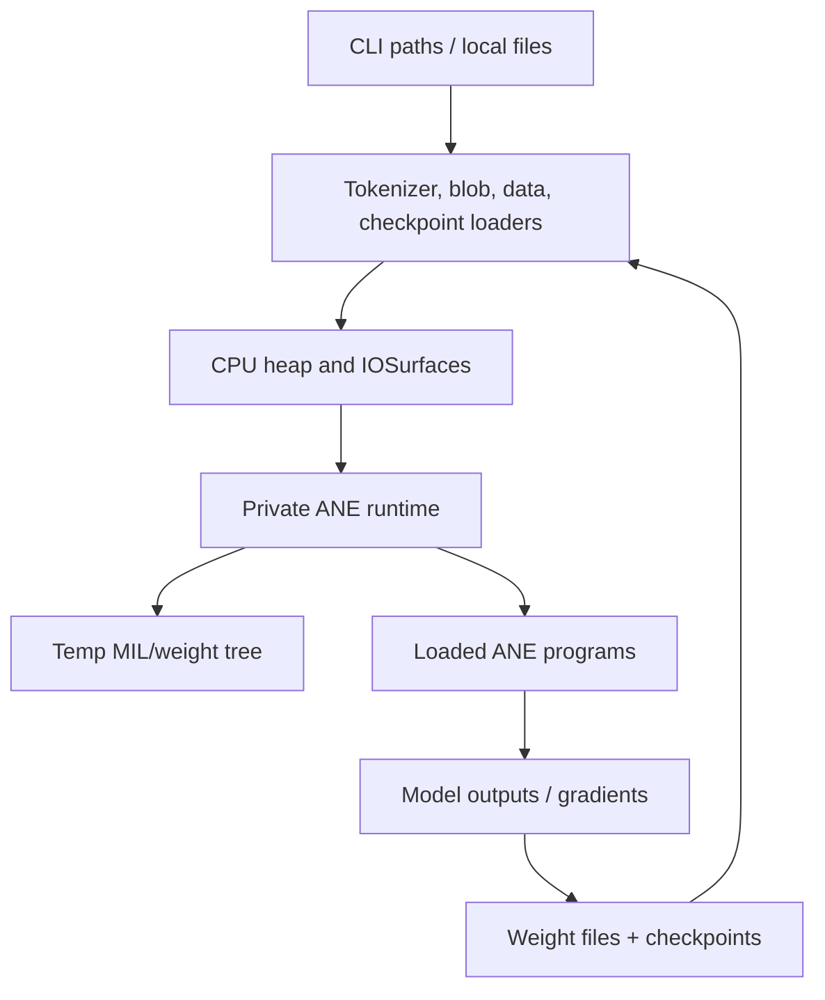
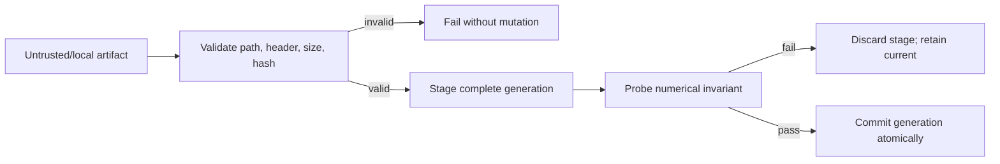

# Security, Reliability, and Portability Review

## Scope and method

This review examines trust boundaries and failure behavior in BLOBFILE/model loading, IOSurface memory operations, private-ANE compilation/evaluation, program cache, training reload, checkpointing, tokenization, data loading, and platform integration. It is a source review, not a fuzzing, sanitizer, fault-injection, or hostile-input exercise.

## Evidence status

| Status | Meaning | Evidence |
|---|---|---|
| Source-confirmed | Current implementation exposes the behavior | Unchecked sizes/allocations, path construction, globals, non-atomic transitions, private APIs |
| Inferred risk | Consequence follows from reachable inputs but was not exploited | Memory overwrite, path escape, partial trainer/checkpoint state, races |
| Locally verified previously | Supplied validation, not rerun | Build and 23/23 tests passed after ignored assets; deterministic CPU/ANE smoke agreed |
| Historical/platform-specific | Repository records only | M4 Max/macOS 15 performance, private API behavior, compile limit |

The local smoke agreement is relevant to one deterministic numerical path, but does not cover malformed files, allocation failure, concurrency, interrupted writes/reloads, OS upgrades, or unsupported hardware.

## Current flow and design

Native callers load tracked tokenizer data and ignored model/data/checkpoint files, allocate CPU buffers and IOSurfaces, then invoke dynamically resolved private ANE classes (`core/ane_runtime.m:30-46`). ANE compilation creates a model-identifier temp directory and copies MIL/weight entries into it (`ane_runtime.m:51-126`). Training updates CPU weights, writes many BLOBFILEs, unloads and reloads five weight-bearing programs per layer, with full recompilation as fallback (`kernels/training/stories_train.m:954-1050`).



The program cache protects dictionary operations with `@synchronized` (`core/ane_program_cache.m:49-112`), but returns an unretained raw program pointer after leaving the lock. ANE initialization, compile count, and profiler accumulators are process globals without equivalent synchronization (`core/ane_runtime.m:10-17,30-46,115-123`; `core/profiler.m:9-33`).

## Strengths

- Private framework loading and all required class resolutions fail closed during initialization (`core/ane_runtime.m:30-46`).
- ANE eval validates null program/I/O pointers and positive counts before request construction (`ane_runtime.m:132-139`).
- Program cache mutation is serialized, and cache entries own/release programs (`core/ane_program_cache.m:21-33,49-112`).
- Data loader uses read-only private `mmap`, validates a minimum sequence, and unmaps/closes resources (`kernels/training/data_loader.m:11-41,73-82`).
- Checkpoints validate magic, version, and core model dimensions before reading payload arrays (`core/checkpoint.m:167-183`).
- Training waits for asynchronous dW work before returning (`kernels/training/stories_train.m:748-755,907-910`), reducing a direct update-before-gradient race.
- Many filesystem writes use Foundation’s atomic replacement option, including baseline JSON, MIL, source blobs during compile, and per-weight training files (`apps/cli/commands/bench.m:101-110`; `core/ane_runtime.m:79-93`; `stories_train.m:77-82`).

## Limitations

- Security assumptions are undocumented. CLI paths and model artifacts are treated as trusted local inputs, yet malformed files can reach low-level arithmetic and memory copies.
- Errors are often discarded: directory creation/writes in ANE runtime ignore errors (`ane_runtime.m:76-95,283-317`), training ignores per-file save results (`stories_train.m:85-168,1030-1034`), and final checkpoint reporting ignores save success (`apps/cli/commands/train.m:317-321`).
- The runtime has no cancellation, timeout, health reset, or isolation boundary around private API calls (`ane_runtime.m:97-181,320-385`).
- Most allocation APIs are assumed to succeed across inference/training/compiler paths; failure handling is inconsistent.
- “Portable” currently means neither cross-platform nor public-API stable: Objective-C, IOSurface, Accelerate/NEON, private AppleNeuralEngine classes, and `ios18` MIL are hard requirements (`Makefile:4-7`; `core/iosurface_tensor.m:1-45`; `ane_runtime.m:33-42`; generated MIL in `apps/cli/commands/bench.m:334-350`).

## Severity-ranked risks

### Critical

1. **Untrusted weight paths can escape the ANE temp directory.** `orion_compile_mil` removes the `@model_path/` substring wherever it appears and appends the remainder without canonical containment checks (`core/ane_runtime.m:82-94`). Reload and patch repeat this (`ane_runtime.m:290-307,363-372`). Keys containing `../`, absolute semantics, or unexpected prefixes can target paths outside the intended model tree. This is a write primitive if a hostile weight dictionary reaches these APIs.

### High

1. **BLOBFILE parsing can read out of bounds.** GPT-2 and LoRA readers subtract 128 from unchecked `ftell` results, allocate that signed-derived size, ignore `fseek`/`fread` failures, and do not validate magic/header fields (`model/weight_loader.m:16-50`; `core/lora_adapter.m:14-60`). Training reads `data_bytes` and `data_offset` from the header but verifies neither against `NSData.length` before indexing (`kernels/training/stories_train.m:188-210`). A malformed local asset can cause huge allocation, underflow, short-read use, or out-of-bounds access.
2. **IOSurface copy helpers do not check capacities or offsets.** Raw read/write and conversion functions trust caller sizes/counts (`core/iosurface_tensor.m:50-112`); region copy computes a destination offset and copies without comparing either surface allocation (`iosurface_tensor.m:116-157`). Shape/config mistakes can become heap/shared-memory corruption rather than a recoverable error.
3. **Checkpoint load is not transactional.** Header state is assigned before payload completion, and arrays are overwritten in place as reads proceed (`core/checkpoint.m:185-210`). A truncated checkpoint returns false after partially mutating the live trainer. There is no expected file-size check, payload checksum, finite-value validation, or trailing-data policy.
4. **Delta reload is not atomic across files or programs.** Training writes dozens of blobs, then unloads/reloads programs sequentially (`stories_train.m:1030-1044`; `core/ane_runtime.m:344-385`). Failure can leave a mix of old/new files and loaded/unloaded or old/new programs. Fallback full recompile first releases programs layer by layer (`stories_train.m:966-985`), so it also cannot preserve a known-good generation.

### Medium

1. **Allocation and integer-overflow handling is weak.** Examples include `count * sizeof(float)` with signed counts (`model/weight_loader.m:39-45`), `channels * seq_len` before or during allocation/copy (`core/iosurface_tensor.m:10-45,139-157`), fixed graph allocation without null checks (`compiler/graph.c:8-19`), and topo allocations used immediately (`compiler/topo.c:13-39`). Large or corrupt dimensions can overflow or dereference null.
2. **Global state and cache lifetime are unsafe for concurrent use.** `g_init`/`g_compile_count` are unsynchronized (`core/ane_runtime.m:12-17,30-46,115-123`); profiler sessions share `g_prof` (`core/profiler.m:9-33`); tokenizer BPE cache is mutable without locking (`tokenizer/gpt2_bpe.m:202-260`). Cache lookup returns a raw pointer that another thread can evict and free immediately (`core/ane_program_cache.m:49-59,82-105`).
3. **Initialization can race and leak framework state.** Concurrent `orion_ane_init` calls can both initialize/reset compile count, and the `dlopen` handle is neither stored nor closed (`core/ane_runtime.m:30-46`).
4. **Training asset failures can degrade into zeros or incomplete weight dictionaries.** `load_blob_f32` returns zero, but callers ignore it and retain zero-initialized arrays (`stories_train.m:476-498,505-572`). `load_weight_dict` logs and omits missing blobs rather than failing construction (`stories_train.m:170-185`). This risks compiling/running a semantically incomplete model.
5. **Data file validation is incomplete.** Odd byte counts are silently truncated to uint16 tokens, token IDs are not checked against vocabulary, and `seq_len <= 0` is not rejected before size arithmetic in open (`kernels/training/data_loader.m:11-39,44-61`).
6. **Private APIs create hard reliability and deployment constraints.** Selectors/classes, QoS constants, temp artifacts, and MIL dialect can change without compatibility guarantees (`core/ane_runtime.m:30-45,62-112,163-181`). App Store distribution and sandbox behavior are not established. The Makefile is macOS-only and uses arm64 NEON (`Makefile:4-7`; `core/iosurface_tensor.m:2`).

### Low

1. Checkpoint save opens the final path directly and can leave a truncated file on interruption (`core/checkpoint.m:107-153`).
2. Training creates checkpoint directories while ignoring errors (`apps/cli/commands/train.m:204-206`).
3. Fixed 512/1024-byte path buffers can truncate long caller paths without detection (`apps/cli/commands/train.m:262-264,318-320`; `core/lora_adapter.m:104-138`; `model/weight_loader.m:70-120`).
4. `orion_ane_init` fallback in inference can leave `ane_decode` true after `use_ane` becomes false (`apps/cli/commands/infer.m:96-102`), leading to attempted ANE decode after CPU prefill.

```mermaid
sequenceDiagram
    participant CPU as CPU weights
    participant FS as Blob files
    participant P1 as Program L0
    participant PN as Program Ln
    CPU->>FS: replace many files
    FS->>P1: unload, overwrite, load
    P1-->>FS: success
    FS->>PN: unload, overwrite, load
    PN--xFS: failure
    Note over CPU,PN: no generation rollback;<br/>files and programs can disagree
```

## Actionable recommendations

1. **Centralize a strict BLOBFILE parser.** Validate file status/size, magic, version, declared length/offset, arithmetic overflow, exact expected shape, read completion, and finite values before allocating or exposing data. Reuse it for GPT-2, Stories, LoRA, and tests.
2. **Enforce path containment.** Accept only normalized relative paths under the exact `@model_path/` prefix; reject absolute paths, `..`, symlinks escaping the root, empty components, and collisions. Verify standardized/resolved destination remains under a per-process private temp root.
3. **Make tensor APIs checked.** Return `bool`; use `IOSurfaceGetAllocSize`; validate multiplication with overflow helpers; ensure source/destination ranges fit; check lock/base-address results. Propagate errors.
4. **Make checkpoints transactional and self-validating.** Write a temp file, include payload length/config/schema and checksum, flush/fsync, then rename. Load into a complete staging trainer/state object and swap only after every field validates.
5. **Implement generation-based reload.** Stage a complete weight generation and replacement programs, validate with a deterministic probe, then atomically switch trainer references. On failure retain the known-good generation and clean staging. At minimum, stop ignoring save/write/unload results.
6. **Define concurrency ownership.** Serialize ANE compile/load/eval/reload or document/enforce single-thread confinement. Make cache lookup retain a handle through eval. Use `dispatch_once` for framework initialization and atomics/locks for counters; make profiler state instance-owned.
7. **Add fault-oriented tests.** Fuzz headers and tokenizer files; test short reads, huge dimensions, odd data length, `../` keys, allocation failure, interrupted checkpoint save, reload failure at every layer, and concurrent lookup/eviction. Run ASan/UBSan for CPU-only/compiler tests where feasible.
8. **Fail closed on missing training assets.** Require every expected blob and exact element count before any compile; return errors rather than substituting zero arrays or incomplete dictionaries.
9. **State portability honestly.** Publish a support matrix: Apple Silicon, tested macOS/build versions, private API risk, no iOS target, no App Store assurance, and which CPU/compiler tests can run without ANE/assets. Treat OS updates as a compatibility test event.


