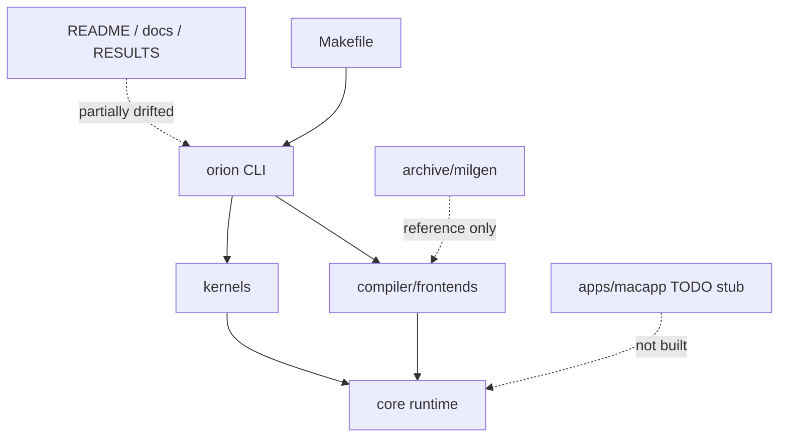
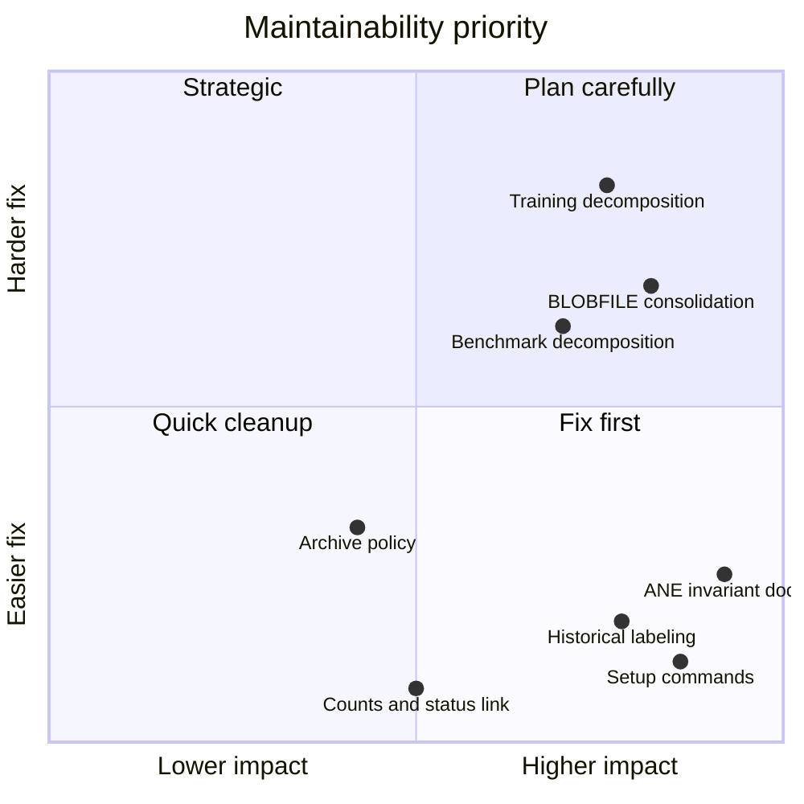
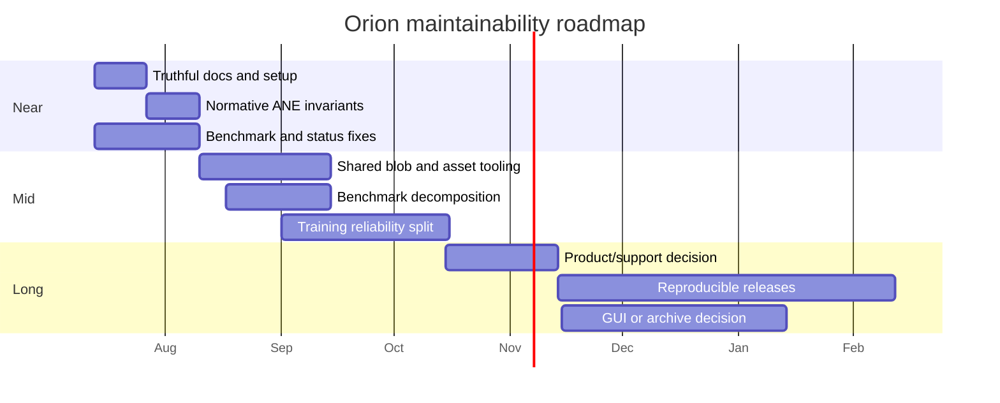

# Documentation, Maintainability, and Roadmap Review

## Scope and method

This review compares public and internal documentation with current build lists, CLI help, source behavior, tests, constraints, archived code, and the unbuilt app stub. It also assesses concentration, duplication, and a prioritized delivery roadmap. Sources include `README.md`, `RESULTS.md`, `docs/*.md`, `Makefile`, CLI commands, `core/`, `compiler/`, `kernels/`, `archive/milgen/`, and `apps/macapp/`.

## Evidence status

| Status | Meaning | Evidence |
|---|---|---|
| Authoritative current source | Controls actual build/runtime behavior | `Makefile`, CLI `--help` strings, compiled source paths |
| Current but incomplete docs | Generally aligned, missing caveats | Architecture and code map portions of README |
| Drifted docs | Contradicted by current source/tree | Commands, counts, constraints, restart/reload rules, ordering, status link, app/platform claims |
| Historical only | Valid only as dated record unless reproduced | `RESULTS.md` and `docs/m2_benchmarks.md` performance/endurance figures |
| Locally verified previously | Supplied result, not rerun for this report | Build and 23/23 tests succeeded after ignored assets; deterministic CPU/ANE smoke agreed |

Historical performance is explicitly not locally reproduced in this review. The supplied local verification should be documented as a dated environment-specific check, not used to refresh or endorse historical throughput/endurance claims.

## Current flow and design

The actual shipped artifact is the root `orion` CLI built by `Makefile:131-147`, dispatching `infer`, `train`, and `bench` (`apps/cli/main.m:5-45`). Compiler frontends generate graph IR and MIL; runtime/training code owns private API execution. `apps/macapp/` is a TODO-only SwiftUI prototype and is absent from all Makefile targets (`apps/macapp/OrionApp.swift:1-42`; `apps/macapp/ModelRunner.swift:1-15`; `Makefile:15-90`). `archive/milgen/` retains retired generator implementations but is not built.

Maintainability is strongest in the compiler’s split graph/pass/frontend structure and weakest in runtime workflows. `apps/cli/commands/bench.m` is 1,212 lines and combines parsing, persistence, graph construction, execution, reporting, and regression logic. `kernels/training/stories_train.m` is 1,064 lines and combines BLOB I/O, kernel adapters, compile/reload, allocation, forward/backward execution, async CPU gradients, optimizer support, and lifecycle.

## Documentation drift inventory

1. **Dataset filename:** README uses `data/tinystories.bin` (`README.md:27-29,81-90`); downloader creates `data/tinystories_data00.bin` (`scripts/download_data.sh:11-20`).
2. **Converter arguments:** README invokes both Python converters without arguments (`README.md:303-311`); GPT-2 requires `--output` and Stories requires `--checkpoint --output` (`model/convert/hf_to_blobs_gpt2.py:171-175`; `hf_to_blobs_llama.py:209-213`).
3. **Source counts:** Makefile comment says “38 total: 24 runtime + 14 compiler” (`Makefile:11-13`), but listed sources are 24 runtime/library plus 22 compiler, with `main.m` separately, for 47 translation units (`Makefile:15-90`). README says “~50,” which is approximate (`README.md:293-300`).
4. **Test counts:** Makefile comments claim 21 tests and 17+4 (`Makefile:92-94,149-150`), but `TEST_NAMES` has 19 and compiler tests have 4, totaling 23 (`Makefile:96-125`). README mixes 21/21 and 17/17 historical milestones with the current 23-suite command (`README.md:204,211,293-300,332-334`). Known local verification was 23/23 after ignored assets were present.
5. **Constraint count:** README claims 20 constraints and 14 new Orion constraints (`README.md:238-240,270-274`), while `docs/ane_constraints.md` contains and tabulates 14 total (`docs/ane_constraints.md:9-184,188-205`). References to LoRA discoveries “#18-#20” cannot be resolved in that document (`README.md:210-211`).
6. **Mandatory full recompile is stale:** constraints say overwriting/reloading cannot change outputs and full recompilation is mandatory (`docs/ane_constraints.md:77-83`), while current training intentionally unloads, rewrites, and reloads without compiler calls (`core/ane_runtime.m:344-385`; `kernels/training/stories_train.m:991-1050`). This needs nuanced wording separating ordinary source BLOB overwrite, compiled `data` replacement, unload/reload, and full compile.
7. **Mandatory restart guidance is stale for normal training:** constraints/API reference prescribe `exec()` around the ~119 compile limit (`docs/ane_constraints.md:53-59`; `docs/ane_api_reference.md:80-83,241-247`), while current training compiles once and delta reloads (`apps/cli/commands/train.m:270-279`). Restart remains relevant to workloads that truly compile repeatedly, not the normal training loop.
8. **Input ordering is wrong in API reference:** request comments say indices match MIL function argument order (`docs/ane_api_reference.md:121-137`); current constraint says multi-input surfaces must be alphabetical by parameter name (`docs/ane_constraints.md:164-172`).
9. **Operation support is misleading:** API operation table lists `concat` as an operation (`docs/ane_api_reference.md:196-212`) despite the constraints and compiler banning it (`docs/ane_constraints.md:9-15`; `compiler/graph.c:26-54`).
10. **I/O wording conflicts:** API reference says fp32 IOSurface I/O/fp16 compute (`docs/ane_api_reference.md:93-118,182-192,248-249`); core tensor API and repository invariant use fp16 `[1,C,1,S]`, while selected MIL wrappers use fp32 surfaces/casts (`core/iosurface_tensor.m:4-45`; `apps/cli/commands/bench.m:343-350`). “All ANE I/O” must distinguish logical MIL boundary dtype from common physical/runtime storage paths.
11. **“Full ANE” overstates execution:** README labels `--ane` “Full ANE forward” (`README.md:70-75`) but documents CPU embedding, CPU logits projection, and CPU sampling (`README.md:164-170`). The accurate term is ANE transformer prefill/decode with CPU embedding/head/sampling, not full-model ANE execution.
12. **Absent `STATUS.md`:** README links it (`README.md:313-318`), but `.gitignore` excludes it as internal project management (`.gitignore:83-89`) and no tracked file exists.
13. **Benchmark claims exceed wiring:** README says benchmark TFLOPS and ANE utilization (`README.md:95-112`); current benchmark dictionaries do not produce either, and inference profiler never records eval time/passes FLOPs (`core/profiler.m:20-74`; `apps/cli/commands/infer.m:140-216`).
14. **App/mobile aspirations are not deliverables:** README discusses iPad/iPhone use and a future platform (`README.md:35-50,174-180,216-235`) while the repository builds only macOS Objective-C CLI code; SwiftUI files are nonfunctional TODOs and not in a project/Makefile target (`apps/macapp/*.swift`; `Makefile:15-90`).
15. **Production-quality language is premature:** README calls the private-API research runtime “production-quality” (`README.md:43-50,270-283`) despite ignored/unmanifested assets, private API fragility, non-transactional reload/checkpoint paths, and benchmark-gating defects documented in reports 13-15.

## Strengths

- Repository structure clearly separates compiler, core runtime, inference, training, model, tokenizer, tests, and experiments.
- `Makefile` is a concise authoritative inventory of what ships and what tests run (`Makefile:15-125`).
- `docs/ane_constraints.md` records failure modes, workarounds, provenance, and severity symptoms in a useful format (`docs/ane_constraints.md:9-205`).
- Compiler code is decomposed into graph, validation, topological ordering, passes, codegen, adapters, and frontends (`Makefile:50-75`), enabling focused compiler-only tests (`Makefile:117-125,168-185`).
- Public CLI help is colocated with parsing and is more reliable than prose for current options (`apps/cli/commands/bench.m:232-320`; `apps/cli/commands/train.m:30-92`; `apps/cli/commands/infer.m:22-88`).
- Historical results identify hardware and many workload details (`RESULTS.md:1-3`; `docs/m2_benchmarks.md:1-5`), providing useful research context if labeled historical.

## Limitations

- Task IDs (`T###`) and phase language permeate production comments without a tracked public status/task source, reducing context for maintainers (for example `apps/cli/commands/bench.m:28-33`; `core/ane_runtime.m:6-9`; `compiler/graph.c:1`).
- Architecture prose combines current behavior, historical milestones, and future product positioning in one README, making status hard to interpret (`README.md:185-235,313-335`).
- Duplicated BLOBFILE readers/writers exist in Python, GPT-2 loading, training, LoRA, tests, and experiments, with different validation behavior (`model/convert/hf_to_blobs_gpt2.py:23-53`; `model/weight_loader.m:10-50`; `kernels/training/stories_train.m:56-82,188-210`; `core/lora_adapter.m:9-61`).
- Timer/statistics and IOSurface creation helpers are duplicated across CLI/tests (`apps/cli/commands/bench.m:37-64`; `apps/cli/commands/infer.m:42-46`; `tests/test_bench_decode.m:30-60`).
- Model dimensions are duplicated in configs, registry, and loader literals (`model/configs/gpt2_124m.h`; `core/model_registry.m:4-38`; `model/weight_loader.m:55-68`).
- `archive/milgen/` preserves useful reference code but creates two apparent implementations without a top-level archive policy or removal criteria.

## Severity-ranked risks

### High

1. **Contradictory ANE invariants can cause silent wrong results.** Input ordering, dtype/I/O wording, and weight-update requirements differ across docs (`docs/ane_api_reference.md:93-137,241-249`; `docs/ane_constraints.md:77-83,152-184`). These are not cosmetic because ANE violations may compile and return incorrect values.
2. **Setup instructions do not produce a runnable checkout.** Dataset path and converter command drift block reproducible onboarding (`README.md:27-29,81-90,303-311`).
3. **Current and historical status are conflated.** Performance, test counts, completed phases, “production-quality,” and “full ANE” language can be interpreted as current guarantees (`README.md:7-13,50,185-214,313-335`; `RESULTS.md:7-179`).

### Medium

1. **Runtime monoliths increase regression radius.** Benchmark and training files each mix many responsibilities and exceed 1,000 lines (`apps/cli/commands/bench.m:1-1212`; `kernels/training/stories_train.m:1-1064`).
2. **Format/helper duplication invites divergent fixes.** BLOBFILE parsing already has inconsistent validation and offset handling across implementations.
3. **Unbuilt app code creates false surface area.** `apps/macapp` looks like a product target but has no build integration and returns “Not yet implemented” (`OrionApp.swift:29-32`; `ModelRunner.swift:10-14`).
4. **Archive and phase debris obscures ownership.** Retired generators and unresolved T/phase references make it harder to tell current APIs from research history.
5. **No tracked status source exists.** The README’s `STATUS.md` dependency is intentionally ignored (`README.md:318`; `.gitignore:83-89`).

### Low

1. Build comments and source/test counts are stale (`Makefile:11-13,92-94,149-150`).
2. README’s operation/frontend/pass counts require manual updates and have no generated check (`README.md:193-204`).
3. Historical docs do not record commit/asset hashes, limiting forensic value.

## Prioritized roadmap

### Near term: correctness and truthful status (0-4 weeks)

1. Correct README setup commands, dataset filename, test/source counts, absent `STATUS.md` link, constraint count, benchmark capabilities, and app/platform wording.
2. Reconcile `docs/ane_constraints.md` and `docs/ane_api_reference.md` into one normative ANE invariants section: alphabetical input/output order, uniform allocation, packed data, supported ops, exact BLOBFILE semantics, and delta reload caveat.
3. Mark all `RESULTS.md` and `docs/m2_benchmarks.md` numbers “historical, not locally reproduced,” with hardware/date/commit/command/asset-manifest fields where recoverable.
4. Rename “full ANE” to “ANE transformer” or similarly precise wording; explicitly list CPU embedding, LM head/logits, attention portions if applicable, and sampling.
5. Fix benchmark correctness/gating and asset failure exits described in report 13 before publishing new numbers.
6. Add a tracked `docs/status.md` generated or checked from the Makefile/test inventory, or remove status-dashboard promises entirely.

### Mid term: shared infrastructure and fault tolerance (1-3 months)

1. Introduce one validated BLOBFILE library used by runtime, training, LoRA, conversion tests, and manifests.
2. Split `bench.m` into workload modules plus shared timing/statistics/baseline reporting, while keeping CLI dispatch small.
3. Split `stories_train.m` along lifecycle/weights, ANE program set, forward/backward execution, and reload boundaries. Preserve one orchestrating step function rather than proliferating thin wrappers.
4. Centralize model metadata so configs, registry, loaders, converters, and manifests derive dimensions from one versioned description.
5. Add asset lock/manifest/bootstrap verification and record asset identity in tests/benchmarks (report 14).
6. Add transactional checkpoint/reload behavior, checked tensor APIs, and concurrency ownership (report 15).
7. Add documentation checks for links, commands, declared test counts, and generated CLI help snapshots.

### Long term: supported product boundary (3-12 months)

1. Decide whether Orion is a macOS research runtime or a supported SDK/product. Define API stability, supported macOS/SoC matrix, private-API policy, sandbox/distribution constraints, and compatibility testing.
2. If a GUI is a real target, add a buildable Xcode/Swift package target, stable C API, cancellation/streaming/error model, and automated smoke tests. Otherwise remove `apps/macapp` from the active tree or move it to experiments.
3. Establish reproducible release artifacts with signed binaries, SBOM/dependency lock, asset manifests, benchmark methodology, and release-specific evidence.
4. Retire or externalize `archive/milgen` after preserving only fixtures needed for equivalence tests; document archive ownership and deletion criteria meanwhile.
5. Build a cross-version ANE compatibility lab that reruns compiler-only tests everywhere and numerical/performance suites only on identified supported Apple Silicon hosts.

## Actionable recommendations

1. Assign one normative document per fact class: `Makefile` for build/test inventory, generated CLI help for options, ANE constraints for runtime invariants, asset manifest for inputs, and dated results documents for measurements.
2. Add “Current,” “Historical,” and “Planned” labels throughout README and never use completion language for unbuilt targets.
3. Prefer generated tables for source/test/front-end counts; otherwise remove counts that do not aid users.
4. Keep historical task IDs only where they link to a public record; replace unexplained IDs in active source comments with behavior-focused rationale over time.
5. Document `archive/milgen` as non-built reference immediately, then reduce it to golden fixtures or remove it after compiler equivalence coverage no longer needs source copies.
6. Gate documentation changes with link checking and smoke execution of documented commands in an asset-aware CI matrix.
