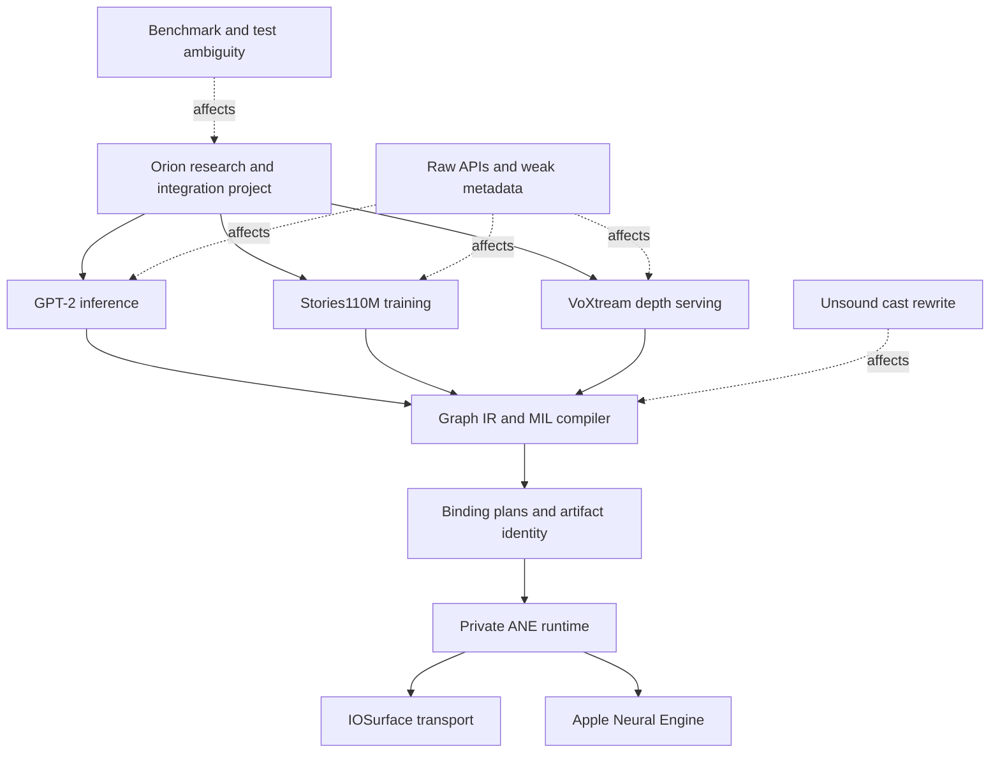
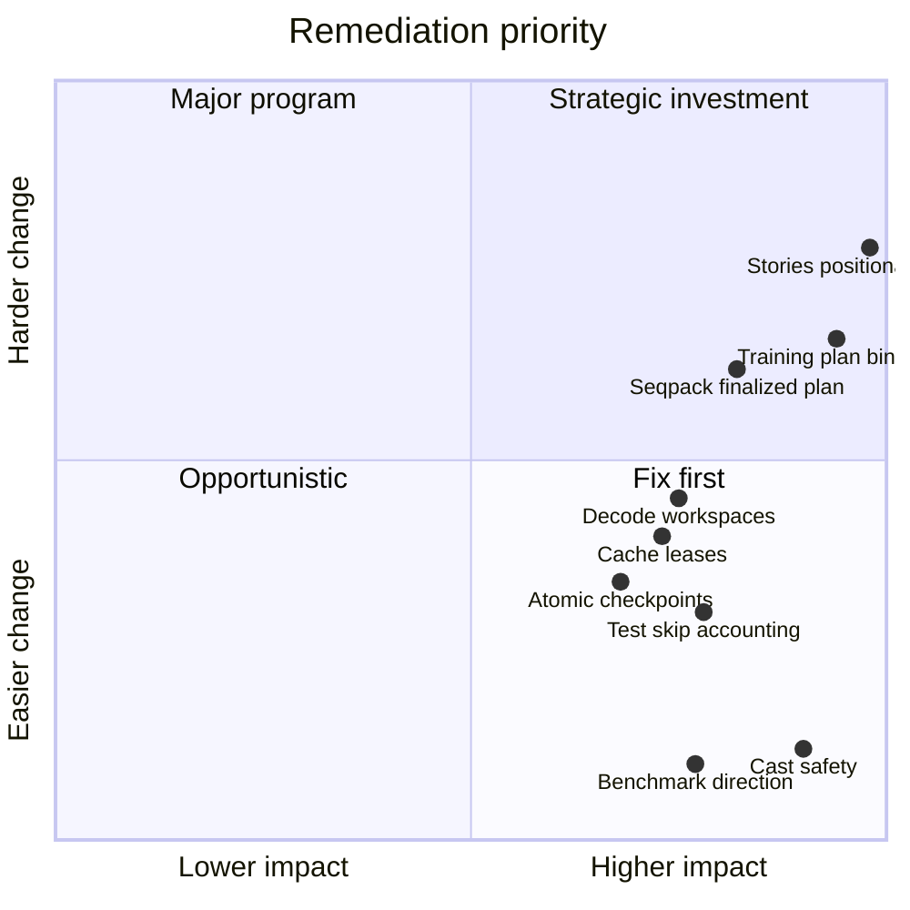
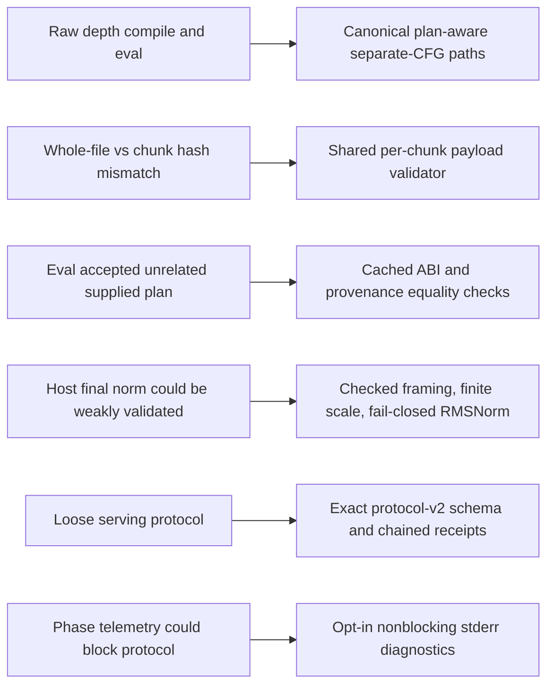
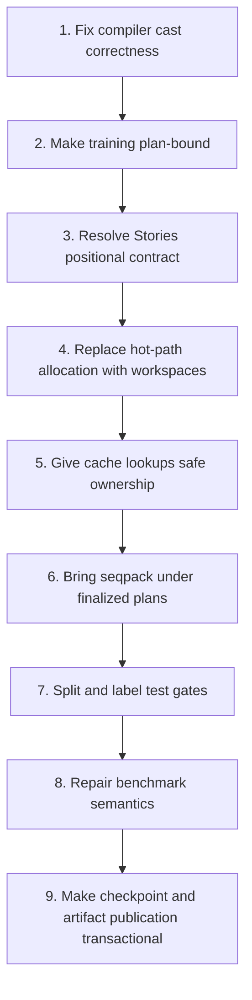

# Current Orion Review — Executive Priority Map

> **Review date:** 2026-08-03  
> **Reviewed revision:** `118e2df` on `feat/voxtream-depth-integrity`, including the working-tree changes in `apps/cli/commands/depth_serve.m` and `tests/test_iosurface_tensor_checked.m`  
> **Method:** source review, comparison with the earlier reports in `reports/`, `make test-compiler`, static depth-protocol checks, and backlog validation. Expensive ANE benchmarks and training runs were not executed.

## Executive assessment

Orion is now two substantial systems sharing one private-ANE compiler/runtime:

1. a GPT-2 and Stories110M research stack; and
2. a production-oriented VoXtream depth worker with canonical aggregate artifacts, plan-aware compilation, strict protocol-v2 receipts, compile accounting, and fail-closed execution.

The most important recent progress is at the trust boundary. Binding plans now sort and describe the actual emitted I/O names, per-chunk BLOBFILE validation is centralized, plan-aware evaluation authenticates the supplied plan against the program-cached plan, and `depth-eval`/separate-CFG `depth-serve` use canonical plan-verified compilation. These changes close several major gaps identified in `reports/CODEBASE_ANALYSIS.md`.

The highest remaining risks are concentrated elsewhere:

- the generic cast optimization is still numerically unsound for `fp32 -> fp16 -> fp32`;
- legacy raw IOSurface APIs and raw compile/eval paths remain widely used by GPT-2, training, benchmarks, and seqpack;
- Stories training is not plan-bound, performs very large host copies/transposes, silently sanitizes non-finite values, and still shows no positional encoding in the active graph;
- GPT-2 decode allocates and copies heavily inside every token/layer and top-p sampling insertion-sorts the entire vocabulary;
- the benchmark comparator still interprets all “higher” values as regressions, never fails the command, mixes workload identities, and fabricates the training phase split;
- `make test` still maps many asset/hardware skips to exit status zero and suppresses the evidence needed to distinguish pass from skip.

## Review facets

| Report | Facet | Current conclusion |
|---|---|---|
| [01 Architecture, Build, and Product Boundaries](01-architecture-build-product.md) | What actually builds and where are the product boundaries? | Strong vertical integration, but one monolithic binary and inconsistent qualification paths create coupling and release ambiguity. |
| [02 Compiler, Binding Plans, and ANE ABI](02-compiler-binding-abi.md) | Is graph-to-ANE translation checked end to end? | Ordering and plan integrity improved materially; cast safety, post-pass validation, and offset-policy fragmentation remain. |
| [03 Runtime, IOSurface, Cache, and Lifecycle](03-runtime-iosurface-lifecycle.md) | Are programs, weights, surfaces, and private calls managed safely? | Plan-aware paths are much stronger; raw APIs, cache borrow semantics, unchecked filesystem operations, and global state remain important risks. |
| [04 GPT-2 Inference Performance](04-gpt2-inference-performance.md) | Where do latency, allocation, copy, and fallback costs arise? | Correctly structured hybrid inference, but decode is allocation-heavy and host-bound; top-p sampling is algorithmically poor. |
| [05 Stories110M Training](05-stories-training-performance-correctness.md) | Is compile-once training correct, efficient, and recoverable? | Delta patching is a major strength, but training remains host-memory intensive, raw-ABI based, numerically masking, and insufficiently oracle-tested. |
| [06 VoXtream Depth Integration](06-voxtream-depth-integration.md) | Is the current production integration trustworthy and fast? | Separate CFG is canonical and plan-verified; strict v2 is unusually strong. Seqpack integrity and host-side phase costs are the main remaining focus. |
| [07 Testing, Benchmarking, and Release Evidence](07-testing-benchmark-release.md) | What does the evidence actually prove? | Portable/static gates pass, but full-suite pass/skip ambiguity and broken benchmark gating prevent release-grade confidence. |

## Verification performed

| Check | Result | Interpretation |
|---|---:|---|
| `make test-compiler` | **8/8 passed** | Portable/compiler target is currently healthy. It includes graph, passes, ANE validation, compiler equivalence, protocol-v2, BLOBFILE, error, and ledger tests. |
| `tests/test_depth_serve_lifecycle_static.py` | **5/5 passed** | Startup validation, exact seqpack compile schedule, budget preflight, readiness gating, and fail-closed host RMSNorm checks are present structurally. |
| `tests/test_depth_serve_protocol_static.py` | **11/11 passed** | Strict schemas, request bounds, hashing order, invocation accounting, receipt chaining, and phase-timing separation are present structurally. |
| `backlog/validate_backlog.py` | **126 tasks validated** | The new backlog has internally consistent indexing and area records. |
| ANE numerical/performance suites | **Not run** | No new throughput, latency, thermal, parity, or endurance claim is made. |

Compiler tests emitted three unused-variable warnings in test sources. They did not fail the gate, but warning-clean portable tests would improve signal.

## Risk register

| Priority | Finding | Impact | First action |
|---|---|---|---|
| P0 | Lossy cast round trips are still eliminated | Silent numerical change in compiled graphs | Restrict cast-pair elimination to proven lossless compositions and add `fp32 -> fp16 -> fp32` regression coverage. |
| P0 | Stories training has no positional operation in the active graph | Model semantics may not match the claimed Llama-style architecture | Add RoPE forward/backward or explicitly redefine the trained architecture and fixtures. |
| P0 | Training still binds multi-I/O surfaces manually through raw eval | A name/order/allocation regression can silently corrupt gradients | Generate plans for all seven programs and allocate/evaluate by plan entries. |
| P1 | GPT-2 token decode allocates per token, layer, head, and surface | Avoidable allocator, zero-fill, lock, and memory-bandwidth overhead | Introduce reusable decode workspaces and persistent plan-bound surfaces. |
| P1 | Program-cache lookup returns an unretained raw pointer | Concurrent eviction can release a program while another caller evaluates it | Return retained leases or hold the synchronization/ownership boundary through evaluation. |
| P1 | Benchmark regression logic is directionless and non-enforcing | Throughput collapse can pass while throughput improvement warns | Add metric direction/schema and return nonzero on required regression failure. |
| P1 | Test success conflates execution and skip | “All passed” can omit ANE and asset-dependent coverage | Add explicit PASS/SKIP/FAIL result transport and separate portable, hardware, asset, and benchmark gates. |
| P1 | Seqpack uses raw compile/eval without a finalized Orion plan | It lacks the same program/weight/surface authentication as separate CFG | Define a seq64 plan contract or make seqpack artifacts produce finalized plans. |
| P2 | CLI and Makefile inventory comments are stale | Misleads maintainers and downstream automation | Generate inventory/help documentation from authoritative lists. |
| P2 | Checkpoints mutate live state while reading and save directly to destination | Truncation can leave partial files or partially restored trainers | Load into temporary state, validate exact length, then commit; save via temp file + fsync + rename. |

## What improved since the prior audit

Specific closures include:

- per-chunk payload hashing and exact payload-range overlap checks in `compiler/binding_plan.c:328-359` and `core/ane_runtime.m:34-74`;
- program/plan ABI and provenance equality before plan-aware evaluation in `core/ane_runtime.m:377-446`;
- canonical aggregate preflight and plan-aware compilation in `apps/cli/commands/depth_serve.m:385-498` and `apps/cli/commands/depth_eval.m:858-939`;
- strict runtime invocation states at the private selector boundary in `core/ane_runtime.m:306-366`;
- strict protocol-v2 request/receipt chaining in `apps/cli/commands/depth_serve.m:1321-1601`;
- nonblocking phase diagnostics after receipt-chain commitment in `apps/cli/commands/depth_serve.m:1101-1144,1597-1601`.

## Recommended sequence

## Bottom line

Orion’s strongest code is increasingly the code that turns empirical private-ANE behavior into explicit contracts. The same approach should now be extended to the remaining legacy paths: plans for training and seqpack, checked surfaces everywhere, safe cache ownership, explicit benchmark semantics, and independent training oracles. Performance work should prioritize host allocation/copy removal before graph-level micro-optimization because the source shows large repeated CPU-side movement around already-compiled ANE programs.
