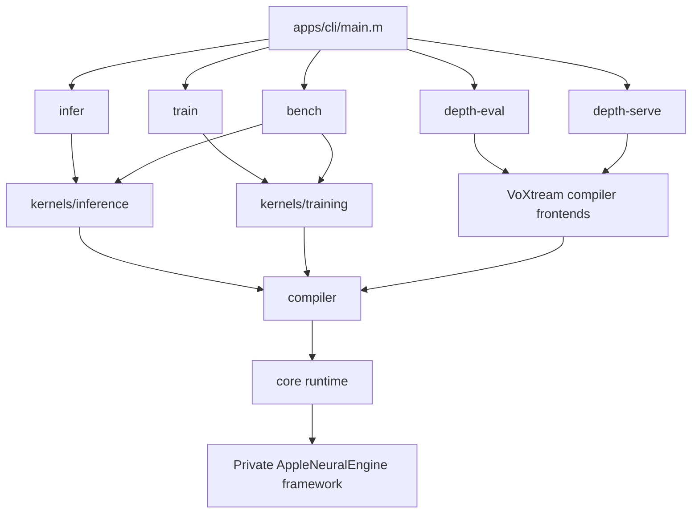
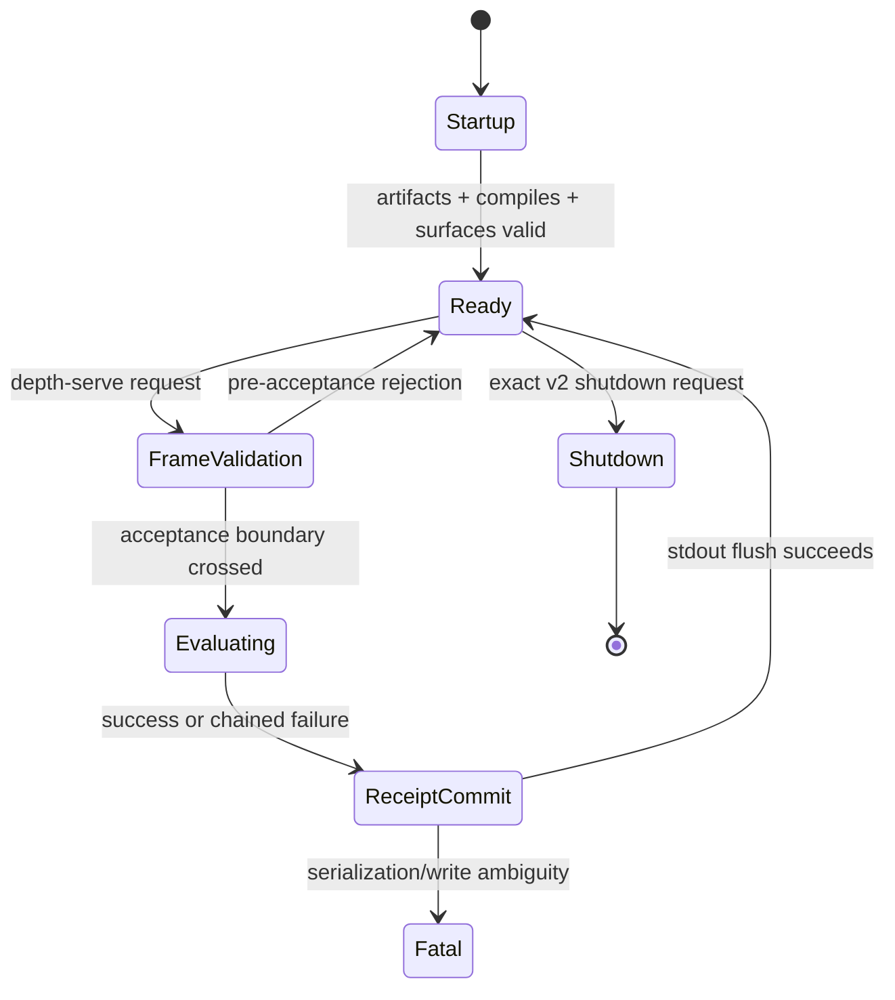
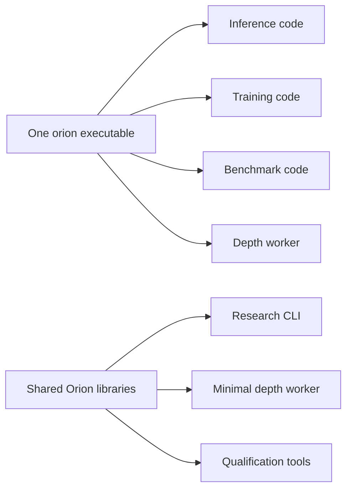
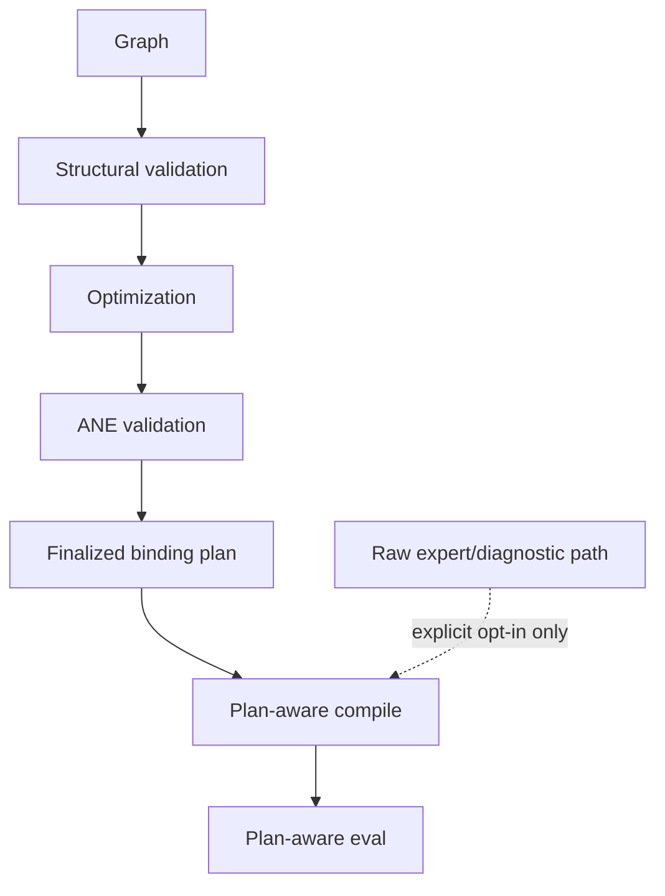
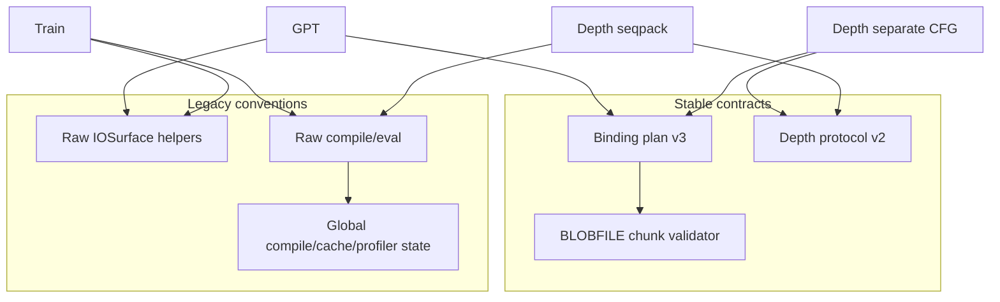

# Architecture, Build, and Product Boundaries

> Current review at `118e2df`, including the 2026-08-03 working tree.

## Scope

This report reviews repository topology, build composition, command surfaces, module ownership, product boundaries, and architectural coupling. It treats `Makefile` lists and current source as authoritative, as required by `AGENTS.md`.

## Current inventory

| Area | Tracked source LOC | Primary responsibility |
|---|---:|---|
| `tests/` | 14,435 | Native/static tests and generators |
| `apps/` | 6,043 | CLI plus unbuilt macOS app stubs |
| `compiler/` | 5,809 | IR, validation, passes, MIL, frontends, plans |
| `core/` | 3,715 | Private ANE bridge, surfaces, cache, lifecycle, persistence |
| `kernels/` | 3,086 | GPT-2 inference and Stories training |
| `experiments/` | 1,957 | Historical/private-API spikes |
| `archive/` | 1,113 | Retired MIL-generation reference code |
| `tokenizer/` | 672 | GPT-2 BPE and tokenizer-bin support |
| `model/` | 655 | Configs, loading, conversion |
| `backlog/` | 333 Python LOC plus Markdown records | Governed remediation inventory |

The root executable currently links 56 listed translation units: 11 core, 4 inference, 3 training, 1 model, 2 tokenizer, 7 CLI, 1 compile-ledger C source, 23 compiler C, 3 compiler Objective-C sources, and `main.m`. The Makefile comments saying “38 total” and “41 tests” are stale (`Makefile:10-12,101-103`); the actual lists contain 35 runtime tests and 8 compiler-target tests (`Makefile:105-151`).

## Product boundaries

The root CLI exposes five operational commands (`apps/cli/main.m:4-9,26-52`). The earlier three-command description is now stale. The current product is therefore not just an LLM research CLI; it is also a depth-transformer integration worker with a normative wire protocol.

| Command | Product character | State model | External contract |
|---|---|---|---|
| `infer` | Interactive GPT-2 generation | Process-local model/cache | Human CLI text |
| `train` | Mutating Stories training | Long-lived trainer, files, checkpoints | CLI flags and binary artifacts |
| `bench` | Exploratory measurement | Baseline JSON and process state | Human output plus kernel JSONL |
| `depth-eval` | One-shot qualification/diagnostic | Compiles five programs per process | Protocol v1 info/evidence and files |
| `depth-serve` | Persistent production integration | Compiled worker, receipt chain | Strict JSONL protocol v2 |

## Strengths

1. **The active build is inspectable and direct.** One Makefile and `xcrun clang` build the entire system without a runtime package manager (`Makefile:1-6,160-176`).
2. **Compiler-only qualification is first-class.** `test-compiler` avoids dependence on model blobs and includes protocol/BLOBFILE/error/ledger tests (`Makefile:203-260`).
3. **The depth integration now has a shared canonical construction layer.** Both commands use `depth_canonical.m`, reducing drift between one-shot and persistent execution (`apps/cli/commands/depth_canonical.m:0-7`).
4. **Backlog governance is explicit.** The committed backlog spans 21 areas and validates 126 tasks, giving the project a stronger remediation mechanism than free-form report prose.
5. **Hardware constraints are documented near code.** `docs/ane_constraints.md` captures silent-data-corruption hazards such as alphabetical binding and packed-prefix semantics.

## Findings

### High — One binary couples research, benchmark, training, and production serving

All source groups are linked into `./orion` (`Makefile:164-166`). A change to the benchmark, training, tokenizer, or depth worker can therefore affect the same final artifact, even when the deployment only needs `depth-serve`.

**Impact:** larger change surface, slower linking/test setup, accidental product coupling, and no smallest deployable serving artifact.

**Recommendation:** retain shared `compiler`/`core` libraries but introduce explicit executable targets such as `orion`, `orion-depth-worker`, and possibly `orion-test-tools`. Use the same objects rather than duplicating code.

### High — Qualification paths are not uniform

The kernel adapter performs structural validation, optimization, ANE diagnostics/validation, optional plan generation, and MIL identity binding (`compiler/kernel_adapter.m:62-117`). However:

- training directly compiles generated MIL with raw dictionaries (`kernels/training/stories_train.m:319-370`);
- seqpack generates/re-writes/codegens and raw-compiles without a plan (`apps/cli/commands/depth_serve.m:94-175`);
- benchmark kernels raw-compile generated MIL (`apps/cli/commands/bench.m:634-695`);
- GPT-2 descriptors generate MIL through adapter helper functions but do not set `adapter_frontend`; `core/kernel.m` therefore takes the raw compile/eval branch (`kernels/inference/prefill_ane.m:138-158`; `kernels/inference/decode_ane.m:116-129`; `core/kernel.m:24-52,75-78`).

**Impact:** “the compiler enforces X” is only true for some callers.

**Recommendation:** define named qualification tiers and make them explicit in APIs:

Production and training should use the complete path. Raw paths should be named `*_unverified` or confined to tests/experiments.

### Medium — CLI parser quality differs significantly by command

`depth-serve` validates ranges, exact schemas, bounded input, and unknown arguments (`apps/cli/commands/depth_serve.m:1199-1251`). In contrast, `infer` uses `atoi`/`atof`, silently ignores unknown arguments, and does not validate maximum tokens, temperature, top-p, or prompt/model context compatibility (`apps/cli/commands/infer.m:47-87`). `train` similarly uses basic numeric conversion (`apps/cli/commands/train.m:48-91`).

**Impact:** malformed research CLI invocations can produce surprising behavior or memory-bound work rather than clear failures.

**Recommendation:** extract shared checked integer/float parsing and reject unknown flags consistently.

### Medium — Build/test metadata is manually duplicated and stale

The Makefile’s source/test comments no longer match the lists (`Makefile:10-12,101-103`). The root help text also describes Orion primarily as an on-device LLM despite two depth commands (`apps/cli/main.m:11-23`).

**Impact:** documentation and automation can make wrong assumptions about suite size and product scope.

**Recommendation:** add a cheap `make inventory` target and generate report counts/help tables from the same variables used to build.

### Medium — The architectural abstraction layer remains incomplete

`orion_kernel_from_frontend` stores `adapter_frontend` but leaves `generate_mil = NULL` (`compiler/kernel_adapter.m:162-173`). Current hand-written `OrionKernel` constants work, but the generic factory is not itself a complete executable adapter.

**Impact:** callers can construct a kernel that looks configured but cannot use non-adapter generation paths safely.

**Recommendation:** either complete the factory or remove it until needed; avoid a partially valid public abstraction.

### Low — Private API and OS/tool metadata are hard-coded

The runtime loads a fixed private framework path (`core/ane_runtime.m:133-149`) and codegen emits fixed MIL/build metadata (`compiler/codegen.m:274-285`).

**Impact:** macOS/toolchain drift can break the system abruptly, while generated provenance may imply a compiler combination different from the host.

**Recommendation:** define a versioned target profile, perform startup selector/version capability checks, and include actual host/build identity in qualification artifacts.

## Coupling map

## Recommended architecture milestones

1. **Separate deployable targets** while preserving shared libraries.
2. **Classify APIs** as verified, checked, or legacy raw.
3. **Move training and seqpack to finalized plans.**
4. **Unify checked CLI parsing and error contracts.**
5. **Generate build/test inventories.**
6. **Version the private-ANE target profile.**

## Bottom line

Orion’s architecture is coherent vertically but not yet cleanly separated horizontally. The compiler/runtime is a strong shared core; the main architectural opportunity is to make qualification level and ownership explicit for every consumer, then split the minimal production worker from broad research tooling.
