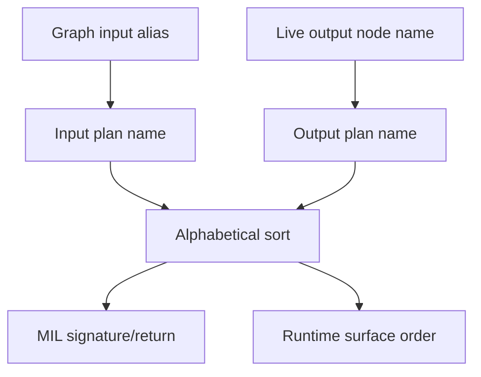
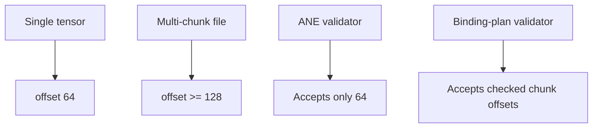
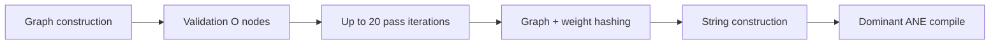

# Compiler, Binding Plans, and ANE ABI

> Current review at `118e2df`.

## Scope

This report covers graph validation, optimization, ANE-specific validation, MIL emission, binding-plan generation/finalization, BLOBFILE integrity, and compile/eval provenance.

## Current compiler pipeline


The full adapter path now implements this sequence (`compiler/kernel_adapter.m:62-117`). This is an important improvement over the earlier audit: ANE validation is mandatory in the adapter, input and output ordering are sorted by the names actually emitted by codegen, and finalized plans bind exact MIL identity.

## Strengths and resolved findings

### Canonical I/O ordering is now aligned

Codegen sorts inputs by function-argument name and outputs by the live node-expression name (`compiler/codegen.m:17-25,284-312`). Binding-plan generation uses the same distinction and sorts entries (`compiler/binding_plan.c:209-250`). This resolves the earlier alias-versus-emitted-name ordering risk for plan-bound paths.



### Unsupported operations are rejected in the adapter

`codegen_supports` explicitly enumerates emitted operations, and ANE validation rejects anything else (`compiler/pass_ane_validate.c:24-38,50-69`). `SPLIT`/`PAD` can no longer silently reach codegen through the standard adapter.

### Structural validation is materially stronger

Validation now checks reshape element counts, transpose permutations/output shapes, matmul dimensions/broadcasting, binary-op broadcasting, and conv shape contracts (`compiler/validate.c:96-154`). This closes much of the earlier “structure only” gap.

### Per-chunk BLOBFILE integrity is centralized

Plan generation validates each chunk header, exact payload size, payload range, SHA-256, and actual payload overlap (`compiler/binding_plan.c:322-359`). Runtime dictionary validation independently checks the same payload domains and rejects unused dictionary entries (`core/ane_runtime.m:34-74`). The central implementation is `core/blobfile.c:89-167`.

### Plan-aware evaluation authenticates the cached program

The runtime compares the supplied plan’s ABI and provenance—including MIL identity and every weight record—to the program-cached plan before private invocation (`core/ane_runtime.m:377-446`). This closes the prior gap where eval validated a caller-supplied plan without binding it to the program.

## Findings

### Critical — Lossy cast round-trip elimination remains unsound

The pass removes any nested cast pair where the original dtype equals the final target (`compiler/pass_cast.c:34-46`). Therefore:

```text
fp32 values -> fp16 rounding -> fp32
```

is treated as identity even though the fp16 step loses information. Current coverage tests only `fp16 -> fp32 -> fp16` (`tests/test_passes.m:77-91`).


**Impact:** silent numerical changes in arbitrary compiler clients.

**Recommendation:** model cast precision/range and eliminate only compositions proven observationally equivalent. At minimum, never remove a pair when the intermediate dtype is narrower than the source.

### High — There is still no post-optimization structural validation

The adapter validates before optimization, then mutates graph liveness and output references and proceeds to ANE validation/codegen (`compiler/kernel_adapter.m:70-101`). ANE validation is not a complete replacement for structural validation.

**Impact:** a pass bug can create dead references, invalid shapes, or name collisions after the only structural gate.

**Recommendation:** run `orion_graph_validate` again after `orion_pipeline_optimize`, before ANE validation and plan generation.

### High — Offset policy is fragmented

Generic ANE validation still requires every BLOBFILE offset to equal 64 (`compiler/pass_ane_validate.c:89-98`), while canonical aggregate chunks legitimately use offsets greater than 64 and are validated by binding plans. Depth canonical construction therefore validates before rewriting offsets and does not run ANE validation afterward (`apps/cli/commands/depth_canonical.m:226-258`).



**Impact:** two definitions of “valid ANE graph,” encouraging bypasses and making future reuse error-prone.

**Recommendation:** change ANE validation from “offset must be 64” to “offset must identify a valid plan-verified BLOBFILE chunk,” or split legacy and aggregate policies explicitly.

### High — Canonical layer construction duplicates graph generation

`depth_canonical_build_layer` builds, validates, optimizes, rewrites, and codegens one graph, then builds/optimizes/rewrites a second graph for plan generation (`apps/cli/commands/depth_canonical.m:225-258`).

**Impact:** extra CPU work at startup and a possible drift point if graph generation becomes non-deterministic or frontend behavior gains context.

**Recommendation:** generate MIL and plan from one rewritten graph, then free it after both artifacts are finalized.

### Medium — Structural validation remains incomplete for many op contracts

Current validation adds several important shape checks, but it still lacks a central table for every operation’s arity, dtype relationship, shape rule, allowed attribute range, and unique-name requirement (`compiler/validate.c:63-175`).

Examples not uniformly enforced include unary arity, reduction axes/type, slice index tensor constraints, softmax axis bounds, duplicate live-node names, duplicate graph I/O names, and graph input membership.

**Recommendation:** define an op-contract table and negative tests for every operation.

### Medium — Graph identity includes declaration order even when emitted ABI is equivalent

`graph_identity` hashes graph input/output arrays in declaration order (`compiler/binding_plan.c:132-143`), while emitted I/O is sorted. Equivalent graphs with reordered declarations therefore get different graph identities.

**Impact:** unnecessary cache misses/artifact churn, not incorrect execution.

**Recommendation:** hash canonical sorted I/O records, or document identity as construction provenance rather than semantic graph identity.

### Medium — Plan identity strings can be operationally unqualified

The generic runtime adapter uses literal identities `runtime-unqualified` and `kernel-adapter` (`core/kernel.m:4-15`). The plan remains internally bound, but the provenance fields do not identify an actual revision/toolchain.

**Recommendation:** inject build revision and target-profile identity at compile time.

### Low — Codegen retains a default unsupported-op comment

The default emission branch still writes an unsupported-op comment (`compiler/codegen.m:258-260`). Standard validation should prevent this, but returning `nil` would be safer for direct callers.

## Performance considerations



Private ANE compilation remains the dominant startup cost, but avoidable host costs include:

- duplicate canonical graph construction;
- reading/hashing every weight at plan generation and again validating in-memory dictionaries;
- repeated plan/MIL regeneration on every adapted cache lookup (`core/kernel.m:24-35`).

The latter is a deliberate correctness tradeoff: it prevents stale frontend/config reuse. A content-keyed frontend/plan memo could retain this guarantee without rebuilding on every eval.

## Test coverage matrix

| Contract | Current evidence | Gap |
|---|---|---|
| Graph topology and core shape validation | `test_graph_ir`, `test_ane_passes` | Not every op/attribute contract |
| Pass fixpoint/DCE/identity/cast | `test_passes` | Missing lossy cast direction |
| Unsupported op rejection | ANE pass tests | Direct codegen still not fail-hard |
| Alphabetical codegen/plan order | `test_ane_passes`, plan tests | More multi-I/O numerical tests desirable |
| Aggregate chunk hashing/ranges | `test_blobfile`, `test_aggregate_plan_generation`, `test_plan_weight_dict` | Hardware plan-verified aggregate tests can skip |
| Program/plan eval identity | `test_plan_weight_dict`, runtime tests | Concurrency/patch provenance race coverage |

## Recommended changes

1. Fix cast safety and add both narrowing/widening regression directions.
2. Revalidate structurally after optimization.
3. Unify aggregate offset policy with ANE validation.
4. Generate canonical MIL and plan from one graph instance.
5. Make codegen return failure for unsupported ops.
6. Canonicalize semantic graph identity or rename it as construction identity.
7. Add a complete op-contract validator.
8. Memoize finalized plan/MIL by graph/config/weight identity where lookup cost matters.

## Bottom line

The compiler’s ANE ABI is significantly stronger than the prior reports suggest: ordering, chunk hashing, exact MIL identity, and eval provenance are now aligned for plan-bound callers. The most urgent remaining compiler bug is small but severe—the lossy cast rewrite. The broader architectural issue is that not every caller uses the now-strong verified pipeline.
