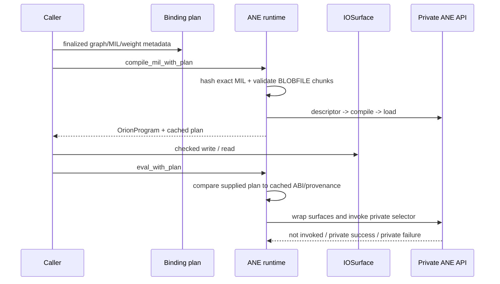
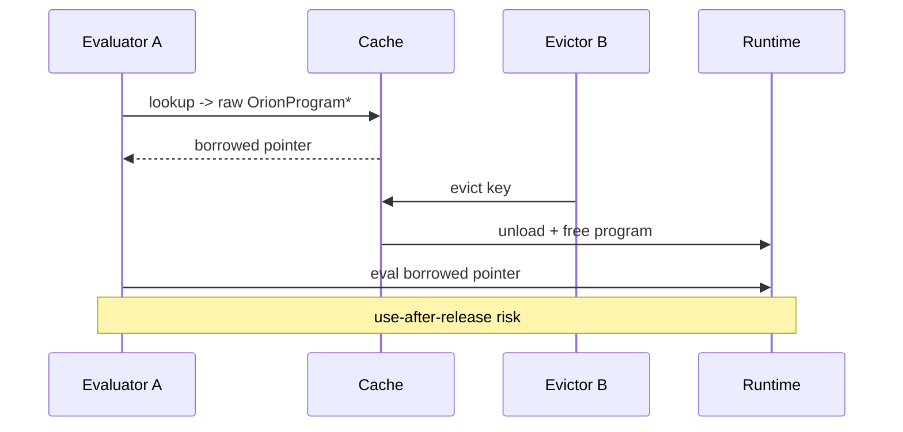
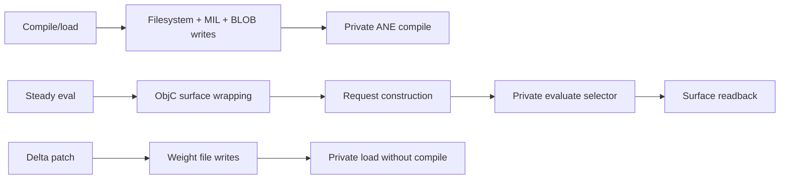

# Runtime, IOSurface, Cache, and Lifecycle

> Current review at `118e2df`, including the working-tree checked seqpack-surface change.

## Runtime architecture

## Strengths

- `orion_eval_report` distinguishes preparation failure from entering the private selector and catches Objective-C exceptions around evaluation (`core/ane_runtime.m:306-365`). This enables the depth v2 invocation receipt rather than a binary “false” with no boundary evidence.
- Plan-aware eval validates finalized metadata, exact input/output counts, ABI entries, and provenance before dispatch (`core/ane_runtime.m:426-446`).
- `core/blobfile.c` centralizes bounded source reads, little-endian header validation, overflow checks, exact payload bounds, and chunk payload hashing (`core/blobfile.c:16-86,89-167`).
- Checked IOSurface allocation records dtype metadata and validates allocation size, packed range, and binding shape (`core/iosurface_tensor.m:22-70,99-137,253-309`). The current uncommitted depth change correctly uses checked FP16 metadata for seqpack surfaces (`apps/cli/commands/depth_serve.m:531-550`).
- Weight patching creates an isolated model directory and only swaps handles after all weighted replacements load (`core/ane_runtime.m:532-661`; `kernels/training/stories_train.m:1039-1087`).

## Findings

### High — Program-cache lookups return borrowed raw pointers

The cache stores owning `_OrionCacheEntry` objects and releases programs in `dealloc` (`core/ane_program_cache.m:17-30`). Lookup synchronizes only while fetching the raw pointer, then returns it (`core/ane_program_cache.m:48-59`). Evaluation occurs after the lock is released (`core/kernel.m:64-79`). A concurrent `orion_cache_evict` can remove the entry and unload/free the program between lookup and eval.

**Recommendation:** add a retained lease object whose lifetime spans evaluation, or expose `orion_cache_eval` that retains/synchronizes the entry through the call. Do not make callers rely on “do not release” comments as a lifetime guarantee.

### High — Cache identity does not include all execution inputs

The key is `kernel:layer:weights_id:bucket` (`core/ane_program_cache.m:42-46`). Adapted kernels partially compensate by regenerating a plan and checking graph/MIL identities after a hit (`core/kernel.m:24-35`), but raw kernels and non-adapter callers remain identity-string based. The key also does not include compiler target profile, model revision, or actual weight content digest.

**Impact:** stale reuse is possible when a caller reuses a `weights_id` for changed files or changes compiler/toolchain settings.

**Recommendation:** use a structured key containing graph identity, finalized MIL identity, weight manifest digest, target profile, and requested bucket. Keep human labels separate from cache identity.

### High — Runtime filesystem writes are unchecked in raw compile and patch paths

Raw compile creates directories and writes MIL/blob files while ignoring errors (`core/ane_runtime.m:176-196`). Patch writes model files, weight files, and the `data` file with partial checks (`core/ane_runtime.m:572-623`).

**Impact:** disk-full, permission, path, or partial-write failures can reach private compile/load with incomplete artifacts.

**Recommendation:** centralize checked atomic artifact staging. Verify every write, directory creation, and rename, and remove the staged directory on any failure.

### High — Patch plan hash domain still differs from plan semantics

`rebound_plan_for_weights` computes a chunk payload hash (`core/ane_runtime.m:89-108`), which is the right domain for per-chunk plans. However patching still uses `patched_mil_text` over full dictionary blobs to create a textual patch identity (`core/ane_runtime.m:111-129`) and writes `data` from a “primary” path discovered through compiled-data byte equality (`core/ane_runtime.m:222-249,586-613`).

**Impact:** multi-weight/aggregate patch behavior remains difficult to authenticate and depends on private compiler materialization behavior.

**Recommendation:** make patching plan-native: stage the exact physical files described by the rebound plan, validate each chunk, and have runtime compile/load derive the materialized mapping rather than guessing a primary blob.

### Medium — Global initialization and compile counters are process-global

`g_init` and `g_compile_count` are static globals (`core/ane_runtime.m:13-18`). Initialization is not synchronized (`core/ane_runtime.m:133-149`). The profiler is also process-global (`core/profiler.m:10-17`).

**Impact:** multiple workers/threads or tests in one process can race initialization, mix compile budgets, and corrupt profiling sessions.

**Recommendation:** protect runtime initialization with `dispatch_once`, make compile accounting an explicit context/ledger, and make profiler sessions instance- or thread-scoped.

### Medium — Legacy raw tensor helpers still permit unchecked copies

`orion_tensor_write`, `orion_tensor_read`, `orion_tensor_copy_into`, and `orion_tensor_write_f32_at` do not check allocation capacity, lock return status, base address, or offset arithmetic (`core/iosurface_tensor.m:313-460`). The checked APIs are stronger, but the raw helpers remain the easiest path for GPT-2, training, and benchmarks.

**Impact:** malformed dimensions or caller mistakes can overrun IOSurfaces or silently ignore lock failures.

**Recommendation:** convert production callers to checked/binding-aware APIs and make raw functions explicitly diagnostic-only or add checked dimensions to their signatures.

### Medium — `orion_tensor_copy_packed_checked` validates only physical surfaces, not binding prefix

The binding-aware copy wrapper does validate prefixes (`core/iosurface_tensor.m:296-309`), but direct checked copy validates only allocation bounds (`core/iosurface_tensor.m:185-225`). This is appropriate for generic surface movement but easy to misuse when declared shapes are smaller than allocations.

**Recommendation:** require binding entries for production copies wherever packed-prefix semantics matter.

### Low — Cache has no size/eviction budget

The cache grows by distinct weight ID/bucket/kernel combinations and only evicts on explicit calls (`core/ane_program_cache.m:61-105`).

**Impact:** long-lived processes can retain many loaded ANE programs and temporary directories.

**Recommendation:** add bounded LRU or explicit capacity plus metrics for hits, misses, evictions, loaded program bytes, and failed unloads.

## Performance profile

The likely runtime-level optimization order is:

1. eliminate repeated surface allocation and raw conversion in consumer hot paths;
2. hold cache leases safely while evaluating;
3. reduce plan/MIL regeneration on adapted cache hits through content-keyed memoization;
4. use persistent staging and checked file descriptors for patch/reload;
5. only then tune private selector/eval invocation overhead.

## Test gaps

- No concurrent cache eviction/evaluation stress test.
- No fault-injected partial filesystem-write/rename test for compile or patch.
- No test that a changed weight file under a reused `weights_id` cannot hit a stale raw cache entry.
- No broad test that every raw tensor caller is migrated to checked metadata.
- No process/thread test for global compile counter and profiler contamination.

## Bottom line

The core runtime now has a credible checked path, especially for canonical depth. The major remaining lifecycle risk is ownership: a synchronized dictionary is not enough when it returns an unretained C pointer. The major performance risk is duplicated host work around ANE calls, not the private selector itself.
