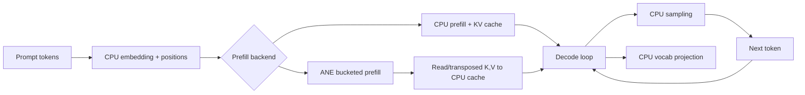
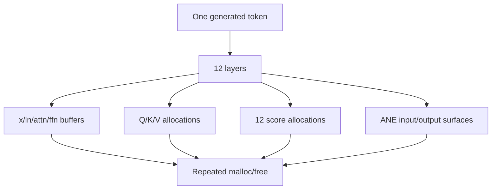
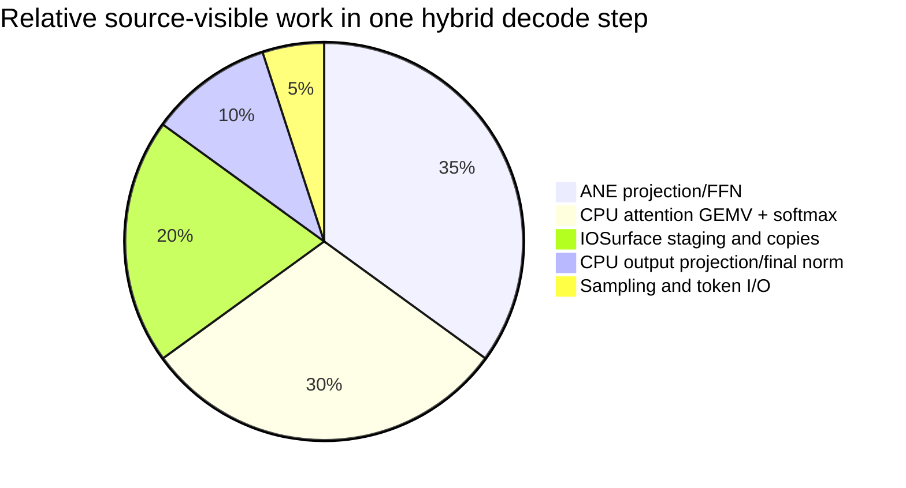

# GPT-2 Inference Performance

> Current review at `118e2df`. No new ANE benchmark was run; performance conclusions below are source-derived.

## Execution topology

## Strengths

- The CPU path is a useful numerical baseline with Accelerate GEMM and explicit causal attention (`kernels/inference/decode_cpu.m:90-177,216-274`).
- Prefill stores K/V once and decode consumes the cache (`kernels/inference/decode_cpu.m:278-338`; `kernels/inference/kv_cache.m:25-59`).
- ANE prefill uses sequence buckets and keeps the large vocabulary projection on CPU (`kernels/inference/prefill_ane.m:244-351`).
- Hybrid ANE decode deliberately leaves cache attention and output projection on CPU while using ANE for projections/FFN (`kernels/inference/decode_ane.m:11-17,163-286`). This is a defensible partition given the private-ANE constraints.
- Compiler frontends generate the GPT-2 MIL, but the current kernel descriptors do not set `adapter_frontend`; inference therefore uses raw compile/eval rather than finalized plan-aware compile/eval (`kernels/inference/prefill_ane.m:138-158`; `kernels/inference/decode_ane.m:116-129`; `core/kernel.m:24-52,75-78`). This is a hardening opportunity, not a current strength.

## Findings

### High — GPT-2 inference does not use finalized plan-aware compile/eval

The GPT-2 descriptors set `.generate_mil` and `.build_wdict` but do not set `.adapter_frontend` (`kernels/inference/prefill_ane.m:138-158`; `kernels/inference/decode_ane.m:116-129`). `core/kernel.m` consequently uses `orion_compile_mil` and `orion_eval` instead of the plan-aware branches (`core/kernel.m:24-52,75-78`).

**Impact:** the generated compiler graph is not accompanied by binding-plan validation of runtime dtype, allocation, packed prefix, exact weight identity, and I/O ABI.

**Recommendation:** set the frontend pointers in the descriptors or provide an equivalent plan-generating descriptor API, then allocate persistent surfaces from plan entries.

### High — Inference cache identity uses the literal `base`

Both prefill and decode set `weights_id = "base"` (`kernels/inference/prefill_ane.m:257-260`; `kernels/inference/decode_ane.m:147-150`), while the cache key contains only kernel, layer, weight ID, and bucket (`core/ane_program_cache.m:42-46`). The weight root/content digest is absent.

**Impact:** a process evaluating two different GPT-2 weight directories can reuse the first compiled model for the second.

**Recommendation:** derive the weight ID from a manifest/content digest and canonical weight root, not a constant label.

### High — CPU prefill-with-KV computes Q/K/V twice

`orion_gpt2_prefill_kv` computes Q/K/V to store them, then calls `attention_prefill`, which computes Q/K/V again for the same layer/input (`kernels/inference/decode_cpu.m:301-313`).

**Impact:** approximately doubles the projection work for prefill attention and creates three extra large allocations per layer.

**Recommendation:** pass the already-computed Q/K/V into an attention routine, or split attention into `project_and_cache` and `attend_from_qkv`.

### High — Decode allocates inside the token/layer/head hot path

Each CPU decode step allocates hidden work buffers, three projection vectors per layer, a projection output, and one `scores` buffer per head (`kernels/inference/decode_cpu.m:391-416,423-447`; `:349-376`). ANE decode also allocates/frees per-layer IOSurfaces, Q/K/V buffers, attention scores, and output buffers (`kernels/inference/decode_ane.m:160-193,198-251,253-270`).

**Impact:** allocator lock traffic, zeroing/copying, cache churn, and latency jitter dominate small-token workloads where GEMM itself is short.

**Recommendation:** create a persistent `OrionDecodeWorkspace` sized to the model/cache; reuse one score buffer sized to `max_seq`; keep ANE surfaces per layer/program alive across steps.

### High — ANE decode performs full-surface staging for one active token

`write_decode_input` allocates a `d * seq` float buffer, zeros it, writes only position zero, and copies the entire surface (`kernels/inference/decode_ane.m:29-40`). `read_decode_output` allocates and copies the entire surface, then gathers position zero (`:42-53`).

For GPT-2 decode this is repeated for every layer and both projection/FFN programs (`:163-270`).

**Impact:** each token moves far more data than its logical one-token payload and performs two extra heap operations per read/write.

**Recommendation:** retain preallocated staging buffers and use a channel-major strided gather/scatter directly under one IOSurface lock. If ANE requires zeroed padding, zero the persistent buffer once and overwrite only active positions.

### High — CPU attention remains the recurrent bottleneck in hybrid decode

For each layer/head, CPU attention computes a `cache_len x head_dim` GEMV, softmax, and a second GEMV (`kernels/inference/decode_ane.m:198-235`; CPU equivalent `decode_cpu.m:421-430`). This is inherently repeated for every generated token and scales with context length.

**Impact:** ANE acceleration does not remove the O(layers × heads × context × head_dim) CPU work; longer contexts progressively reduce the benefit of ANE projections.

**Recommendation:** benchmark by context length, not only fixed prompt size. Reuse score buffers, fuse max/sum normalization where safe, and investigate a plan-compatible ANE attention path only after independent numerical validation.

### High — Top-p sampling insertion-sorts all 50,257 vocabulary entries

For non-greedy generation, `orion_sample_token` allocates probabilities and indices and insertion-sorts the full vocabulary (`kernels/inference/decode_cpu.m:491-522`).

**Impact:** O(vocab²) worst-case comparisons per generated token, with large temporary allocations. This can overwhelm model decode for sampling workloads.

**Recommendation:** use a bounded top-k selection followed by sort of only k candidates, or an nth-element/heap threshold; retain deterministic tie handling and add distributional tests.

### Medium — Context capacity is not checked before KV writes

The cache is allocated to `cfg->max_seq` (`kernels/inference/kv_cache.m:10-22`), but append/store paths do not reject `seq_len > max_seq` or `current_len >= max_seq` (`:25-59`). The CLI accepts arbitrary `--max_tokens` and a 1024-token prompt buffer (`apps/cli/commands/infer.m:49-87,123-126`).

**Impact:** long prompts or generations can write beyond the allocated K/V cache.

**Recommendation:** validate `prompt_len + max_tokens <= max_seq` before allocation/execution, and make cache APIs return status on bounds failure.

### Medium — Fallback changes backend without fully correcting reported identity

`infer` mutates `use_ane` after init fallback and `ane_decode` after decode failure (`apps/cli/commands/infer.m:95-101,189-200`), but the final backend label is derived from those flags and does not record whether prefill/decode partially fell back. The benchmark has a similar issue (`apps/cli/commands/bench.m:744-750,824-855,781-785`).

**Recommendation:** track actual backend per phase and emit a structured execution identity: requested, active prefill, active decode, fallback reason, and compile/cache status.

### Medium — Prefill makes multiple full-size CPU copies and transposes

ANE prefill allocates CPU embedding and ANE staging arrays (`kernels/inference/prefill_ane.m:168-190`), then reads full K/V output surfaces and creates CPU K/V arrays before writing head-split cache (`:279-285,197-229`).

**Impact:** high memory bandwidth and allocator cost per prompt; this is particularly material for long prompts.

**Recommendation:** use persistent staging buffers and write directly from channel-major surface into head-split cache, avoiding intermediate `k_cpu`/`v_cpu` arrays.

## Performance model

The percentages are a qualitative source-based prioritization, not a measurement. The highest-confidence avoidable costs are allocation and full-surface staging.

## Evidence gaps

- `tests/test_bench_decode.m:61-133` has no numerical assertion despite its summary wording.
- There is no current benchmark that compares decode latency across context lengths while holding output correctness constant.
- Profiler wiring does not measure ANE eval time: `core/profiler.m:24-27` has no production caller, and `infer` passes zero FLOPs (`apps/cli/commands/infer.m:207-210`).
- Timing uses `gettimeofday` (`apps/cli/commands/infer.m:41-45`) rather than a monotonic clock.

## Recommended order

1. Add cache bounds and fail-fast context validation.
2. Eliminate duplicate CPU prefill projections.
3. Add persistent CPU/ANE workspaces and surfaces.
4. Remove full-surface staging copies from decode.
5. Replace full-vocabulary insertion sort.
6. Add phase/backend-aware, monotonic benchmarking.
7. Only then investigate deeper ANE attention fusion.

## Bottom line

The GPT-2 execution split is conceptually sound, but its hot path is dominated by host-side allocation, staging, and CPU attention. The first performance release should target memory movement and workspace reuse rather than attempting more private-ANE graph complexity.
