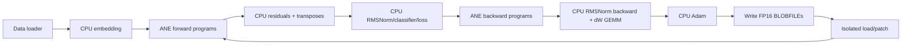
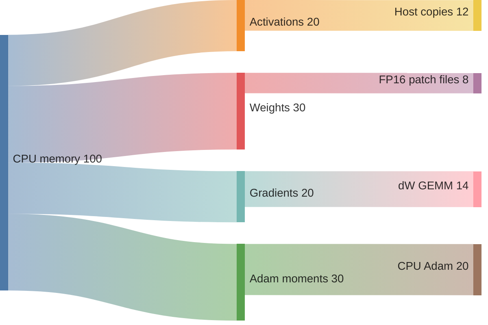
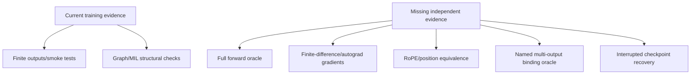

# Stories110M Training: Performance and Correctness

> Current review at `118e2df`. No full training run was executed.

## Training pipeline

The model configuration claims a 12-layer Llama2-style model with RoPE (`model/configs/stories110m.h:5-18`), but source search of the active Stories frontend/training code finds no positional/RoPE operation. This is a semantic issue, not a tuning detail.

## Strengths

- Training compiles programs outside the per-step loop and uses isolated delta patching rather than ANE recompilation on every update (`kernels/training/stories_train.m:319-370,1039-1114`).
- Delta patching prepares all weighted replacements before swapping handles (`kernels/training/stories_train.m:1053-1077`), which is a meaningful transactional improvement.
- CPU optimizer and gradient accumulation are explicit and inspectable (`stories_train.m:641-673,955-991`; `apps/cli/commands/train.m:229-279`).
- The resume path intentionally defers compilation until checkpoint state is loaded, avoiding an initial compile set with stale weights (`apps/cli/commands/train.m:147-175`).
- The current checked runtime and BLOBFILE validator provide a path for hardening training, even though training has not adopted it yet.

## Program and memory topology

The active trainer compiles seven program types per layer in `compile_layer` (`kernels/training/stories_train.m:319-370`), so the current topology is 84 programs across 12 layers. Six weighted programs are delta-patched; `sdpa_bwd2` is weight-free and retained (`:1053-1068`).

The chart is qualitative: the code clearly allocates large fp32 arrays for weights, gradients, Adam moments, activations, logits, and temporary copies (`stories_train.m:441-512,588-608`), but exact resident memory depends on configuration and allocator behavior.

## Findings

### Critical — Active graph/model contract has no positional encoding

`kStories110M` describes “RMSNorm, SwiGLU, RoPE” (`model/configs/stories110m.h:5-8`), but the active frontend files contain no `rope`/`rotary`/positional operation. The training input path embeds token IDs without position IDs (`kernels/training/stories_train.m:689-706`).

**Impact:** sequence order may not affect the attention computation as claimed, and the trained model may not be comparable to the stated architecture or external references.

**Recommendation:** either implement verified RoPE in forward and the corresponding backward math, or rename the model/configuration and regenerate independent reference fixtures. Do not publish Llama-style equivalence until this is resolved.

### Critical — Raw multi-output eval order is manually encoded

Training passes arrays such as `io->fwd_attn_qkv_out` directly to `orion_eval` and comments assume alphabetical output order (`kernels/training/stories_train.m:708-719`). It then selects semantic slots by hard-coded indexes (`:713-719,728-735`). The surfaces are allocated with legacy untyped constructors (`:394-423`).

**Impact:** a frontend rename or output change can produce finite but semantically swapped activations/gradients.

**Recommendation:** generate finalized plans for all seven program types, allocate `orion_tensor_create_for_binding`, and bind arrays by plan entry name rather than comments/indexes. Add tiny independent forward/backward oracles for every tap.

### High — Every forward/backward boundary transposes and copies large tensors

The training loop repeatedly calls `io_write_transpose`, `io_read_transpose`, and `orion_tensor_copy_into` (`kernels/training/stories_train.m:705-735,805-924`). Each transpose allocates a full temporary float buffer (`stories_train.m:21-52`). Backward additionally allocates heap copies for every asynchronous dW job (`:821-843,885-910`).

**Impact:** memory bandwidth and allocation pressure can dominate private evaluation, especially at sequence 256 and hidden dimension 2048.

**Recommendation:** maintain persistent transpose scratch per layer, use fused pack/unpack kernels, and schedule dW from reusable ring buffers. Measure bytes moved per step alongside eval time.

### High — Host code creates a dispatch queue/group every training step

`orion_train_step` creates a serial dispatch queue and group inside each call (`kernels/training/stories_train.m:793-795`).

**Impact:** repeated GCD object creation and destruction, plus serial dW scheduling, adds overhead and prevents broader overlap.

**Recommendation:** store one queue/group in `OrionTrainer`, or use a fixed worker pool. If dW is intentionally serialized for safety, document the dependency and benchmark concurrent alternatives.

### High — Non-finite values are sanitized instead of causing a hard failure

Readback clamps NaN/large values to fp16 range (`stories_train.m:18-34`), writeback clamps values (`:37-52`), blob loading converts NaN/Inf to zero (`:187-209`), and Adam converts non-finite gradients to zero (`stories_cpu_ops.m:79-84`).

**Impact:** training can continue while silently changing the optimization trajectory, defeating NaN/Inf detection and making a “no NaNs” claim misleading.

**Recommendation:** make strict mode the default for qualification: return a structured numerical failure with layer/tensor/position. Keep sanitizing only as an explicitly labeled recovery experiment.

### High — Delta patch failure falls back to full recompile after files are written

`orion_trainer_recompile_delta` writes all updated weight blobs, then patches each layer; a failed patch calls full `orion_trainer_recompile` (`kernels/training/stories_train.m:1090-1114`).

**Impact:** a transient patch failure can suddenly consume the finite ANE compile budget and may leave a partially updated on-disk weight set if a later write fails.

**Recommendation:** stage all BLOBFILEs in a temporary generation directory, validate them, atomically publish the generation, then patch. Make fallback compile budget-aware and explicit rather than automatic.

### Medium — Training benchmark phase split is fabricated

`bench_training` times the combined `orion_train_step`, then assigns 40% to forward and 60% to backward+dW (`apps/cli/commands/bench.m:964-973`). Labels call these measured phases (`:951-955`).

**Impact:** performance regressions can be attributed to the wrong subsystem.

**Recommendation:** instrument phase boundaries inside `orion_train_step`, or report one honest `train_compute_ms` metric.

### Medium — Checkpoint persistence is not transactional

Checkpoint save opens the destination directly (`core/checkpoint.m:106-129`) and writes large arrays sequentially (`:131-149`). Load writes directly into the live trainer (`:157-209`).

**Impact:** interrupted saves can leave truncated files; interrupted/invalid loads can partially mutate trainer state.

**Recommendation:** save to a same-directory temporary file, flush/sync, and rename. Load into a temporary trainer/state buffer and commit only after exact-length and configuration validation.

### Medium — Configurable `--seq` is not applied to the trainer config

`train` parses `--seq` (`apps/cli/commands/train.m:22-26,82-84`) but uses `kStories110M` directly as the config (`:138-140`) and calls data loader/trainer with `cfg->max_seq` (`:194-209`).

**Impact:** users may believe they are changing sequence length when they are not; benchmark comparisons can be mislabeled.

**Recommendation:** either construct a validated config copy using `args.seq_len` or remove the option.

## Correctness evidence gaps

The suite does not establish independent equivalence for every named training output, gradient, or positional behavior. The highest-value tests are:

1. tiny model with all seven program outputs compared to a trusted CPU/PyTorch reference;
2. finite-difference checks for each parameter group and backward tap;
3. A/B output-order permutation tests that fail if semantic names are not bound;
4. checkpoint truncation and resume atomicity tests;
5. strict numerical-failure tests proving NaN/Inf is reported rather than sanitized.

## Recommended order

1. Resolve positional/RoPE architecture contract.
2. Move training programs to finalized binding plans.
3. Add independent forward/backward oracles.
4. Replace per-call temporary transposes/copies/queues with persistent workspaces.
5. Make numerical failures strict and persistence transactional.
6. Repair training phase instrumentation.

## Bottom line

The compile-once/delta-patch strategy is the right high-level design. The limiting factors are now semantic contract strength and host memory movement: training still relies on manually indexed raw ABI arrays and repeatedly allocates/transposes large fp32 buffers around each ANE call.
