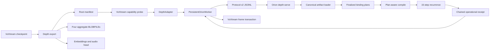
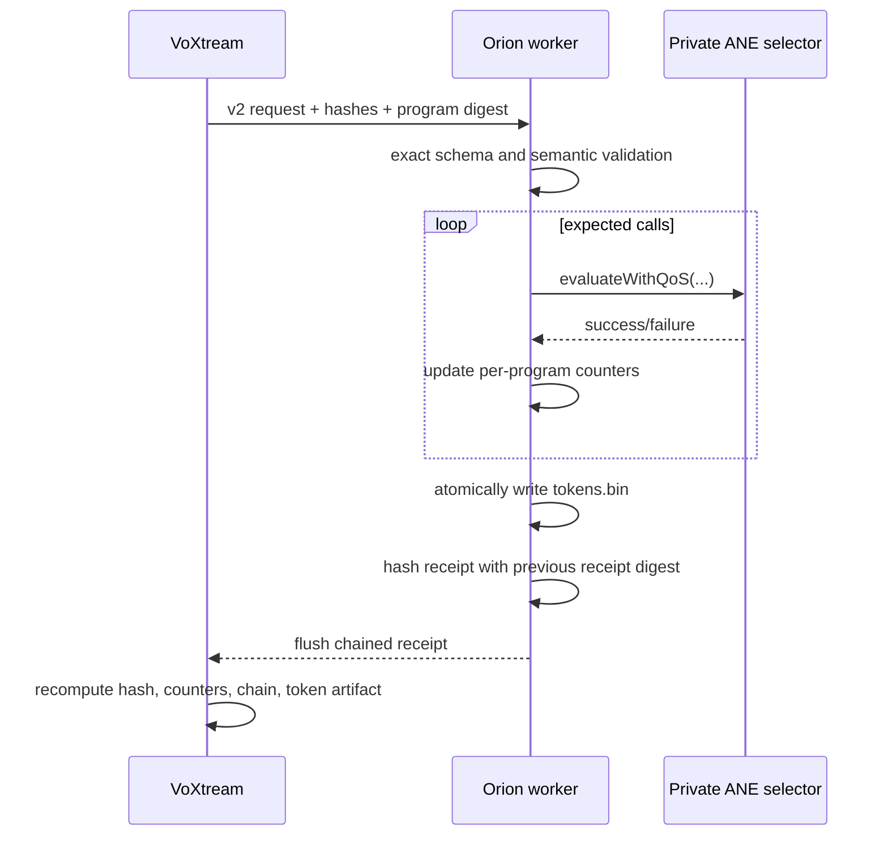
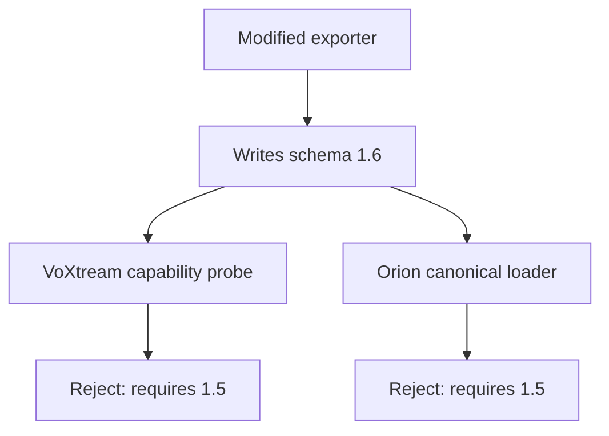
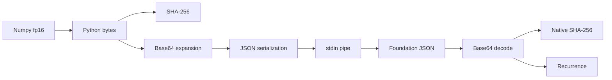
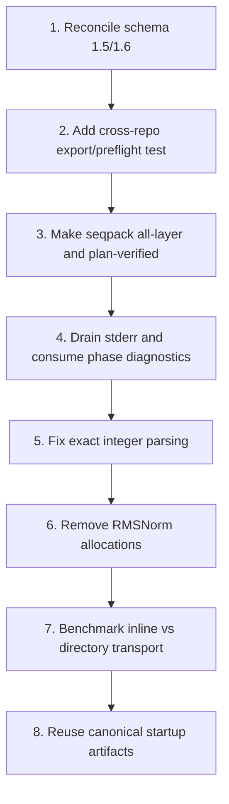

# Orion ↔ VoXtream Depth Integration

> **Review date:** 2026-08-03  
> **Orion scope:** `118e2df` plus working-tree changes in `depth_serve.m` and its checked-surface test  
> **VoXtream scope:** `d6fab64` on `feat/orion-frame-provenance`, including uncommitted changes to `export.py` and `packed_export.py`  
> **Important:** findings involving VoXtream schema 1.6 are working-tree integration findings, not claims about the clean `d6fab64` revision.

## Executive assessment

The separate-CFG production path is now substantially stronger than the earlier audit described. Orion validates canonical aggregate files, generates finalized plans, verifies exact MIL and per-chunk payload identities, compiles through plan-aware APIs, evaluates with the cached program plan, and emits strict protocol-v2 receipts proving whether the private selector boundary was entered.

The present cross-repository working trees are **not mutually consumable**, however: VoXtream’s modified exporter writes schema 1.6 while both Orion’s canonical loader and VoXtream’s capability probe require 1.5. Seqpack is also materially less governed than separate CFG: it has no finalized Orion plan, reads a comparatively weak sidecar offset map, raw-compiles the blob, and the VoXtream helper creates one layer by default even though the native worker requires all four.

## End-to-end current path

1. VoXtream exports fp16 depth weights/constants and runtime fp32 artifacts (`voxtream/backends/orion/export.py:239-451`).
2. The capability gate inspects the root manifest before selecting Orion (`voxtream/backends/orion/capability.py:253-302`).
3. `DepthAdapter` lazily launches `PersistentOrionWorker` (`voxtream/backends/orion/adapter.py:252-268`).
4. The Python worker starts `orion depth-serve`, validates readiness, serializes each frame request, verifies receipts, and validates `tokens.bin` (`persistent_worker.py:487-537,603-707,737-1066`).
5. Orion preflights artifacts, compiles four layers plus final norm in separate mode, allocates persistent surfaces, and emits readiness (`apps/cli/commands/depth_serve.m:321-574,1285-1318`).
6. Orion validates exact request keys, correlation identity, tensor hashes, semantic hash, and program-set digest before accepting a frame (`depth_serve.m:1321-1496`).
7. The native worker runs 15 recurrence steps and records exact private invocation counts (`depth_serve.m:657-873,1498-1542`).
8. It atomically writes `tokens.bin`, builds a typed receipt, flushes it, advances the chain, then optionally emits unattested phase diagnostics (`depth_serve.m:1544-1601`).
9. VoXtream accepts the receipt chain and only then commits the frame result; unsafe transport/protocol/output failures poison the worker (`persistent_worker.py:687-706,1088-1094`; `adapter.py:399-540`).

## Strengths

### Strict, fail-closed protocol boundary

The v2 contract has exact request and receipt schemas, bounded 1 MiB request lines, typed cross-language hashes, challenge/session correlation, program-set identity, compile-count invariants, atomic token output, private invocation counters, and chained receipts (`docs/depth_serve_protocol.md:1-194`).

### Canonical separate-CFG artifact and plan path

Orion preflights every layer’s root record, sidecar, full-file hash, chunk inventory, chunk header/range, and chunk payload hash (`apps/cli/commands/depth_canonical.m:92-210`). It then generates a finalized plan and validates the runtime dictionary before plan-aware compile (`depth_canonical.m:217-272`). `depth-serve` uses that path for all four layers and final norm (`depth_serve.m:385-498`).

### Cross-language receipt verification

The native typed transcript is implemented in `depth_serve_support.m:22-201,247-453`; Python recomputes the semantic and receipt digests and checks exact fields/counters (`persistent_worker.py:639-662,861-1066`). This is substantially more robust than trusting JSON text or exit status.

### Honest placement and fallback semantics

Readiness identifies ANE-private, checked CPU RMSNorm, Accelerate audio head, vDSP CFG, and CPU argmax placements (`depth_serve.m:1302-1318`). A successful receipt forbids native fallback; VoXtream separately records MLX recovery when Orion does not produce an accepted success (`adapter.py:423-540`).

## Critical and high-priority findings

### Critical — Current VoXtream schema 1.6 cannot pass current consumers

The modified VoXtream exporter writes `voxtream.orion.depth-export/1.6` (`voxtream/backends/orion/export.py:39-54,349-351`). Orion hard-requires 1.5 (`apps/cli/commands/depth_canonical.m:100-108`), and VoXtream’s own capability probe also hard-requires 1.5 (`voxtream/backends/orion/capability.py:253-265`).

**Impact:** a newly generated working-tree export cannot reach worker startup.

**Recommendation:** define one compatibility matrix in both repositories. If 1.6 only adds runtime artifacts, update Orion and capability validation to accept 1.6 and validate the new fields. Add a cross-repository fixture test that exports with current VoXtream and runs Orion preflight.

### High — Seqpack lacks canonical plan and artifact verification parity

Seqpack reads a JSON sidecar and maps chunk names to offsets without validating exact schema, layer inventory, duplicate names, full-file hash, chunk hashes, shape, or payload size (`apps/cli/commands/depth_serve.m:94-125`). It then raw-compiles one blob dictionary (`depth_serve.m:129-175`) and raw-evaluates via `orion_eval_report` (`:621-639`). Separate CFG uses finalized plan-aware compile/eval.

**Impact:** seqpack’s program-set digest authenticates loaded MIL/blob bytes, but it does not prove that sidecar offsets match a governed manifest contract or that surfaces match a finalized plan.

**Recommendation:** export a seq64 finalized binding plan per layer, validate all sidecar records with `core/blobfile`, and use `orion_compile_mil_with_plan`/`orion_eval_with_plan_report`.

### High — Seqpack export helper defaults to one layer while the worker requires four

`create_packed_export` defaults to `layer=0` and produces one `layerN_seqpack.blob`/manifest (`voxtream/backends/orion/packed_export.py:88-100,184-239`). Its CLI also defaults to layer zero (`:242-256`). Orion startup loops over all four layers and fails if any is missing (`apps/cli/commands/depth_serve.m:358-384`).

**Impact:** the documented helper’s default output is not a bootable seqpack export.

**Recommendation:** make the default generate all four layers and emit a root `seqpack_blob_export.layers` inventory. Keep single-layer generation only as an explicit diagnostic option.

### High — Aggregate writer and validator disagree about alignment gaps

`write_multi_chunk_blob` aligns every chunk header to 64 bytes and can insert padding (`voxtream/backends/orion/blobs.py:719-728`). `validate_aggregate_blob` requires each next offset to equal the prior chunk’s exact end and rejects any gap (`blobs.py:855-875`).

Most production tensor payloads are naturally 64-byte multiples, so the current depth shapes may avoid the defect. The generic contract nevertheless breaks for valid small/non-aligned chunks, and the validator contradicts the writer’s documented behavior.

**Recommendation:** either define padding as legal and verify it is zero, or remove writer alignment beyond what the prior chunk already provides. Add a two-chunk non-64-byte payload regression test.

### High — Python captures stderr but never drains it

`PersistentOrionWorker` starts the child with `stderr=subprocess.PIPE` (`persistent_worker.py:518-523`) and starts only a stdout reader (`:1109-1130`). Native compile/eval failures and logs use stderr. If that pipe fills, the worker can block while Python waits for stdout.

**Impact:** noisy failures or long-lived diagnostics can turn into frame timeouts and poisoned workers.

**Recommendation:** continuously drain stderr on a bounded reader thread/ring buffer. Parse complete phase-diagnostic JSON separately when enabled, and retain recent human diagnostics for errors.

### High — Native exact-integer parsing accepts JSON integral floats

The protocol says fields such as version, IDs, sequence, and `c0` must be exact non-Boolean JSON integers (`docs/depth_serve_protocol.md:80-97`). Native `json_exact_integer` converts any NSNumber to double and accepts it if `trunc(number) == number` (`apps/cli/commands/depth_serve.m:919-932`), so JSON `2.0` can pass.

**Impact:** the implementation is looser than the normative wire contract and Python’s `_is_int` checks.

**Recommendation:** reject float/double NSNumber object types as the receipt parser already does for unsigned fields (`depth_serve_support.m:203-213`). Add process-level protocol tests for `2.0`, `42.0`, booleans, and exponent forms.

## Performance findings

### Inline transport adds avoidable base64 and JSON copies

Each 65,536-byte hidden tensor is copied to bytes, hashed, base64-encoded, inserted into JSON, written through a pipe, decoded by Foundation, canonical-base64 re-encoded for validation, and hashed again (`persistent_worker.py:619-680`; `depth_serve.m:966-974,1468-1494`). Orion already supports a directory form with exact regular-file reads (`depth_serve.m:983-1024,1453-1467`), but the Python worker always chooses inline form (`persistent_worker.py:664-735`).

**Recommendation:** benchmark both forms end to end. A per-frame temporary input directory with atomic file publication avoids base64 expansion but adds filesystem calls; choose based on measured latency and operational simplicity.

### Recurrence is dominated by repeated private calls and host audio heads

Separate mode performs 150 private calls per frame; seqpack performs 60 (`docs/depth_serve_protocol.md:40-42`; `depth_serve.m:615-619`). Both modes also run two `1024 x 2050` audio-head GEMVs for each of 15 steps—about 63 million multiply-adds per frame—plus CFG and argmax (`depth_serve.m:757-771,844-859`).

The current phase telemetry is well placed to identify the actual split, but VoXtream neither enables nor consumes it.

### Seqpack RMSNorm performs 30 avoidable allocations per frame

`orion_depth_serve_host_rmsnorm_checked` allocates a 1024-float temporary result and frees it on every call (`apps/cli/commands/depth_serve_support.m:499-541`). Seqpack calls it twice for each of 15 steps (`depth_serve.m:733-745`).

**Recommendation:** write directly to the caller-provided output after validating all inputs, or use preallocated worker scratch.

### Startup repeats canonical file loading and hashing

`depth-serve` preflights all four canonical artifacts (`depth_serve.m:400-415`), then `depth_canonical_build_layer` loads/hashes each artifact again (`:417-425`; `depth_canonical.m:217-225`). That helper also builds the frontend graph twice (`depth_canonical.m:225-258`).

**Recommendation:** retain validated artifact objects across preflight/build and produce MIL/plan from one graph.

### Lazy worker creation is not synchronized at adapter level

`DepthAdapter._get_persistent_worker` checks and assigns `_persistent_worker` without a lock (`adapter.py:252-268`). Current server-level serialization may mask this, but concurrent library consumers can launch multiple workers.

**Recommendation:** protect creation/close with a lock or construct the worker eagerly during adapter startup.

## Additional contract issues

- The capability probe is weaker than exporter validation and still describes a legacy fallback to per-layer directories even though Orion’s canonical commands fail closed without aggregate artifacts (`capability.py:277-301`; `depth_serve.m:385-415`).
- Runtime embeddings and audio head are size-checked but not scanned for finite fp32 values (`depth_serve.m:1265-1275`). The exporter validates source finiteness, but externally supplied files can bypass it.
- `depth-eval` preflights four layer aggregates before ANE init but validates final norm later, while `depth-serve` validates final norm before any compile (`depth_eval.m:742-760,909-932`; `depth_serve.m:337-355`). Align the fail-fast order.
- Phase diagnostics are intentionally best-effort and not receipt-attested (`docs/depth_serve_protocol.md:196-239`). Native emission uses one nonblocking write and ignores partial writes (`depth_serve.m:1133-1144`), so consumers must discard truncated records.

## Test evidence and gaps

Strong existing evidence includes Orion’s protocol-v2 native test, static protocol/lifecycle checks, blob/aggregate plan tests, and VoXtream’s Python receipt/worker/export tests. The review’s Orion checks passed 8/8 compiler targets, 5/5 lifecycle static checks, and 11/11 protocol static checks.

Missing high-value tests:

1. current VoXtream export → Orion canonical preflight compatibility;
2. live child-process protocol tests, not only source/static helpers;
3. stderr saturation and continuous drain behavior;
4. seqpack all-four-layer export inventory and plan verification;
5. inline versus directory transport benchmark;
6. non-aligned aggregate chunk writer/validator round trip;
7. concurrent adapter worker creation;
8. finite runtime embeddings/audio-head rejection;
9. exact JSON integer process tests.

## Recommended sequence

## Bottom line

The separate-CFG protocol and integrity path is one of Orion’s strongest facets. The immediate blocker is not ANE performance but cross-repository contract drift: the modified exporter, capability gate, and native loader disagree on schema version. After that, seqpack should be brought under the same finalized-plan and artifact-validation model before its lower private-call count is treated as production-ready.
