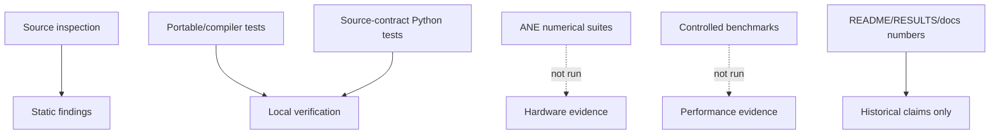
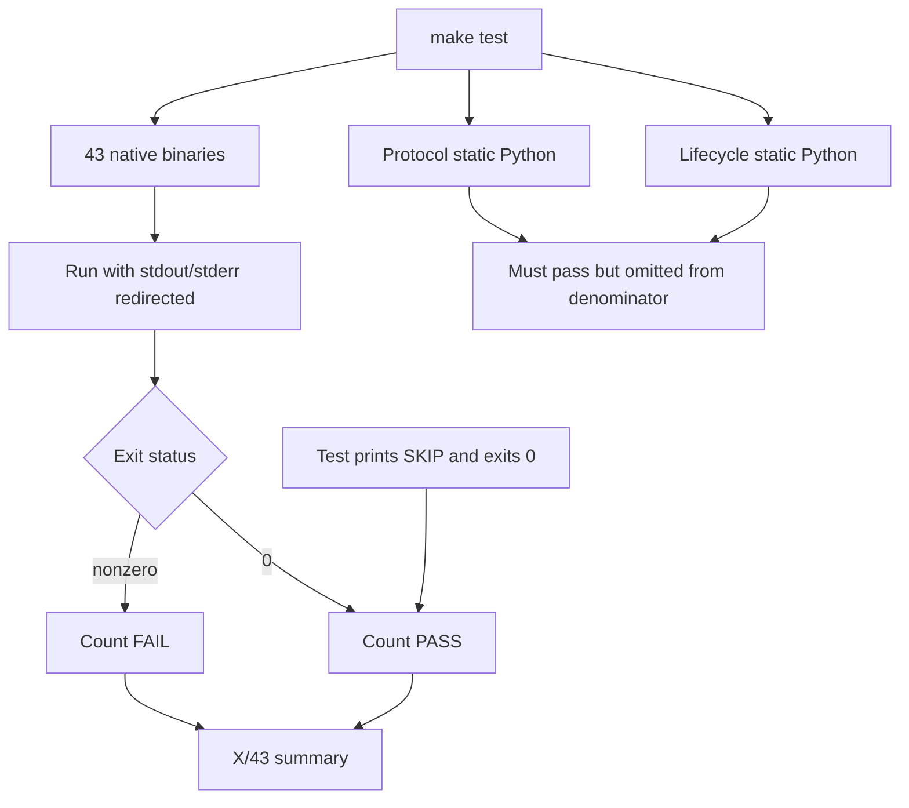
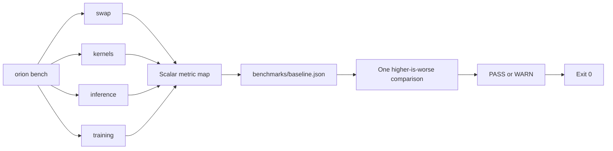
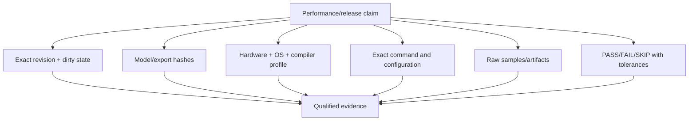

# Testing, Benchmarking, and Release Evidence

> Current review at `118e2df`, including current working-tree source.  
> Verified locally in this review: `make test-compiler` 8/8, depth lifecycle static 5/5, depth protocol static 11/11, backlog validation for 126 tasks. Full ANE/model/training suites and real benchmarks were not run.

## Evidence model

A zero exit from a current binary is not automatically evidence that hardware assertions executed, because many tests print `SKIP` and return zero. Similarly, source-static tests prove that required code patterns are present, not that a live child process or ANE behaves correctly.

## Current test topology

The Makefile declares 35 runtime tests and 8 compiler-target tests (`Makefile:105-151`). `make test` also runs two static Python prerequisites (`Makefile:178-201`). Therefore the effective command invokes 45 checks, but its summary loop counts only the 43 binaries (`Makefile:180-195`).

The Makefile comments are stale: they say 41 tests, 35 runtime plus 6 compiler (`Makefile:101-103`), while the lists contain 43 binaries. The source comment claiming 38 source files is also stale (`Makefile:10-12`); the current linked lists total 56 translation units including `main.m` and the compile ledger.

## Verification performed

| Command/check | Result | Scope |
|---|---:|---|
| `make test-compiler` | 8/8 passed | Graph, optimization, ANE validation, compiler equivalence, protocol-v2 hashing, BLOBFILE, errors, compile ledger |
| `tests/test_depth_serve_lifecycle_static.py` | 5/5 passed | Source-level startup lifecycle invariants |
| `tests/test_depth_serve_protocol_static.py` | 11/11 passed | Source-level protocol schema/hash/receipt invariants |
| `backlog/validate_backlog.py` | 126 tasks validated | Backlog schema/index consistency |
| Full `make test` | Not run | Would include hardware/assets and suppress output |
| `make bench` | Not run | Real ANE benchmark requiring supported environment/assets |

The compiler build emitted three unused-variable warnings in tests (`tests/test_passes.m` and `tests/test_ane_passes.m`). This is not a correctness failure, but warning-clean tests improve regression signal.

## Strengths

1. **Portable qualification exists.** `test-compiler` provides a useful gate independent of model blobs and most private-runtime behavior (`Makefile:203-260`).
2. **Depth protocol helpers have focused native tests.** Typed semantic/receipt hashing and exact schema behavior are exercised in `tests/test_depth_serve_protocol_v2.m`.
3. **BLOBFILE validation has standalone C coverage.** `test_blobfile` links only the shared validator (`Makefile:248-250`).
4. **The backlog defines explicit evidence expectations.** `backlog/GATES.md` and `backlog/README.md` require pass/fail/skip and provenance rather than prose-only closure.
5. **Several CPU numerical paths have independent goldens.** GPT-2 CPU forward/KV decode and training primitives are tested without requiring ANE.
6. **The new depth worker distinguishes invocation states.** Receipts can represent not-invoked, private success, and private failure instead of reducing everything to process exit.

## Testing findings

### High — PASS conflates executed assertions and capability skips

Many tests return zero when ANE or exports are unavailable, including `test_m5_compile_limit.m:21-24`, `test_program_cache.m:303-310`, and most VoXtream ANE tests such as `test_voxtream_depth_ane.m:186-195` and `test_voxtream_seqpack_depth_loop_ane.m:113-125`. `test_plan_weight_dict` also treats unavailable ANE, MIL generation failure, or compile failure as successful test helper returns in several hardware-dependent cases (`tests/test_plan_weight_dict.m:223-334`).

**Impact:** a “43/43 passed” summary can mean materially different coverage on different hosts.

**Recommendation:** standardize test exit/result transport:

| Result | Meaning | Aggregate behavior |
|---|---|---|
| PASS | Required assertions executed and passed | Count pass |
| SKIP | Declared prerequisite unavailable | Count separately; optionally fail required gate |
| FAIL | Assertion or unexpected prerequisite failure | Fail gate |
| ERROR | Harness/setup failure | Fail gate |

A simple shared test footer or TAP/JUnit output would preserve detail even when normal logs are quiet.

### High — Test output is suppressed exactly where skip evidence is printed

`make test` redirects every binary’s stdout and stderr to `/dev/null` (`Makefile:185`). It then prints only PASS/FAIL by exit status.

**Impact:** developers cannot see whether a green binary actually ran ANE tests, skipped assets, or executed only portable subtests.

**Recommendation:** capture output to per-test logs and parse a machine-readable summary. On failure, print the log; on success, show pass/skip counts.

### High — Current modified sources were not covered by the completed binary suite

The working tree changes `depth_serve.m` and `test_iosurface_tensor_checked.m`. `make test-compiler` does not link `depth_serve.m`, and the full checked IOSurface test was not run in this review. The static suites passed, but they are source-level checks.

**Impact:** the report can state that the change is source-consistent and static checks pass, not that the current modified worker ran successfully on ANE.

### Medium — Static protocol/lifecycle checks are necessary but not process tests

The Python suites explicitly inspect source structure. They do not launch `depth-serve`, fill pipes, exercise JSON parsing, verify atomic files, or observe private invocation (`tests/test_depth_serve_lifecycle_static.py:1-7`; `tests/test_depth_serve_protocol_static.py:1-2`).

**Recommendation:** add a process-level worker harness with a fake/evaluable backend mode for protocol tests and a separate supported-hardware suite for real private invocation.

### Medium — Some benchmark-labeled tests have no performance or numerical gate

`tests/test_bench_decode.m:61-133` reports timing and a PASS summary but does not assert CPU/ANE token equality or a performance threshold. `test_voxtream_seqpack_timing.m` measures kernel calls but does not establish a full recurrent worker latency gate.

**Recommendation:** rename exploratory probes, or add explicit correctness and controlled performance criteria with environment identity.

### Medium — Useful tests are outside the Makefile

`tests/test_weight_convert.py` is a unittest suite but is not invoked by a Make target. `tests/test_program_swap.m` is a deliberate not-implemented stub and is likewise outside the suite.

**Recommendation:** add a Python test target for conversion and keep incomplete stubs out of “tests” or mark them expected-fail in a visible registry.

### Medium — No CI, sanitizer, or fuzz configuration is present

No tracked `.github` workflow, sanitizer target, or fuzz harness was found.

**Impact:** the portable gate depends on manual local execution; binary parsers, BLOBFILE readers, NPZ handling, JSON protocol, and cache concurrency lack continuous stress.

**Recommendation:** add CI for compiler/C/Python tests on a macOS runner, plus ASan/UBSan for portable code and fuzz targets for BLOBFILE, checkpoint headers, protocol JSON, and NPZ parsing.

## Benchmark architecture

## Benchmark findings

### Critical — Throughput comparison direction is backwards

`baseline_compare` computes `(current - baseline) / baseline` and warns only when the result is greater than 15% (`apps/cli/commands/bench.m:112-156`). This is appropriate for latency/RSS but wrong for `inference.tok_per_sec` (`bench.m:883-889`): a throughput improvement warns, while a throughput collapse passes.

**Recommendation:** define each metric with unit, direction, workload dimensions, and warn/fail thresholds.

### High — Regression warnings never fail the command

The comparator returns `void`, missing baselines only print a message, and every benchmark mode returns zero after comparison (`bench.m:112-156,471-482,725-734,891-905,1025-1037`).

**Impact:** `make bench` cannot enforce performance regressions.

**Recommendation:** return structured status and nonzero for required missing baselines, incomplete workloads, benchmark failures, and threshold violations. Offer `--warn-only` explicitly.

### High — Baseline identity and provenance are absent

All modes merge scalar values into one ignored `benchmarks/baseline.json` (`bench.m:68-110`; `.gitignore:73-77`). CPU, hybrid, and ANE-full inference share `inference.*` keys (`bench.m:781-889`). Prompt, generated-token count, fallback status, model digest, host, OS, compiler target, revision, dirty state, warmup, and sample count are absent.

**Impact:** comparisons can be between different workloads/backends and still look valid.

**Recommendation:** store append-only run records with a schema and select an explicit baseline by complete execution identity.

### High — Training phase numbers are invented

The benchmark times the combined `orion_train_step`, then assigns 40% to forward and 60% to backward+dW (`bench.m:963-973`). It presents and baselines those values as phases (`:951-955,1008-1023`).

**Recommendation:** instrument actual phase boundaries or report only `train_compute_ms`.

### High — Swap benchmark does not swap weights

The benchmark builds a weight-free `z = x + y` program and compiles with `@{}` (`bench.m:331-352,389-405`). `weights_a` and `weights_b` are cache identity strings, not loaded model data.

**Impact:** the result measures compile/cache/eviction churn, not changed-weight correctness or patch endurance.

**Recommendation:** use a small weight-bearing graph, alternate known A/B blobs, assert outputs A/B/A, and separately time staging/load/eval/eviction.

### Medium — Timing uses a non-monotonic clock

Benchmark and inference helpers use `gettimeofday` (`bench.m:36-40`; `apps/cli/commands/infer.m:41-45`). Training and depth already use Mach monotonic clocks.

**Recommendation:** provide one shared monotonic timing utility and use it in CLI, tests, and benchmarks.

### Medium — Partial kernel results can still report success

Kernel compile/eval failures skip a row, after which the mode can save a partial metric map and return zero (`bench.m:634-734`). Missing training assets explicitly print “Skipping” and return zero (`bench.m:912-925`).

**Recommendation:** return incomplete/error status unless an explicit optional mode was requested.

### Medium — Profiler claims are not wired

`orion_prof_record_eval` has no production caller (`core/profiler.m:24-27`). `infer` records decode wall time only and passes zero FLOPs (`apps/cli/commands/infer.m:189-210`), so TFLOPS and ANE utilization remain zero (`core/profiler.m:64-70`). The profiler is also process-global (`:9-17`).

**Recommendation:** instrument runtime eval boundaries, make sessions instance-scoped, or remove unsupported metrics from public claims.

## Documentation and release evidence

README still says `make test` runs 23 suites (`README.md:295-301`) despite the current 43 native targets plus two static checks. `AGENTS.md:15` already warns that README counts are stale. README also links a non-tracked `STATUS.md` (`README.md:318`; `.gitignore:83-87`).

Historical speed, endurance, and accuracy numbers in `README.md`, `RESULTS.md`, and `docs/m2_benchmarks.md` do not include the complete revision/asset/command/raw-artifact identity expected by current backlog gates. They should remain explicitly labeled historical, not current release evidence.

The backlog validator passed 126 records, but the registry itself does not close those tasks; proposed tasks and unchecked acceptance criteria are a roadmap, not evidence that release gates have passed.

## Recommended test and evidence matrix

| Gate | Portable? | Required evidence | Suggested command family |
|---|---:|---|---|
| Compiler/IR | Yes | Exact tests and negative cases | `make test-compiler` |
| CPU numerical | Yes on macOS | Goldens, tolerances, asset hashes | dedicated CPU target |
| Static depth contract | Yes | Source-level pass counts | static Python target |
| Live protocol process | Mostly | Child-process requests, pipe/error/output behavior | fake/runtime-neutral worker test |
| ANE synthetic | No | Hardware/OS/compile count/PASS-SKIP | dedicated ANE target |
| Model-asset ANE | No | Model/export digests and numerical oracle | asset-qualified target |
| Training oracle | No/partial | Full forward/gradient comparison | controlled tiny-model target |
| Performance | No | Raw samples, warmup, thermal state, metric directions | explicit benchmark qualification |
| Endurance | No | Duration, failures, RSS, compile/load counts | opt-in soak target |

## Recommended sequence

1. Make PASS/SKIP/FAIL explicit and include static tests in totals.
2. Preserve per-test logs and machine-readable summaries.
3. Split portable, hardware, asset, training, benchmark, and endurance targets.
4. Fix metric direction and enforceable exits.
5. Add complete benchmark identity/provenance.
6. Replace fabricated phases and weight-free swap claims.
7. Add live protocol, sanitizer, fuzz, and cache-concurrency coverage.
8. Refresh README/generated inventory and classify historical results.

## Bottom line

Orion has many tests, but the aggregate result currently overstates what executed. The fastest confidence improvement is not adding more test files—it is making existing outcomes explicit and separating qualification classes. Performance data should not gate releases until metric semantics, workload identity, failure exits, and raw evidence are repaired.
