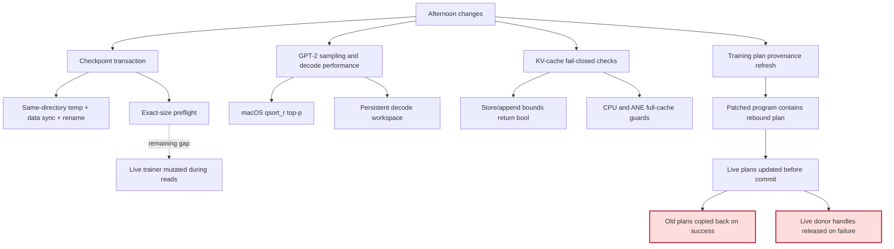
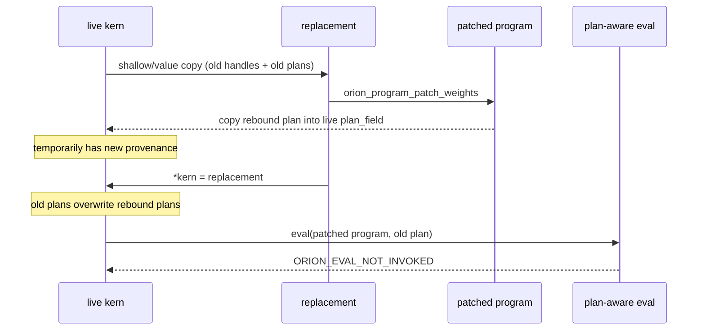
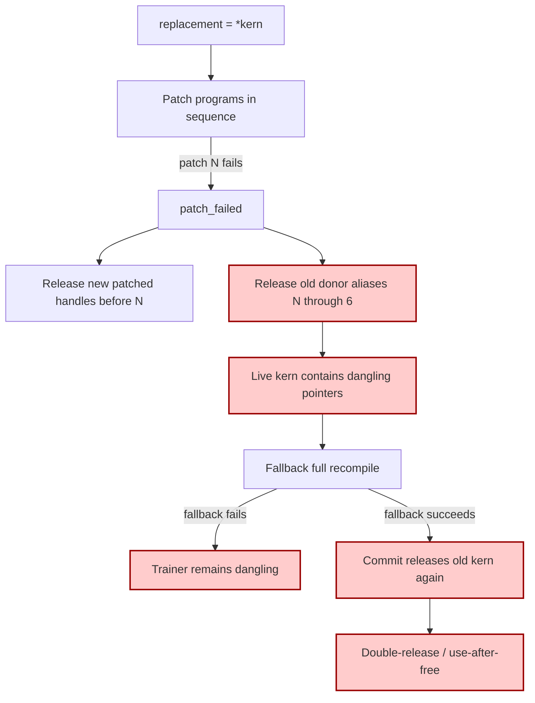
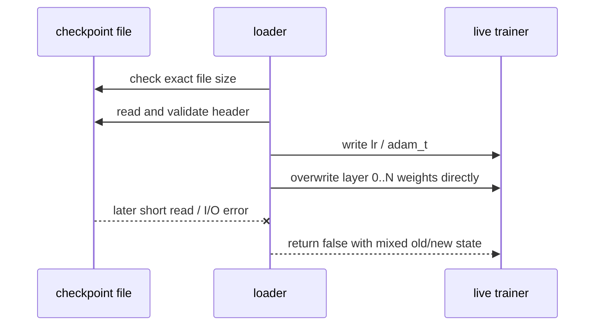
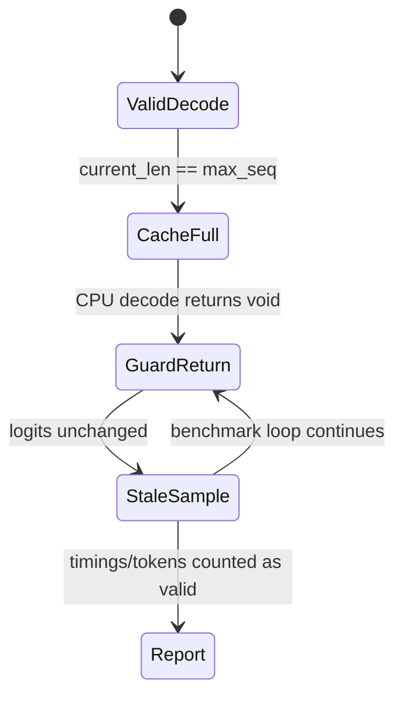
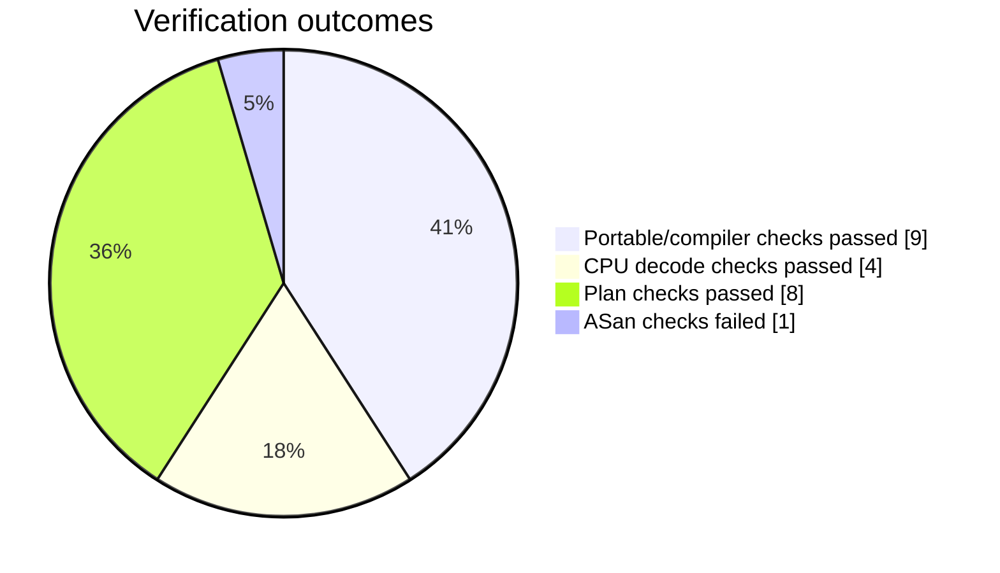
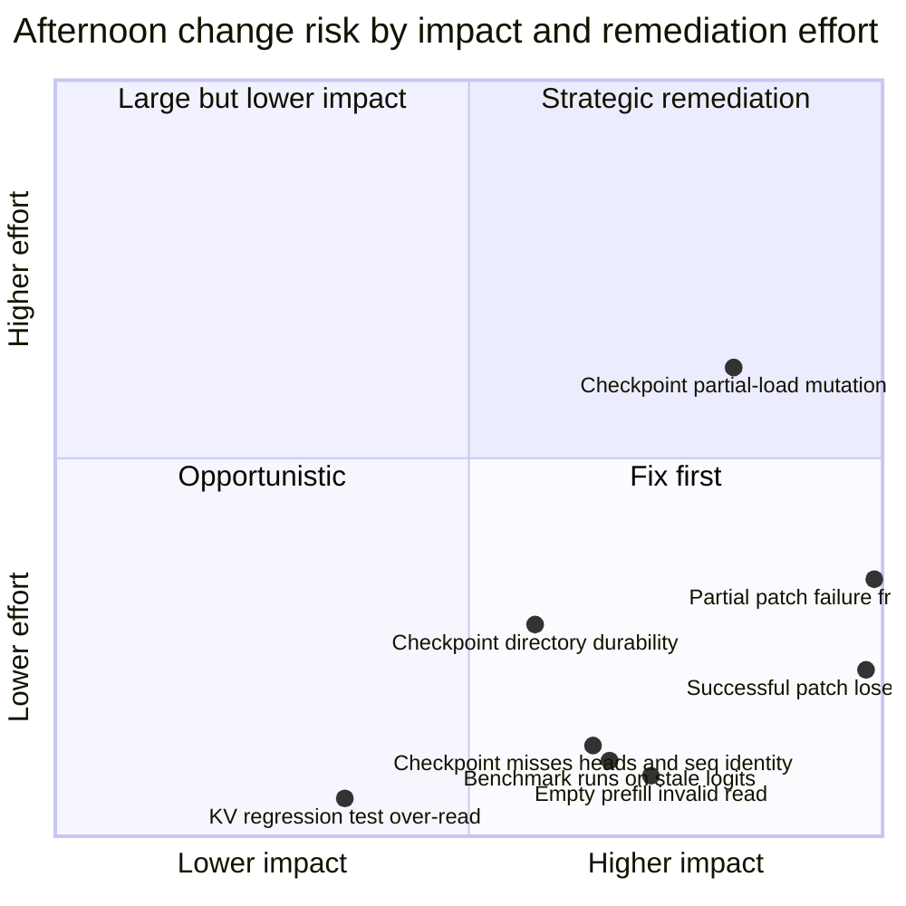
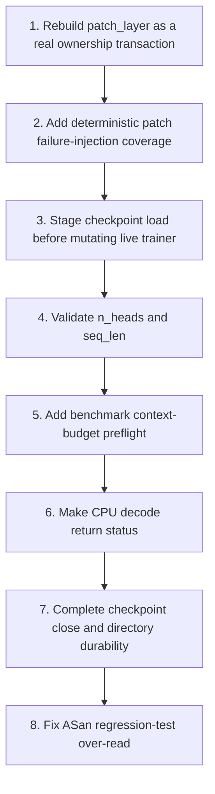

# Orion Afternoon Change Review — Logic and Failure Semantics

> **Review date:** 2026-08-03
> **Review window:** commits authored from 2026-08-03 12:00 local through 20:14 local
> **Git range:** `e47398dc7a5435fd47b43d4f920cbab9089bf27f..9518d39b50097f91d92a78be92e0b11827a87f13`
> **Branch:** `feat/voxtream-depth-integrity`
> **Review emphasis:** production logic, ownership, transactionality, state transitions, bounds, and failure propagation. Test mechanics are secondary except where they obscure production behavior.

## Executive assessment

The afternoon work materially improves GPT-2 decode performance and closes the original KV-cache write-overflow paths. The macOS `qsort_r` conversion is correct, the persistent workspace removes allocator churn from CPU decode, the CLI inference path now rejects requests that cannot fit in the model context, and checkpoint publication is substantially safer than direct overwrite.

However, the patched-weight training correction in `9518d39` is not functionally complete and introduces a dangerous failure transaction. The successful delta-patch path copies the old binding plans back over the rebound plans, so plan-aware evaluation still rejects the patched programs. The partial-failure path can release program handles that remain installed in the live trainer, creating dangling pointers and a later double-release/use-after-free during fallback recompilation. These are merge blockers.

Checkpoint loading also remains non-transactional after its initial file-size check: a later read failure can leave a trainer partially restored. The checkpoint header validation omits two architecture fields that are explicitly stored (`n_heads` and `seq_len`). Benchmark inference also lacks the production CLI's context-budget preflight, so it can continue after the CPU decode guard stops advancing the cache and report timings generated from stale logits.



## Reviewed commits

```mermaid
timeline
    title Work reviewed since 2026-08-03 12:00 local
    12:00 : 9d78626 Transactional checkpoint save and load preflight
    12:02 : 21b2c45 Top-p insertion sort replaced by qsort_r
    12:11 : d6e5d38 Persistent decode workspace and initial KV bounds checks
    16:10 : 3da51ec Makefile inventory documentation and target
    20:14 : 9518d39 Fail-closed KV fixes, training provenance, honest test SKIP
```

| Commit | Primary effect | Assessment |
|---|---|---|
| `9d78626` | Same-directory temp checkpoint publication and exact-size load preflight | Material improvement, but load commit and filesystem durability remain incomplete |
| `21b2c45` | O(vocab²) insertion sort replaced with macOS `qsort_r` | Correct and worthwhile |
| `d6e5d38` | Persistent CPU decode workspace and first KV bounds checks | Performance improvement; original bounds propagation was incomplete |
| `3da51ec` | Source/test inventory documentation | Low-risk documentation/build change |
| `9518d39` | Follow-up KV bounds, training plan refresh, SKIP semantics | KV fixes are valuable; training transaction is still broken |

## Findings

### Critical 1 — Successful delta patch discards the rebound plans it just obtained

**Location:** `kernels/training/stories_train.m:1157-1191`

`patch_layer` begins with:

```objc
OrionLayerKernels replacement = *kern;
```

This copies both the old program pointers and the old `OrionBindingPlan` values into `replacement`. Each successful `PATCH_PROGRAM` obtains the patched program's rebound plan, but writes it into the live object:

```objc
const OrionBindingPlan* rebound = orion_program_plan(replacement.field);
if (rebound) kern->plan_field = *rebound;
```

After every patch succeeds, the function commits with:

```objc
*kern = replacement;
```

That assignment copies the old plans held in `replacement` back over the rebound plans just written into `kern`. The final state is therefore:

- program handles: patched programs;
- program-owned plans: patched weight SHA-256 provenance;
- trainer `kern->plan_*`: original pre-patch SHA-256 provenance.

The next `orion_eval_with_plan` compares the trainer plan against the patched program plan in `plan_has_same_provenance` and rejects the invocation as `ORION_EVAL_NOT_INVOKED`.



**Impact:** the intended fix in `9518d39` is undone on every successful patch cycle. Training cannot reliably continue with plan-aware evaluation after `orion_trainer_recompile_delta`.

**Required fix:** write rebound plans into `replacement.plan_field`, not `kern->plan_field`, and commit the fully constructed replacement only after every patch succeeds.

---

### Critical 2 — Partial patch failure releases live donor programs and enables double-release/use-after-free

**Location:** `kernels/training/stories_train.m:1157-1203`

Because `replacement = *kern` aliases every original program pointer, only successfully patched fields stop pointing at the live donor. If patch N fails:

- fields before N contain newly created patched programs;
- field N and all later fields still contain the original live donor pointers;
- `patch_failed` releases every non-null weighted field in `replacement`.

Therefore the cleanup releases both the newly created replacements and original programs that are still installed in `kern`. The caller then falls back to `orion_trainer_recompile`. If fallback compilation fails, the trainer remains populated with dangling program pointers. If it succeeds, its commit path calls `release_layer_kernels` on those already-freed pointers, producing a double-release/use-after-free path.

Failure at the first patch is the clearest case: all six weighted donor programs are still aliased by `replacement`, so all six live programs are released before the fallback begins.



**Impact:** deterministic memory corruption is possible on an ordinary patch failure path. The patch path is explicitly meant to fall back safely, but the fallback is not safe after donor ownership has been destroyed.

**Required fix:** initialize `replacement` to zero, store only newly owned weighted programs in it, store rebound plans in `replacement`, and release only newly created handles on failure. Do not mutate or release any live `kern` field until the entire replacement is valid. Preserve `sdpa_bwd2` only at the success commit boundary.

A safe structure is:

1. `OrionLayerKernels replacement = {0};`
2. Patch every weighted program from the corresponding donor in `kern`.
3. Copy each patched program's plan into `replacement.plan_*`.
4. On failure, release only non-null replacement weighted handles.
5. On success, copy/preserve the weight-free handle, release old weighted donors, then assign `*kern = replacement`.

---

### Important 1 — Checkpoint load is not transactional after the size preflight

**Location:** `core/checkpoint.m:216-279`

The new exact-size check prevents a statically truncated checkpoint from being loaded. It does not guarantee that all subsequent reads will succeed. After validating the header, the loader immediately mutates live state:

```objc
t->lr = hdr.lr;
t->adam_t = hdr.adam_t;
```

It then reads weights and Adam arrays directly into the live trainer. A storage error, concurrent file truncation/modification, or another short read after the size check causes an early `false` return with part of the trainer already replaced.

The commit comment says the file is "known-complete," but file length is not an immutable read transaction. Even without a concurrent writer, `fread` can fail after a successful `fseek`/`ftell`.



**Impact:** a failed resume can leave weights, optimizer state, and scalar training state from different checkpoints. Continuing training from that mixed state is invalid.

**Required fix:** stage the complete checkpoint in temporary allocations (or read the exact file into one validated immutable buffer), validate every section, then commit to the live trainer in one final copy/swap phase. Delay `out_step`, `out_loss`, `lr`, and `adam_t` updates until the full payload has been read successfully.

---

### Important 2 — Checkpoint compatibility validation ignores stored head count and sequence length

**Location:** `core/checkpoint.m:149-160, 244-248`

The save header stores:

- `hdr.n_heads = cfg->n_head`;
- `hdr.seq_len = cfg->max_seq`.

The load compatibility check validates layers, model dimension, hidden dimension, and vocabulary only. It does not compare `hdr.n_heads` or `hdr.seq_len` with the active configuration.

**Impact:** a checkpoint from a model with the same aggregate tensor dimensions but different attention partitioning or sequence contract can be accepted. The raw array sizes may match while model semantics and compiled training kernels do not.

**Required fix:** include `n_heads` and `seq_len` in the compatibility predicate and diagnostic message. Treat all architecture fields serialized into the header as part of checkpoint identity.

---

### Important 3 — Benchmark decode can run past KV capacity and report stale-logit work

**Location:** `apps/cli/commands/bench.m:816-904`, `kernels/inference/decode_cpu.m:441-459`

The `infer` command now correctly checks:

```objc
prompt_len + max_tokens <= max_seq
```

The inference benchmark has no equivalent preflight. When `current_len` reaches `max_seq`:

- `orion_gpt2_decode_step` returns `void` without changing logits;
- the benchmark loop cannot detect the failure;
- it continues sampling from the previous logits and recording decode timings;
- `gen_count` continues to increase even though the model state is no longer advancing.

The ANE path eventually falls back to CPU, but the CPU guard also returns without a status, so the stale-logit loop continues.



**Impact:** benchmark results can include repeated sampling and near-empty guarded decode calls rather than actual model decode. This can make performance regressions appear as improvements and corrupt output-token claims.

**Required fix:** apply the same `prompt_len + max_tokens <= max_seq` preflight as the inference command. Longer-term, make the CPU decode step return `bool` so all callers can propagate capacity and allocation failures explicitly.

---

### Important 4 — Checkpoint publication is atomic but not fully crash-durable

**Location:** `core/checkpoint.m:184-202`

The save path performs `fflush`, `fdatasync`, `fclose`, and same-directory `rename`, which is a substantial improvement over direct overwrite. Two durability/error gaps remain:

1. `fclose(f)` is not checked. A close-time flush/error can be ignored and the temporary file renamed as though publication succeeded.
2. The parent directory is not synced after `rename`. A power loss can lose the directory entry update even though the function returned success.

**Impact:** readers will not observe a partially renamed file, but a reported successful checkpoint can disappear or revert to the previous file after a crash. Close-time failure can also be misreported as success.

**Required fix:** incorporate `fclose` into `ok`, and after successful rename open and `fsync` the parent directory before reporting success. If strict macOS durability is required, document whether `F_FULLFSYNC` is needed for the file on supported filesystems.

---

### Important 5 — The public CPU prefill contract accepts an empty sequence and then addresses before the buffer

**Location:** `kernels/inference/decode_cpu.m:279-350`

The new fail-closed check rejects `seq_len < 0` and `seq_len > max_seq`, but accepts `seq_len == 0`. It later computes:

```objc
x + (seq_len - 1) * d
```

which points before the allocation before the final logits GEMM. The CLI and benchmark currently reject a zero-token prompt, so their direct paths are protected, but the public kernel function does not enforce its own valid domain and is called directly by multiple tests and library-level callers.

**Impact:** an empty prefill request through any caller that does not duplicate the CLI guard can produce an invalid read/crash.

**Required fix:** require `seq_len > 0`, validate non-null inputs, and document the valid range as `1..max_seq` in `decode_cpu.h`.

---

### Secondary evidence — the new bounds regression has its own heap over-read

**Location:** `tests/test_kv_cache_bounds.m:23-31, 80-83`

The tiny cache has a per-layer stride of 8 floats (`1 * 4 * 2`) and a total allocation of 16 floats across two layers. The test repeatedly calls `layer_kv_is_zero(..., 16)`. For layer 1 this reads offsets 8 through 23, eight floats past the allocation.

AddressSanitizer reproduced the failure:

```text
ERROR: AddressSanitizer: heap-buffer-overflow
READ of size 4
layer_kv_is_zero test_kv_cache_bounds.m:28
test_store_prefill_rejects_bad_layer test_kv_cache_bounds.m:82
```

This is secondary to the production findings, but it matters to the evidence: the normal test passes because the out-of-bounds region happens to look zero, so the green result cannot be used as strong memory-safety proof.

**Required fix:** remove the caller-supplied count or assert `count <= layer_stride`; use exactly `layer_stride` for a per-layer check. Add API-level tests for empty prefill and full-cache decode propagation, not only mutator-level tests.

## Positive findings

### macOS `qsort_r` migration is correct

`kernels/inference/decode_cpu.m:544-623` uses the BSD/macOS signature:

```c
int compar(void *context, const void *a, const void *b)
```

and calls:

```c
qsort_r(indices, vocab_size, sizeof(int), probs, cmp_prob_desc);
```

The comparator sorts descending probability and uses ascending token index for ties, preserving deterministic tie behavior. The nucleus accumulation, renormalization, and original-token index mapping remain intact. CPU decode and golden inference checks passed.

### Persistent CPU decode workspace is a real hot-path improvement

The workspace moves per-token/per-layer temporary allocations out of the inner decode loop. Its constructor checks all component allocations and cleans up on partial failure. Production inference constructs one workspace before generation and releases it afterward.

### KV-cache memory guards now block the original direct overflow paths

The cache mutators return explicit success status, validate both sequence position and layer dimension, and avoid writing on failure. CPU and ANE decode reject `current_len >= max_seq` before attention reads. These changes close the original score-buffer overflow and cache-row over-read paths.

### Inference CLI now performs correct context-budget preflight

`apps/cli/commands/infer.m:135-147` rejects `prompt_len + max_tokens > max_seq`, preventing a production generation request from reaching the full-cache guard under normal operation.

### Checkpoint save and load are materially safer than before

Same-directory `mkstemp` plus data synchronization and atomic rename prevents ordinary readers from observing partially written checkpoints. The exact-size preflight rejects static truncation and trailing bytes before body restoration starts. These are good foundations; the remaining issue is staging/commit completeness, not the overall direction.

## Verification evidence

| Verification | Result | What it establishes |
|---|---:|---|
| `make test-compiler` | **9 passed, 0 failed** | Portable compiler/test target builds and passes |
| `./build/tests/test_decode` | **4 passed, 0 failed** | CPU top-p, prefill, single-step, and multi-step behavior retained |
| `./build/tests/test_plan_weight_dict` | **8 passed, 0 failed** | Plan/dictionary compile and cache identity checks pass on this host |
| ASan `test_kv_cache_bounds` | **Failed** | Confirmed heap-buffer-overflow in the new test helper |
| Delta-patch training smoke | **Not run** | No runtime evidence contradicts the source-level transaction blockers |
| Crash/power-loss checkpoint test | **Not run** | Durability conclusions are based on syscall ordering and mutation flow |



## Risk matrix



## Recommended remediation order



### Immediate patch-layer acceptance criteria

- No live `kern` program pointer or plan changes before all weighted patches succeed.
- Failure cleanup releases only newly created patched programs.
- Successful commit installs rebound plans from the corresponding patched programs.
- The weight-free `sdpa_bwd2` handle remains owned exactly once.
- Failure at each patch position (1 through 6) leaves every original program and plan usable.
- A successful delta patch followed by `orion_eval_with_plan` succeeds without increasing `orion_compile_count`.

## Merge assessment

**Ready to merge:** **No**

The inference performance work and direct KV-cache guards are sound improvements, but the delta-patch training path is neither functionally correct on success nor ownership-safe on failure. Those two findings are sufficient to block merge. Checkpoint load transactionality should also be corrected before relying on resume after I/O errors, and benchmark context capacity should be aligned with the production inference command before treating its output as performance evidence.

## Bottom line

The strongest afternoon changes turn implicit assumptions into explicit bounds and ownership contracts. The remaining failures come from contracts that stop one step too early: the patched program has the right provenance but the replacement transaction reinstalls the wrong plan; the checkpoint file has the right length but live state is mutated before all reads succeed; the decode kernel stops at capacity but the benchmark cannot observe that it stopped. The next pass should make those state transitions fully transactional and propagate failure status end to end.
