# Orion — Verified Codebase Analysis

> **Audit date:** 2026-08-01  
> **Source revision:** `3e29615` (`main`, 74 commits)  
> **Verification performed:** current source inspection, `make`, and `make test-compiler`  
> **Hardware suites:** not rerun; historical ANE results are labeled explicitly  
> **Scope:** `apps/`, `compiler/`, `core/`, `kernels/`, `model/`, `tokenizer/`, `tests/`, `docs/`, `reports/`, `experiments/`, and `archive/`

---

## 1. Audit Basis and Evidence Labels

This report supersedes the earlier version of `reports/CODEBASE_ANALYSIS.md`. The original analysis captured the broad architecture but contained incorrect source/test counts, stale training compile arithmetic, an incorrect compiler-pipeline diagram, and overstatements about binding-plan enforcement and the VoXtream serving evidence.

Claims below use four evidence classes:

| Label | Meaning |
|---|---|
| **Source-verified** | Directly established by tracked source at `3e29615` |
| **Verified locally** | Rebuilt or executed during this audit |
| **Historical evidence** | Recorded in commits, `README.md`, or `RESULTS.md`; not rerun here |
| **External / unverified** | Reported by `AGENTS.md` about the separate VoXtream repository or an absent PRD |

### Repository state at audit time

- Branch: `main`, 29 commits ahead of `origin/main`.
- `reports/CODEBASE_ANALYSIS.md` was untracked while audited.
- `.zcode/` was also untracked and is tooling state, not repository source.
- `build/`, `.venv/`, `data/`, `model/blobs/`, and the root `orion` executable are ignored/generated local state.
- The local `orion` artifact was approximately 376 KiB, but this is not a tracked or reproducible release artifact by itself.

### Verification result

```text
make: Nothing to be done for `all'.
test_graph_ir                  PASS
test_passes                    PASS
test_ane_passes                PASS
test_compiler_equiv            PASS
test_orion_error               PASS
test_orion_ledger              PASS

6/6 passed, 0 failed
```

`make` found the current local build up to date. The six portable tests passed. The full hardware suite was intentionally not run because it contains ANE-, model-blob-, export-, and compile-probe-dependent binaries.

---

## 2. Executive Summary

Orion is a macOS-only Objective-C/C research runtime that invokes the private `AppleNeuralEngine.framework` directly. It avoids the public Core ML model-packaging/runtime API, but it still emits Core ML MIL text and uses compiler metadata associated with the Core ML toolchain.

The repository contains two major application domains:

1. **GPT-2 / Stories110M research stack** — CPU inference, ANE prefill and hybrid decode, and ANE-assisted transformer training with CPU updates and weight patching.
2. **VoXtream depth-transformer work** — compiler frontends, probes, tests, one-shot evaluation, and a persistent JSON-lines worker for a four-layer GQA/SwiGLU decoder.

The strongest engineering theme is the conversion of empirically discovered ANE behavior into graph validation, code-generation conventions, binding metadata, and tests. However, those protections are **not uniformly applied**. In particular, the current `depth-eval` and `depth-serve` commands use raw `orion_compile_mil` / `orion_eval` paths rather than binding-plan-aware compile/eval APIs.

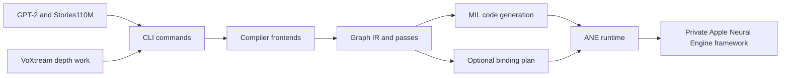

### Corrected headline inventory

| Dimension | Verified value |
|---|---:|
| CLI translation units linked by `make` | **49**: 27 non-compiler + 22 compiler |
| Makefile test binaries | **39**: 33 full-library + 6 portable/compiler-target |
| VoXtream-prefixed test binaries | **11** |
| Git history | 74 commits; `mechramc` 45, `Jim Fung` 29 |
| Current Stories training programs | **84 total**: 72 weighted + 12 weight-free |
| Portable test result | **6/6 passed** |

### Historical performance evidence, not rerun here

| Result | Scope and qualification |
|---|---|
| GPT-2 CPU decode 283 tok/s; ANE full-forward 170+ tok/s | Historical M4 Max results from `RESULTS.md` |
| Stories110M 1,000 steps, 0 NaNs, 0 exec restarts | Historical M4 Max result; mechanism prose in `RESULTS.md` is partly stale |
| Separate-CFG depth loop p99 70.8 ms | Historical M5 Pro loop result, commit `4fc81bc` |
| Seqpack depth-loop harness p99 40.3 ms | Historical M5 Pro **shape/timing harness**, not current end-to-end `depth-serve --seqpack` latency |

The 40.3 ms result must not be interpreted as proof of current production serving latency or four-distinct-layer token parity. The harness reused layer-0 weights for all four stages, measured a fixed-input ANE loop rather than the real audio-token recurrence, and predates host-side final RMSNorm.

---

## 3. Repository Inventory

### 3.1 Reproducible LOC method

The source totals below use tracked files from `git ls-files` with extensions `.c`, `.h`, `.m`, `.mm`, `.swift`, and `.py`. Documentation totals use tracked `.md` files. The untracked report itself is excluded from the tracked-HEAD totals.

| Directory | Tracked LOC | Role |
|---|---:|---|
| `compiler/` | 5,887 | IR, builder, patterns, validation, passes, frontends, codegen, binding plans |
| `core/` | 3,228 | Private ANE bridge, IOSurface tensors, cache, patching, checkpoint and error utilities |
| `kernels/` | 3,086 | GPT-2 inference and Stories110M training |
| `apps/` | 4,435 | CLI and unbuilt SwiftUI stubs |
| `tests/` | 13,162 | C/Objective-C tests plus Python generators/test utility |
| `tokenizer/` | 672 | GPT-2 BPE and custom Llama/Karpathy tokenizer-bin reader |
| `model/` | 655 | Weight loader, fixed configs, and Python converters |
| `experiments/` | 1,957 | Historical private-API and weight-patch spikes |
| `archive/` | 1,113 | Retired MIL generation references |
| `docs/` | 509 | ANE API/constraint notes and historical benchmark notes |
| `reports/` | 2,717 | 17 tracked historical reports, excluding this untracked report |

The source-code directories above total 34,195 lines. Adding tracked docs and historical reports yields 37,421 lines. These totals intentionally exclude top-level Markdown, JSON fixtures, generated blobs, datasets, build artifacts, and this untracked report.

### 3.2 Topology

```mermaid
flowchart TD
    Root[Orion repository]
    Root --> Apps[apps]
    Root --> Compiler[compiler]
    Root --> Core[core]
    Root --> Kernels[kernels]
    Root --> Model[model]
    Root --> Tokenizer[tokenizer]
    Root --> Tests[tests]
    Root --> Docs[docs and reports]
    Root --> Legacy[experiments and archive]

    Apps --> CLI[CLI: infer, train, bench, depth-eval, depth-serve]
    Apps --> MacApp[SwiftUI stubs; not built]

    Compiler --> Frontends[GPT-2, Stories, LoRA, VoXtream]
    Compiler --> Graph[Graph IR, builder, patterns, passes]
    Compiler --> Codegen[MIL codegen and kernel adapter]
    Compiler --> Binding[Binding-plan ABI metadata]

    Core --> PrivateAPI[Private ANE runtime bridge]
    Core --> Surface[IOSurface allocation and conversion]
    Core --> Lifecycle[Cache, checkpoint, patch, profiler]

    Kernels --> Inference[GPT-2 CPU and ANE inference]
    Kernels --> Training[Stories110M training]
```

### 3.3 Build inventory

The comments at `Makefile:12` and `Makefile:98` are stale. The actual lists are authoritative:

- 11 core sources
- 4 inference sources
- 3 training sources
- 1 model source
- 2 tokenizer sources
- 5 CLI handlers
- 1 CLI `main.m`
- 19 compiler C sources
- 3 compiler Objective-C sources

Total: **49 translation units** linked into `./orion`.

Tests:

- `TEST_NAMES`: **33** full-library test binaries.
- `COMPILER_TEST_NAMES`: **6** portable/compiler-target binaries.
  - Four Objective-C tests linked with compiler objects.
  - Two standalone pure-C tests for `orion_error` and the compile ledger.
- Total Makefile-built test executables: **39**.

`test_program_swap.m`, `test_weight_convert.py`, and the golden generators are present but are not Makefile test binaries.

`make test` treats a zero exit status as PASS. Hardware/export tests often return zero after printing `SKIP`, so a simple pass count does not imply that ANE numerical coverage executed.

---

## 4. ANE Constraints and How Orion Enforces Them

`docs/ane_constraints.md` records 14 empirical constraints. They are not all “binding-plan metadata”; enforcement is distributed across frontends, passes, codegen, runtime conventions, and tests.

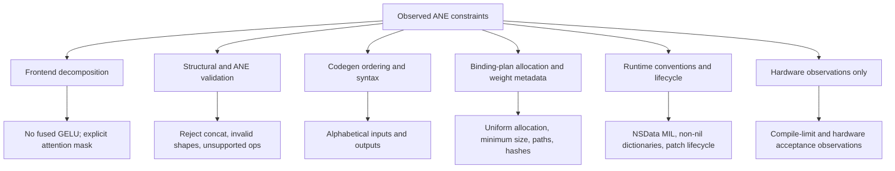

| Constraint | Current enforcement and caveats |
|---|---|
| No `concat` | Structural and ANE validators reject `ORION_OP_CONCAT_BANNED` |
| Uniform output allocation | Binding plan computes one allocation size per output group; warning pass alone does not pad |
| Alphabetical outputs | Codegen sorts by returned node-expression name |
| Minimum allocation about 49 KiB | `ORION_ANE_MIN_ALLOCATION_BYTES=49152` in binding plans |
| Historical compile limit | `g_compile_count` and optional ledger track successful compile+load; limit is not universal across hardware |
| SDPA masks ignored | Attention frontends decompose scores, additive mask, softmax, and value product |
| Weights baked at compile | Runtime supports donor-program weight patching and reload without compile |
| BLOBFILE offset | Legacy single tensors generally use 64; aggregate chunk header offsets can exceed 64 |
| MIL must be bytes | Runtime builds `NSData` from MIL bytes |
| No fused `gelu` | Builder decomposes the tanh approximation |
| Weight dictionary non-nil | Runtime substitutes `@{}` for nil |
| Uniform input allocation | Binding plan computes one allocation size per input group |
| Alphabetical inputs | Codegen and binding entries sort by function-argument name |
| Packed-prefix reads | Plan metadata and LoRA loader use packed data at the start of oversized surfaces |

### Important inconsistency: offset validation

`codegen.m` emits the graph node’s actual `attrs.blob_offset`; it does not universally hardcode 64. The generic `pass_ane_validate.c` still rejects BLOBFILE offsets other than 64, while multi-chunk aggregate graphs need offsets above 64. The aggregate and seqpack command generators therefore bypass the full kernel-adapter ANE validation path and perform raw validation/optimization/rewrite/codegen.

This is a current architectural split, not a fully unified invariant.

---

## 5. Compiler Architecture

### 5.1 Actual adapter pipeline

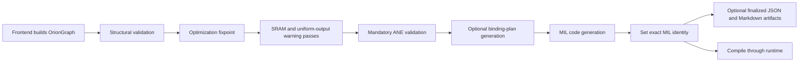

The actual order in `compiler/kernel_adapter.m` is:

1. `orion_graph_validate`
2. `orion_pipeline_optimize`
3. `orion_pipeline_ane_passes`
4. `orion_pass_ane_validate`
5. optional `orion_binding_plan_generate_with_identity`
6. `orion_codegen_mil`
7. optional `orion_binding_plan_set_mil_identity`
8. optional artifact publication, which requires a finalized plan

The earlier report incorrectly placed finalized-plan validation before codegen, even though `mil_identity` cannot exist until after codegen.

Not every repository caller uses this adapter. Training and the depth commands contain direct generation/compile paths, so the adapter’s mandatory gate is not repository-wide.

### 5.2 Graph IR

`OrionGraph` is an arena-style fixed-capacity graph with integer node references:

- `ORION_MAX_NODES = 4096`
- up to 8 input edges per node
- external shapes represented as four integers, conventionally `[1,C,1,S]`
- liveness and output flags used by optimization and validation
- `OrionAttrs` stores permutation, axis, transpose, scalar, BLOBFILE path/offset, and slice metadata

`OrionOp` defines 27 operation values before `ORION_OP_COUNT`, but they do **not** all map one-to-one to emitted MIL:

- `ORION_OP_CONCAT_BANNED` is validation-only.
- `SPLIT` and `PAD` exist in the enum but are rejected by the mandatory codegen-support gate.
- `INPUT` and `CONST` are IR categories rather than normal compute calls.
- Identity-like operations may disappear during optimization.

### 5.3 Passes

| Pass | Status | Effect |
|---|---|---|
| `pass_identity` | active | Bypasses no-op identity, cast, reshape, and transpose nodes |
| `pass_cast` | active | Eliminates reversible nested cast chains |
| `pass_conv_bias` | disabled | ANE MIL conv bias is represented as a separate add |
| `pass_dce` | active | Removes nodes unreachable from graph outputs |
| `pass_sram` | warning | Estimates tensor size against a 32 MiB budget |
| `pass_uniform_outputs` | warning | Reports mixed output sizes; does not rewrite allocations |
| `pass_ane_validate` | mandatory in adapter | Rejects banned/unsupported ops, invalid external layout, conv bias, and legacy-invalid BLOBFILE refs |

The optimization fixpoint runs identity, cast, disabled conv-bias, and DCE for at most 20 iterations.

### 5.4 MIL codegen

`compiler/codegen.m` emits `program(1.3)`, Core ML component metadata, and `func main<ios18>`.

Ordering rules:

- Inputs are alphabetized by `GraphIO` function-argument name.
- Outputs are alphabetized by the returned live node-expression name, not the GraphIO display label.
- Binding-plan entries use the same naming distinction and are separately sorted.
- Graph identity still includes GraphIO arrays in declaration order, so declaration-order changes can change graph identity even when emitted binding order remains equivalent.

Private-parser workarounds include named bool constants for matmul transpose flags and separate add nodes for conv bias.

### 5.5 Frontends

| Frontend | Current role |
|---|---|
| `voxtream_depth.c` | Four-layer depth-decoder graph and numerous compile-acceptance probes, including seqpack |
| `voxtream_depth_chain.c` | 15-program decomposition for the observed one-large-weight-per-program restriction |
| `stories_train.c` | **Seven** training frontends: three forward and four backward |
| `lora.c` | Baked base projection plus hot-swappable LoRA IOSurface inputs |
| `gpt2_prefill.c`, `gpt2_decode.c`, `gpt2_final.c` | GPT-2 prefill/decode/final phases |
| `classifier_softmax.c` | Classifier and vocabulary softmax programs |

The VoXtream fixed configuration is 4 layers, dimension 1024, 8 query heads, 2 KV heads, head dimension 128, MLP dimension 8192, 16 logical tokens, and 32 ANE slots.

Sequence packing keeps learned layer weights unchanged but substitutes packed positional constants: duplicated RoPE cosine/sine tables and a block-diagonal causal mask.

---

## 6. Binding Plan: Intent, Coverage, and Current Gaps

The binding-plan schema is version 3. It records:

- graph and exact MIL SHA-256 strings
- Orion/compiler identity strings
- ordered input/output names, dtype, declared shape, logical bytes, packed-prefix bytes, and uniform allocation bytes
- weight name, path, offset, dtype, shape, logical size, and SHA-256
- declared position, mask, and failure semantics

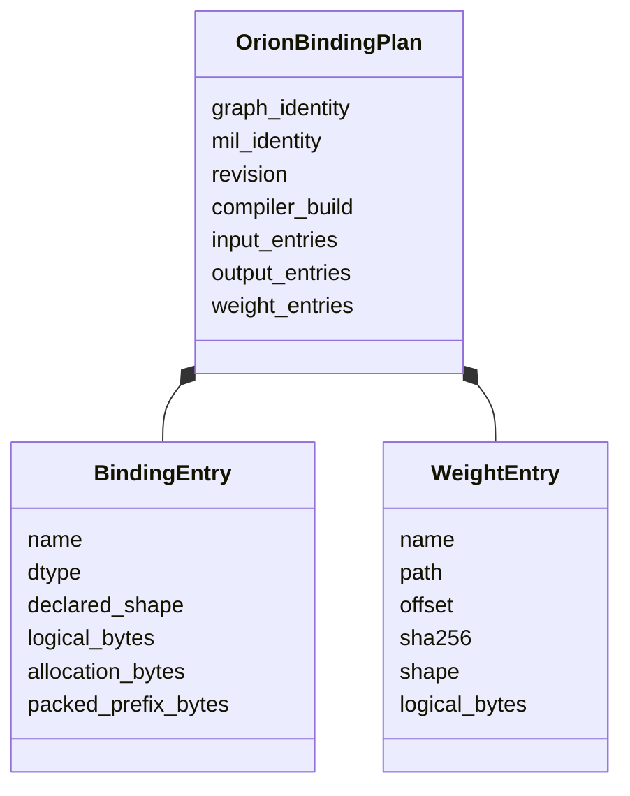

### 6.1 What is source-verified

- Plan generation hashes the optimized graph structure into `graph_identity`.
- Codegen output is hashed into `mil_identity` after MIL generation.
- External binding entries are alphabetized and share one allocation size per input/output group.
- The minimum allocation is 49,152 bytes.
- Weight paths are opened through a confined `openat`/`O_NOFOLLOW` traversal during plan generation.
- Filesystem-side plan generation supports legacy single-tensor files and aggregate chunk offsets.
- Weight payload hashing begins at `weight.offset + 64` for `logical_bytes`.
- Same-path weight ranges receive an O(n²) overlap check.

### 6.2 Integrity gaps found during verification

These are current source discrepancies and should be treated as open correctness issues:

1. **Hash-domain mismatch for offset 64**  
   Plan generation hashes only the tensor payload. Runtime dictionary validation for `offset == 64` hashes the entire BLOBFILE, including headers.

2. **Patch rebinding uses whole-file hashes**  
   `rebound_plan_for_weights` writes the SHA-256 of each dictionary blob into every corresponding weight entry. This is incompatible with per-chunk payload hashes when multiple weights share an aggregate file.

3. **Aggregate first-chunk mismatch**  
   Filesystem-side generation recognizes an aggregate first chunk at offset 64, but runtime dictionary validation treats every offset-64 entry as a unique legacy single-tensor file and rejects a repeated path.

4. **Overlap calculation uses different coordinates**  
   Actual payloads are read as `[offset+64, offset+64+logical_bytes)`. The overlap check compares `[offset, offset+logical_bytes)`, so it does not validate the exact read ranges.

5. **Graph identity is provenance, not recomputed authentication**  
   Plan validation checks that `graph_identity` is syntactically a SHA-256 string. Compile, patch, and eval do not have/recompute the graph to authenticate it.

6. **Eval does not bind the supplied plan to the program**  
   `orion_eval_with_plan` validates the caller-supplied finalized plan and IOSurface metadata, but does not compare it to `prog->plan`, recheck MIL identity, or rehash weights.

### 6.3 Correct trust-boundary description

- `orion_compile_mil_with_plan` verifies exact MIL identity and calls weight-dictionary validation before raw compilation.
- Patch attempts to construct a rebound plan when the donor has a plan, but the hash semantics above are inconsistent.
- `orion_eval_with_plan` verifies binding metadata for supplied surfaces; it is not a full program/plan authentication boundary.
- Current depth CLI paths do not use these plan-aware functions.

The plans are **hash-bound**, not digitally signed.

---

## 7. Core Runtime

### 7.1 Private API bridge

`orion_ane_init` loads:

```text
/System/Library/PrivateFrameworks/AppleNeuralEngine.framework/AppleNeuralEngine
```

It resolves:

- `_ANEInMemoryModelDescriptor`
- `_ANEInMemoryModel`
- `_ANERequest`
- `_ANEIOSurfaceObject`

Key selectors include:

- `modelWithMILText:weights:optionsPlist:`
- `inMemoryModelWithDescriptor:`
- `compileWithQoS:options:error:`
- `loadWithQoS:options:error:`
- `requestWithInputs:inputIndices:outputs:outputIndices:weightsBuffer:perfStats:procedureIndex:`
- `evaluateWithQoS:options:request:error:`
- `unloadWithQoS:error:`

Compile, load, and eval pass QoS 21 and empty option dictionaries.

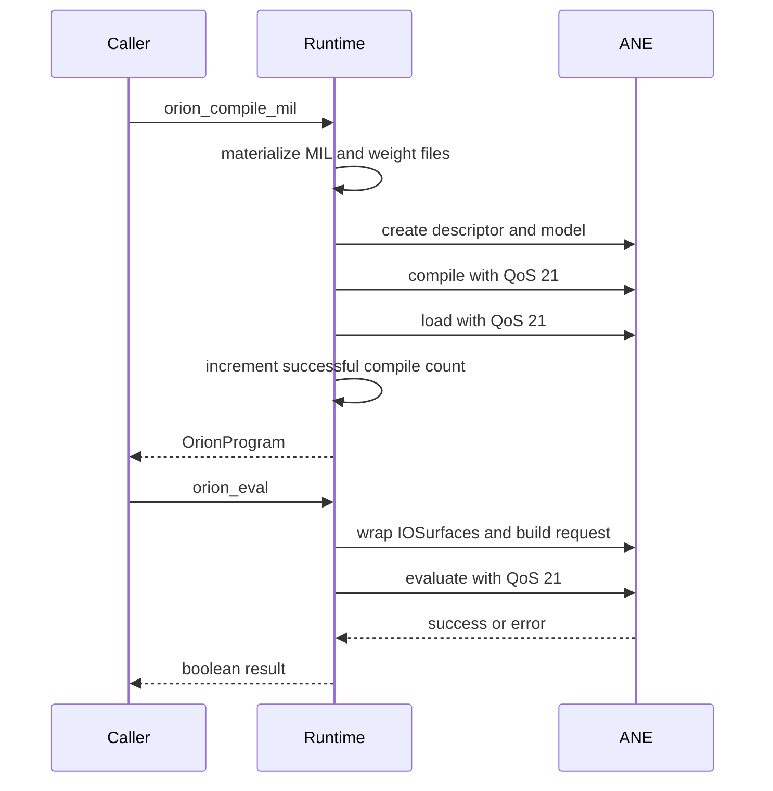

### 7.2 Compile accounting

`g_compile_count` increments only after both compile and load succeed. Failed attempts are not counted. It is process-static and reset by `orion_ane_init` only on first initialization/process start, not by cache clearing.

`OrionCompileLedger` is an in-memory accounting utility with JSON serialization. It is well tested but is not broadly integrated into runtime command paths. Its default safety threshold is 90 and historical empirical limit is 119.

The “119 hard limit” should be treated as a historical M4/upstream observation, not a universal device invariant. The M5 probe compiled byte-identical MIL 1,000 times with different runtime tags; the tag does not make MIL unique, and Orion’s `orion_compile_mil` increments its count on every successful call.

### 7.3 Tensor representation

For the audited fp16 model paths, logical external tensors use `[1,C,1,S]`, stored as contiguous channel-major `[C,S]` values. Element `(c,t)` is at `c*S+t`.

The IOSurface itself is a flat, one-row byte allocation. The core allocator also supports f32 surfaces, so fp16 is not a universal runtime type invariant.

Training CPU activations are generally `[S,C]` and are transposed at the ANE boundary. Checked/plan-aware tensor functions validate allocation, dtype tags, and packed-prefix metadata; legacy raw read/write helpers perform less validation and remain widely used.

### 7.4 Program cache

`ane_program_cache.m` stores `OrionProgram` wrappers in a synchronized dictionary keyed by kernel, layer, weight identity, and bucket. GPT-2 adapter-driven inference uses this cache. Training bypasses it because weights change, and `depth-serve` stores program pointers directly in `DepthWorker` rather than using the global cache.

### 7.5 Error taxonomy

The nine value-stable native error codes map to recommended actions such as continue, retry, worker replacement, request failure, and cancellation. An eventual `mlx_recovery` escalation is external orchestration policy described in comments/PRD context, not a native enum transition implemented by this repository.

---

## 8. Delta Weight Patching and Stories Training

### 8.1 Current program topology

Stories110M has 12 layers and **seven ANE program types per layer**:

1. `fwd_attn`
2. `fwd_attn_core`
3. `fwd_ffn`
4. `ffn_bwd`
5. `sdpa_bwd1`
6. `sdpa_bwd2`
7. `qkv_bwd`

Total live programs: **84**.

Six programs per layer carry weights and are patched: **72 weighted programs**. `sdpa_bwd2` is weight-free and retained across a delta update: **12 retained programs**.

Some comments/macros and historical documentation still state 72 total programs or five/six kernels per layer. Those are stale relative to current source.

### 8.2 Training flow

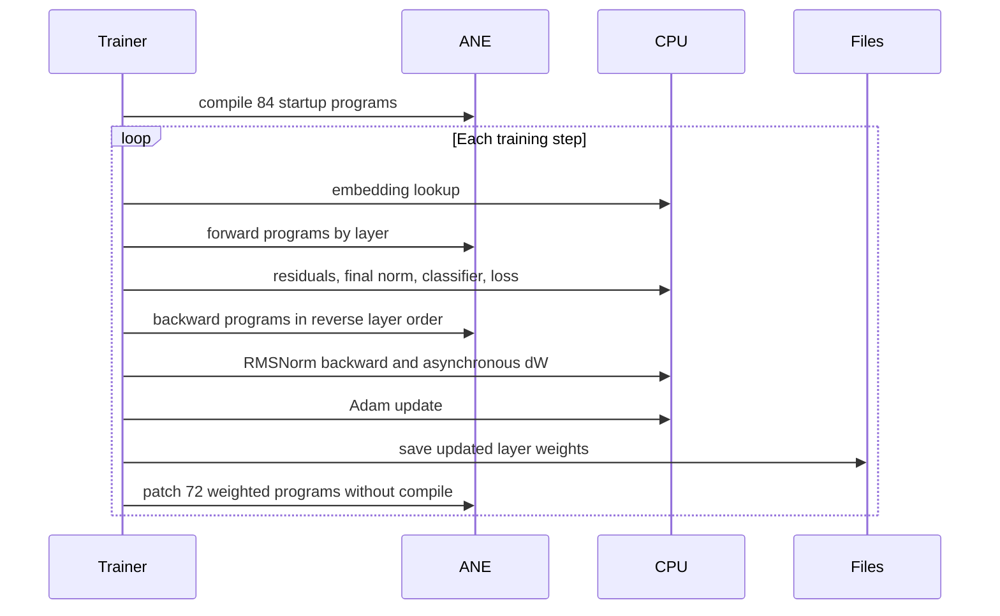

CPU responsibilities include embedding, residual composition, final RMSNorm, classifier projection, cross-entropy, selected backward work, dW accumulation, and Adam updates. dW tasks run on a serial GCD queue and synchronize with `dispatch_group_wait`.

### 8.3 Patch mechanism

`orion_program_patch_weights`:

1. Adds a weight-derived comment to the MIL text to obtain a fresh private model identity.
2. Creates a new model directory.
3. Copies the donor’s compiled `net.plist`.
4. Writes replacement BLOBFILE bytes as the new data/weights.
5. Calls `loadWithQoS` without `compileWithQoS`.
6. Returns a new `OrionProgram` without incrementing `g_compile_count`.

Same-directory patching is rejected. `orion_program_reload_weights` is intentionally disabled and always returns false.

### 8.4 Transactionality qualification

Delta replacement is transactional **within one layer**: all six weighted replacement programs for that layer must load before the old six handles are released. Layers are committed sequentially, so the 12-layer delta operation is not globally atomic.

If a later layer fails, earlier layers may already be replaced. The code then falls back to `orion_trainer_recompile`, which stages a complete replacement set before swapping all live layers.

A successful delta path avoids new compile calls. The automatic fallback can still compile 84 programs and therefore makes compile-budget assumptions relevant during failure recovery.

Deferred resume avoids compiling stale-weight programs before loading a checkpoint. With the current topology it avoids **84**, not 72, redundant startup compiles.

### 8.5 Historical result caveat

`RESULTS.md` reports a 1,000-step run with no NaNs or restarts. That is useful historical evidence, but its prose says `orion_program_reload_weights`; current code instead uses `orion_program_patch_weights`, and reload is disabled.

---

## 9. GPT-2 Inference

### 9.1 Execution modes

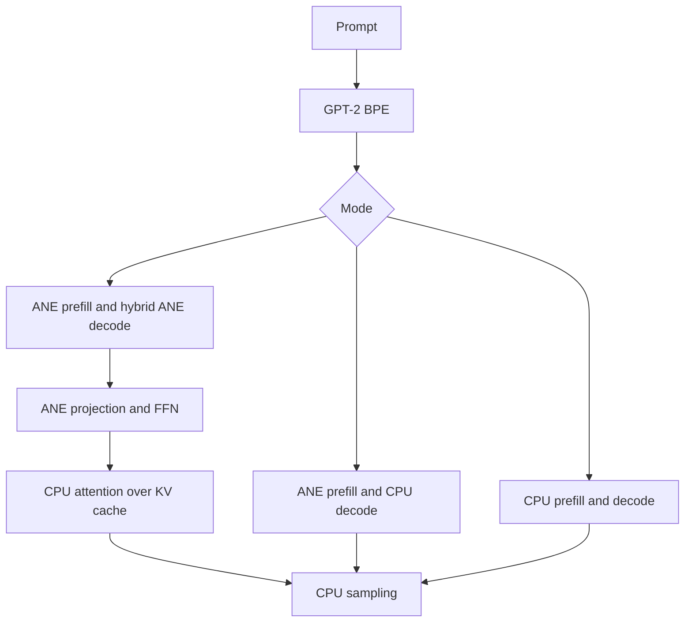

- CPU path: Accelerate-based LayerNorm, projection, attention, FFN, and sampling.
- ANE prefill: per-layer attention and FFN programs plus final normalization; logits remain CPU-side because the vocabulary projection is large.
- ANE decode: projection and FFN on ANE, attention over the KV cache on CPU.
- KV cache layout: `[layer, head, sequence, head_dim]`.

If an ANE eval explicitly fails, the CLI switches subsequent decode steps to CPU. This mitigates reported eval failures; it cannot detect silent numerical corruption by itself.

Historical GPT-2 numbers in `RESULTS.md` were not rerun and depend on ignored model blobs and specific M4 Max hardware.

---

## 10. VoXtream Depth Integration

### 10.1 Status categories

The earlier report conflated three different states. Current source supports this distinction:

| Category | Current status |
|---|---|
| Operational commands | `depth-eval` and `depth-serve`; raw compile/eval APIs |
| Plan-verified test paths | Selected aggregate and seqpack tests use binding-plan-aware compilation |
| External target production contract | Described by `AGENTS.md`; separate VoXtream repository and absent PRD were not audited |

Under `AGENTS.md` terminology, current depth commands are **not** the plan-verified production path. They rewrite BLOBFILE refs, generate MIL directly, compile with `orion_compile_mil`, and evaluate with `orion_eval`.

### 10.2 `depth-eval`

- Default mode is a fixed-input diagnostic and does not establish real autoregressive latency.
- `--recurrence` implements a real 15-token full-prefix recurrence with distinct layer aggregate weights.
- Both modes use raw unsigned aggregate compilation rather than plan-aware compile/eval.
- Protocol version 1 and `--protocol-info` are implemented.

The recurrence relies on a design contract: full-prefix causal evaluation at the active position should match cached decoding because future zero-padded positions cannot affect the active slot and RoPE positions remain fixed. The command implements this construction; source alone does not independently prove equivalence to an external KV-cache implementation.

### 10.3 `depth-serve`

`depth-serve` is an operational persistent worker. It compiles programs at startup, prints a readiness JSON object, then processes newline-delimited JSON requests from stdin.

It stores `OrionProgram*` handles directly in `DepthWorker`; it does not use `ane_program_cache.m`.

Base64 hidden inputs avoid reading `hidden_cond.fp16.bin` and `hidden_uncond.fp16.bin`, and `getline` supports the large JSON payload. Tokens are always returned in JSON. A `tokens.bin` file is written only when a usable `input_dir` provides the path; a base64-only request without `input_dir` has no output file path.

### 10.4 Real 15-token recurrence

Each branch maintains a growing prefix:

- slot 0: last hidden state
- slot 1: `c0` embedding
- later slots: sampled codebook-token embeddings

At each step the worker evaluates four layers, obtains the active hidden row, runs the per-step audio-head GEMV, combines conditional/unconditional logits, selects argmax, and appends the next embedding.

The channel-major indexing fix and GEMV transpose fix in commit `b2d4dd8` are source-verified:

- hidden row element: `surface[c*seq_len + slot]`
- audio head stored as `[D,V]`
- `cblas_sgemv(CblasRowMajor, CblasTrans, D, V, ...)`

### 10.5 Sequence packing

Seqpack uses one logical `[1,1024,1,64]` surface:

- conditional branch in slots `[0,32)`
- unconditional branch in slots `[32,64)`

This reduces layer evals from eight per token to four. Learned layer weights are reused. Packed RoPE tables and a block-diagonal causal mask replace the normal positional/mask constants.

Startup still compiles **five** programs: four seqpack layers plus a regular seq32 final-normalization program. During seqpack requests, that final-normalization program is not evaluated. The worker reads layer-3 output and applies host RMSNorm to the two active slots.

If `final_norm.bin` cannot be cached, the current code warns and falls back to the unnormalized pre-norm hidden values rather than failing closed. The cached `NSData` is intentionally retained for worker lifetime.

### 10.6 Historical timing evidence and its limits

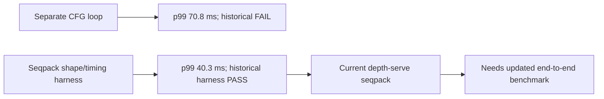

The 40.3 ms result from `test_voxtream_seqpack_depth_loop_ane.m` is valuable but limited:

- layer-0 program reused for all four stage evaluations
- fixed/shape-equivalent eval loop rather than real sampled-token recurrence
- parity checked at layer 0, not a four-distinct-layer final output
- audio-head GEMV, CFG combination, argmax, and embedding feedback excluded from the cited timing evidence
- historical harness predates current host RMSNorm
- missing fixtures/final norm can weaken what the harness actually exercises

Therefore the repository does **not currently contain checked-in evidence that the present `depth-serve --seqpack` end-to-end request path achieves p99 40.3 ms or that its four-distinct-layer token output passes external parity**.

---

## 11. G009 Multi-Chunk Contract

`AGENTS.md` reports an external VoXtream contract in which multiple fp16 tensors are packed into one physical BLOBFILE with manifest offsets and hashes. The separate VoXtream repository and referenced PRD were not directly inspected during this audit.

Within Orion:

- `OrionBindingPlanWeight.offset` can represent chunk-header offsets above 64.
- Filesystem-side plan generation can hash payload ranges from a shared file.
- Plan-aware tests exercise aggregate and seqpack compilation.
- Raw depth commands implement their own rewrite/dictionary paths.

The earlier labels “signed production” and “unsigned legacy” were misleading. Plans use hashes, not signatures, and the operational depth server itself is currently on a raw path.

| Path | Accurate description |
|---|---|
| Plan-aware tests | Integrity metadata generated/finalized and compiled with `orion_compile_mil_with_plan` |
| Raw aggregate/seqpack commands | Manual BLOBFILE rewrite and raw compile/eval; not bound to a finalized plan |
| External target contract | Reported by `AGENTS.md`; not independently verified here |

The “8 of 10 attempts consumed” note in `AGENTS.md` is a dated project-management snapshot, not a persistent repository counter.

---

## 12. Testing and Correctness Evidence

### 12.1 Test categories

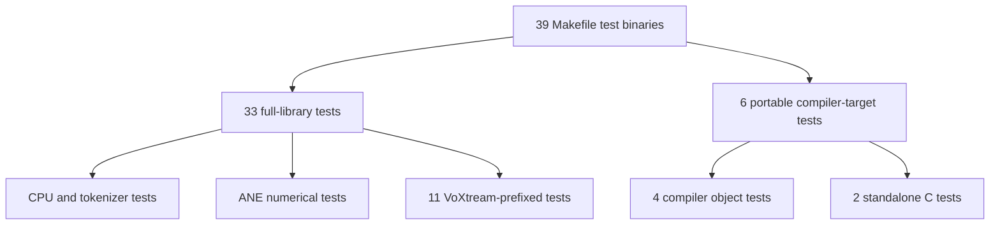

Support requirements vary:

| Requirement | Examples |
|---|---|
| Portable, no ANE | graph IR, passes, ANE-pass validation, compiler equivalence, error, ledger |
| CPU plus tracked fixtures | tokenizers, data-loader unit fixtures |
| GPT-2 blobs | several CPU/ANE inference tests |
| ANE only | runtime/kernel probes and compile-limit probe |
| ANE plus `VOXTREAM_DEPTH_EXPORT` | most depth parity/aggregate tests |
| Probe environment variables | `test_voxtream_probe_channels` uses `VOXTREAM_PROBE_*` rather than export input |

It is incorrect to say every VoXtream test requires `VOXTREAM_DEPTH_EXPORT`.

### 12.2 Seqpack gates

The historical seqpack harness’s final boolean includes parity, finiteness, determinism, depth budget, and compile delta. Those gates apply to that harness’s stated scope; they do not imply end-to-end production parity for current `depth-serve`.

Numerical thresholds commonly used in aggregate/seqpack tests include:

- `max_abs <= 0.03`
- relative L2 `<= 0.005`
- bitwise fp16 determinism for repeat evals
- p99 depth target below 60 ms in selected loop tests

Different tests use different timing projections and pass expressions, so there is no single universal “all loop tests” gate.

### 12.3 G008 failure-injection test

The G008 test covers allocation accounting, rejected invalid eval calls, null release, compile-count accounting, surface integrity after failed eval, and allocation pressure.

Export-independent resource cases consume no compile calls, but the binary still checks `orion_ane_init()` and skips if ANE initialization is unavailable; they are not unconditional across unsupported hosts.

### 12.4 Compile-limit probe

`test_m5_compile_limit.m` passes a unique runtime tag but generates byte-identical MIL text each iteration. `orion_compile_mil` still calls compile/load and increments `g_compile_count` after each success. The historical 1,000-run result establishes only that this repeated-identical-MIL pattern did not fail on that M5 Pro run; it does not characterize unique-MIL behavior or prove that Orion’s program cache prevented counting.

### 12.5 Golden data

- `gen_tokenizer_golden.py` generates GPT-2 BPE cases.
- `gen_forward_golden.py` generates Hugging Face GPT-2 references.
- `test_infer_golden.json` remains an empty stub.
- Tokenizer fixtures are tracked.
- Model blobs and datasets are ignored.

---

## 13. Model Assets and Conversion

### 13.1 Supported fixed configurations

The repository has fixed configurations for GPT-2 124M and Stories110M. Runtime/model code is closely coupled to expected tensor names and shapes rather than providing a general model-package schema.

### 13.2 Conversion

Python scripts under `model/convert/` convert Hugging Face checkpoints to Orion BLOBFILE layouts. Python is a conversion/test dependency, not a runtime inference dependency.

Reproducibility caveats:

- generated blobs are ignored
- converter dependency versions are not locked comprehensively by `requirements.txt`
- no tracked manifest provides hashes/provenance for all generated GPT-2/Stories assets
- clean checkouts do not contain model blobs

### 13.3 Legacy loader trust assumptions

`model/weight_loader.m` and raw dictionary materialization assume trusted local assets. They do not provide the same confined path-opening and per-weight metadata model as plan generation. The repository should not be described as safe for hostile or untrusted model packages.

---

## 14. Tokenizers

### 14.1 GPT-2 BPE

`gpt2_bpe.m` loads tracked `vocab.json` and `merges.txt`, applies GPT-2-compatible byte encoding and merges, and maintains mutable cache state. It is appropriate for local CLI use but is not documented as thread-safe.

### 14.2 Stories/Llama tokenizer reader

`sentencepiece_wrap.m` is not a general parser for a SentencePiece `.model` file. It reads the Karpathy/Llama `tokenizer.bin` format. The tracked `llama2_tokenizer.model` is distinct from the binary format consumed by this wrapper.

The implementation uses simple vocabulary scans and trusted-file assumptions. Malformed-input handling and large-vocabulary performance are less developed than the GPT-2 golden coverage.

---

## 15. Experiments, Archive, and Historical Reports

### 15.1 Experiments

`experiments/` contains direct private-API proof-of-concepts and weight-patch investigations. These files:

- duplicate low-level runtime logic
- are not Makefile targets
- contain historical/nonportable assumptions and paths
- explain the provenance of later runtime behavior
- should not be treated as supported product code or current regression tests

### 15.2 Archive

`archive/milgen/` is retired reference code and is not built. Active graph generation belongs in `compiler/frontends/`.

### 15.3 Previous 17 reports

The other 17 tracked reports are a useful July 12 snapshot, but they are not uniformly current. Some findings were addressed; others remain relevant, including security, reproducibility, benchmark-methodology, abstraction-usage, and private-API deployment caveats.

This report should not claim that they remain broadly accurate without reassessment.

### 15.4 Documentation inconsistencies

Current known stale documentation/comments include:

- Makefile source/test count comments
- AGENTS.md code-map prose listing only infer/train/bench despite two depth commands
- README dataset examples using a stale TinyStories filename
- README/RESULTS training mechanism wording referring to reload rather than current patching
- current program-count comments/macros that still assume older training topology
- references to absent project-management/PRD files in this checkout

---

## 16. Security, Reliability, and Deployment Caveats

Orion is research software using unsupported private APIs. Current evidence does not establish suitability for hostile inputs, sandboxed distribution, the App Store, iOS deployment, or stable operation across macOS upgrades.

### 16.1 Private API fragility

- Private class and selector names can change without notice.
- QoS value 21 and MIL dialect/build metadata are version-specific assumptions.
- Apple provides no compatibility contract for direct use of this framework.
- The tested hardware/OS matrix is fragmented across historical M4 Max and M5 Pro results.

### 16.2 Input trust and filesystem behavior

- Plan generation has confined path opening, but raw runtime weight dictionaries materialize paths with weaker trust assumptions.
- Legacy model/BLOBFILE loaders are not hardened parsers for hostile packages.
- Generated assets lack a complete tracked provenance/hash manifest.

### 16.3 Memory and surface safety

- Plan-aware surface APIs validate exact allocation metadata.
- Legacy tensor read/write functions remain in broad use and provide weaker bounds guarantees.
- Private eval calls have no general timeout, cancellation, or subprocess isolation at the core runtime layer.

### 16.4 Concurrency and lifecycle

- Program cache access is synchronized, but callers must follow ownership rules around cached programs.
- Delta patching is not globally atomic across all layers.
- Checkpoint and filesystem generation replacement do not constitute a single durable transaction.

### 16.5 Release interpretation

Passing compiler tests and historical ANE gates is meaningful research evidence, but does not constitute a security audit, fuzzing campaign, sanitizer result, deployment certification, or production-readiness proof.

---

## 17. Risk Register

| Risk | Severity | Current status |
|---|---|---|
| Operational depth commands bypass plan-aware compile/eval | High | Open |
| Binding-plan hash domains inconsistent across generation, validation, and patch | High | Open |
| Eval does not bind supplied plan to program-cached plan | High | Open |
| Aggregate overlap check uses inconsistent payload coordinates | High | Open |
| Offset-64 runtime handling conflicts with aggregate first chunk | High | Open |
| Current seqpack serving latency/parity not established end to end | High | Evidence gap |
| Host final-norm scale failure falls back to pre-norm values | High | Open |
| Private API and OS compatibility unsupported | High | Inherent |
| Raw loaders/dictionaries assume trusted assets | High | Open |
| Delta patch globally non-atomic across layers | Medium | Mitigated by full-recompile fallback |
| Historical compile-limit assumption varies by hardware/probe design | Medium | Unresolved |
| Ignored model/data assets lack tracked full provenance | Medium | Open |
| Test suite treats hardware skips as successful exits | Medium | Documented behavior |
| `test_infer_golden.json` empty | Low | Open |
| SwiftUI app stubs unbuilt/nonfunctional | Low | Open |
| Stale source comments and documentation counts | Low | Open |

---

## 18. Corrected End-to-End Depth-Serve Seqpack Flow

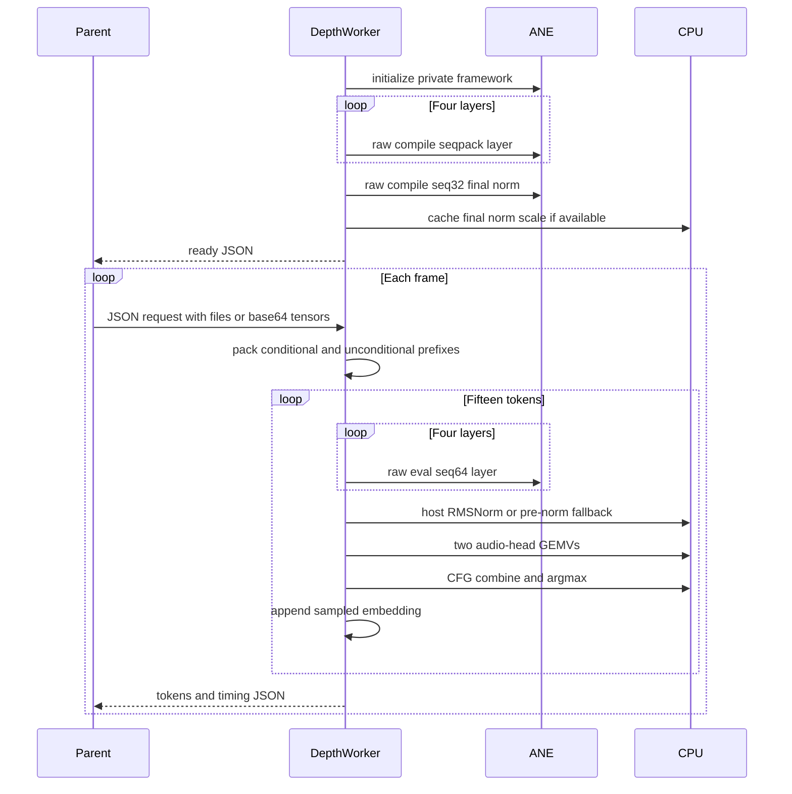

Important details shown here:

- no global program-cache participant
- raw compile/eval rather than binding-plan APIs
- five startup compiles in seqpack mode
- compiled final-norm program unused during seqpack requests
- host RMSNorm may fall back to pre-norm values

---

## 19. Bottom Line

Orion is a technically substantial ANE research system with a real graph compiler, private runtime bridge, CPU/ANE inference, ANE-assisted training, weight patching, and extensive hardware-oriented tests.

The strongest verified achievements are:

- a functioning mostly-C graph compiler and MIL emitter
- checked alphabetical binding/allocation metadata in the plan-aware path
- a private ANE compile/load/eval lifecycle
- 84-program Stories training with 72 weight-bearing programs patched without normal recompilation
- real full-prefix depth recurrence in the CLI
- sequence packing that halves CFG layer evaluations
- a broad test corpus, with all six portable tests passing during this audit

The strongest qualifications are equally important:

- plan enforcement is not universal
- current depth serving is raw/unsigned in binding-plan terms
- binding-plan hash/range semantics contain source-level inconsistencies
- historical 40.3 ms seqpack evidence is not current end-to-end serving evidence
- the private API, asset pipeline, and legacy raw paths assume a trusted research environment
- hardware results were not reproduced during this audit

The appropriate conclusion is therefore not “production ready” or “all gates green.” Orion is a capable and unusually detailed research platform whose plan-aware architecture is promising, but whose operational VoXtream path, integrity checks, benchmark evidence, and deployment hardening still require consolidation before production claims are justified.

---

*Generated from source revision `3e29615` on 2026-08-01. Cross-repository VoXtream details and the absent integration PRD are treated as external/unverified statements from `AGENTS.md`. No ANE hardware benchmark was rerun during this audit.*
